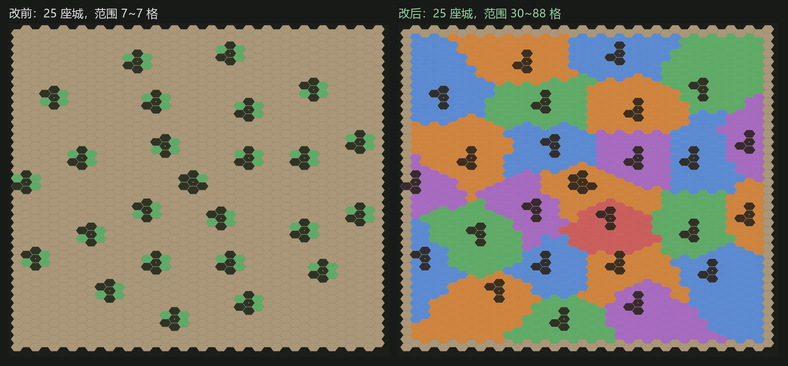
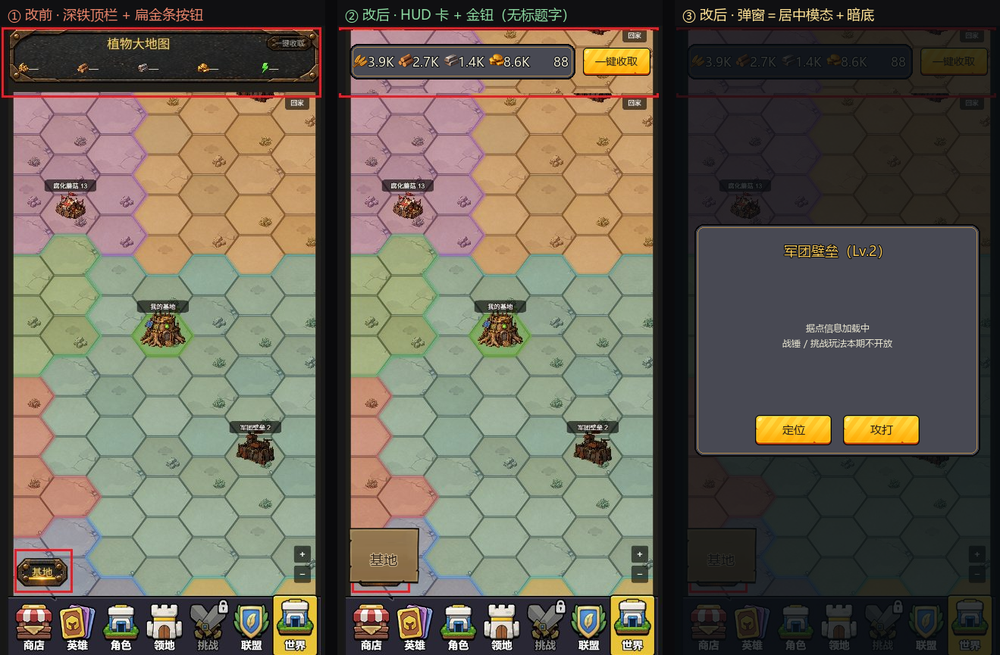

# 大世界地图与基地建造（BigMap）实现说明

> 需求源：`D:/Alan/占城玩法/策划文档/大地图/植物大地图系统.docx`
> 落地时间：2026-10-17 · 范围：**纯玩家个人战斗版**（无联盟 / 战盟 / 赛季 / 商店 / 托管 / 战斗加速）
> 代码：`assets/script/app/bigmap/` · 配置：`assets/remoteRef/BigMap-*.json`

---

## 1. 本期做了什么

| 模块 | 内容 | 状态 |
| --- | --- | --- |
| 基地建造 | 5×5 六边建造区、按格摆放不重叠、建造队列（1→3）、升级前置、资源田产出与主动收获、离线结算 | ✅ |
| 建筑解锁 | **唯一来源 = 冒险章节通关**，真源是服务端 `ChapterInfo.chapters`（第 1 章主城 / 2 章资源田 / 3 章货币田 + 解锁升级 / 4 章科技树 / 5 章功能建筑 / 6 章装饰），见 §5.7 | ✅ |
| 世界地图 | 40×40 六边格、确定性种子生成、四层环形城池（个人层可打、其余画灰）、20 只野怪、1 个玩家基地 + 16 个 NPC 基地 | ✅ |
| 城池解锁 | 「章节 + 开服天数 + 前置城池已占领」三重条件，4 条并行链共 12 座 | ✅ |
| 攻城 | 行动力消耗、城防扣减、势力范围外伤害 −20%、打穿 + 战功达标 = 占领并发奖 | ✅ |
| 野怪 | 逐级解锁（攻 5 级需先通 4 级）、击杀发奖、刷新 CD | ✅ |
| 界面 | 全代码线框图：顶栏资源 / 大地图 / 建造区 / 建造列表 / 详情面板 / 队列条 | ✅（示意稿） |
| 未做 | 商店、赛季、联盟、战盟、托管战斗、战斗加速、攻打玩家基地、实时排名 | 按用户要求排除 |

> **入口**：主界面底栏第 7 格「世界」（`MainTab.World`）—— 2026-10-21 起大地图不再有单独的悬浮按钮，
> 点格子直接 `BigMapEntry.open`。打开后是一层覆盖页，切 tab 不会销毁。

世界入口首屏：地图预制体、目标弹窗与美术并行准备，各类贴图也并行加载；完整美术就绪后再搭建页面，搭建地图前注入贴图，避免先为全图绘制备用 Graphics 地形再清空。SLG 数据同步与页面准备并行，缺少回包时不阻塞世界显示；基地操作仍等服务端快照就绪，关页或换号后迟到回包按原生命周期守卫失效。

---

## 2. 数值推算（第一版，全部可改配置）

正式流程是「策划 Excel → eSon 导表 → `assets/remoteRef/*.json`」。本次本机没有 eSon 源目录
（`D:/City1001/doc/塔防数据配置` 不存在），所以用一次性脚本 `tools/config/gen_bigmap_tables.py`
把**推算数值**直接写成项目统一的 `{"k":[...],"v":[[...]]}` 压缩格式。

**改公式 → 改脚本常量 → `python tools/config/gen_bigmap_tables.py` 重跑即可**，不要手改 JSON。
脚本写盘前会校验「表头字段数 == 每行值个数」，防止解压后整行错位这种极难发现的脏数据。

### 2.1 建筑

| 建筑 | id | 类型 | 解锁章节 | 数量上限 | 1 级消耗（粮/木/铁） | 1 级耗时 |
| --- | --- | --- | --- | --- | --- | --- |
| 主城 | 71001 | 1 | 1 | 1 | 200/150/100 | 30s |
| 粮食田 | 71002 | 2 | 2 | 3 | 120/90/60 | 20s |
| 木材田 | 71003 | 2 | 2 | 3 | 120/90/60 | 20s |
| 铁矿田 | 71004 | 2 | 2 | 3 | 120/90/60 | 20s |
| 货币田 | 71005 | 3 | 3 | 1 | 150/100/80 | 25s |
| 科技树 | 71006 | 4 | 4 | 1 | 300/250/200 | 40s |
| 建造队列 | 71007 | 5 | 5 | 1 | 400/300/250 | 45s |
| 装饰雕像 | 71008 | 6 | 6 | 2 | 100/80/60 | 15s |

升级曲线（第 L 级）：

```
消耗   = 基础消耗 × L^1.6
耗时   = 基础耗时 × L²
非主城建筑上限 = 主城当前等级     （maxOtherLevel/preBuildLevel 双保险）
资源栏上限 = 800 × L^1.5          （主城 resCap，只卡粮/木/铁；货币不设上限）
```

> L² 的耗时是刻意做的：L1→L2 只要 30~120s，方便 Demo 里几分钟走完全链路；
> 越高越慢，正式版按留存目标再调。

### 2.2 资源产出

| 建筑 | 资源 | 每小时 | 累积上限 |
| --- | --- | --- | --- |
| 粮食田 | grain | 40 × L | 480 × L |
| 木材田 | wood | 30 × L | 360 × L |
| 铁矿田 | iron | 20 × L | 240 × L |
| 货币田 | coin | 15 × L | 180 × L |

- 累积上限 = 12 小时产量，`produceCap ≥ producePerHour` 在解析时强校验。
- 离线结算最多 8 小时（`offlineMaxHours`），所以「离线一个月」也只按 8 小时发。
- 初始资源：粮/木/铁 800、货币 200、行动力 120（=`staminaMax`）。

### 2.3 城池

4 条并行链 × 3 座 = 12 座个人层城池，落在半径 **18** 的环上（`cityRing1`），
按 `slot / slotCount` 均匀分布；内层另有 8 座军团壁垒（半径 12）、4 座战盟王城（半径 6）、1 座王座（中心），
全部 `available = 0`，只作为「本期不开放」的灰点。

| 等级 | 战功倍率 | 占领积分 | 上榜战力 | 等级系数 | 行动力 | 最低占领战功 | 城防 |
| --- | --- | --- | --- | --- | --- | --- | --- |
| 1 | 1.5 | 300 | 800 | 1.1 | 20 | 800 | 1600 |
| 2 | 2.0 | 600 | 1500 | 1.2 | 30 | 1600 | 2600 |
| 3 | 3.0 | 1200 | 2600 | 1.3 | 45 | 3200 | 4200 |
| 4 | 5.0 | 2400 | 4200 | 1.4 | 60 | 6400 | 7000 |
| 5 | 8.0 | 4800 | 6000 | 1.5 | 80 | 12000 | 11000 |

链的解锁（`unlockChapter` / `openDay`）：

```
101(2章,第0天) → 102(3章,第0天) → 103(4章,第1天)
104(2章,第0天) → 105(3章,第0天) → 106(4章,第1天)
107(2章,第0天) → 108(4章,第1天) → 109(5章,第2天)
110(3章,第0天) → 111(4章,第1天) → 112(5章,第2天)
```

`prevCityId` 表示必须**占领**前一座才解锁后一座 —— 光打穿不算。

### 2.4 战斗公式

```
攻击力 = 420 + 180 × (主城等级 - 1)                    # 主城等级是唯一战力来源
伤害   = round(攻击力 × 势力范围系数)                   # 联机：目标城 ≠ 所处城池（SlgGameInfo.toCampId）⇒ ×0.8
                                                      # 离线 / 未归属（toCampId=0）：超出 radiateCapacity 格 ⇒ ×0.8
战功   = 边际递减(伤害) × 城池战功倍率 × 名次系数 × 拥挤系数
边际递减(d) = 3000 × (1 - e^(-d/3000))                 # d = 3000 时约 63%，d = 30000 时 95%
名次系数：1~10 名查表 100/90/85/80/75/71/68/65/62/60，之后每名 -3%，下限 30%
拥挤系数 = 0.5 + 0.5 × e^(-0.5 × (人数-1))              # 1 人 = 1.0，3 人 ≈ 0.68
```

占领条件：`城防 ≤ 0` **且** 本轮累计战功 ≥ `minOccupyWarScore`。
占领后城防回满、战功清零、发 `rewardCoin` 货币，并把城池写进 `occupiedCityIds`（下一环立刻解锁）。

一击伤害 420 ⇒ 1 级城要 4 刀（城防 1600），跟「一分钟内能打下第一座城」的目标对齐。

### 2.5 野怪

| 等级 | 名称 | 占格 | 行动力 | 战功 | 城防 | 刷新 | 掉落（粮/木/铁/货币） |
| --- | --- | --- | --- | --- | --- | --- | --- |
| 1 | 腐化幼苗 | 1 | 10 | 200 | 600 | 120s | 100/80/60/40 |
| 2 | 腐化藤蔓 | 1 | 15 | 400 | 1200 | 180s | 200/160/120/80 |
| 3 | 腐化蘑菇 | 2 | 20 | 800 | 2400 | 300s | 300/240/180/120 |
| 4 | 腐化树精 | 2 | 30 | 1600 | 4800 | 600s | 400/320/240/160 |
| 5 | 腐化巨花 | 4 | 40 | 3200 | 9000 | 900s | 500/400/300/200 |

数量 6/5/4/3/2（共 20 只），落位环带按等级由内向外（1 级在环 3~5，5 级在环 8~11，`monsterRingMax = 11`）。

---

## 3. 代码结构

```
assets/script/app/bigmap/
├── model/                       # 纯 TS，零 cc / 零 framework
│   ├── BigMapTypes.ts           # 全部契约（枚举 / 配置接口 / 实例接口 / 存档结构）
│   ├── BigMapConfig.ts          # 12 张表 → 强类型配置 + 边界校验（错了当场抛）
│   ├── BigMapWorld.ts           # 确定性种子生成世界 + 六边距离
│   ├── BigMapUnlock.ts          # 三条解锁链（建筑 / 城池 / 野怪），返回人话原因
│   ├── BigMapBase.ts            # 摆放 / 队列 / 升级 / 产出 / 收获 / tick
│   ├── BigMapBattle.ts          # 攻城 / 野怪结算、战功公式、占领判定
│   ├── BigMapTerritoryColor.ts  # 势力配色（图着色，保证相邻不同色）
│   └── BigMapSaveData.ts        # 存档序列化 + 脏档修复
├── application/                 # 时序、持久化、把规则翻译成视图数据
│   ├── BigMapPresenter.ts       # 唯一的门面：视图只认它
│   ├── BigMapConfigLoader.ts    # ConfigService → parseBigMapConfig
│   ├── BigMapStorage.ts         # sys.localStorage 端口实现（import cc）
│   ├── BigMapSaveKeys.ts        # 存档键 + 内存存储（import cc 之外，给单测用）
│   └── BigMapEntry.ts           # 配置 / 存档 / 冒险进度 / 页面 的唯一接线处
└── view/                        # 只管画与输入
    ├── BigMapTheme.ts           # 线框配色 + 势力色板 + Graphics 画板/按钮工具
    ├── BigMapWorldView.ts       # 大地图（地形层一次画、势力范围层一次画、标记层按需重画、拖拽缩放拾取）
    ├── BigMapBaseView.ts        # 5×5 建造区
    ├── BigMapPage.ts            # 页面装配（顶栏资源带 / 面板 / 模式切换 / 心跳）
    └── (入口在 `main/MainTabHost` 的「世界」格，不再有独立的悬浮按钮)
```

依赖方向严格遵守 `AGENTS.md`：`bootstrap → procedure | view → core`，`model` 不 import 任何上层。
`view` 里没有任何规则判断 —— 所有 `if（够不够钱 / 解没解锁 / 能不能占）` 都在 `model`。

### 3.1 为什么世界是「种子生成」而不是读死数据

`buildBigMapWorld(config, seed)` 是**纯函数**：同 `config + seed` 必得同一张地图。
它把地形（哈希）、城池（按槽位落环）、野怪（按等级落环带）、基地（环带内互斥 ≥3 环）全部算出来，
所以：

- 存档只存「玩家状态」（建筑 / 队列 / 资源 / 占领），不存地图 → 存档小、改版不炸；
- 单测能反复断言同一张地图；
- 联机版把 `seed` 换成服务器下发的 worldId 即可，模型不用改。

> ⚠️ 别用 `Math.random()`。同一份配置每次进页面地图都不同，存档里的格子 id 会全部指错地方。

### 3.2 六边距离的坑

`hexGridLogicalPoint` 的相位是 `column % 2 === 0 ? -phase : +phase`（偶数列下移半格），
所以 axial 转换必须是 `r = row - (column + (column & 1)) / 2`。
写成 `- (column & 1)` 会让每个格子的 6 个邻居里有一个算成 2 环 ——
`tests/bigmap-world.test.ts` 的「相邻格距离恒为 1」就是钉这个的。

---

## 4. 配置表清单

| 表名 | 行数 | 说明 |
| --- | --- | --- |
| `BigMap-世界地图配置` | 1 | 尺寸 / 环半径 / 基地分布 / NPC 数量 / 野怪环上限 |
| `BigMap-建筑配置` | 8 | 类型 / 占格 / 上限 / **解锁章节** / 排序 |
| `BigMap-建筑升级` | 41 | 各级消耗 / 耗时 / 前置 / 主城上限 / 资源上限 / 属性加成 |
| `BigMap-建筑产出` | 20 | 每小时产量与累积上限 |
| `BigMap-资源定义` | 5 | 名称 / 图标 / 初始量 |
| `BigMap-队列配置` | 1 | 队列上下限 / 取消返还 / 离线时长 / 建造区尺寸 / 升级解锁章节 |
| `BigMap-城池配置` | 25 | 层级 / 是否开放 / 解锁章节 / 开服天数 / 前置城池 / 槽位 |
| `BigMap-城池等级` | 5 | 战功倍率 / 占领积分 / 门槛 / 行动力 / 城防 |
| `BigMap-名次系数` | 10 | 1~10 名的战功系数 |
| `BigMap-积分规则` | 1 | 边际递减上限 / 名次外延 / 拥挤系数 / 越界伤害削减 |
| `BigMap-野怪配置` | 20 | 等级 / 占格 / 行动力 / 战功 / 城防 / 刷新 / 掉落 |
| `BigMap-行动力配置` | 1 | 上限 / 恢复间隔 / 每日购买次数 |

字段名 camelCase，端标记沿用原稿（1 = 双端读，3 = 仅客户端，0 = 策划备注）。

---

## 5. 操作说明（线框示意版）

| 操作 | 结果 |
| --- | --- |
| 底部「基地建造 / 大地图」 | 互斥切换两个视图（按钮文案 = **点下去会去哪**，屏幕上永远只有一个） |
| 地图拖动 / 滚轮 / ± 按钮 | 平移与缩放；「回家」把镜头对准自己的基地 |
| 点菱形块 | 选中城池 → 右侧显示状态 / 距离 / 城防 / 战功 / 预计伤害 → 「攻打」 |
| 点小圆点 | 选中野怪 → 「攻打」（未解锁时显示需先通关几级） |
| 点蓝色六边形 | 切到基地建造 |
| 左侧建造列表点一行 | 进入摆放模式 → 点空地放置；再点一次同一行取消 |
| 点已建成的建筑 | 升级（第 3 章解锁；主城等级不够会拒绝并说明原因） |
| 点详情里的「移动」→ 再点空地 | 把这栋建筑搬过去（协议 `CmdSlgBuildMoveReqMsg`，见 §5.5） |
| 点建造中的格子 | 取消建造并按 `cancelReturnRate` 返还 |
| 点已建成建筑时右下的「收取 N」 | 收这一块的产出（受仓库上限截断） |
| 切底部页签 | 关掉大地图并回到目标页（页面内不再有「返回」按钮） |

> 2026-10-21 用户口径：删掉顶栏的「返回」「植物大世界」标题「一键收取」三样，
> 顶栏只留五个货币胶囊（`HEADER_HEIGHT` 128 → 88），高度还给地图。

### 5.1 配色口径（地块 / 势力范围）

| 元素 | 规则 | 实现 |
| --- | --- | --- |
| 地块默认色 | **一律沙地本色** `#CFAF8C`，地形只保留极轻冷暖差 | `BigMapWorldView` 的 `TERRAIN_TINT`（**乘算**，只能压暗） |
| 势力范围 | **整片势力范围**（布局里的 `rangeHex`，线上 30~88 格/城）逐格填势力色，填充半透明（α≈40%），地块纹理透上来 | `paintTerritory` + `BIGMAP_TERRITORY_COLORS` |
| 相邻势力 | **不同色**；邻接取布局的 `adjacentCityIds`（编辑器按范围实际咬合推导），没有布局时按 10 格距离兜底 | `assignTerritoryColorSlotsFromAdjacency` / `assignTerritoryColorSlots`（DSATUR 图着色，`model/BigMapTerritoryColor.ts`） |
| 城池状态 | 走**角标**颜色（可打/已占领/未解锁），不占用地块颜色 | `cityTint` |

**「范围」和「占格」是两份数据，别混用**（2026-10-22 用户口径：「范围内所有地块都上色，
现在只有城池所在的地块上了色」）：

| 字段 | 内容 | 消费方 |
| --- | --- | --- |
| `IBigMapCitySite.hexIds` | 城池本体，4~6 格 | **点击命中 / 占位互斥**（`cityByHex`、`bigMapOccupantOf`） |
| `IBigMapCitySite.rangeHex` | 势力范围，线上 30~88 格 | **染色**（`paintTerritory`）|
| `IBigMapCitySite.adjacentCityIds` | 范围真实相接的邻城 | **配色邻接图**（保证相邻不同色）|

颜色的两个坑：

- `Sprite.color` 与地形色是**乘算**，只能把地块压暗。想要"偏蓝"得把 RGB 里另外两个通道压下去，
  所以地形色一旦取得太浓，整张图会花成迷彩 —— 颜色让给势力染色，地形退成近看才分得出的细节。
- 势力色**不能**用 `cityId % 色板长度`：城池按环上槽位排布，取模必然让环上相邻两座城撞色，
  换一座城的 id 还会整片错位。图着色是唯一稳的做法。
- `rangeHex` 如果是「城池本体 + 半圈」（7 格）这种退化数据，代码改得再对，屏幕上也几乎看不出变化 ——
  这类数据用 `tools/map-editor/gen_bigmap_ranges.ts` 补算（加权 Voronoi + 连通性修补 + 邻接推导）。
  线上 `world_01` 已用它重算：25 座城、1445/1600 格有主、每城 30~88 格、全部单块、邻接度 3~7。



补算势力范围（改完布局记得跑一次 `verify_bigmap_world` 确认没碰坏别的东西）：

```
npx tsx tools/map-editor/gen_bigmap_ranges.ts                    # 处理线上 world_01 并写回
npx tsx tools/map-editor/gen_bigmap_ranges.ts path/to.json --dry # 只算不写
npx tsx tools/map-editor/verify_bigmap_world.ts                  # 校验布局仍与种子世界一致
```

### 5.2 UI 皮肤：领地页 HUD 那套（2026-10-22 第二轮）

用户口径：*「将世界玩法的 UI 风格改成领地玩法的 ui 风格，按钮的样式，题头底板的样式，弹窗样式 /
删除植物大地图的文字」*。追问后确认：**走领地页顶部 HUD 那套深色卡，不是底部菜单栏的木牌**
（第一轮曾按「和底部菜单栏保持统一」做过木牌，本轮整条替换）。

改之前世界页贴的是 `image/bigmap/concept/ui/*.png` 那张**深色铁框 + 铆钉**概念图；现在照抄领地页语法：
**地图顶到屏幕边，只有几张浮在上面的深色卡**（玩家卡 / 资源条），没有任何通栏底板。

| 元素 | 用什么 | 出处 / 尺寸 |
| --- | --- | --- |
| 资源卡 / 详情弹窗 / 建造面板 / 队列条 | `drawBigMapCardPanel` 手画：近黑描边 2px → 卡面（各收 2px）→ 铜金细线 1px（再收 2px） | 色值取自 `hud_player_card.png`，见 `BIGMAP_HUD_COLORS` |
| 题头 | **不要底板、不要文字**（用户要求删「植物大地图」） | 顶栏只留 `ResourceCard` + 收取钮；模式由切换木牌表达 |
| 「基地 / 大地图」切换 | `cu_ty_btn13`（常态）/ `cu_ty_btn14`（当前所在模式），**122×96** | 底部菜单栏七格 `TabButton.offBgFrame/onBgFrame` 同款**同尺寸** |
| 一键收取 / 建造 / 攻打 / 定位 | `btn_quick_fight`（领地页【快速寻敌】那颗 3D 金钮） | `image/main/city`，无九宫边，按宽度压 |
| 弹窗 | 居中模态：全屏暗底 `scrim = 5,10,14,205` + 居中卡（标题金 / 正文米白 / 两颗钮并排） | 暗底与 `TerritorySiteDetail.prefab` 的 `Dim` **逐通道同值** |
| 文字 | 米白正文 + 金色标题，一律 2px 近黑描边 | 压在深色卡/地图上都得有描边，否则字会被吃掉 |

五个坑（都踩过，别重犯）：

1. **`hud_player_card` 没有九宫边**（`.meta` 里 border 全 0），是给固定 335×122 用的；
   面板从 62 高的资源条到 400 高的弹窗都有，SIMPLE 拉伸会把圆角和右上角那块小装饰一起拉糊 ⇒ 手画。
2. **首轮的木牌不能混着留**：`BIGMAP_WOOD_COLORS` / `drawBigMapWoodPanel` / 缎带 `cu_title_brown` /
   扁条 `cu_9g_bar_02` 已**整条退役**，`tests/bigmap-hud-skin.test.ts` 里有反向断言挡回流。
3. **暗底与卡片必须同生同死**：只亮卡片就是一块浮在地图上的板，没有模态感；`setInfoVisible` 两行都要写。
   暗底要挂 `BlockInputEvents` + 点它 `clearSelection()`（领地页同一个交互）。
4. **标题字删了，`baseTitle` 也一起退役**：世界页不再有标题 Label，「当前在基地还是大地图」由那颗
   两态木牌表达；`BIGMAP_PRESENTATION_TEXT.baseTitle` 已删并留注释。
5. **颜色不许写第二份数值**：`BIGMAP_HUD_COLORS.card/rim` 必须等于 `hud_player_card` 的实测色，
   `scrim` 必须等于领地弹窗 `Dim`（测试直接读 prefab JSON 比对），改一边另一边就会红。

改前改后（① 深铁顶栏 ② HUD 卡＋金钮 ③ 弹窗居中模态）：



重新生成这张图（只出图，不动游戏代码）：

```
python tools/preview_world_ui_hud.py
```

### 5.3 详情弹窗「一条中线竖排」（2026-10-22 第九轮）

用户口径：*「弹窗内的 icon 和描述以及标题 需要统一居中对齐」*。

改之前三样各偏一边，根因是**用了视口宽当卡片坐标**：

| 元素 | 改前 | 改后 |
| --- | --- | --- |
| 图标 | `fitBigMapSprite(.., -this.size.width / 2 + 80, ..)` ⇒ `-360 + 78 = -282`，**卡片左边界是 -280** ⇒ 压在正文上 | `x = 0`，与标题/正文同一条中线 |
| 标题 | `textCenter = (panelWidth/2 - 24) - textWidth/2 = +86`，专门让开图标 | `x = 0` |
| 正文 | `horizontalAlign = LEFT`，从图标底下起笔 | `CENTER` + `verticalAlign = CENTER` |

排版算法搬到纯函数 `model/BigMapInfoLayout.ts`（零 `cc`，只有数字进出）：

- 顺序是**先算文字、再分空间给图标、空间不够图标让位**（文字优先，不能让 `CLAMP` 静默截字）；
- `titleY = H/2 - 46`；正文下沿 `= -H/2 + (有按钮 ? 78 : 30)`；正文上界 `= titleY - 34`；
- 剩余空间 `room < 56` ⇒ `iconVisible = false`（9 行文案的城池详情就是这一档）；
- `centerX` 恒 0 也照样往外吐 —— 留着是为了让「三样在同一条中线」**能被断言**，而不是靠肉眼；
- 两颗按钮都亮时 `secondaryX / primaryX = ∓76`，只剩一颗时归 0（不再各偏一边）。

三个坑：

1. **卡片子节点一律用卡片局部坐标**。`this.size.width` 是视口 720，父节点 `InfoPanel` 只有 560；
   这类错位编译不报错、只在实机穿帮。
2. **`Label.verticalAlign` 默认 TOP**。正文框是「图标下沿 ~ 按钮上沿」，设了 `CENTER` 才不吃掉下方半框。
3. **`refreshInfo` 必须拆两层**。内容方法里有 6 个提前 `return`，排版若不单独跑一轮，
   空态/缺图态就是上一次的残留布局 ⇒ `refreshInfo() = refreshInfoContent() + applyInfoLayout()`。

`tests/bigmap-info-layout.test.ts`（15 条）钉住：一条中线、不重叠不越界、不截字、图标让位、
脏输入不出 NaN，外加源码反向守卫（禁 `this.size.width / 2 + 80`、禁 `fitBigMapSprite(this.infoThumbnail`、
必须有 `verticalAlign = CENTER`、必须有 `refreshInfo` 拆分）。

改前改后（① 老排法三样各偏 ② 据点 3 行 ③ 城池 9 行图标让位；橙虚线 = 卡片中线）：


```
npx tsx tools/preview_bigmap_info_layout_curves.ts && python tools/preview_bigmap_info_layout.py
```

---

### 5.4 蓝湖世界地图与配套弹窗接入（2026-10-23）

世界地图使用植物建筑、顶部短编号牌及主城头像气泡。`BigMapArtLoader` 优先用已有 `hq-base`、`barracks-default` 与 `territory_boss_v1`；概念建筑图继续用于基地生产建筑。脚底对齐台面，编号牌随可见建筑高度上移；编号牌与头像的显示、点击、裁剪共用标记几何。主城头像通过入口注入加载端口，复用 `HeadArt` 查表及 `AssetService` / `ResourceScope` 加载；缺失时保留主城编号牌。

通过 Cocos MCP 接入两种现有预制体：

- `BigMapLevelInfoPanel`：城池／野怪详情，显示真实名称、状态、行动力与挑战说明，提供定位、攻打、关闭。
- `BigMapPlayerLevelPanel`：其他基地详情，显示已有基地名称、战力和距离，保留定位；攻打仍按当前功能范围禁用。

控制器 `BigMapTargetPanel` 只更新显示与转发输入；资格、请求、战斗参数及结算继续由原 Presenter / Repository 负责。全部示例奖励、示例费用已清除；小屏等比缩放，禁用按钮同时变暗。`BigMapChestDetailPanel` 暂无世界宝箱实例协议，`BigMapLevelTipPanel` 暂无开战前敌军阵容数据，两者保留为资源，未填入虚构数据。基地建造详情继续使用原有界面。

### 5.4.1 无缝背景上的透明格（2026-10-28）

世界地图使用连续平铺背景时，`BigMapWorldView` 不再覆盖 `grounds/ground_0x` 沙地 Sprite。空地完全透明，森林 / 岩地 / 水面只叠轻色（alpha 24 / 24 / 40），格线 alpha 48、宽 1px；既有势力范围仍使用原色板、alpha 104 的填充与原边界描边，透出连续背景的纹理。

`syncVisibleTiles` 沿用原视口裁剪结果，只让 `paintTerrain(ids)` 绘制可见六边格。草石装饰使用独立复用槽位，建筑、编号、头像、选中和点击几何沿用原路径。切入无缝背景时必须隐藏并清空已有沙地图槽位；视口移出世界时清掉旧格与装饰。不改变世界规则、地图数据或基地地面。

验证：`tests/bigmap-transparent-tiles.test.ts` 覆盖透明色、裁剪、缺少沙地图、切换与势力叠色；`tmp/bigmap-transparent-tiles-probe.mjs` 用真实 Prefab、配置和 `world_01` 验证 0.15 / 0.55 / 1.6 缩放、背景覆盖、5 种势力色和实际鼠标拾取，无无效 SpriteFrame 或运行时异常。

### 5.5 建筑搬移与野怪击杀进度（2026-10-26）

两件都是**纯客户端补齐**：协议早就有能力，界面一直没入口。

**建筑搬移** —— `CmdSlgBuildMoveReqMsg` 从 r804 就在，`BigMapPresenter.requestMove` 也写好了，
但全仓零调用（死代码）。现在不新增控件，把基地详情那颗**次按钮一键两用**：

| 状态 | 次按钮 | 点击结果 |
| --- | --- | --- |
| 有产出 / 能收服务端产出 | 「收取」 | 收这一块 |
| 收不了、且没在施工 | 「移动」 | 进搬移态：点空地搬过去，再点这格取消 |
| 建造 / 升级中 | 隐藏 | —— |

规则侧只有 `bigMapCanMove` / `bigMapMove` 两条（`model/BigMapBase.ts`）：

- **不查解锁章节、数量上限、空闲队列和资源** —— 服务端搬一次不收钱、不占队列，客户端别自己加规矩；
- 目标格必须空（`occupiedPlotCells(state, instanceId)` 排除自己，在建格同样占位）；
- 只换 `hexId`，等级 / 存量 / `lastTickAt` 原样带走，搬一下不白送产出；
- 校验不过时**原状态原样返回**，调用方不必判空。

联机走 `repository.move`，离线预览走本地 `bigMapMove` + 落盘，两条路同一套校验。

**野怪击杀进度** —— `SlgGameInfo.maxMonsterLevel` 早就喂了逐级解锁（`unlockContext`
取 `max(本地, 服务器)`），但 view 层 0 引用，玩家看不到「打到第几级」。现在并进详情**首行**：

```
状态：已解锁　已通关最高 3 级
```

⚠️ 不要单独插一行：详情面板按 `sections` 把正文切成「前 2 / 中 3 / 其余」三块喂给弹窗，
多一行会把中间那块整体挤歪。

判据：`tests/bigmap-move.test.ts`（10 条）。

### 5.6 开战 → 进战斗的界面交接（2026-10-26）

用户反馈：*「大地图战斗，会到领地那边再进入游戏」*。

**根因不是开战参数发错，是界面被提前关了**：

1. `ProcedureManager.changeProcedure` 是「预加载 → 进入」两阶段 —— `onPreload` 里把战斗资源
   （单位、弹道、地图）全部加载完才 `onLeave` / `onEnter`，**这段时间当前界面不动**；
2. `BigMapEntry.startBattle` 却在 `navigate` 之后立刻 `this.close()`；
3. 世界页挂的是 **Canvas**（`open` 只传 `navigation`、不传 `parent`），不在 Main 节点下，
   所以 `ProcedureMain.onLeave` 销毁 Main 时带不走它 —— 它必须自己关，但关早了就露底；
4. 露出来的正好是 `MainTabHost.currentTab`，而 `defaultTab = MainTab.Territory`。

冷加载实测 25s 量级（`docs/领地与大地图开战加载优化验证.md`），所以这中间有足够长的时间
看到领地页 —— 就是用户说的现象。

**修法**：世界页留到流程真正切走，中间盖遮罩。

| 环节 | 变更 |
| --- | --- |
| `ProcedureManager` | 新增 `onSwitchSettled(cb)`：进入成功 `true`，预加载失败 / 被新的切换顶掉 `false`。回调在 `onLeave` **之前**同步触发 —— 宿主（主界面）还活着，覆盖页关闭时回调宿主刷底栏才不会碰已销毁节点 |
| `BigMapEntry.startBattle` | `navigate` 后**不再** `close()`；订阅落定钩子，`true` 才关，`false` 调 `page.cancelEnteringBattle()` |
| `BigMapPage` | 新增 `EnteringBattleMask` 全屏遮罩（`BIGMAP_HUD_COLORS.scrim` + `BlockInputEvents` + 「正在进入战斗…」）；开战成功即显示，`onWorldTap` / `onPlotTap` 在遮罩期间直接 return |

三个坑：

1. **落定回调别放在 `onEnter` 之后**。`onEnter` 抛错时 `current` 会被清空、Main 已销毁，
   这时再关覆盖页，`close()` 里的宿主回调（`renderNav`）会碰到已销毁的底栏节点。
   放在 `onLeave` 之前，同一帧内完成「关覆盖页 → 销毁 Main → 建战斗」，中间没有渲染帧。
2. **失败分支只通知一次**。`cancelPendingSwitch()` 已经发过 `false`，`runSwitch` 里
   「token 已过期」那条早退**不能**再补发一次，否则订阅方收到重复失败。
3. **订阅不是一次性的**。一次订阅可能跨多次切换（先被取消、再真正进入），
   由订阅方自己在回调里 `stop()`；`BigMapEntry` 就是这么写的。

判据：`tests/bigmap-battle-enter-mask.test.ts`（5 条）+ `tests/bigmap-entry-cancellation.test.ts`
（命中「预加载期间世界页必须留着 / 落定才关 / 失败保留页面并撤遮罩」三条）。

### 5.7 冒险章节真源 = 服务端 `ChapterInfo.chapters`（2026-10-26）

用户反馈：*「有我的章节集合，我通关了章节，应该可以建造，当前未读取」*（`ChapterInfo { chapters: [3,2,1] }`，大地图建筑全是灰的）。

**根因**：`BigMapEntry.readAdventureChapter` 当时读的是
`TerritorySaveStore.loadLastChapter(availableChapters, chapters[0])` —— 那个存的是
**「上次点开的章节」**，不是通关进度。新号 / 从没进过冒险页时它恒为 `fallback = chapters[0]`，
服务端明明下发了 `[1,2,3]`，大地图仍按第 1 章算 ⇒ 粮食田（`unlockChapter = 2`）锁着。

**修法**：

| 环节 | 变更 |
| --- | --- |
| `readAdventureChapter` | **服务端优先**：取 `TerritoryChapterInfoRepository.current.chapters` 的最大值（`[1,2,3]` ⇒ 3）。`loadLastChapter` 只在服务端快照还没到时兜底 |
| 口径 | 「能进第 N 章」与配置 `unlockChapter = N` 是同一口径（第 N 章的资源田 / 科技树…），所以直接用最大章 |
| 晚到补刷新 | `BigMapPresenter.refreshUnlockContext()`（re-emit）。开页时若快照为空，入口自己 `refresh()`，回包到达后叫一声 —— 否则建筑要等下次重进页面才亮 |

⚠️ `TerritoryChapterInfoRepository.availableChapters` 在无快照时返回 `[1]`（兜底），
**不能拿它当进度** —— 判断「服务端有没有回包」要读 `current`（`null` = 没有）。

判据（`tests/bigmap-entry-cancellation.test.ts`）：`[3,2,1]` ⇒ `adventureChapter() === 3`；
无快照 ⇒ 1；快照晚到 ⇒ `refreshUnlockContext` 恰好调一次。

### 5.8 顶栏资源图标走背包道具（2026-10-26）

用户口径：*「大地图顶部资源 18501 18502 18503 18504 18505 用这几个，走背包的」*。

五个资源现在各挂一个背包道具 id（`W-物品表`）：

| `bigmapResource.resType` | 道具 id | 背包道具名 |
| --- | --- | --- |
| `grain` | 18501 | 粮食 |
| `wood` | 18502 | 木材 |
| `iron` | 18503 | 矿石 |
| `coin` | 18504 | 钻石 |
| `stamina` | 18505 | 行动力 |

**链路**：`bigmapResource.itemId` →（读 `item` 表）`resId` → `item.icon`
→ `attachBigMapResourceItemIcons` → `config.resourceIcons`
→ `BigMapArtLoader` 优先按它加载 `icons/item/xxx`（`spriteFramePathOf` + `main-pages` 分包）。

| 环节 | 说明 |
| --- | --- |
| `parseBigMapConfig` | **仍是纯函数**，只多解析一列 `itemId`（缺列给 0）；`resourceIcons` 先给空表 |
| `attachBigMapResourceItemIcons` | 唯一读 `item` 表的地方，在 `BigMapConfigLoader` 里调用。`item.icon` 为空 / 行缺失 ⇒ 不并 |
| `BigMapArtLoader` | 有背包图标就用，`null` 就退回 `image/bigmap/concept/sprites/<resType>`；**绝不留空图标** |

⚠️ 三个坑：

1. **`resName` 跟背包对齐**（`铁矿` → `矿石`、`大地图货币` → `钻石`）—— 同一个东西两套叫法，玩家会当成两种资源。
2. **`item.icon` 的路径规则不一样**：它是相对 `resources` 的路径（`icons/item/xxx`），走
   `spriteFramePathOf` 补 `/spriteFrame`，bundle 由 `BundleCatalog` 路由到 **`main-pages`**。
   当成 `resources` 相对路径拼会**静默返回 null**（不报 404）。
3. **表还没导时不能炸**：`item.json` 落后于 Excel 时 `getTable('item')` 可能拿不到这几行，
   `readItemRows` 全 catch ⇒ 退回空表 ⇒ 概念图。**不能**让图标加载挡住世界页打开。

⚠️ `gen_bigmap_tables.py` 是**推算数值的第一版脚本**：野怪 / 建筑 / 队列那几张表后来换成了策划 Excel
导出的正式表，**全量重跑它会把正式表覆盖回旧推算值**（2026-10-26 实际踩过：`bigmapMonster.json`
从 34 行被写回 20 行、`bigmapQueue.json` 又把已删的三列写回去）。改 `bigmapResource` 这类
仍由脚本产出的表时，只重跑该表、别跑 `main()`。

判据：`tests/bigmap-resource-item-icons.test.ts`（4 条）。

### 5.9 建造队列：`bigmapQueue` 七个字段的消费点（2026-10-26）

用户口径：*「bigmapQueue.json 要接入 maxBuildQueue 配置可以多队列，以及其它字段」*。

现状是**七个字段全部已接**，但 `maxBuildQueue` 以前只在建造目录那一行体现（队列条只显示已解锁的
条数），所以看起来像"只有一条队列"：

| 字段 | 消费点 | 表里现值 |
| --- | --- | --- |
| `maxBuildQueue` | `createBigMapBaseState` / `projectBigMapServerBase` 建槽位数；`queues()` 现在**按它返回全部槽位**；`queueUnlockInfo().max`；`bigMapClampQueueUnlocked` 上限 | 3 |
| `initBuildQueue` | 新档 `queueUnlocked`；`bigMapClampQueueUnlocked` 下限 | 1 |
| `queueUnlockCost2` | 第 2 条解锁价（`queueUnlockInfo().cost` 当 `current<=1`） | 1200 |
| `queueUnlockCost3` | 第 3 条解锁价 | 36000 |
| `cancelReturnRate` | `bigMapCancelQueue` 返还比例 | 1 |
| `upgradeUnlockChapter` | `upgradeUnlocked()` —— 到这一章才允许升级建筑 | 3 |

`offlineMaxHours` / `plotRows` / `plotCols` **故意不在表里**（策划表删了这三列），
客户端按 `5×5` 建造区、离线 8 小时兜底，见 `BIGMAP_QUEUE_CLIENT_DEFAULTS`。

**本轮修的是"看不见上限"，不是"没接配置"**：

- `queues()` 以前 `slice(0, queueUnlocked)` —— 新号只返回 1 条，玩家不知道上限是 3；
- 现在按 `maxBuildQueue` 返回全部槽位，未解锁的标 `locked`（`busy` 恒 false、不参与忙碌计数）；
- 队列条文案从 `建造队列 0/1` 变成 `建造队列 0/1 · 待解锁 2` —— 分母仍是**已解锁**条数，
  上限用尾部提示表达，避免把"可用槽位"和"总槽位"混成一个分数。

⚠️ **联机态的队列数由服务端 `SlgBuildGameInfo.unlockQueue` 决定**，客户端只做
`clamp(initBuildQueue, maxBuildQueue)`。想让新号就有 2 条，改表里的 `initBuildQueue`（策划表），
不是改代码。解锁走 `CmdSlgBuildUnlockQueueReqMsg{queueId}`（`queueId` 必须恰好是 `unlockQueue+1`）。

判据：`tests/bigmap-latest-queue-config.test.ts`（9 条，含「槽位按 maxBuildQueue 全量返回」
和「七个字段每个都有行为出处」）。

### 5.10 建筑表迁到策划表 `baseBuilding`（2026-10-26）

**用户反馈**：*「我点的是货币田，但 id 传错了」* —— 点货币田发出 `CmdSlgBuildReqMsg{buildingId:71005}`，
服务端回 `CmdTips{content:'章节尚未通关'}`。

**根因**：客户端建筑表一直是 `gen_bigmap_tables.py` 的**推算版**（`bigmapBuilding.json`，8 行），
而策划表 `DM-建筑配置.xlsx`（导出名 `baseBuilding.json`，23 行）是**每座田一个 id**：

| 客户端旧 id | 旧名 | 策划表同 id | 策划表同名建筑 |
| --- | --- | --- | --- |
| 71001 | 主城 | 主城 ✓ | 71001 |
| 71002 | 粮食田 | 粮食田-1 ✓ | 71002 |
| 71003 | 木材田 | 粮食田-2 ✗ | 71007 |
| 71004 | 铁矿田 | 粮食田-3 ✗ | 71012 |
| 71005 | 货币田 | **粮食田-4（第 5 章）** ✗ | 71015 |
| 71006 | 科技树 | 粮食田-5 ✗ | 71016 研究院 |
| 71007 | 建造队列 | 木材田-1 ✗ | 71017 小玩法入口 |
| 71008 | 装饰雕像 | 木材田-2 ✗ | 71018 |

所以只有 71001/71002 两端碰巧一致（主城和粮食田能建），一建货币田就打到「粮食田-4」⇒ 服务端按第 5 章拒。

**迁移内容**：

| 环节 | 变更 |
| --- | --- |
| `BIGMAP_TABLE` | `building` → `baseBuilding`、`buildingLevel` → `baseBuildingLevel` |
| `parseBuilding` | 双套字段兼容：`baseBuildSize`/`occupyHex`、`baseBuildMaxNum`/`maxOwnNum`、`unlockType`+`unlockParam`/`unlockChapter`；新增 `canMove` |
| `parseBuildingLevels` | `preBuild` 是**数组**（`[{buildId,buildLevel}]`，主城升 2 级要两座田），`attrBonus` 是数组（按 0） |
| `parseProduce` | 策划把产出并进 `baseBuildingLevel`：`resType` 是**背包道具 id**（18501~18504）+ `producePerHour` + `produceCap`；旧 `bigmapBuildingProduce` 只在没有产出行时兜底 |
| `bigMapBuildingUnlock` | 按 `unlockType` 分支：1=章节（`unlockParam`）/ 2=赛季开始天数 / 3=积分购买（客户端恒锁，交服务端） |
| `buildMenu()` | 按 `kind`（`baseBuildType`）**合并同名**成一行：`count` = 该类已建数、`maxOwnNum` = 该类 id 数、`buildingId` = **下一座**要建的 id（建满为 0） |
| `BigMapPage` | 建造行按 `kind` 定位（`buildingId` 建完就会换，不能拿来记行） |
| `IBigMapPlotCellView.resType` | 地块自己带产出类型，`BigMapBaseView` 不再硬编码 `{71002:grain,71003:wood,…}` |

⚠️ 三个坑：

1. **`unlockChapter` 只对 `unlockType = 1` 有效**。type=2/3 的章节号是 0，直接拿去比会让「积分购买的装饰雕像」无条件解锁。
2. **`resType` 是道具 id 不是枚举串**，要靠 `bigmapResource.itemId` 反查；两者都没配时按固定约定 18501~18504 兜底，否则资源田整块不产出。
3. **`queueUnlocked` 仍由服务端 `unlockQueue` 决定**，`baseBuilding` 里的「小玩法入口」(71017) 不再是队列建筑。

## 6. 测试

```
npx tsx --test tests/bigmap-world.test.ts       # 14 条：世界生成 / 占位互斥 / 环位 / 解锁链
npx tsx --test tests/bigmap-base.test.ts        # 13 条：摆放 / 队列 / 产出 / 收获 / 升级 / 离线
npx tsx --test tests/bigmap-battle.test.ts      # 12 条：伤害 / 战功 / 占领 / 野怪 CD
npx tsx --test tests/bigmap-presenter.test.ts   # 10 条：整条链路 + 存档读写 + 脏档修复
npx tsx --test tests/bigmap-territory-color.test.ts  # 16 条：势力配色（相邻不同色 / 范围非退化 / 无飞地 / 不重叠）
npx tsx --test tests/bigmap-info-layout.test.ts     # 15 条：详情弹窗排版（一条中线 / 不重叠 / 不截字 / 图标让位）
```

断言全部落到**具体数值**（例如「4 刀占领首城」「离线只结算 8 小时 = 320」），
不写「ok === true」—— 公式里任何一项算错都会被抓住。

### 6.1 存档

- 键：`zhancheng.bigmap.save`（`sys.localStorage`，与领地章节存档分开命名空间）。
- 结构：`{ version, savedAt, base:{...}, battle:{...} }`，**不含地图**。
- 读盘一律过 `normalizeBigMapSave`：不认识的建筑 id 丢掉、等级夹到合法区间、格子越界回收、
  资源 NaN 回初始值、主城缺失自动补回、只保留配置里存在的城池 id。
- 解析失败直接退回新档，**不向界面抛错**。

---

## 7. 后续（不在本期范围）

1. **联机版**：`npcBaseCount` 的 NPC 换成服务器下发的真实玩家基地；世界 `seed` 由服务器给；
   攻城改走请求-响应（现在是本地即时结算）。
2. **联盟 / 战盟层**：`BigMap-城池配置` 里那 13 条 `available = 0` 的城已经按层 / 槽位配好，
   把 `available` 打开、`unlockChapter` 改成实际章节即可，模型不用改（但 `parseBigMapConfig`
   现在会**主动拦住**「开放层不是个人层」的配置，需要同步放宽这条断言）。
3. **排名与拥挤系数**：现在 `attackers/rank` 是入参，单机版恒为 1/1；联机版接真实排行榜。
4. **美术替换点**：`view/BigMapTheme.ts`（配色与面板）+ 两个 View 里的 `Graphics` 绘制。
   `BigMapPage` 的布局（坐标常量）不用动。
5. **商店 / 赛季 / 托管 / 战斗加速**：按用户要求不做。
