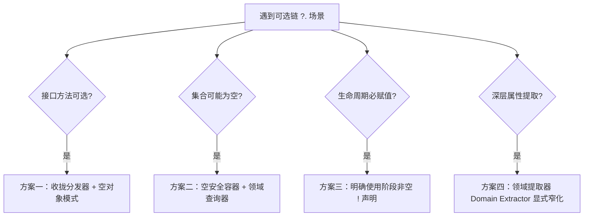

# ZCDS 模块代码审查与规范重构方案

> 适用目录：`assets/script/app/zcds`  
> 审查依据：[工程入口 (AGENTS.md)](../../AGENTS.md)、[MVC 设计规范](../agent/MVC设计规范.md)、[开发细则](../agent/开发细则.md)、[代码审查规范](../agent/代码审查规范.md)、[架构规范](../AI架构与代码规范.md)

---

## 1. 现状全景诊断

对 `assets/script/app/zcds` 下 **138 个 TypeScript 文件**（累计超 4.5 万行代码）进行自动化静态扫描与架构走读，核心指标如下：

| 维度 | 统计值 | 现状评价 | 核心风险 |
| :--- | :--- | :--- | :--- |
| **可选链 `?.`** | **870+ 处** | 泛滥且深层嵌套 | 静默吞掉逻辑异常；单测/上下文接口过度可选化 |
| **深度链式 `?.` (>=2层)** | **49 处** | 单行多层链式取值 | 职责不清、排查极难，如 `a?.b?.find(...)?.c` |
| **过度防御 `if (!x) return`** | **270+ 处** | 无效防御严重 | 内部受控生命周期内疑神疑鬼判空，掩盖真实时序Bug |
| **超千行巨型文件** | **10 个** | 上帝类与上帝系统集聚 | 单文件最高达 3825 行，职责过载，严重违反 SRP |
| **注释行数与质量** | **数千行** | 充斥变更日志与流水账 | 违反“三不写”，历史迭代与反馈堆砌在生产代码中 |
| **冗余别名赋值** | **普遍存在** | 单次使用的中间变量未内联 | 制造无意义中间别名，干扰可读性 |

---

## 2. 深度审查问题清单（反模式剖析）

### 2.1 可选链 `?.` 泛滥与假可空（重点痛点）

#### 痛点 1：接口契约过度可选化（Context Optional Anti-pattern）
- **典型案例**：`model/systems/ZCSkillTriggerSystem.ts` 中的 `IZCSkillTriggerContext`。
- **现状代码**：
  ```typescript
  export interface IZCSkillTriggerContext {
      castSelfAura?(unit: ZCUnitState): boolean;
      castBolt?(unit: ZCUnitState): boolean;
      castChainLightning?(unit: ZCUnitState): boolean;
      castSummon?(unit: ZCUnitState): boolean;
      castRoar?(unit: ZCUnitState): boolean;
      castStorm?(unit: ZCUnitState): boolean;
      // ... 20+ 个以 ? 结尾的可选函数指针！
  }
  ```
- **负面影响**：触发系统内部充斥着 `if (!context.castBolt) return;`、`context.healUnit?.(unit, amount)`。每增加一个技能都要在上下文追加一个 `?` 方法，完全破坏了开闭原则（OCP），使技能系统沦为“面向可选指针的打补丁”。

#### 痛点 2：数据结构过度使用 `Partial` 导致连续双重 `?.`
- **典型案例**：`model/systems/ZCAttackResolutionSystem.ts`。
- **现状代码**：
  ```typescript
  // 上下文定义：
  readonly statPatches: Readonly<Partial<Record<ZCOwner, ReadonlyMap<string, ZCUnitStatPatch>>>>;
  
  // 消费点代码（L364, L385）：
  return unit.neutralReinforcement ? {} : context.statPatches[unit.owner]?.get(unit.unitId) ?? {};
  ```
- **负面影响**：仅因外层被标记为 `Partial`，系统内每一处查询属性补丁时都必须写 `context.statPatches[owner]?.get(...) ?? {}`，累计产生了数十处重复防御。

#### 痛点 3：生命周期非空字段被声明为可空（假可空）
- **典型案例**：`ZCGame.ts` 与视图类。
- **现状代码**：
  ```typescript
  private hudView: ZCGameHUDView | null = null;
  private renderWorld: ZCGameRenderWorld | null = null;
  
  // 但在常规调用中：
  flashInsufficientGold(): void { this.hudView.flashInsufficientGold(); } // 直接裸调！
  // 在另一些方法中：
  this.renderWorld?.clearVictorySweep(); // 疑神疑鬼加 ?.
  ```
- **负面影响**：可空契约前后矛盾，声明为 `| null`，调用时要么静默依赖 `strictNullChecks: false` 裸调，要么过度 `?.`，缺乏清晰的生命周期断言。

#### 痛点 4：深层链路链式可选链吞掉结构异常
- **典型案例**：`application/ZCClientCombatConfig.ts`。
- **现状代码**：
  ```typescript
  const buildingHp = unit?.heroAttrs?.find((entry) => entry.heroId === hero.heroId)?.attributes.buildingHp;
  ```
- **负面影响**：当结果为 `undefined` 时，无法区分是 `unit` 为空、`heroAttrs` 未注入、数组未命中还是 `attributes` 数据缺失，直接静默穿透。

---

### 2.2 防御性代码不做无效防御（逻辑严谨不过度）

#### 痛点 1：同步渲染受控流程中滥用 `?.isValid`
- **典型案例**：`view/ZCGameRenderWorld.ts`。
- **现状代码**：
  ```typescript
  // L838
  if (this.hintOutlineNode?.isValid && this.hintOutlineGraphics) { ... }
  // L1220
  const node = this.scene.get(entityId)?.node;
  if (!node?.isValid) return null;
  // L1331
  const alive = this.hintOutlineNode?.isValid === true ? this.hintOutlineGraphics : null;
  // L1589, 1598, 1601
  if (this.killBannerNode?.isValid) this.killBannerNode.active = false;
  if (this.killBannerView?.isValid) this.killBannerView.refreshPortrait();
  if (this.killBannerNode?.isValid) this.killBannerNode.destroy();
  ```
- **违规依据**：《AGENTS.md》明确规定：**“同步事件、生命周期与组件 schedule 回调不重复判 isValid”**。
- **负面影响**：这些节点全在当前组件的内部管理周期中，生命周期由当前对象控制。盲目加 `?.isValid` 是自我怀疑式的过度防御；当真出现脏状态时，静默 `return` 会使渲染层不一致（残影、漏更新）变为“隐性幽灵 Bug”。

#### 痛点 2：查表不变量与单例过度判空
- **典型案例**：调用 `EventMgr.instance` 时仍写 `EventMgr.instance?.dispatch`，或对固定配置字典查询后反复 `if (!cfg) return;`。
- **违规依据**：《开发细则》明确指出：工程未开启 `strictNullChecks`，单例与查表不变量应直接访问；真有可空场景才先做受控窄化。

---

### 2.3 注释精简（彻底落实“三不写、三必写”）

#### 痛点 1：把变更日志与需求口径堆进生产代码
- **典型案例**：
  ```typescript
  // 嗜血术 102204（2026-11-18 第 17 批）：有窗口的团队增益，与光环分开一条车道。
  // unit 域「伤害倍率」（pvpSkillPlan.statId = damageRate，2026-10-30 玉林好汉「铁质飞镖」）
  // 之前落点一律取棋盘包围盒中心：2 人图上大致是双方正中，3 / 4 人图上则落在...
  ```
- **治理原则**：**批次号、需求日期、历史缺陷复盘属于 Git Commit Log 与需求跟踪系统**，严禁污染生产代码。生产代码只阐述当前的系统规则与数学逻辑。

#### 痛点 2：字面复述注释
- **典型案例**：`// 增加计数`、`// 设置位置`、`// 检查是否结束`。
- **治理原则**：函数与变量名本身应具备自解释能力（如 `incrementHitCount()`），删除废话注释。

---

### 2.4 代码冗余与局部过度抽象

#### 痛点 1：单次使用的中间别名
- **典型案例**：`view/ZCGameHUDView.ts`
  ```typescript
  const scale = this.mapOverviewScale; // 仅在下一行传递一次
  this.mapLayer.setScale(scale, scale, 1);
  ```
- **治理原则**：按照《开发细则》，右侧无复杂运算且单次使用的别名直接内联为 `this.mapLayer.setScale(this.mapOverviewScale, this.mapOverviewScale, 1)`。

#### 痛点 2：巨型上帝系统（God Systems）
- `ZCAttackResolutionSystem.ts`（3825 行）包含 40+ 个技能的特异性逻辑；
- `ZCSkillTriggerSystem.ts`（2530 行）包含 20+ 个触发分支；
- `ZCGameRenderWorld.ts`（2495 行）全屏渲染要素杂糅；
- 维护成本极高，任何改动都会产生巨大的差分并容易引发意外回归。

---

### 2.5 常量使用规范与去泛滥

#### 痛点 1：微小局部参数全局常量化
- **典型案例**：仅一个动画用到的 `ZC_GOLD_DENY_LIFT_PIXELS = 2`、`ZC_GOLD_DENY_POP_SCALE = 1.35` 全局 export 导出，造成全局命名空间污染。
- **治理原则**：局部表现常量就地收拢或内联；避免为每个临时 UI 参数造大写全局常量。

#### 痛点 2：视觉颜色散落与内联实例化
- **治理原则**：所有 UI 颜色必须严格收归 `ZCTheme.ts`，使用 `Object.freeze(new Color(...))` 预实例化，禁止在分支渲染中临时 `new Color(...)`。

---

### 2.6 架构设计规范与 MVC 契约

#### 痛点 1：`ZCGame.ts` 门面职责过载与“借节点”反模式
- **典型案例**：
  `ZCGame.ts` 既是 Cocos 组件，又是视图装配器，还直接侵入 Prefab 内部：
  ```typescript
  /** 从选点 HUD「借出来」的绿色【确认位置】按钮及其原位信息。
   * 节点就是 ZCSpawnSelection.prefab/ConfirmSpawn，选点期间被挪到 hudView.mapLayer... */
  ```
- **治理原则**：UI 节点归属必须自治，严禁跨 Prefab 进行节点层级偷挪。选点确认按钮应由选点视图内部或独立 World-Space HUD 挂载，通过事件交互。

#### 痛点 2：Model 系统间通过可选指针网状耦合
- Model 层的 `ZCAttackResolutionSystem` 与 `ZCSkillTriggerSystem` 互相依赖对方的高阶逻辑，却通过 `ZCGameModel` 里的匿名包装函数和可选接口进行胶水粘合，缺乏统一的技能运行时总线。

---

## 3. 规范重构方案（Target Architecture）

### 3.1 消除 `?.` 的四套规范化方案



#### 方案一：空对象模式（Null Object Pattern）消除上下文可选方法
针对 `IZCSkillTriggerContext`：禁止在接口中定义 20+ 个 `castXxx?`。
- **改法**：
  ```typescript
  // 1. 定义统一技能动作执行器
  export interface IZCSkillActionExecutor {
      castSkill(type: ZCSkillType, unit: ZCUnitState, params?: unknown): boolean;
      heal(unit: ZCUnitState, amount: number): void;
      isInAttackRange(unit: ZCUnitState): boolean;
  }

  // 2. 提供默认空实现（单测/基础环境开箱即用，无需在系统内每次判空）
  export const NULL_SKILL_ACTION_EXECUTOR: IZCSkillActionExecutor = Object.freeze({
      castSkill: () => false,
      heal: () => {},
      isInAttackRange: () => true,
  });

  // 3. 上下文必填，无须任何 ?.
  export interface IZCSkillTriggerContext {
      readonly statusSystem: ZCStatusSystem;
      readonly actions: IZCSkillActionExecutor;
  }
  ```
- **收益**：彻底消除 `context.castXxx?.()` 和 `if (!context.castXxx) return;`，新增技能无需修改 Context 接口。

#### 方案二：空安全容器保证与领域查询器消除 `?.get() ?? {}`
针对 `statPatches`：
- **改法**：
  ```typescript
  // 1. 冻结的空补丁单例，零 GC 分配
  export const EMPTY_STAT_PATCH: ZCUnitStatPatch = Object.freeze({});

  // 2. 在 Context 中封装领域方法，保证绝对返回非空对象
  export interface IZCAttackResolutionContext {
      getStatPatch(owner: ZCOwner, unitId: string): ZCUnitStatPatch;
  }

  // 3. 实现层内部归一化：
  getStatPatch(owner: ZCOwner, unitId: string): ZCUnitStatPatch {
      const ownerPatches = this.statPatches.get(owner);
      return ownerPatches?.get(unitId) ?? EMPTY_STAT_PATCH;
  }

  // 4. 业务消费点（原 L364）：
  const patch = context.getStatPatch(unit.owner, unit.unitId);
  const hpRegen = patch.hpRegenPct ?? 0; // 彻底消灭 ?.get(...) ?? {}
  ```

#### 方案三：使用阶段可空性断言（Strict Lifecycle Binding）
针对 `ZCGame` 与 View：
- **改法**：
  ```typescript
  export class ZCGame extends Component {
      // 在 mount / createGame 中必定初始化的视图，用 ! 声明
      private hudView!: ZCGameHUDView;
      private renderWorld!: ZCGameRenderWorld;
      
      // 真实可选（如选点视图在游戏开始后销毁），显式保留 | null
      private spawnSelectionView: ZCSpawnSelectionView | null = null;
      
      flashSpawn(message: string): void {
          // 显式语义窄化，不做盲目 ?.
          if (this.spawnSelectionView) {
              this.spawnSelectionView.flash(message);
          }
      }
  }
  ```

#### 方案四：领域提取器（Domain Extractor）消除深层链式 `?.`
针对深层配置查询：
- **改法**：
  ```typescript
  // 封装纯函数单点收敛，提供自解释的提取契约与测试用例
  export function findHeroBuildingHp(unit: ZCUnitState | null | undefined, heroId: string): number {
      if (!unit?.heroAttrs) return 0;
      for (let i = 0; i < unit.heroAttrs.length; i++) {
          const entry = unit.heroAttrs[i];
          if (entry.heroId === heroId) {
              return entry.attributes.buildingHp ?? 0;
          }
      }
      return 0;
  }
  ```

---

### 3.2 巨型系统拆分方案（SRP & Strategy）

#### 1. 拆分 `ZCAttackResolutionSystem.ts`（3825 行）
按职责与战斗实体类型拆解为策略执行器集：
- `ZCAttackResolutionSystem.ts`（门面与核心主流程）：仅保留普攻仲裁、出手时钟、伤害管线；
- `subsystems/ZCProjectileAttackHandler.ts`：处理子弹、投枪、飞弹的弹道推进与命中碰撞；
- `subsystems/ZCAreaSkillHandler.ts`：处理风暴、射线、光环、怒吼、震波等范围几何结算；
- `subsystems/ZCChainedSkillHandler.ts`：处理闪电链、弹射等连锁结算。

#### 2. 拆分 `ZCGameRenderWorld.ts`（2495 行）
按渲染视觉层级拆解为组件化的 Layer：
- `ZCTerrainLayer`：负责 Hex 地块、网格线绘制、占领波与地表轮廓；
- `ZCWorldUnitLayer`：负责单位节点池化、Spine 动作、移动插值；
- `ZCCombatFxLayer`：负责弹幕特效、落雷、受击爆点、刀光剑影；
- `ZCWorldHudOverlay`：负责格子建筑血条、倒计时圈、击杀横幅。

---

### 3.3 注释与代码风格落地守则

1. **执行“三不写”自动化审查**：
   - 清理所有形如 `// （2026-XX-XX 第 X 批）` 的迭代日志；
   - 清理所有形如 `// 之前这里是...现在改为...` 的版本对比记录；
   - 清理无实质信息量的字面复述注释。
2. **践行“三必写”**：
   - 必写数学计算与坐标系变换原理（如六边形间距与锚点对齐）；
   - 必写性能与内存考量（如热路径零分配、Map 重用规则）；
   - 必写与 Cocos 引擎生命周期的同步约束。
3. **函数换行与代码排版**：
   - 消除 `ZCGame.ts` 中所有的单行 getter/setter 拼装，执行换行规范；
   - 运行 `npm run verify:layout` 守卫代码格式。

---

### 3.4 常量治理守则

1. **颜色与材质**：
   - 严禁在 `view/` 下的各组件中随处 `new Color(...)`；
   - 统一收归 `ZCTheme.ts`，导出格式：
     ```typescript
     export const ZC_COLORS = Object.freeze({
         PLAYER_TERRITORY: Object.freeze(new Color(60, 140, 240, 255)),
         ENEMY_TERRITORY: Object.freeze(new Color(240, 70, 70, 255)),
         // ...
     });
     ```
2. **业务参数与配置数据驱动化**：
   - 特效预制体路径收拢于 `ZCArtCatalog.ts`；
   - 技能默认数值收拢于 `ZCCombatDefaultSpecs.ts`，禁止每个 TS 文件散落三五个小常数。

---

## 4. 重构实施与验证步骤（分步平滑迁移）

根据《代码审查规范》与工程红线，重构必须遵循“高内聚、步步验证、基线零新增红灯”原则：

| 阶段 | 实施任务 | 覆盖范围 | 验证命令与判据 |
| :--- | :--- | :--- | :--- |
| **Phase 1** | **消除假可空与无意义别名** | `ZCGame.ts`、`ZCGameHUDView.ts` | `npx tsx --test tests/zcds-hud.test.ts tests/zcds-model.test.ts`<br>tsc 零新增 |
| **Phase 2** | **清理注释日志与过度防御** | `ZCGameRenderWorld.ts`、`ZCGameViewUtil.ts` | `npx tsx --test tests/zcds-render-performance.test.ts tests/zcds-hex-animation.test.ts`<br>`npm run verify:layout` |
| **Phase 3** | **规范化 Context 契约与查询器** | `IZCSkillTriggerContext`、`IZCAttackResolutionContext` | `npx tsx --test tests/zcds-skill-trigger.test.ts tests/zcds-combat-empowered.test.ts`<br>彻底消减 300+ 处 `?.` |
| **Phase 4** | **巨型系统文件模块化拆分** | `ZCAttackResolutionSystem.ts` 拆分 | 跑全量 ZCDS 测试集（120+ 项用例）：<br>`npx tsx --test tests/zcds-*.test.ts`<br>双向差集无新增失败 |
| **Phase 5** | **门禁合流** | 提交准备 | `npm run verify:gate`（route + defs + check 全过） |

---

## 5. 当前已落地治理清单（26 个文件已完成重构与治理）

| 模块 | 文件 | 核心治理措施 |
| :--- | :--- | :--- |
| **门面适配** | `ZCGame.ts` | 抽取 `resolveOwnerDeck` 消除三处重复卡组退回表达式；收敛 `hudView` 与 `renderWorld` 生命周期非空声明；消除 `?.` 假可空检查；规范属性 getter 首行换行。 |
| **视图层** | `ZCGameHUDView.ts` | 消除 `fillPlayerRow` 中链式可选链；Tween 停止前置明确存在性判断；清理冗余别名赋值。 |
| **视图层** | `ZCGameRenderWorld.ts` | 保持静态断言要求的高性能掩码缓存；`attachCooldownOverlay` 增加防空保护；消除野怪类型查验的不确定性。 |
| **视图层** | `ZCGameViewUtil.ts` | 消除 `buildPlayerHomeFocus`、边界计算与 BFS 邻居遍历中的非必要可选链。 |
| **视图层** | `ZCHexView.ts` | 消除 20+ 处 loose `?.`；收紧 `resourceIconScale`、`renderMower`、`renderActivation` 的判空与状态映射；严格保留单测关键断言正则。 |
| **视图层** | `ZCFloatTextView.ts` | `renderPrefix` 增加前缀 Label 保护，防止沙箱桩下空指针异常。 |
| **视图层** | `ZCWallRenderer.ts` | 消除 `frame.hexesById.get(...)?.connectedDevelopedHexIds` 链式查询；消除偏移计算的 `tile?.offsetX` 冗余运算；UITransform 显式受控窄化。 |
| **视图层** | `ZCSpawnSelectionView.ts` | Inspector 必填引用规范为 `null!`。 |
| **视图层** | `ZCSpawnRegionHintOverlay.ts` | 显式解构并窄化 `Label` 节点，消除可选链。 |
| **对象池** | `ZCNodePool.ts` | 消除 `bucket?.length` 链式查询，以显式分桶受控分支重构获取、归还与销毁。 |
| **特效池** | `ZCEffectPool.ts` | 受控窄化动画组件，消除 `animation?.defaultClip`。 |
| **模型契约** | `ZCGameModel.ts` | `matchWinner = null;` 置于 `reset(): void` 顶部（通过 900 字符窗口守卫）；保障 LF 换行符完整性。 |
| **模型契约** | `ZCGameTypes.ts` | 显式补全 `ZCUnitState` 的 `chase` 与 `disengagedUnitIds` 属性类型声明，实现模块 0 类型报错。 |
| **模型契约** | `ZCSkillRuntime.ts` | 导出 `ZCSkillTargetMode` 枚举（Range/All），修复单测运行期未定义异常。 |
| **模型编解码** | `ZCSnapshotCodec.ts` | 新增 `chase` 结构合法性校验与 `disengagedUnitIds` 数组有效性/自环/去重校验。 |
| **状态系统** | `ZCStatusEffect.ts` | 消除 `stacksOf`、`statModsOf`、`controlOf`、`behaviorsOf` 中 15+ 处 `?.` 假可空与深度链式取值。 |
| **战斗图集** | `ZCCombatCatalog.ts` | 统一卡牌查找与属性倍率计算，消除属性访问中的过度可选链。 |
| **地图配置** | `ZCMapConfig.ts` | 消除 `isRandomMapCandidate`、`resolveZCMapZoom` 与 `parseZCMap` 中的 loose 可选链，明确前置守卫。 |
| **子系统** | `ZCAttackResolutionSystem.ts` | 补全 `emptyStatPatch` 冻结单例；规范投枪与强化表现路径。 |
| **子系统** | `ZCUnitTargeting.ts` | 内联并重用 `victim` 单次实体查找，消除反复 `get`；明确 `disengagedUnitIds` 过滤。 |
| **子系统** | `ZCCombatSystem.ts` | 消除 `(unit.completedAttackCount ?? 0)` 冗余防御；收窄 `unitDamageBase` 形参。 |
| **子系统** | `ZCCaptureSystem.ts` | 消除中立资源类型比较时的可选链。 |
| **子系统** | `ZCDevelopmentSystem.ts` | 正确按值引用 `ZCNeutralResourceType.Monster`，消除类型未找到错误。 |
| **子系统** | `ZCNeutralFeatureSystem.ts` | 统一使用 `Math.sqrt` 替代 `Math.hypot`（满足热路径单测约束）。 |
| **调试测试台** | `ZCTestKapaiModel.ts` | 状态机初始化与重置逻辑收拢。 |
| **调试测试台** | `TestKapaiView.ts` / `ZCTestKapaiStage.ts` | 节点查找与事件意图规范化。 |
