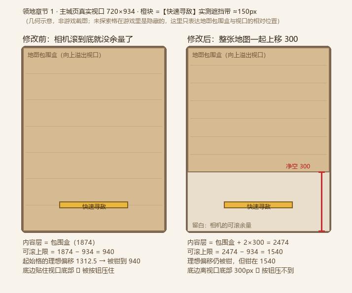

# 占城大师（zcds）表现层与领地专项规范

> **定位与适用范围**：
> - 本文档拆分自 [AI架构与代码规范.md](AI架构与代码规范.md) 原第 `7.3.3` ~ `7.3.11` 节，维护**对局表现层（`app/zcds/view`）与「冒险」领地页（`app/territory`）的业务与表现规格**。其中参数和功能范围适用于对应模块，不是全工程 Agent 禁令；本次明确需求变更时，同步调整实现、配置、本文与相关测试。
> - 凡涉及对局棋盘图层、地块激活/脉冲/卡牌/建筑动画、特效缩放、飘字曲线、自选主城、开局归属扩散波、胜利扫场、传说卡横幅以及领地页（含领地喷发 / 资源读数）的修改，必须先核对本文档中的**唯一写入口**、**不变量**与**回归测试判据**。
> - 仅按本次任务读取相关章节。旧入口中的参数、旧实现与历史范围完整保存在[旧入口业务与表现记录](history/2026-10-31-旧入口业务与表现记录.md)，仅在追溯或核对差异时读取，不作为当前规格或强制规则；本文中的取值演进、旧方案也按历史说明处理。

## 模块核心写入口与必跑单测速查表

| 功能域 | 关键文件 / 唯一写入口 | 必跑单测判据（`npx tsx --test <路径>`） |
| :--- | :--- | :--- |
| 棋盘图层与城墙 y 排序 | `ZCGameBoard.prefab` / `ZCGameRenderWorld.boardLayer`、`renderWallSystem` | `tests/zcds-progress.test.ts`、`tests/zcds-render-performance.test.ts` |
| 地块/建筑/资源图标缩放 | `ZCHexView.renderContent`（图标）、`applyBuildingScale`（建筑） | `tests/zcds-tile-icon-scale.test.ts`、`tests/zcds-building-icon-scale.test.ts`、`tests/zcds-resource-icon-scale.test.ts` |
| 中立资源抬层与兵团落点 | `ZCHexView.setResourceIconRaised`、`applyIconPosition`、`layoutResourceUnits` | `tests/zcds-resource-icon-layer.test.ts`、`tests/zcds-resource-unit-preview.test.ts` |
| 地块激活（脉冲∥缩没→卡牌→建筑） | `ZCHexView.hexActivationFx`、`hexPulseShrinkFx`、`applyTileTransform` | `tests/zcds-hex-activation.test.ts`、`tests/zcds-card-reveal-pop.test.ts`、`tests/territory-hex-flip.test.ts` |
| 点击脉冲的 5 帧序列（对齐缩放 / 一次性退场） | `ZCHexView.applyPulseRipple`、`HexFlipPresentation.hexPulseFx`（`pulseFrame`） | `tests/zcds-hex-activation.test.ts` |
| 单位出生抖动 & 建筑产兵/产金抖动 | `ZCUnitView.playSpawnShake` / `ZCHexView.playBuildingShake`、`drainBuildingShakes` | `tests/zcds-unit-spawn-shake.test.ts`、`tests/zcds-building-spawn-shake.test.ts` |
| 新扩展邻格生成动画（与脉冲同起） | `ZCHexView.noteDevelopableSpawn` / `advanceDevelopableSpawn`、`ZCGameRenderWorld.renderDevelopableSpawns` | `tests/zcds-hex-neighbor-spawn.test.ts` |
| 出生 / 受击 / 阵亡特效缩放 | 各特效 `.prefab` 根 `_lscale` / `ZCEffectPool.playSpawnFx`、`playDeathFx`、`playHitFx` | `tests/zcds-hit-fx.test.ts` |
| 受击特效总时长锁 0.15s（加速、无定格） | `ZCEffectPool.HIT_FX_TARGET_SECONDS` / `state.speed`、`ZCGameModel.HIT_FX_SECONDS` | `tests/zcds-hit-fx.test.ts` |
| 出生特效锁总时长 1.25s（speed 由 clip 反推） | `ZCEffectPool.SPAWN_FX_TARGET_SECONDS` / `state.speed` | `tests/zcds-spawn-fx.test.ts` |
| 传说卡出场横幅（金卡 tier 4） | `ZCGameLegendBanner.prefab` / `legendRoleProgress`、`legendRoleEase` | `tests/zcds-legend-banner.test.ts` |
| **战斗技能特效：锚点 / 层级 / 飞行段 / 朝向**（2026-11-02） | `ZCCombatEffectPlacement.ts` / `ZCCombatEffectFlight.ts`（均按 prefab 路径配）/ `ZCCombatEffectView.render` | `tests/zcds-combat-effect-placement.test.ts`、`tests/zcds-combat-effect-flight.test.ts` |
| **冲刺（运动霸「拳击冲撞」）**（2026-11-02 接线） | `ZCUnitSystem`（`chargeSpeedScale` → `speedScale` + `unit.charging`）/ `ZCUnitTargeting.chargeSpeedScale` / `ZCUnitView` 动作切换 | `tests/zcds-charge.test.ts` |
| 「冒险」领地页与台面中心对齐 | `TerritoryPresenter.ts` / `TerritoryMapView.cellCenter`、`applyIconPlacement` | `tests/territory-presenter.test.ts`、`tests/territory-page-split.test.ts`、`tests/territory-cell-center-align.test.ts` |
| 敌方单位顶点色置灰 | `ZCUnitView.applyVisualTint` | `tests/zcds-unit-view-render.test.ts` |
| 自选主城（选择基地模式） | `ZCSpawnSelection.defaultHexFor`、`isPlacing` / `borrowSpawnConfirmButton` | `tests/zcds-spawn-base-confirm.test.ts` |
| 战斗飘字「快进慢出」与收尾漂移 | `ZCFloatTextView` / `floatTextEntrance`、`floatTextFade`、`floatTextDrift` | `tests/zcds-float-text-gold-icon.test.ts`、`tests/zcds-progress.test.ts` |
| 开局归属扩散波 | `ZCClaimWave` / `buildClaimWavePlan`、`ZCHexView.setClaimWave` | `tests/zcds-territory-claim-wave.test.ts` |
| 胜利结算三段式扫场（铺场/回正/脉冲） | `ZCVictorySweep` / `zcDeepFactionColor`、`setSweepOwner`、`appendHexPulseOutlineSegments` | `tests/zcds-progress.test.ts`、`tests/zcds-outline-layer.test.ts` |
| **废墟地块底色按归属方混合灰**（2026-10-29） | `ZCTheme.zcRuinsFactionColor` / `ZCHexView.territoryTint`（`ZCHexView.TERRITORY_FILL_ALPHA`） | `tests/zcds-ruins-tile-color.test.ts` |
| **废墟建筑不再产金**（主城那一路原来无条件发钱，2026-10-29） | `ZCEconomySystem.tickIncome` / `isIncomeSource`、`isBuildingOperational` | `tests/zcds-ruins-income.test.ts` |
| 开局金矿格整圈描边呼吸（绿色 · 9px · 棋盘最上层） | `ZCGameViewUtil.zcNeutralHintAlpha` / `ZCHexView.strokeHintOutline` / `ZCGameRenderWorld.ensureHintOutlineGraphics` | `tests/zcds-neutral-hint-outline.test.ts` |
| 对局中立资源奖励**金币飞向战斗金币栏**（6 枚错峰飞行 + 金币栏读数上飘，2026-11-04 恢复） | `ZCGame` 金币栏目标装配 / `view/ZCGameRenderWorld.renderNeutralRewards` / `view/ZCNeutralRewardFx` / `ZCBattlePresentationQueue.ZC_NEUTRAL_REWARD_TOTAL_SECONDS` | `tests/zcds-neutral-reward-fx.test.ts` |
| 领地随机资源格「翻开」（**原地碎裂**，2026-10-16 起只剩这一套） | `core/hex/HexFlipPresentation.hexShatterFx` / `TerritoryHexFlip.applyFace`、`applyReveal` | `tests/territory-hex-flip.test.ts` |
| 领地建筑**生成抖动**（先 Y 后 X，120%）+ **展示滞后到翻转结束** | `core/hex/ShakePresentation` / `TerritoryStationView.playBuildingShake`、`TerritoryMapView.pendingBuildingReveal`、`ITerritoryStationRender.hidden` | `tests/territory-building-shake.test.ts` |
| 领地**新地块进场**动画（两档：普通生成 / **胜利通过更重**，2026-11-03） | `model/TerritoryHexSpawn.territoryHexSpawnFrame`（`peakScale` 过冲）/ `…Delays` / `TERRITORY_HEX_SPAWN_(VICTORY_)TIMING` / `view/TerritoryHexSpawn.play(…, timing)` / `TerritoryMapView.syncHexSpawn` / `TerritoryModel.victoryClaimCells` | `tests/territory-hex-spawn.test.ts`、`tests/territory-battle-prelude.test.ts` |
| 领地**资源不足**的数字变红（银币 / 体力各判各的，2026-11-03） | `model/TerritoryCostShortfall.territoryUnlockShortfall` / `TerritoryMapView.stationRenderOf`（`conditionTextColor` · `levelBubbleTextColor`）/ `TerritoryStationView.renderLevelBubble` / `TerritoryModel.buildState`（`wallet`） | `tests/territory-wallet-shortfall.test.ts`、`tests/territory-random-resource-render.test.ts` |
| 领地「获得银币 / 体力」**格心抛物线喷发（12 颗 · ±26° · 由小变大 + 持续自转）** + 读数在其**上方 40px**（row17；粒子自身动画 2026-11-02 改口径，旧的「上下翻面」已作废） | `model/TerritoryResourceGain.territoryBurstLaunch / territoryBurstParticle`（`scale` / `rotation`） / `view/TerritoryGainBurst` / `TerritoryMapView.playResourceGain`、`ensureBurstRoot` | `tests/territory-resource-gain.test.ts` |
| **宝箱气泡底图 / 排版**（`frame_04` 竖向水滴，icon 在上、数字在下；2026-11-02 两轮） | `model/TerritoryChestBubble.territoryChestBubbleLayout`（尺寸 / icon / 字号 / 描边） / `TerritoryStationView.renderLevelBubble`、`themeLevelBubbleLabel`、`applyLevelBubbleLayout` / `TerritoryPageAssets`（`chestBubbleFrame`） | `tests/territory-chest-bubble.test.ts` |
| 领地奖励**图标解析**：`roleProperty` + `item` **两张表**、`item` 图在 `main-pages` 分包 + 随机格**读数合成一条**（2026-10-26） | `ResTypes.resBarCellOfRefId` / `ResTypes.resBarIconSpritePath` / `MainTerritoryMap.ensureRewardIcon`、`refRows` / `TerritoryMapView.playResourceGain` 的 `readout` | `tests/res-types.test.ts`、`tests/territory-resource-gain.test.ts` |
| **资源栏「扣除」反馈**（数字**白色闪烁** → 跳一下 → 才扣 + 上方飘 `-N`；2026-11-02 立项，2026-11-03 改口径去掉红色） | `main/MainResBarFeedback.resBarSpendFx / resBarSpendFloatFx / resBarSpendFlashColor` / `main/MainResBarSlot.playSpendFeedback`、`ensureSpendFloat` / `common/ResBar.reload`（`spendDeltaOf` 自动检测） | `tests/main-resbar-spend.test.ts`、`tests/main-resbar-feedback.test.ts`、`tests/militia-talent-ui.test.ts` |
| **「章节选择」行排版**（金边即底框 / 区块留白 / 挂锁 ×1.3 / 序号块与完成度块缩 90%+上抬 / 章节名居中 / 挂锁两轴跟随；2026-11-03/04 五轮） | `ChapterSelectPanel.prefab` 的 `CurrentRing` · `NumBlock` · `StatusBlock` · `LockIcon` · `NameLabel` 几何 / `main/ChapterSelectItem.render` | `tests/chapter-select.test.ts` |
| **「章节选择」完成度 = 已通关格子 / 章节全部格子**（格子按区域关整片算通关、资源据点不扩散；空格不算；与金牌判据解耦；2026-11-05） | `model/ChapterSelectRows.chapterPercentOf`（+ `passedCellSet`）/ `IChapterSelectMapInfo.areaGroups` / `ChapterSelectLoader.buildAreaGroups`（与 `TerritoryProgress.areaPeers` 同源） | `tests/chapter-select.test.ts` |
| **战斗宝箱入口开启条件**（pvp 20001 通关才显示 + `0→1.15→1` 生成动画 + `Cell0..Cell3` 同进同出；2026-11-03） | `open.json` `refId=701`「战斗掉落宝箱」的 `visibleCondition` / `main/ChestEntryGate.ts` / `main/BattleLevelPassed.ts` / `MainPage.onLoad`、`applyChestEntryGate`、`setChestCellsVisible` | `tests/chest-entry-gate.test.ts` |
| **章节通关判据 = 通过本章最后一个首领关**（异步据点不参与；无首领退回全占领；2026-11-04） | `model/TerritoryStageBinding.chapterFinalBossCell`（取 `stage.stage` 最大，同级比 `levelId` 再比 `cellId`）/ `TerritoryModel.chapterCompletion`（`bossCellId` + `progress.isAreaPassed`）/ `model/ChapterSelectRows.chapterClearedOf` / `ChapterSelectLoader.finalBossLevelIdOf`（`levelMod === 2`）与 `finalBossCells` | `tests/territory-stage-binding.test.ts`、`tests/territory-presenter.test.ts`、`tests/chapter-select.test.ts` |
| **整章云散回收 + 章节切换镜头 + 散雾只给首次通关演**（模型只发 `chapterSwitch` 命令 → 页面压住换图保住云散 → `cover/wait/reveal` 三段 + 只认按钮来源；散雾判**边沿**（`chapterClearPending`）不判电平；2026-11-04 / 11-05） | `model/TerritoryChapterSwitch`（四段时长 / `lead` 相机先行 / `rise` / `sink` / `reveal` 曲线）/ `model/TerritoryCloud.territoryCloudClearAction`（`none` / `animate` / `instant`）/ `TerritoryModel.noteChapterJustCleared`、`emitStateChange`（发一拍就消费）/ `MainTerritoryMap.beginChapterSwitch`、`stepChapterSwitch`（`lead`/`cover`/`wait`/`reveal`）、`writeChapterSwitchLead`、`renderAll`（`chapterSwapPending`）/ `TerritoryMapView.beginChapterSwitch`、`setChapterSwitchOffset`、`syncClouds` / `TerritoryCloudView.setChapterCleared(cleared, animate)`、`dismissFillNow`、`dismissing` | `tests/territory-chapter-switch.test.ts`、`tests/territory-cloud.test.ts`、`tests/territory-battle-prelude.test.ts` |
| **铺满背景的雾（铺满层）**：盖住"没有内容"的空格与内容层那圈留白；换章那一帧必须**当场重建**（2026-10-26 / 11-06） | `model/TerritoryCloud.territoryCloudFillPoints` / `TerritoryCloudView.setFillArea`、`setFillOccupied`（判据是 `fillAreaReady`，**不是** `fillKey`）、`rebuildFill`、`applyFillActive` / `TerritoryMapView.syncContentSize`、`syncClouds`、`syncGrid`（`reset()`） | `tests/territory-cloud.test.ts` |
| **塔防 BOSS 波识别**（`defenceModWave.monsterType`：`1` 普通 / `2` 精英 / `3` BOSS；客户端 JSON 必须含该列，缺列时按「每组最后一波」兜底，2026-11-07） | `model/TerritoryCampaignConfig.projectDefenceWaves`（→ `TerritoryCampaignWave.isBoss`）/ `ZCGameModel.defenceBossWaveIndex`、`isBossWave`、`ZCPveDefenceWave.isBoss` | `tests/territory-campaign-config.test.ts`、`tests/zcds-pve-defence.test.ts` |
| **塔防胜负只认「BOSS 已被击败」**（中间波清空不算赢；拆 BOSS 建筑提前触发的跳末波逻辑保持不变，2026-11-07） | `ZCGameModel.defenceBossState`（账本空时按场上同卡单位兜底）→ `ZCOutcomeSystem.checkOutcome(state, context, nextWaveIndex, defenceBoss)` | `tests/zcds-outcome-system.test.ts`、`tests/zcds-pve-defence.test.ts` |
| **塔防中间 UI 大血条只在 BOSS 波显示**（普通小怪只有头顶血条，2026-11-07） | `ZCGame.renderBossPanel`（判 `progress.currentWaveIsBoss`）/ `ZCHudBossPanel` | `tests/zcds-pve-defence-hud.test.ts` |
| **NPC 翻地块限速不超过 `levelInfo.openGrideTime`**（「关卡翻地快频率(s)」；`0` = 不受限，2026-11-07） | `ZCGameModel.aiDevelopIntervalSeconds = max(rules.enemyAiIntervalSeconds, openGrideTime)` / `TerritoryCampaignStage.openGrideTime` → `ITerritoryBattleNavParams` → `ZCBattleEntryBuilder` | `tests/zcds-pve-defence.test.ts`、`tests/territory-campaign-config.test.ts` |
| **塔防关 NPC 卡组按 `npcCard` 收紧**（服务端开战回包里带英雄也不能整池上阵，2026-11-07） | `ZCBattleEntryBuilder.buildZCBattleEntry`（`clipToLevelCards = requestedEnemyCards.size > 0 && (!battle \|\| pve?.mode === 'defence')`） | `tests/zcds-client-combat-config.test.ts` |

## 对局资源与控制器生命周期（2026-10-30）

- 匹配、大地图、章节地图均通过 `createZCBattlePreload(battle, options)` 准备对局；入口只交战斗 Promise、人数与波次，不再注入独立 AssetService / ConfigService。
- 战斗准备创建 `ComponentController`，沿用 `ControllerBase` 从既有 GameContext 取得必需服务、优先使用会话复用资源。加载器只接收统一的只读资源契约。
- `ZCGamePreload` 独立 scope 归属加载资源和准备控制器。取消或失败释放；移交后匹配退出不释放，战斗流程退出才释放。显式 scope 必须穿透控制器的默认 scope。
- 直接进入战斗时，`ProcedureGame.onPreload` 将准备控制器登记到本次流程 scope；取消后不得写入 preparedResources。流程上下文缺失须明确报错。
- `ZCGame` 单独持有运行时补图控制器，玩家头像、角色卡面、首领头像及结算奖励图经其 AssetService 加载；继续复用公共头像解析、图标缓存和奖励换算规则。异步返回仍检查离场状态，`shutdown()` 先关闭弹窗和展示节点，再释放控制器并清空帧表，重复退出幂等。
- 回归：`tests/zcds-controller-resources.test.ts`、`tests/battle-preparation-entry.test.ts`、`tests/zcds-matching-preload.test.ts`、`tests/zcds-game-preload.test.ts`、`tests/zcds-map-loading.test.ts`、`tests/zcds-sprite-frame-loader.test.ts`、`tests/cocos-resource-lifecycle.test.ts`、`tests/controller-resources.test.ts`。

## 1. 对局棋盘的图层结构与地块表现（`ZCGameBoard.prefab`）

### 1.1 声明式棋盘图层（代码不拼层）与城墙排序

`ZCGameRenderWorld` **禁止在代码中 `new Node` 拼图层**。地图层下的结构固定声明在 `ZCGameBoard.prefab` 中，**子节点顺序 = 渲染顺序**（后画的压在上面）：

```text
mapLayer（= ZCGameHUD.prefab 的 content）
└─ ZCGameBoard          ← ui/game/ZCGameBoard.prefab（ZCGameLoader 加载 → ZCGame 实例化后挂进来）
   ├─ MapWater          水面：white Sprite，透明色在 prefab 配置，initialize 只按地图包围盒设置位置与尺寸
   ├─ HexLayer          地块实例挂这里
   ├─ OutlineLayer      整盘共享的领地轮廓：一个 cc.Graphics（ZCOutlineLayer 逐边描线）
   ├─ (ZCGameWallLayer) ← 城墙砖层来自独立 prefab，initialize 时插到 OutlineLayer 之后（outlineLayer.getSiblingIndex() + 1）
   ├─ ResourceLayer     中立资源图标：从地块节点里抬上来的（压得过墙砖，防图标被墙线切断）
   ├─ DecorLayer        自由装饰：ZCGameDecor.prefab 的条目挂这里
   ├─ BuildingOverlay   建筑剪影（从地块节点里提升上来的）
   └─ CooldownOverlay   生命条 + 冷却圈
```

- **硬约束**：
  1. 层的引用一律走 `board.getChildByName('<层名>')`（`ZCGameRenderWorld.boardLayer()`），严禁再用 `siblingIndex` 现算层序或 `new Node` 建同名层。
  2. 城墙层插入锚点必须是 `OutlineLayer + 1`（若插在 `HexLayer + 1` 会导致轮廓线从墙砖里穿出来）。
  3. 各层（含水面）的 `layer` 必须全部为 `UI_2D`。
  4. `destroy()` 只摘 ECS 实体与装饰节点；**board 与城墙层归调用方（随 HUD 销毁）**，渲染层内严禁拆毁。
- **中立格只做矢量绘制（2026-10-16）**：中立格**不铺地块底图**（`ZCHexView.NEUTRAL_FILL_ALPHA = 0`，
  `setSprite` 见 alpha 0 连 Sprite 都不启用）⇒ 棋盘底图直接透出来；格子感全部由 `OutlineLayer`
  的矢量线提供 —— 中立格自己画**暖棕细线**（`ZCOutlineLayer.NEUTRAL_GRID_LINE_WIDTH/COLOR`，
  半透明深色叠在底图上、颜色随底图走），与阵营交界的那条边仍由阵营方的粗线负责
 （`buildTerritoryBoundaryMasks` 已把它从这一格的 mask 里剔掉）。
- **城墙砖全盘按屏幕 y 降序排列**：
  - `ZCGameRenderWorld.renderWallSystem` 在铺砖前必须把**全盘**墙段按 `segment.y` **降序**排一遍（y 小的后画 ⇒ 越下方的城墙层级越高、恒压住上方的城墙）。
  - ⚠️ **必须整盘一起排**，严禁按格或按连通簇分段排（分段会让环形城墙接角处的上下关系随遍历顺序漂移，出现“有的角对齐、有的角带台阶”）。
  - ⚠️ 排序会打乱 `segmentIndex` 与六边形 edge 的对应关系，共享材质帧槽号也按新顺序分配 ⇒ 单测必须**按落点坐标反查边号**，不得写死 `records[edge]` 或 `rightUp = 0`。
- **判据**：`tests/zcds-progress.test.ts`（图层顺序与 `_layer`）、`tests/zcds-render-performance.test.ts`（跨格城墙按屏幕 y 降序）、端到端探针 `tmp/_board_probe.mjs`。

### 1.2 地块图标缩放、中立资源抬层与落点

- **地块与建筑图标缩放由代码唯一决定（只改 Prefab `_lscale` 会被静默覆盖）**：
  - `iconSprite` 同时承载地块类型图标（`icon_jk/by/wh/em`）与中立资源点图标，唯一缩放写入口为 `ZCHexView.renderContent`：类型图标写 `TILE_ICON_SCALE = 0.8`，资源图标按 `resourceIconScale` 缩放到格子边长。
  - 已建建筑唯一缩放写入口为 `applyBuildingScale`（基准 `BUILDING_ICON_SCALE = 0.72`）。
  - 金币图标 `BuildingLayer/PriceIcon` 与价格数字 `BuildingLayer/IconLabel` **不参与**上述缩放。
  - **判据**：`tests/zcds-tile-icon-scale.test.ts`、`tests/zcds-building-icon-scale.test.ts`、`tests/zcds-resource-icon-scale.test.ts`。
- **中立资源图标必须抬到 `ResourceLayer`（防邻格切边）**：
  - **物理原因**：地块整图 130×119、格距仅 92.25×90（相邻格整图重叠）；资源图标 128×128 大于地块顶面 123×90，若留在格节点内必然被后画的邻格沿格边线齐刷刷切掉一半。
  - **唯一入口**：`ZCHexView.setResourceIconRaised`（唯一写 `parent` 入口）将其抬至 `ResourceLayer`，并由 `applyIconPosition`（唯一写坐标入口）换算为棋盘层局部坐标（`格节点位置 + BuildingLayer 偏移 + 图标偏移`）。
  - 地块类型图标字形仅 33×33 落在顶面内，**不抬层**。激活表现的「整格隐藏」段需在 `applyActivationFx` 中同步控制已抬层资源图标的显隐。
  - **判据**：`tests/zcds-resource-icon-layer.test.ts`。
- **地块类型图标落点与兵团资源落点**：
  - `ZCHexView.DEFAULT_TILE_ICON_POS` 与 `ZCGameHex.prefab` 的 `BuildingLayer/BuildingIcon._lpos` 必须同值：当前 `y = 4`（下界 `y >= 1.4`，再小会切到底部 `y = -26.376` 的金币图标）。注意 `BuildingLayer` 挂有 `cc.Widget`，运行时局部 `y = 15.101`（早期注释中的 `2.342` 已作废）。
  - 中立兵团资源点（`unit_cap`）格内兵团纵向落点为 `ZCHexView.RESOURCE_UNIT_POS_Y = 12`（横向间距 `RESOURCE_UNIT_SPACING = 16`、目标高 `RESOURCE_UNIT_TARGET_HEIGHT = 48.6` 保持不变），防止小兵陷进地块下半部被侧壁遮挡。
  - **判据**：`tests/zcds-resource-unit-preview.test.ts`。

### 1.3 地块激活表现：点击动画（阶段 1 脉冲 → 阶段 2 缩没，0.7s）→ 卡牌弹出 → 建筑同拍由小变大

`ZCHexView.hexActivationFx` 将总时长 `ZC_HEX_ACTIVATION_SECONDS = 1.856s` **按秒切成两段**（总长由固定段长相加得出：`ZC_HEX_ACTIVATION_SECONDS = ZC_CARD_START_SECONDS(0.7) + ZC_CARD_REVEAL_SECONDS(1.156)`；卡牌段固定 `1.156s` 以保证淡出窗恒大于建筑生长时长，与点击动画段解耦）：

| 阶段 | 时间窗口 | 核心行为与不变量 |
| :--- | :--- | :--- |
| **① 点击动画段** | `[0, ZC_CARD_START_SECONDS = 0.7s)` | 合成函数 `hexPulseShrinkFx`，**两阶段先后**（2026-10-19）：<br>**阶段 1** `[0, 0.2s)` 只播脉冲 —— `GroundGlow` 按 `pulseFrame` 播 5 帧美术序列（10fps、一道波 `0.5s`；放大与淡出**烘焙在图里**），格子连图标 + 价格数字**原尺寸不动**（`tileScale` 恒 1）；<br>**阶段 2** `[0.2s, 0.7s]` 脉冲继续（0.5s 处自然退场），格根同时原地等比缩至 `0.1`。全程 `tileLift = 0` 零位移、`buildingPopScale = 0` 保持开发前价格外观 |
| **② 卡牌弹出段** | `[0.7s, 1.856s)`（长 `1.156s`） | `0.7s` 当帧显形（`now < startedAt` 时写绝对 `node.active = false`，严禁可见静止干等），按 `elasticPopScale`（`0.2 → 峰值 1.2 → 下探 0.92 → 1`）弹出，`progress = 0.62` 起淡出 |
| **③ 建筑同拍生长** | 卡牌最后 38% 淡出窗（`0.43928s`）内 | 卡牌开始淡出那刻地块原尺寸回场，建筑在 `ZC_HEX_BUILDING_SECONDS = 0.36s` 内从 `0.15` 经同一条 `elasticPopScale` 长到 `1`（`0.36 < 0.43928` 保证卡牌淡完时建筑已长齐） |

- **点击动画段六条硬约束**：
  1. **只由缩没写格根 `tileScale`**：`hexPulseFx` 的 `tileScale` 恒为 `1`；缩没由 `hexPulseShrinkFx` 在 **阶段 2** 才写入 —— 起点 `HEX_PULSE_SHRINK_START_SECONDS = 0.2s`（= 5 帧里的**中间帧**第 2 帧开始那一刻，`HEX_PULSE_FRAME_SECONDS × 2`，别写成 `WAVE/2` 差半帧），跨度 = `ZC_HEX_SHRINK_SECONDS - 0.2 = 0.5s`，末刻收到 `HEX_SHRINK_MIN_SCALE = 0.1`。**段长仍恒 0.7s**（卡牌弹出 / 首批兵 / 邻格按住窗都锚它），严禁把整段也改成 0.5s。
  2. **脉冲层必须抵消父节点缩放与位移**：脉冲节点 `GroundGlow` 是格根的子节点，格根缩小时，`applyPulseRipple` 必须写入 `局部缩放 = 对齐换算 / 格根缩放`、局部 y 写入 `ZC_LAND_TOP_CENTER_LIFT / 格根缩放`。对齐换算是**常量**：把美术图里 `164×142` 的本体摊成格面 `123×90` ⇒ `x = 123/164`、`y = 90/142`（本项目格面 1.367 比正六边形 1.155 更扁，**不许等比**）。节点 `contentSize` 必须按整张 `320×320` 画布给（波最大约 `292×253`，只给格面尺寸会把波挤扁）；离开脉冲段由 `restorePulseLayer` 把缩放归 1、`contentSize` 写回 prefab 的 `130×239`。
  3. **只换帧，不叠 scale / opacity**：美术已把放大（1.00 → 1.78）与不透明度（70% → 15%）烘焙进图，`hexPulseFx` 只产出 `pulseFrame`（5 帧、10fps、`0.1s/帧`）；**不许**在节点上再写缩放 / 透明度动画（等于放大两次、虚化两次），也不再使用 `shaders/hex-pulse.effect` 的径向虚化（旧 30 帧 `fkz_*` 那套已整条退役）。一道波 `0.5s` 播完 ⇒ `pulseFrame = HEX_PULSE_FRAME_HIDDEN(-1)` 直接退场，段尾剩下 `0.2s` 只有缩没在走（**不许**举着末帧当静止波）。
  4. **全程零位移（`tileLift = 0`）**：保持地块与图标中心点坐标不变；底光序列帧（依赖 `tileLift > 0`）与换父置顶（`setRaised`）在对局点击段天然不触发，**严禁为点亮底光而把 `tileLift` 改回非零**。
  5. **无卡牌路径（`hasCardReveal = false`）**：点击动画（两阶段）照常播放，播完直接回常规定格（`HEX_FLIP_IDLE_FX`），不进隐藏段。
  6. **浮点容差与负数保护**：段末比较必须带 `HEX_ACT_SECONDS_EPSILON = 1e-9`；`progress < 0` 必须先返回 idle，严禁交给 `clamp01` 折成 0（否则会把正常建筑 `buildingPopScale` 置 0 藏起来）。
- **判据**：`tests/zcds-hex-activation.test.ts`（含阶段 1 `tileScale` 恒 1、阶段 2 才缩且末刻到 0.1、`pulseFrame` 按 10fps 等宽推进 / 播完退场、对齐缩放恒定、零位移、淡出窗 > 建筑生长时长）、`tests/zcds-card-reveal-pop.test.ts`、`tests/zcds-building-icon-scale.test.ts`、`tests/territory-hex-flip.test.ts`。

### 1.4 单位出生抖动、建筑产兵/产金抖动与新邻格生成动画

- **单位出生抖动（110%）**：
  - `ZCUnitView.playSpawnShake(now)` 只记起点，`render` 按 `now - 起点` 调 `spawnShakePulse`（先 Y 轴拉至 `1 + SPAWN_SHAKE_STRETCH(0.1) = 1.1` 回落，再 X 轴拉至 `1.1` 回落，各 `SPAWN_SHAKE_PHASE_SECONDS = 0.12s`），叠乘在朝向翻转之上（含描边副本 `applyOutlineCopyScale`）。由 `renderUnitEntity` 的 `isBirth` 分支触发。
  - **判据**：`tests/zcds-unit-spawn-shake.test.ts`。
- **建筑抖动（产兵 + 产金共用曲线，拉伸量 120%）**：
  - 详见第 9.5 节：`ZCHexView.playBuildingShake(now)` 使用 `BUILDING_SHAKE_STRETCH = 0.2`（120%），因子乘进唯一写入口 `applyBuildingScale`，挂 `renderDynamic` 逐帧推进。
  - **判据**：`tests/zcds-building-spawn-shake.test.ts`。
- **新扩展邻格生成动画与脉冲同步（2026-10-26 改口径，**取代** row6 的 0.9s 按住窗）**：
  - 需求原话：「战斗中，新格子的生成动画和地块脉冲动画同步播放」。旧口径「延迟 0.2s、等卡牌生成动画开始后再展示」（`ZC_HEX_NEIGHBOR_HOLD_SECONDS = ZC_CARD_START_SECONDS + 0.2`）已**删除**，不要加回来。
  - **不再按住**：新点亮邻格的图标 / 价格数字 / 玩家色染色 / 共享轮廓描边在**点击那一拍**就跟脉冲一起出现（渲染世界与地块视图在同一次静态刷新里各自写，天然同帧，见第 9.2 节）。
  - **生成动画**：只动 `buildingLayer`（= 地块图标 + 价格图标 + 价格数字的容器）。缩放沿 `elasticPopScale(t, DEVELOPABLE_SPAWN_FROM_SCALE = 0.6)`（`1.2` 峰值 → `0.92` 下探 → `1`），透明度走 `developableSpawnOpacity`（前 `DEVELOPABLE_SPAWN_FADE_END = 0.55` 线性淡入，之后恒 1）。时长 `ZC_HEX_NEIGHBOR_SPAWN_SECONDS = HEX_PULSE_WAVE_SECONDS = 0.5s`，与那道波**同起同收**；**别**把它写成脉冲段长 0.7s（那会把邻格拖到卡牌起点之后才长齐）。
  - **起点锚脉冲起点**：`ZCHexView.noteDevelopableSpawn` 只在 `canDevelop` **由假变真**那一拍登记，起点取 `presentation.developPulseStartedAt`（渲染层用本帧 `hexActivations` 里最新的 `startedAt` 填），拿不到才退回 `now`。⚠️ 锚 `now` 会让生成动画整体滞后于脉冲（地块走 0.15s 静态节流）。
  - **逐帧推进**：`ZCGameRenderWorld.renderDevelopableSpawns`（挂 `renderDynamic`）+ `developableSpawnHexes` 集合，与 `renderBuildingShakes` 同款：`renderHexSystem` 里 `isDevelopableSpawning()` 入队、`advanceDevelopableSpawn` 返回 `false` 出队并复位 1 / 255。
  - `UIOpacity` **懒挂**在 `buildingLayer` 上（只有真播过生成动画的格子才多这个组件）；`initialize` 必须复位 `developableSpawnStartedAt / lastCanDevelop / developableBootstrapped`，并调 `applyDevelopableSpawn(0)` 把缩放 / 透明度落回基准。
  - **判据**：`tests/zcds-hex-neighbor-spawn.test.ts`。

### 1.5 特效（出生光柱 / 受击 / 阵亡）的显示大小由 Prefab 根 `_lscale` 唯一决定

与地块/建筑图标（由代码定缩放）**正好相反**，特效的显示尺寸完全归属美术 Prefab 根节点 `_lscale`，**在代码里写 `setScale` 或 `setPosition(0,0,0)` 会静默破坏表现**：

| 特效类型 | 图片像素 / 固定显示画布 | Prefab 根 `_lscale` | 屏上显示尺寸 | 代码端硬约束（`ZCEffectPool`） |
| :--- | :--- | :--- | :--- | :--- |
| **出生特效** | 110×137 / 266×330 | `0.4144` | 110.2×136.8（基准宽 ~110px） | `playSpawnFx` **严禁写 `setPosition` 或 `setScale`**（Prefab `_lpos = (0, -28.2)` 是美术将光柱重心从头顶压到胸口的偏移，写 `(0,0,0)` 会静默覆盖） |
| **受击特效（五组）** | 约 62–77px / 原显示画布 | 按原图折算后再 **×0.7** | 屏上宽 **77px**（战士 61.6，= 110 基准 ×0.7 ×0.8） | 缩图后固定显示画布，改大小只动 Prefab `_lscale` |
| **阵亡特效（唯一例外）** | 88×180 / 535×1092 | **`0.16448`**（`= 0.2056 × 0.8`） | **88×179.6**（比 110px 基准小 20%） | `playDeathFx` 只写 `x/y`（阵亡 Prefab `_lpos` 本就是 `(0,0,0)`），**严禁写 `scale`**（池化复用节点每播一次乘一次会逐次缩水；且**严禁顺手把阵亡特效“统一口径”改回 110px**，它刻意缩小 20% 以免抢单位本体视觉重心） |

- **2026-10-28 用户要求降低资源包**：出生、五组受击及阵亡特效帧按常规显示尺寸缩图；Sprite 改为 `CUSTOM` + `trim=false`，保留原 UITransform 画布、根缩放、位置与帧 UUID。逐帧换图不得让画布跟着新图像素尺寸变化。
- **判据**：`tests/zcds-hit-fx.test.ts`（同一条用例同时断言**缩放倍数**与**屏上像素尺寸**，防止原图基数变动漏检）。 `tests/zcds-unit-fx-resolution.test.ts` 核对缩图和固定画布。

### 1.6 受击特效：总时长锁死 0.15s，且不许有定格（2026-10-17）

三条硬约束，缺任何一条都会出现「闪一下之后还剩一坨末帧杵在角色身上」：

| 关注点 | 唯一真源 | 说明 |
| :--- | :--- | :--- |
| **总时长 0.15s** | `ZCEffectPool.HIT_FX_TARGET_SECONDS` + `ZCGameModel.HIT_FX_SECONDS` | 两处必须同值（视图层不 import 模型层常量）；`tests/zcds-hit-fx.test.ts` 有源码级断言钉住 |
| **加速而不是截断** | `state.speed = clip.duration / 0.15` | 资产 `_duration` 仍是美术真值「帧数/18fps」（射手 0.4444s、法师 0.7222s）。改 `clip.duration` / `state.duration` 是**丢帧**，改 `speed` 才是加速 |
| **回收点跟着加速后的时长** | `playHitFx` 里 `duration: HIT_FX_TARGET_SECONDS` | 还按 `clip.duration` 回收 ⇒ 动画 0.15s 就播完、节点留到 0.44s，`wrapMode = Normal(1)` 把**末帧定住** |

- **`play()` 必然 seek 回 0**：`Animation.play(name)` → `crossFade(name, 0)` → `clear()` → `AnimationState.onPlay()` → `setTime(0)`。所以 ① 池化复用节点不会先闪一帧旧画面，无需额外 `stop()`；② **渲染循环里绝不能逐帧调 `playHitFx`**，必须走 `syncHitFx` 按 fx 对象引用去重，否则动画被钉死在第 0 帧。
- **`speed` 只在 `AnimationState.initialize()` 里从 `clip.speed` 取一次**，`play()` / `stop()` 都不重置 ⇒ 每次播放重算 `clip.duration / 0.15` 是幂等的，池化复用不会累乘。3.8.8 的 `play(name?)` **没有** `startTime` 第二参（`animation-component.ts:200`）。
- **判据**：`tests/zcds-hit-fx.test.ts`（`state.speed` 逐个职业断言 + 0.149s 未回收 / 0.15s 必回收 + 两处常量同值）。

### 1.7 出生特效：锁总时长 1.25s（2026-10-19，两次收紧）

用户口径两轮：「播放速度加快，动画总时长缩短成 80%」（2.0s → 1.6s）→「再加速，**1.6s → 1.25s**」。

- **唯一真源** `ZCEffectPool.SPAWN_FX_TARGET_SECONDS = 1.25` —— **锁总时长**，倍速由 clip 反推：
  `state.speed = clip.duration / 1.25`（美术原速 2.0s ⇒ **1.6×**，24 帧 / sample 12）。
  和受击那 0.15s 是同一套做法（见 §1.6）：只动 `speed`，**不改资产 `_duration`**
  （那是「帧数 / sample」的美术真值，改它等于把后半段关键帧丢掉，时间戳不会重排）。
- **回收点就是目标时长**：`duration = SPAWN_FX_TARGET_SECONDS`。`wrapMode = Normal(1)` 播完会**停在末帧**，
  还按 2.0s 回收就多出 0.75s 冻住的残影。拿不到 clip 时也按这个值占位。
- ⚠️ 尺寸 / 位置仍归 Prefab（§1.5），加速**只碰 `speed`**，别顺手写 `setScale`。
- **判据**：`tests/zcds-spawn-fx.test.ts`（`state.speed === 1.6`、1.2s 不回收 / 1.25s 必回收）。

### 1.8 中立资源奖励：金币飞向战斗金币栏（2026-11-04 恢复）

本次用户明确要求恢复之前的动画：「金币飞到战斗游戏金币栏」。此要求替代 2026-10-26 的格心金币喷发口径。

#### 一、金币堆 / 宝箱

- 玩家领取时，6 枚金币从资源格中心错峰飞向战斗 HUD 的**金币栏 `ZCGameHUD CoinPanel`（整个面板）**；每枚沿确定性弧线飞行，到达后淡出。
- 最后一枚金币到达后，在金币栏位置显示实际奖励金额「+N」，向上飘并淡出。
- 不叠加格心喷发；非玩家领取不向玩家金币栏飞行。金矿仍走建筑激活，兵力仍走单位出生表现。

#### 二、接线与坐标

- ZCGame 将 `hudView.coinPanel` 注入 `ZCGameRenderWorld` 的 `coinPanelNode`，目标节点是**整个 CoinPanel，不是 `GoldLabel` / `coin` 子图标**；旧字段名 `goldCounterNode` 已废弃，表现口径以 2026-11-04 用户指令为准（规则 405），历史注释与 `ZCNeutralBurst` 备用曲线只作档案、当前不接线。
- 渲染世界每帧用 `overlayLocalOf()` 把资源格中心与金币栏面板中心换算到 `overlayLayer` 局部坐标，再传给 `ZCNeutralRewardFx`。
- 金币目标缺失时跳过金币飞行，神器目标独立处理。节点随事件过期或换局统一销毁。
- HUD 挂点四段缺一不可：`ZCGameHUDView.coinPanel` 声明 → prefab 绑定 → `ZCGame.ts` 装配 `coinPanelNode` → `ZCGameRenderWorld.overlayLocalOf()`；任一断开金币整条不播、零报错。

#### 三、时间轴

复用 ZCBattlePresentationQueue 的飞行、错峰和上飘常量，以及 ZCNeutralRewardFx 的现有纯函数曲线；记录 startedAt，逐帧按当前时间计算，禁止累加 dt 或新建 tween。
事件存活时长必须覆盖飞行 + 最后一枚错峰 + 读数上飘的整段时间，不缩短现有队列保留时间。

#### 四、验证

tests/zcds-neutral-reward-fx.test.ts 覆盖正式装配的金币栏目标、真实渲染入口中的金币堆 / 宝箱、全屏层坐标转换、金币飞行、金币栏读数上飘以及过期清理。
神器仍保持格心爆炸 + 图标飞向神器按钮，见下节及 tests/zcds-artifact-claim-burst.test.ts。

#### 五、神器领取的格心爆炸：屏上边长 **90px**（2026-10-27）

`ZC_ARTIFACT_CLAIM_BURST_SIZE` 只决定**屏上大小**（`Sprite` 是 `CUSTOM` + `trim = false`，按 `UITransform` 拉满），与源图像素无关；2026-10-28 按用户要求将 18 帧从 300×300 缩至 90×90，原始尺寸仅用于下方历史问题说明。取值演进：

| 日期 | 值 | 口径 |
| :--- | :--- | :--- |
| 初版 | 220 | ≈1.7 格 —— 盖住邻格资源图标与造价数字 |
| 2026-10-26 | 150 | ≈1.15 格（「特效太大了」第一次收） |
| **2026-10-27** | **90** | **0.6 × 150，稳在一格之内**（0.73 × 顶面 123） |

- **上限口径**：一格顶面 `123×90`（`core/hex/HexGridLayout`）、地砖脚印 `130×119`（`ZCGameHex.prefab` 的 `TileBackground`），取最紧的 **123** 当红线 —— 用例直接断言 `≤ 123`。
- 🔴🔴 **这三次改动在屏上全都没生效过（2026-10-27 二次返工查出）**：`ZCNeutralRewardFx.createSprite`
  原来是「先 `transform.setContentSize(size)` → `addComponent(Sprite)` → **赋 `spriteFrame`** → 最后才
  `sizeMode = CUSTOM`」。`Sprite._sizeMode` 出厂是 `TRIMMED`，**赋图那一刻**引擎走
  `_applySpriteFrame() → _applySpriteSize()`，TRIMMED 分支直接 `setContentSize(rect.width, rect.height)`
  把节点写成**原图 300×300**；而 `sizeMode = CUSTOM` 的 setter 只在非 CUSTOM 时重算，**不会把尺寸还回来**。
  ⇒ 用户看到的始终是 300px（≈2.4 格），所以「怎么改都没变小」。
  修法：**先 CUSTOM + `trim = false` → 再赋 `spriteFrame` → 最后兜一次 `setContentSize`**。
  同一个 helper 建的三样都受影响，修好后一起生效：爆炸 300 → **90**、神器图标 230 → **40**
  （`ZC_NEUTRAL_REWARD_ARTIFACT_SIZE`）、金币 43 → **34**（`ZC_NEUTRAL_REWARD_COIN_SIZE`）。
- ⚠️ **别只用 `contentSize` 断言**：测试夹具里的 `cc.Sprite` 是空类，不模拟这条回写 ⇒
  「先设尺寸后 CUSTOM」的老写法在桩里照样绿。用例现在额外钉**赋值顺序**
  （`sizeMode` 的位置必须早于 `spriteFrame`，兜底的 `setContentSize` 必须晚于它）。
- 🔴 **问号状态不跟着缩**：图 1 那个「六边形底 + 问号指示器」是 `ZCHexView.artifactHexSpine`（prefab 里 **168×166.8**、Spine 循环动画，`artifact_charge` 专用），代码只切显隐与动画名、**一行尺寸都不写** ⇒ 改爆炸常量动不到它。
- 判据：`tests/zcds-artifact-claim-burst.test.ts` 的「爆炸屏上边长 90px（0.6 × 150、不超一格），问号态的六边形 Spine 尺寸不动」——同时钉住 `90 == 0.6 × 150`、`≤ 123`、节点实际 `contentSize`、`createSprite` 的赋值顺序、以及 `ArtifactHexSpine` 仍为 168×166.8。

### 1.9 废墟：底色按归属方混合灰，且**不再产金**（2026-10-29）

用户口径两条：

> 1.「战斗中形成废墟后，废墟的地块颜色需要和归属玩家的一致」
> 2.「形成废墟的建筑不会再生产金币，现在前端还有播放金币生成的动画」

**① 底色（`ZCHexView.territoryTint` + `ZCTheme.zcRuinsFactionColor`）**

- 改前：`state.state === 'ruins'` 时**无条件**返回 `ZC_CLIENT_COLORS.ruins`（`#5E656C` 一块中立灰），
  `state.owner` 完全没参与取色 ⇒ 谁的地被打成废墟都变成同一块灰，看不出这块废墟原来属于谁。
- 改后：`zcRuinsFactionColor(owner)` = **阵营色往废墟灰里线性混 `ZC_RUINS_GRAY_MIX = 0.45`**。
  实测 我方 `#7e82ff → #7075bd`、敌方 `#fb4969 → #b4566a`、3 号 `#fbcc49 → #b0a05a`、4 号 `#bd49fb → #8f56bd`。
  `0` = 跟完好领地一样（看不出废了）、`1` = 退回老 bug（全都一块灰）—— 两端都别取。
- `owner === 'neutral'` **原样返回废墟灰**：中立没有阵营色可混（`zcFactionColor('neutral')` 是浅石板色，
  混出来比灰还亮、反倒像"崭新"），中立废墟就是"没有归属的废墟"。
- alpha 不在函数里写死：`ZCHexView.TERRITORY_FILL_ALPHA` 由视图给，与普通领地同一口径（透明度的语义是
  「这格是不是领地」，不是「是不是废墟」）。取色优先级不变：扫场 `sweepOwner` → 开局扩散波 `claimWave` → 废墟 → 常规。
- 判据：`tests/zcds-ruins-tile-color.test.ts` —— 纯函数逐通道按公式复算、四席位废墟色两两不同、
  视图真的按 `state.owner` 出 `tileSprite.color`、源码守卫禁止再出现 `ZC_CLIENT_COLORS.ruins.r/g/b`。

**② 产金（`ZCEconomySystem.tickIncome`）**

- 🔴 真凶是**主城**那一路：主城收入原来是**无条件**给 `context.owners` 每一方发钱、飘字坐标写死
  `homeId(owner)`。主城被打成废墟（`building='none'` + `state='ruins'` + `hp=0`）之后，只要这一方
  还有别的建筑（`developedCount > 0`，对局没结束），这段循环照跑 ⇒ **废墟格每一拍飘一次「金币 + 数字」、
  还带着建筑抖动**，看起来就是"废墟还在产金币"。
- 金矿那一路本来就有 `building !== 'mine'` 兜着，所以之前只在主城上露出来。
- 修法：主城先 `isIncomeSource(hexById(homeId), 'hq')` 判「主城还在且还在运转」，判不过 `continue`；
  金矿改走同一条闸 `isIncomeSource(mine, 'mine')`。`isBuildingOperational` 同时补齐
  `building !== 'none'` 与 `state !== 'ruins'`（存档 / 回放里两者只其一的脏数据也挡住）。
- **不是"把产金关掉"**：同一时刻还活着的金矿必须照常产出、照常飘字 —— 用例用反向守卫钉住这一点
  （只钉"废墟没有飘字"的话，删掉整条产金也能绿）。
- 判据：`tests/zcds-ruins-income.test.ts` —— 主城废墟 + 旁边活金矿 ⇒ 主城坐标 0 条产金飘字、
  金币增量**恰好**等于金矿飘出的数值之和；金矿废墟同理；外加 `tickIncome` 的赋值顺序守卫。

### 1.10 战斗技能特效（`ZCCombatEffectView`）：锚点 / 层级 / 飞行段 / 朝向都**按 prefab 路径**配

技能特效（`pvpSkill.effectPrefabPath` 指向的那份 prefab）在 `ZCCombatEffectView` 里逐帧定位。
四件「画在哪、画在哪层、要不要飞、朝哪边」的事都是**纯表现配置**，一律不进 `ZCSnapshot`（快照只带
`fromX/fromY/toX/toY/durationSeconds` 这些逻辑事实）：

| 表现项 | 唯一真源 | 认法 | 判据 |
| :--- | :--- | :--- | :--- |
| 播放锚点 | `view/ZCCombatEffectPlacement.ts` 的 `ANCHOR_BY_PREFAB_PATH` | 特效 prefab 路径 | `tests/zcds-combat-effect-placement.test.ts` |
| 图层（地面 / 顶层） | 同上 `zcCombatEffectLayerOf` | **事件类型**（`area` ⇒ ground） | 同上 |
| 飞行段（位置 + 寿命 + 转角） | `model/ZCCombatEffectFlight.ts` 的 `FLIGHT_BY_PREFAB_PATH` | 特效 prefab 路径 | `tests/zcds-combat-effect-flight.test.ts` |
| 朝向（**只**转角，不飞） | 同上 `FACING_BY_PREFAB_PATH` | 特效 prefab 路径 | 同上 ⑥ |

**为什么按 prefab 路径认、而不是技能 id**：真正决定「该贴谁身上 / 该不该飞 / 该朝哪边」的是**画出来的是哪张图**。
同一个 prefab 被两条技能行复用时（30802 坚果重砸 / 30803 亡者护盾共用 `巨力坚果_普攻`）配一次就都对了。

**飞行段与朝向必须分两张表**：飞行段的记录里带着 `speed / min / max`，它同时决定**事件寿命**
（`zcCombatEffectTravelSeconds` 会把它喂给 `durationSeconds`）。把「只是想转个身」的效果登记进飞行表，
会顺手改掉它活多久 —— 这就是 `FACING_BY_PREFAB_PATH` 单独存在的唯一理由（`zcCombatEffectFacingOffsetOf`
里飞行段的偏移**优先**，同一个 prefab 不允许两张表给出两个答案）。

**猎头者普攻（2026-11-02 需求「特效需要匹配射程，改成像子弹一样飞向目标」）**：

| 事实 | 值 |
| :--- | :--- |
| 卡 | `pvpCard` 68012 猎头者，`unitSkillId = 30271`，`unitAttackRange = 500` |
| 技能行 | `pvpSkill` 30271 —— 名字叫「斧盾兵普攻」，**`mode = 'melee'`**，特效 `斧盾兵_反击气刃`（150×61 月牙，单帧） |
| 改前的两条硬伤 | ① `attackTravelSeconds` 对 melee 返回**固定 0.32s**（与距离无关）⇒「和射程对不上」；② 视图把特效**钉在锚点上播一次** ⇒ 没有飞行过程 |
| 改后 | 登记飞行段 `speed 420 / min 0.14 / max 0.6 / facingOffsetDegrees 0`：时长 = `距离 / speed`（满射程 150px ⇒ 0.357s），视图沿 `from → to` 插值并转角 |

- 🔴 **朝向 = 让箭头的「正面」沿弹道指着目标**，`facingOffsetDegrees` 只有一个含义：
  美术的正面画在哪个方向。美术 150×61，**亮白弧顶在右、速度线拖在左** ⇒ 正面就是 `+X` ⇒ 填 **`0`**
  （转角 = 弹道方向本身）。
- ⚠️ **别改回 90**。2026-11-02 第一轮曾按「长轴的法线朝目标」登记 `90`，实战截图里箭头变成
  **侧着飞**（正面朝上、敌人却在右边，见 `tmp/_crescent_shot_4x.png`），用户要求「顺时针再旋转 90°」
  —— 顺时针 = 负方向，`90 → 0` 正好 90°。判据只有一条：**明亮的弧顶那一头必须冲着目标**。
- 美术正面若画在 `+Y`（朝上），填 `-90`；一句话记法：**正面朝右填 0，正面朝上填 -90，逆时针为正**。
  - 转角算式 `zcCombatEffectFacingDegrees(弹道角, flight)` 是纯函数；弹道角**必须用视图坐标**算
    （`mapToViewX/Y` 的 x / y 缩放比不同，拿逻辑坐标直接 `atan2` 会算歪）。
  - 只影响转角，不影响位置与时长；同一个 prefab 的所有持有者共用这**一个**值 ——
    换成竖版美术（长轴本来就竖直）时记得把它调回 0。

- 🔴 **不改表**：`pvpSkill` 走 `RefUtil` 从远端 `refSmallAll` 拉，`assets/remoteRef/*.json` 只是拆分副本，
  单侧改会被覆盖（`tests/zcds-combat-effect-flight.test.ts` ⑤ 专门守着「30271 仍是 melee」）。
- 🔴 **`durationSeconds` 是纯表现**：melee 的伤害在 `state.combatEvents.push(event)` **之后立刻**
  `context.damageUnit(...)` 结算，`durationSeconds` 只决定事件存活多久（`ZCGameModel.advance` 按它剔除）。
  所以在这里按距离拉长是安全的 —— 但也意味着**它不能拿来调伤害节奏**。
- 🔴 不在 `FLIGHT_BY_PREFAB_PATH` 里登记的特效逐字不变（22 条近战特效保持原地播）。
  想登记一条之前先确认：美术是「能朝目标飞的形状」（月牙 / 箭矢 / 飞镖），正面砸地的爆炸类不要登记；
  以及这张图还被哪几条技能行引用 —— **同一张图的所有持有者会一起开始飞**（30271 另外还挂在
  饥饿战士 50030、艺术家 50033、怪物猎头者 50014 身上）。
- 实现细节：视图里飞行分支与 projectile 分支**共用同一套角度算式**，别各写一份；
  起点仍走 `ZCCombatEffectPlacement` 的锚点（渲染层建节点时的初值），所以第一帧不会闪。

**运动霸普攻 / 能量光束（2026-11-02 需求「技能特效没有朝向目标，现在的朝向是反的」）**：

| 事实 | 值 |
| :--- | :--- |
| 卡 | `pvpCard` 68033 运动霸，`unitSkillId = 30713`，`unitAttackRange = 45`，`unitMoveSpeed = 25` |
| 引用同一张图的行 | 30713「运动霸普攻」（`melee`）+ 30852「能量光束」（`area`）⇒ 换朝向两边一起生效 |
| 美术 | `消灭学霸_普攻` 228×256、15 帧绿色气刃：**亮白汇聚点在画布左侧**（最亮 15% 质心 x≈25~40，画布中心 114 ⇒ 根节点尺度下约 -37px），刃口向**右**散开 ⇒ 正前方 = `+X`，偏移 **0°** |
| 改前 | `ZCCombatEffectView` 对 melee / area 一律 `setRotationFromEuler(0,0,0)` ⇒ 美术朝哪边就朝哪边：目标站左边时正好反 180°，站上下时是「横着扫」 |
| 改后 | 登记 `FACING_BY_PREFAB_PATH[...]= 0`，转角 = 弹道方向（`zcCombatEffectHeadingDegrees`） |

- 只登记**美术本身有明确正前方**的效果。左右镜像对称的（`重骑兵_践踏` 那种横向冲击波）转不转都一样。
- `from === to` 的原地爆（气浪 / 扇形技 / 多点落点）返回 `null` 不转 —— 没有方向可言。
  `NaN` 也返回 `null`：`NaN` 流进 `setRotationFromEuler` 会让节点矩阵变 `NaN`，特效静默消失且不报错。
- ⚠️ 已知取舍：这张图的**汇聚点不在画布中心**（偏左约 37px），所以绕节点中心旋转时「出拳点」会以
  半径 ~40px 绕着角色转。气刃本身 114×128（视图 px）比近战射程（45×0.3 ≈ 13.5 世界 px）大一圈，
  所以观感上仍盖得住目标；若要彻底校正，得把 `消灭学霸_普攻.prefab` 里 `offset` 节点的 `_lpos`
  调到 `(80, 21)`（让汇聚点落到节点原点）—— 那是改美术摆位，未做。对照图：`tmp/sport-attack-facing.png`。

### 1.11 冲刺（运动霸「拳击冲撞」）：**真·撞击**，撞到才算伤害；冲刺＝普攻本身（2026-11-03）

设计案口径：「挥拳冲撞当前目标，近战判定，命中结算 1 次伤害，距离敌人 120px 时开始冲刺，
冲刺阶段的移动速度 ×4」「开始冲刺时播放**循环的攻击动作**」。

> 🔴 **老实现（2026-10-31 ~ 11-01）是错的，已整体替换**：那时冲刺只是「距敌 `chargeDistance` 内
> 把移速乘 4」，`move` 分支仍一路 `advanceTowardUnit / advanceUnitMovement` **追着目标走**，
> 只要进了近战射程就必定结算 ⇒ **结构上不可能 miss**，冲刺也就没有躲的余地。
> 用户 2026-11-02 原话：「现在是会索敌的」。新语义见下表，各条均由用户逐条拍板。

| 环节 | 唯一真源 | 说明 |
| :--- | :--- | :--- |
| 起冲判定 | `ZCUnitSystem.tryStartDash()`（`updateUnit` 里 `attack` 之后、`waitAttack/idle/move` 之前） | 四个门槛**缺一不可**：有目标（**单位 / 城墙 / 建筑都算**）+ `chargeSpeedScale() > 1`（在 `chargeDistance` 内）+ `now >= nextAttackAt`（冷却就绪）+ 上下文真的给了 `dashStep/placeAt` |
| 终点 | `unit.dashX / dashY`（起冲时拍的**快照**） | 不是每帧读目标位置 —— 读现算值就等于没改，冲刺又会变成必中 |
| 推进 | `ZCMovementSystem.dashStep()` → `placeAt()` | 直线、不寻路、不改道；`dashStep` 只给**预测**落点，判完碰撞才 `placeAt` 落盘 |
| 命中 | `ZCUnitTargeting.dashFirstHit()` → `IZCDashHit.kind` | 线段扫掠圆，取**路径上第一个**进圈的对象（单位 / 城墙 / 建筑统一扫掠，不是只认锁定目标） |
| 收场 | 撞到 → 停在接触点并结算 1 次普攻；冲空 → **零伤害** | **四种收场都进 0.7s 冷却**，但只有「撞到」结算伤害 |
| 冷却 | `startDashCooldown()`：`nextAttackAt = now + attackInterval`、`dashRecoverUntil = nextAttackAt` | 从**撞上 / 冲空那一刻**起算（不是起冲）；时长就是这张卡的攻速 |

- 🔴 **冲刺＝普攻本身，不是额外的加速 buff**（2026-11-03 用户口径：「冲刺是运动霸的普通攻击，
  每次普通攻击都会有 0.7 秒的冷却时间，冷却时间静止在原地播放待机动作」）。
  所以 0.7s **没有新加一列**，直接改 `pvpCard 68033.unitAttackInterval`（原 1.8）：
  冲锋段（≈0.51s）是这一拳的动作，收场起算 0.7s 原地待机，然后下一次冲锋。
  好处是表源只有一处、`nextAttackAt` 只有一套时钟、快照不用加字段。
- 🔴 **起冲不扣冷却，收场才扣**（这条推翻过上一版）：`startDash` 只写 `dashX/dashY/dashUntil`。
  若在起冲处扣，中途被硬控打断 / 超时兜底这些路径就要靠「起冲时扣过」自证，
  而 0.7s 起算点也会比画面上「撞上」的时刻早约 0.5s。
- 🔴 **`dashRecoverUntil` 与 `nextAttackAt` 是同一时刻的两个用途**，必须一起写：
  前者管「这 0.7s 站住别动」（`updateUnit` 里放在 `born` 之后、**索敌之前**，冷却期间连
  `acquire` 都不做），后者管「什么时候能再出手」。只写前者会一边等一边挪窝，只写后者则
  冷却期间会追着目标走 —— 都不是「静止在原地播待机动作」。
- 🔴 **冷却期间 `charging === false`、`battleState === 'idle'`**：`charging` 是「本帧正在冲刺」
  的派生量，`ZCUnitView` 靠它把移动动作换成循环攻击动作；待机时还挂着它，播的就是出拳而不是待机。
- 🔴 **`charging` 每帧先清**：它不能是记忆量。不清的话，离开冲刺的那一帧（撞上 / 目标死亡 /
  被硬控）会把这个标记带进 idle，单位就会停在出拳姿势上。
- 🔴 **冲刺分支抢在所有状态之前**（`updateUnit` 里紧跟硬控闸门之后）。塞进 `move` 分支里是不够的：
  目标中途死亡 / 跑出射程都会让 `move` 提前 return，冲锋就半路刹车了 —— 真·撞击的前提是
  「冲出去就收不回来」。
- 🔴 **碰撞半径用近战 `reach`，不是双方 `bodyRadius` 求和**。`bodyRadius` 是给弹道算「贴脸」的
  （表里常是 6px，换算到世界坐标才 1.8），拿它当冲撞判定会变成「必须精确踩到对方脚心」，
  画面上看就是反复穿人。取 `attackReach` 还顺带把「改 `attackRange` 时冲撞手感跟着走」这条焊死。
  - 单位目标 `bodyRadius = 6` ⇒ `reach = 15.3`；**结构目标 `bodyRadius = 80`**（`STRUCTURE_TARGET_BODY_RADIUS`）
    ⇒ `reach = (45 + 80) × 0.3 = 37.5`，所以冲城墙时停在离地块心 37.5 处，不会钻进墙里。
- ⚠️ **城墙 / 建筑目标也走冲刺**（2026-11-03 用户口径「城墙 / 建筑目标也需要走冲刺，撞到就停止，
  撞到单位目标也会停止」）：撞到就停在接触点、结算一次，然后同样进 0.7s 待机。
  - 结构只在**它是当前锁定目标**时才参与扫掠 —— 冲锋路过一面无关的墙不该被它截住；
    那面墙本身由 `dashStep` 的「进不了敌方墙格」兜住。
  - `current()` 已经把合法性判完（墙要 `hasExposedWall`、建筑要 `hp > 0 && wallHp <= 0 && owner` 合法），
    墙被拆平 / 建筑爆了 ⇒ 返回 null ⇒ 不会冲过去撞空气。
  - 撞到后把 `targetWallHexId / targetBuildingHexId` 写成那个地块，`sendAttack` 据此分流到
    `damageWall / damageBuilding`。
- ⚠️ **`dashStep` 要放行「本次冲刺目标所在的那一格」**（`unit.targetWallHexId ?? unit.targetBuildingHexId`）：
  否则冲进目标城墙时，会被自己的「进不了敌方墙格」兜底提前截停，永远撞不到墙上。
- ⚠️ **冲空 / 超时 / 被硬控打断同责**：都不结算伤害，但**都要进 0.7s 冷却**。
  这三条以前靠「起冲就扣过」蒙对；改成收场扣之后必须各自显式调 `startDashCooldown`，
  漏一条就会出现「零成本冲锋」（硬控解掉下一帧立刻再冲）。`dashUntil` 只是超时兜底
  （终点不可达时别让冲刺永远挂着），正常收场靠「撞到」或「到点」。
- 📐 **看得见的冲锋段 = `chargeDistance × combatDistanceScale − 近战 reach`**：
  `220 × 0.3 = 66` 起点、`reach = 15.3` 终点 ⇒ 冲锋段 ≈ 50.7 世界 px，
  按 `moveSpeed 25 × 4 = 100 px/s` 约 **0.51s**（30fps 下 15 帧），「起冲 → 追过去 → 撞上」三段才读得出来。
  冲锋段（0.51s）**必须短于攻速（0.7s）**，否则收场瞬间冷却就到期，画面上根本看不到待机那一段。
  - 表值 `chargeDistance` 已于 **2026-11-02 由设计案的 120 改成 220**（`tools/config/set_yundongba_dash_distance.py`
    三处同写：表源 xlsx S 列 + `json/client/pvpSkill.json` + `assets/remoteRef/pvpSkill.json`）。
    这一条**偏离了设计案原值**，需要策划同步到 `pvpSkill` 真源，否则下次拉远端 ref 会被打回 120。
  - `unitAttackInterval` 于 **2026-11-03 由 1.8 改成 0.7**（`tools/config/set_yundongba_attack_interval.py`
    + `tools/config/write_card_interval.js`，同样是表源 + 两份 json 三处同写）。
- ⚠️ `chargeDistance` / `unitAttackInterval` / `attackRange` 都是 `pvpSkill` / `pvpCard` 的**远端表值**
  （`assets/remoteRef/*.json` 只是本地副本，`RefUtil` 拉的是 `refSmallAll`）—— 单侧改会被覆盖。
- **判据**：`tests/zcds-charge.test.ts`（27 条）—— ①起手距离几何 ②三个门槛各自失效 ③碰撞半径 /
  第一个目标 / 友军尸体跳过 ④`dashStep` 直线与撞墙、`placeAt` 朝向 ⑤起冲 / 命中 /
  **冲空零伤害照吃冷却** / 路径上第一个 / 冷却没好不起冲 / 硬控打断 / 超时兜底
  ⑤b**城墙与建筑也走冲刺、停在 37.5 处、作废结构不再冲** ⑥气浪仍是纯表现
  ⑦两处配表同值（`chargeDistance 220` / `unitAttackInterval 0.7`）+ 冲锋段 ≥ 0.4s 且短于攻速。


## 2. 抽到金卡的「传说卡出场横幅」（`ZCGameLegendBanner.prefab`）

抽到 `tier === 4`（金卡/传说）时，除地块上的小卡牌（`ZCGameCardReveal`，挂 `mapLayer`）外，同时在 **HUD 根节点 `options.overlayLayer`** 弹出全屏出场横幅 `ui/game/ZCGameLegendBanner.prefab`（四色底板与头像环按 `ZC_CLIENT_COLORS` 色相匹配 `owner`）。

- **角色图来源（2026-11-04）**：横幅与卡牌阵容页一致，按 `resolveCardHeroArt(card)` 取 `CARD_HEAD_ART_ROOT` 下的专属图；未配置专属图时按 `resolveHeroArt(resolveCardClass(card, art.lineup))` 取 `ICON_ART_ROOT` 下的职业雕像。由本局资源作用域预载并经 `legendRoleArtFrames` 只读表注入；离场后不回填。地块翻牌继续使用独立的 `cardArtFrames`（`headIcon`）表。新立绘含 390×300 等宽幅画布，仍按画布高等比缩放到 280，底边对齐；下文 84 / 256 为旧资源样本，非规格限制。

- **宽度 = 屏幕宽度**（2026-10-19 用户口径「传说牌弹出的 UI 提示应该对齐屏幕的宽度」）：
  `applyLayout` 里 **根节点** = `viewWidth × (屏高 / 人数)`（它是「布局格子」，落位按它算），
  **底板 `Banner`** = `viewWidth × 417` —— 只跟宽度走，**高度永远是 prefab 的 417**，
  并强制回到 `x = 0`。设计稿 720 只是兜底（`DESIGN_WIDTH`）。
  - 只改根不改底板 ⇒ 底图仍是 720 宽、右边留一条缝（一次反馈的画面）；
  - 底板连高度也一起按「格子高」拉伸 ⇒ 2 人局被拉到 640，横幅平白长高一截、底边掉到屏幕中间
    （**另一次**反馈「横幅底部的高度被修改了」）。这两条都是实测踩过的，别合并成一次写入。
  ⚠️ 底板 / 标题 / 头像 / 卡名曾在 prefab 里被整体左移 62.6（左贴边、右空一截），已改回设计位；
  改这条链时别再把 `Banner` 往左挪。

- **四条静默失效硬约束**：
  1. **严禁挂 `mapLayer`**：必须挂 `options.overlayLayer`（HUD 根），否则会随棋盘 ScrollView 拖动并被 Mask 裁切。
  2. **立绘按画布规格等比放大到立绘区**（2026-11-02 需求「萨尔等旧角色，模型也要匹配 banner 的高度，
     放大对应的模型让它与 UI 等高」）：`Role` 节点 `sizeMode = RAW(2)`、中心锚点，
     **视图写的是等比 `scale = LEGEND_ROLE_TARGET_HEIGHT / 画布高`**，不是写死 UITransform 尺寸。
     - 目标高 **280**、静止位由 `legendRoleRestY()` = `LEGEND_ROLE_BOTTOM_Y(-188) + 280/2 = -48` 算出（脚踩下沿往上长）。
     - 为什么是 280 而不是底板的 417：底板是**右边高、左边斜切**的丝带（`legend_banner_02` 实测 `x=0` 处可见 252 高、
       `x=719` 处 363）。立绘落在 `x=-192`（png `x=168`），那一列可见区 `y ∈ [-189, 101]`、**291 高** —— 按 417 定高会顶穿丝带。
       280 = 291 × 96%；逐列实测最坏只探出 **6.7px**（`MF_BFS_YUREN` 的左肩），256 画布那批还富余 9~44px。
     - 为什么能做到「等高」：横幅左格取的是**卡面静态图**（`resolveLegendArt` ①），`cardHead` 里躺着两种画布 ——
       本地卡面 **256×256**（17 张）、旧角色走的老头像 **84×84**（27 张，`tx_icon_*`）。
       `sizeMode = RAW` 会把节点直接定成画布尺寸 ⇒ 84 那批只占 417 的 20%，截图里「萨尔小得像个图标」就是这么来的。
       84 档放大 **3.33 倍**、256 档 1.09 倍，视觉高一致。
     - 为什么按**画布**高归一而不是可见高：运行时的 `SpriteFrame` 只给 `rect` / `originalSize`（`.meta` 是 `trimType: none`
       ⇒ 都是整块画布），**拿不到 alpha 包围盒**。同画布内可见高的差异（256 那批 221~249、84 那批 81~84）是美术本身的高矮，
       不是该抹平的偏差。
     - ⚠️ 节点来自 `ZCNodePool` ⇒ 每次**绝对赋值**；解析器拿不到图时必须显式写回 1，否则复用回来还带着上一张卡的倍数。
     - ⚠️ 必须是 `setScale(s, s)` 等比。早前废弃的「按 `frame.height` 缩放到高度 333」是把**固定框 × 方形图**拼在一起，
       才会纵向压扁 30%；等比放大不会。2026-10-10 的「不缩放、就用 256×256」也已作废。
  3. **禁 Trim 尺寸覆写**：`CUSTOM` 尺寸的 Sprite 必须 `_isTrimmedMode = false`。
  4. **头像圆裁**：`Head` 节点挂载工程既有的 `CircleAvatar`（shader `circle-avatar`），禁止用 `cc.Mask`。
- **扇入与 Role 下落动画（row11）**：详见第 9.4 节。
- **异步头像晚注入**：`ZCGame.loadLegendPortraits()` 异步加载完成后，渲染层每帧 `renderLegendBanners` 里通过闭包取 `ProcedureGame.current?.resolveLegendPortrait(owner)` 喂给 `view.setPortraitResolver`；解析器更换时作废内容键、立刻重绘已弹出的横幅。加载失败则保留玩家色头像环，不阻断对局。
- **判据**：`tests/zcds-legend-banner.test.ts`、端到端探针 `tmp/_legendbanner_probe.mjs`。

## 3. 「冒险」领地页的职责边界（Prefab 骨架 + 视图 + MVC）

### 3.1 职责切分表

| 关注点 | 唯一归属模块 |
| :--- | :--- |
| 主城地图页骨架、布局、Widget 对齐 | `ui/main/MainTerritoryMap.prefab` + `app/main/MainTerritoryMap.ts` |
| 滚动 / 裁剪 / 拖拽 / 拖动中抑制子节点点击 | `cc.ScrollView`（挂在带 `Mask` 的 `MapViewport`，`content = MapLayer`，`cancelInnerEvents = true`） |
| 六边格 + 站点（按 `cellId` diff 复用） | `view/TerritoryMapView.ts` |
| 站点条目、图标 trim 补偿、未解锁格「银币图标 + 数值」排布 | `ui/territory/TerritoryStation.prefab` + `view/TerritoryStationView.ts` |
| 站点 / 待配置据点详情弹层 | `ui/territory/TerritorySiteDetail.prefab` + `view/TerritorySiteDetailPanel.ts`（页内 `instantiate` 持有，`Panel` 挂空 `cc.Button` 防点击穿透） |
| 配色真源 / 坐标换算 / 协议归一化 | `view/TerritoryTheme.ts` / `model/TerritoryMapLayout.ts` / `model/TerritoryMapConfig.ts` |
| 章节状态与业务规则（纯 TS） | `application/TerritoryModel.ts`，原 `TerritoryPresenter` 仅兼容导出 |
| 网络/缓存订阅、时钟、界面意图与会话生命周期 | `application/TerritoryController.ts`，页面单实例，退出时统一解除订阅并取消异步任务 |
| 章节 JSON、地图美术与弹窗补图资源归属 | `framework/controller/ControllerBase.ts` 提供必需展示资源契约并统一释放，页面不保存可空 AssetService |
| 章节加载器、Repository、存档与 MVC 装配 | `application/TerritoryEntry.ts`，页面传入已绑定 ResourceScope 的资源入口 |
| 引擎生命周期与渲染接线 | `app/main/MainTerritoryMap.ts` 消费展示快照与表现命令、派发操作意图；`MainTabHost.showPage` 必须在 `setParent` 前调用 `initialize(this.controller.resources)` |

章节地图事件释放遵循全局规范 §2.1.1：Controller 退出时退订 UI、网络、缓存与时钟，同步意图 / 广播 / 定时回调不重复判断 disposed。退出前的 `stopping` 仅用于平衡本会话 loading；`await` 后的有效性和取消检查继续保留。测试从事件入口验证解绑，不直接调用已保存的旧 handler。

### 3.2 七条硬口径

领地挂机产出通过主城左下角金币车征收入口点击领取，并弹出获得奖励。进入领地、占领结算及定时刷新只建立新据点的计时账本，不自动发奖或消费已有累计时间。入口不受旧主线 `CmdBattleLevel` / `CmdBattleChapter` 解锁条件控制；计时读取当前章节已占领据点的领地账本。整小时产出、配置上限及新占领据点不追溯历史时间的结算规则保持不变；重复点击不得重复领取。

章节地图的关卡、首领和异步据点统一两步点击：未解锁且区域未通关时，点击先请求解锁；**主线关卡（stage / boss）解锁回包成功后立刻请求开战、直接进战斗**（2026-10-29 口径「只有解锁那一次直开」），异步据点与绑不到关卡的格子只解锁、不自动弹窗；再次点击**已解锁**站点才打开对应详情（异步据点为「玩家关卡」，主线为「关卡界面」）。已通关区域跳过重复解锁，保留重复挑战入口。验证见 `tests/territory-presenter.test.ts`。

章节地图已解锁的关卡 / 首领 / 玩家据点在建筑上方显示短编号气泡（显示配置中的 `chapterId-stage`，例如 `1-5`，**连字符两侧不留空格**）。2026-10-28 用户指定底图 `image/spawn-region/frame_03`：使用蓝色带尖角原图，88×45、15 号白字，文字局部 y=5 对齐气泡正文；Sprite 先 CUSTOM + trim=false 再赋帧，采用 SLICED 保留边角，白色顶点色保留原图蓝色。同日按美术效果图校正文字样式：字重改**加粗**（美术稿笔画约占字高 25%，常规体只有 14%）、字距走 `spacingX = -1` 收紧（美术稿三字紧贴）、行高 20、字号 15 保持不变（实测字高/气泡高 0.50，美术稿 0.53，差的不是字号）。⚠️ 间距**不许写进字符串**：空格宽度跟字号 / 字体绑定，一旦换字号就会整体漂移；四个样式值统一从 `app/common/MapMarkerBadge` 导出（`MAP_MARKER_BADGE_FONT_SIZE` / `_LINE_HEIGHT` / `_SPACING_X` / `_BOLD` / `_TEXT_Y`），`renderLevelBubble` 必须整组覆盖 —— prefab 里的 `12 / 16 / 常规体` 是旧角标口径，只改字号会留下旧字重与旧字距。美术由 `TerritoryPageAssets` 经页面作用域的 AssetService 加载，`BundleCatalog` 路由到 battle 分包，不从视图加载。底部尖角距建筑可见顶边 3px；跟随 trim 和 `buildSize` 后的可见高度定位。大地图仍使用原有 88×30 编号牌，两边共用 `app/common/MapMarkerBadge` 的宽度、字号和定位函数。未解锁格保留银币条件，资源点及缺少有效建筑 / 气泡帧 / 关卡配置的站点不画气泡。气泡在共享角标层按需创建，`getStationLayers` 必须把角标层移至透明命中层之后，避免相邻行的 128×128 命中区抢走编号点击。点击沿用 `STATION_TAP`，隐藏 / 在途 / 生成淡入与站点同步，回收时统一销毁。判据：`tests/territory-station-batching.test.ts`、`tests/territory-tile-frames.test.ts`、`tests/territory-level-bubble-style.test.ts`（字重 / 字距 / 行高 / 抬升的常量守卫）、`tmp/territory-level-bubble-probe.mjs`（包含真实鼠标点击）。

快速寻敌优先按当前推进顺序定位未通关 Boss；没有未通关目标时，定位当前章节关卡序号最高的已通关 Boss，同区域优先选建筑格。Boss 关卡、首领波次与异步据点允许重复挑战，区域已通关时跳过再次解锁；详情按钮与地图点击均请求服务端开战，保留在途判重与迟到回包校验。主线 Boss / 首领使用章节格子战斗参数；异步据点沿用服务端确认通关后切宝箱子类型的规则，奖励以服务端结算为准。

1. **滚动用 `cc.ScrollView`**：禁止手写触摸拖拽或建多余 `view` 子节点；切章回中心调 `scrollToOffset(Vec2.ZERO, 0)`。
   - **内容层尺寸 = 地图包围盒 + 四周留白**（2026-10-21 用户口径「整体一起上移，不要被按钮遮挡」）。
     唯一出口 `model/TerritoryMapLayout.territoryMapContentSize()`（`TERRITORY_MAP_CONTENT_PADDING = 300`）。
     ⚠️ 留白不是装饰，是**可滚范围**：`ScrollView` 的偏移被「内容层尺寸 − 视口尺寸」钳死，
     内容层 ≡ 包围盒时，贴到地图下边缘的目标格**再大的抬升量也抬不动**（第一章起始格在第 18 行，
     理想偏移 1312.5、上限只有 940，差 372.5 —— 正好是被【快速寻敌】压住的那一截）。
     加了留白后滚到底时地图底边仍在视口底部之上 300px，而且**格心坐标一个都不用动**，
     `buildTerritoryMapLayout` 与共享格心对齐的契约继续成立。
     判据：`tests/territory-map-layout.test.ts`「滚到地图最底部时，底边仍在视口底部之上留白那么多」。
   - 底图 `syncBackground` 的 cover 必须按**内容层尺寸**算，不能按包围盒 —— 否则滚进留白那 300px 会露空白。
   - 效果对照（左：内容层 ≡ 包围盒；右：内容层 + 2×300 留白）：

     
2. **节点按 `cellId` diff 复用**：`tickProgress` 每秒重绘，严禁 `destroyAllChildren` 全量重建。
3. **主城 HUD 与地图分层**：`MainTerritoryMap` 只保留地图与详情弹窗；主城顶部信息与导航由 `ArenaRoot` 承载。地图视口顶部贴页面顶边（`MapViewport.Widget.top = 0`），让格子云延伸到顶部 HUD 背后；底部仍预留 168px 导航区。`ArenaRoot` 的 `MapRoot` 排在 `TopHud` / `BottomHud` 前，确保 HUD 显示与按钮点击在地图之上，禁止再通过顶部视口留白裁掉云。进入地图先渲染本地存档，服务端状态后台单调合并，失败仅 `outputs.showTip`。
4. **`@property` 引用区分**：`{type: Node}` 直接是节点本身，组件引用才访问 `.node`。
5. **运行时不画站点解锁连线**：依赖连线仅存在于地图编辑器 `tools/map-editor/territory.html` 的 `g.layer-links` 开关。
6. **Presenter 纯度与单通知通道**：页内只走 `presenter.subscribe()` 一个**本地订阅**通道（纯 TS、返回退订函数、`dispose` 清空），严禁接全局 `FWEventCenter`；视图间跨组件通知统一走**节点事件**（`node.on` / `node.emit` + `view/TerritoryEvents.ts` 的 `TERRITORY_EVENTS` 常量表），监听挂组件自身节点、随节点销毁自动清理；`TerritoryPresenter` 剥掉 `import type` 后严禁 import `cc`、`framework` 或具体边界实现类。
7. **建筑/站点落在格子可见台面中心（`cellCenter` + trim 补偿 + 可见宽归一 70）**：
   - **台面偏移**：地块底图 `img_land_01_gray`（130×119）可见台面占 `y = 2~91`（高 90px），下方 28px 为侧壁；锚点在整图中心 `y = 59` ⇒ 台面中心比锚点高 `HEX_GRID_CONTENT_LIFT = 12.5px`。因此 `TerritoryMapView.cellCenter()` 必须返回 `{ x: point.x, y: point.y + HEX_GRID_CONTENT_LIFT }`（注意：`syncGrid` 中格子节点自身坐标仍为 `(point.x, point.y, 0)`，只偏移格内建筑/站点内容）。
   - **逐图 trim 偏移补偿与可见宽归一（`TerritoryStationView.applyIconPlacement`）**：读取动态合批安全的 `frame.rect / originalSize / offset` 补偿美术非对称留白，并将**trim 后目标可见宽统一归一为 `84`**（2026-10-19 用户要求「当前尺寸调大 120%」：70 × 1.2；可见高 65~75，占台面高 90 的 72~83%，判据 `可见高 <= 台面高 × 0.85`）。取值历史：100 ⇒ 顶满格子（严禁回去）；70 ⇒ 2026-10-15 的保守值；换尺寸只改这一个常量，同屏建筑等比缩放、比例关系不变。
   - **未解锁格的「银币图标 + 数值」成对排布（`TerritoryStationView.applyCaptionPlacement`）**：2026-10-16 需求 —— 图标 **×1.1**、数值 **×1.5**、两者间距**恒 2px**，且这一对**以格心为中心**（数字多一位是往左长、图标同步让位，不是整体右漂）。
     - 间距**不能写成两个固定偏移**（旧实现是图标 `−24` / 数值 `+22`）：那样间距随位数漂，钉不住 2px。改为按**实测文本宽**算 —— 与 `ZCFloatTextView.renderGoldIcon` 的 `GOLD_ICON_GAP` 同一套口径。
     - 数值在条件模式下必须切 `overflow = NONE`：prefab 里它是 `SHRINK` + 固定 `92` 宽、文本居中，**量到的是框宽不是文本宽**（`LayerActivityLayout` 的数量框同理）。写完字符串后立刻调 `refreshCaptionTextLayout()`（`Label.updateRenderData(true)`）把布局逼到**同一帧**，否则「按 A 宽度摆、按 B 宽度画」会让间距偏掉。
     - 引擎还没量过的那一帧（读到出厂宽 92）按**位数**估宽（`CONDITION_DIGIT_WIDTH = 9.5`，Arial 数字等宽 `0.556em`）。
     - ⚠️ 退出条件模式必须还原 `overflow` 与两个缩放：`CaptionLabel` 同时承担「名称底条」文案（那边靠 `SHRINK` 防超宽），且站点节点是**池化复用**的。
- **判据**：`tests/territory-cell-center-align.test.ts`、`tests/territory-map-layout.test.ts`、`tests/territory-map-config.test.ts`、`tests/territory-page-split.test.ts`、`tests/territory-presenter.test.ts`、`tests/territory-station-batching.test.ts`（间距恒 2px / 1·3·5 位数 / 出厂宽那一帧 / 退出模式还原）、`tmp/_territory_probe.mjs`。

### 3.3 随机资源格「翻开」：原地快碎裂（2026-10-16）

- 随机格请求（2026-11-04）：点击立即沿用按压/光圈反馈，等待服务器期间不弹全屏 loading；等待期间不展示「开启中…」文字。一次只处理一个随机格，期间保留地图拖动，拒绝其他格点击和快速定位，防止改交互号丢弃已发写请求。回包成功后才翻地、展示建筑和实际奖励；失败恢复点击并提示，网络失败先重拉章节快照核对是否已经解锁。切章/退出仍按会话作废旧结果。关卡解锁、开战和固定资源点保持原有等待流程。

需求原文：「地块反转动画优化，**两种方案都做，点击后随机播放**，让我根据播放的结果判断只保留哪一种方案」⇒ 用户看完两套后拍板「**只保留地块破碎效果的方案**」。

于是**只剩一套**：曲线 `hexShatterFx`（`core/hex/HexFlipPresentation.ts`，纯函数、零 `cc`，可脱离引擎单测）+ `HEX_SHATTER_SECONDS = 0.68s`（碎裂段 + 新地皮放大段），由 `TerritoryHexFlip` 走**一条**接线（材质 → `apply` 写口 → `applyFace` 换脸）：

| 环节 | 做法 |
| :--- | :--- |
| 地块本体 | **原地**碎：全程 `tileLift = 0`（不抬起）、`tileFlip = 1`（不旋转）、`tileScale = 1`（不缩整格）—— 需求原文「**原地**快碎裂」，格心坐标与格根缩放全程不动 |
| 碎裂 | **片元级碎块腐蚀**（`shaders/hex-flip.effect`）：格内归一化坐标切 4×4 网格 → 3×3 邻域 Voronoi 取最近 / 次近抖动种子 → `border` 随进度往块心推（错峰碎裂）+ 薄圈裂缝提亮 |
| 换脸点 | `HEX_SHATTER_ERODE_END = 0.55`：到这里旧地皮**已经碎没**，同一帧换成新地皮（换帧看不见） |
| 新地皮 | `revealScale` 从 `HEX_SHATTER_REVEAL_START = 0.42` 起由 0 涨到 1（末尾轻微过冲 `HEX_REVEAL_POP` 再收回）—— 写在**子节点 `Reveal`** 上 |
| 起手 | `flash` 在 `[0, HEX_SHATTER_FLASH_WINDOW = 0.16]` 内冲上去再退掉（整格朝白推一下） |

- **删除的部分（2026-10-16，方案1「抬起后绕水平轴垂直翻转 360°」整条下线）**：
  - core：`hexTurnFx` / `makeTurnFx`、`HEX_TURN_SECONDS = 0.72` / `HEX_TURN_FACE_SWAP = 0.75` / `HEX_TURN_EDGE_FADE_COS = 0.32`、随机点将 `pickHexFlipVariant` + 类型 `ZCHexFlipVariant`、`IZCHexFlipFx.tileSin`、`HEX_FLIP_PERSPECTIVE`（顶点层透视除法）、`hexFlipBodyGlow` + `HEX_FLIP_BODY_GLOW`（正面开口补光）；
  - 视图：每格抽中的 `variant` / `lastVariant` / `totalSecondsOf`、`flipCos` / `flipSin` / `flipPerspective` / `turnParams` 四个材质参数、以及「抬起期间提到同层末位」的 `raise`/`reindex`（`siblingIndex` 不再被动画碰）；
  - 着色器：顶点层 3D 旋转 + 透视除法、片元层体积明暗（`vDepth` / `vTurn`）、侧视淡出（`turnParams.x` / `vCos`）、正面开口补光（`glowStrength` / `vLocalY` / `rim`）。
  - 🔴 这些删除都是**逐像素等价**的：碎裂全程 `tileFlip(cos) = 1`、`tileLift = 0` ⇒ 旋转角 0（透视因子 `q ≡ 1`）、`abs(sin) = 0`（`mix(1, shade, 0) ≡ 1`）、补光强度恒 0、`smoothstep(0, t, |cos|) ≡ 1`。**别只把曲线补回来** —— 着色器那几段已经不在了，翻整圈会退化成纯压扁；要回看走版本历史（SVN）。
- **旧地皮由 `TerritoryMapView.syncFlip` 显式传入**（`{ from: art.tileLocked, to: art.tileCleared }`）：点击那一帧 `paintHexes`（同一次 `renderMap` 里**先**跑）已按新进度把地皮换成草地，不传旧的就等于「从新地皮开始碎」，读不出「翻开」这件事。
  - ⚠️ 换脸点必须**每帧重写**：`paintHexes` 是幂等全量重绘、随时可能把 `spriteFrame` 直接写成新地皮，动画中途被顶掉就是「碎到一半突然换地皮」。每帧比一次引用即可自愈。
  - ⚠️ `settle()` 必须落回**新地皮**：动画被 `reset()`（换章 / 重建格节点）打断时，不收口会永远停在泥巴块。
- **`Reveal` 子节点**（`TerritoryMapView.createHex` 挂，`sizeMode = RAW`，默认收起）：**不动格根** —— 格根缩放归对局的缩没段，动它会把格面框 / 底光 / 建筑一起放大。池化复用前必须把倍率还原成 `1`（`hideReveal`）。
- **底光（`GroundGlow` 序列帧）恒灭**：那道光画的是「地块抬起来后露出的原格开口」，而碎裂**不抬起**（`tileLift ≡ 0`）⇒ `hexFlipGroundGlowStrength` 恒 `0`。保留通道是因为它与对局共用同一份 core 推导；**别为了让底光出现去伪造抬升量**（那等于把「原地」破坏掉）。
- **着色器 `shaders/hex-flip.effect`**：uniform 只剩 `flipCenter` / `flipHalfHeight` / `flipHalfWidth` / `flashParams` / `shatterParams` / `shardGrid`；碎裂整段挂在 `shatterParams.x > 0.5` 上（为 `0` 时**逐像素等价于「没有碎裂」**，起手那几帧与静止态都走这条）。碎块划分用**格内归一化坐标 `vQuad`**（世界坐标 ÷ 实际半尺寸），**不能用 `a_texCoord`**（SpriteFrame 可能裁剪 / 进图集）。裂缝亮线必须**乘完遮罩之后**再加（它就长在遮罩边缘上，先加会被自己那圈 `shardMask < 1` 抹掉）。顶点**不做任何形变**（只换算 `vQuad`）。
  - ⚠️ 顶点 / 片元两段的 `uniform HexFlip` 块必须**逐字一致**（成员与顺序）—— 不一致不会报错，只会静默错读。用例直接对账两份成员表。
  - 半尺寸由**格子实际 `UITransform` 尺寸 × 世界缩放**派生（帧到位后是 126×117，与设计常量 130×119 差一圈），取不到才退回整图常量。
- **时长归属**：`HEX_FLIP_SECONDS`（0.384s）**只属于对局**（`ZCBattlePresentationQueue.ZC_HEX_FLIP_SECONDS`）；领地**不定义自己的时长常量**，直接按 core 的 `HEX_SHATTER_SECONDS` 计时（禁止再造 `TERRITORY_HEX_FLIP_MAX_SECONDS` 这类别名 / 第二份字面量——时长只存在 core 一份）。
- **判据**：`tests/territory-hex-flip.test.ts`（19 条：碎裂的「原地」三恒定、碎裂与放大单调 + 过冲幅度、白闪窗口、底光两个帧序分支、接线守卫，以及**删除守卫** —— 方案1 的符号 / uniform / 着色器四段与 `raise`/`reindex` 一律不许残留）。

### 3.4 建筑生成抖动 + 建筑展示滞后到地块翻转结束（2026-10-16 row14）

需求原文：「冒险 / **建筑生成增加类似战斗系统的建筑抖动效果** / **建筑展示的时间需要滞后，等待地块反转结束**」。

#### 一、抖动曲线只有一处真源：`core/hex/ShakePresentation.ts`

这条「先 Y 后 X」两段脉冲原本只长在 `app/zcds/view/ZCGameViewUtil.ts` 里；领地的建筑也要播同一条，而 **`app/territory` 与 `app/zcds` 之间没有任何依赖**（领地是独立页面，不该反向吃对局的视图层）⇒ 与 `HexFlipPresentation` 一样落到 `core/hex`。

| 符号 | 值 / 含义 |
| :--- | :--- |
| `SPAWN_SHAKE_STRETCH` | `0.1` —— **单位**自己出生那一下（110%） |
| `BUILDING_SHAKE_STRETCH` | `0.2` —— **建筑**生成（120%，需求原文「建筑模型放大比例改成 120%」） |
| `SPAWN_SHAKE_PHASE_SECONDS` | `0.12` —— 单段（Y 或 X）时长 |
| `SPAWN_SHAKE_TOTAL_SECONDS` | `0.24` = 两段之和 |
| `spawnShakePulse(t, stretch)` | `1 + stretch · sin(π t)`，`t` 钳到 `[0,1]`（出手 / 收手零斜率，无尖点） |
| `spawnShakeScaleY/X(elapsed, stretch)` | 前段拉 Y（X 恒 1）、后段拉 X（Y 已回落）；段外恒 1 |

- `ZCGameViewUtil` **只做转发**（`export { … } from '../../../core/hex/ShakePresentation'`），对局侧既有的 `from './ZCGameViewUtil'` 写法与数值全部不变 —— 但**真源只剩 core 那一处**，判据直接对账两份导出逐个相等。
- 两边都是把因子**乘进各自的基准缩放**（对局 `0.72`、领地 `BUILDING_VISIBLE_WIDTH / 可见宽`），不是覆盖 ⇒ 「抖完建筑尺寸变了」这种漂移不会发生。
- 推进方式两边不同：对局由渲染世界每帧调 `advanceBuildingShake(now)`（对局静态渲染是 0.15s 节流，播不出 0.24s 的抖动）；领地的站点视图本来就是每帧的，由自己的 `update(dt)` 推进（没在抖时只做一次数值比较，百来个站点的开销可以忽略）。

#### 二、建筑展示滞后到翻转结束：`ITerritoryStationRender.hidden`

随机资源格翻开的那一帧，进度上已经是「已开启」，但地皮正在翻 ⇒ 建筑必须等翻转播完才出现。

- `TerritoryMapView.syncFlip` 在 `hexFlip.play(...)` **返回 true** 时才把 cellId 记进 `pendingBuildingReveal` —— 没注入 effect（`play` 返回 `false`）**不会**登记，建筑照旧立刻出现，不会变成「格子不动、建筑也不出来」。
- `syncStations` 对在待办里的格子改用 `{ ...content, hidden: true }` 渲染，并把**这一份 content** 存进 `pendingBuildingRender`（解除待办发生在 `update`，那时算不出 content）。
- `update(dt)` 里 `hexFlip.step(dt)` 之后立刻 `resolveBuildingReveal()`：这一格的 `isPlaying` 已经变 false ⇒ **同一帧**用存下的 content 重画一次（不带 `hidden`）并 `view.playBuildingShake()`。
- 换章 / 重建格子（`syncGrid` 的换图分支）必须 `clear()` 两张表，否则新图上同名格会永远等一个不会播完的翻转。
- 🔴 **`renderMap` 里 `syncFlip` 必须排在 `syncStations` 之前**：排后面的话站点会先按「已开启」画一帧，表现为建筑**闪一下就消失**（下一帧才被隐藏、要等 0.7s 再长出来）。

为什么不能靠 `icon: null` 实现隐藏 —— `TerritoryStationView.render` 里 `hasBuilding = !isCondition && content.icon !== null`，`icon` 一为空，名称底条 / 名称 / 角标三者的 `active` **全部变 true**（反而多出一条底条）。所以走独立的 `hidden` 闸：只关**四个视觉节点**的 `active`，并且 `button.interactable` 一并关掉。

⚠️ 也不能关 `this.node.active`：四个视觉节点在 `initialize` 里已被 reparent 到**共享 layer**（`StationIconLayer` 等），站点根节点上只剩命中区 —— 关根节点只关掉点击，视觉照旧留在屏幕上。

#### 三、判据

`tests/territory-building-shake.test.ts`（8 条）：core 零依赖 + 对局侧转发逐项相等 + 领地不出现 `zcds`；120% 与「先 Y 后 X」、段外恒 1；抖动**乘**在归一化基准缩放上、播完复位、`dispose` 停表；`hidden` 只关四个视觉节点（并反向钉「关根节点没用」）；翻开登记待办 → 翻转期间 `hidden` → 播完同一帧补建筑并抖一次；没翻格不登记；换章清空；`renderMap` / `update` 的顺序守卫。

### 3.5 领地「获得银币 / 体力」：格心喷发（抛物线倒锥 + 由小变大 + 持续自转）+ 读数在其上方 40px（row17，喷发口径 2026-11-02 改）

需求原文（2026-10-16）：「获得银币或者体力时，播放**喷发**的效果，喷发**多个图标**，多个图片的喷发范围限制在一个**倒圆锥**的图形，喷发的坐标点对应**点击地块的中心点坐标**，图标和数字 ui 增加上移的动画放在例子效果坐标点的**上方间隔 40px**」。

2026-10-17 用户把喷发单独细化成一整套物理口径（12 颗 / 错峰 0.025s / ±26° / 初速 650±12% / 重力 1500 / 抛物线 / 落回台面 0.12s 淡出且不穿模），**喷发段已按新口径重写**，读数那条 1.15s 时间线一行没动。

🔴 **2026-11-02 又改了一次粒子自身动画**：用户原话「优化【种族经验】粒子的发射动画优化，**取消垂直反转效果**，改成粒子**由小变大生成**，同时伴随**持续的旋转效果**」 ⇒ 2026-10-17 那版「绕自身水平轴上下翻面」（`scaleY = baseScale·cos(ωt+phase)`）**整段作废**。轨迹、错峰、淡出三条一个字没动，只换了「每颗粒子自己怎么变大小 / 怎么转」。

#### 一、一句话分工：喷发一半，读一半

| 需求里的句子 | 落点 |
| :--- | :--- |
| 「喷发多个图标」 | `TERRITORY_GAIN_BURST_COUNT = 12` 颗粒子（**每颗都是一个资源图标**，不是一颗带动画的图） |
| 「限制在倒圆锥」 | `TERRITORY_GAIN_BURST_HALF_ANGLE_DEG = 26` —— **出射方向**与屏幕竖直轴夹角的上限 |
| 「喷发坐标点 = 点击地块的中心点」 | `TerritoryMapView.playResourceGain`：`originY = hex.position.y + HEX_GRID_CONTENT_LIFT` |
| 「图标和数字 ui … 上方间隔 40px」 | `baseY = originY + TERRITORY_GAIN_START_LIFT_PX`（该常量就是 `40`），仍由 `TerritoryResourceGainView` 升起 1.15s |
| 「icon 由小变大 + 持续旋转」（2026-11-02 取代旧的「上下翻转」） | `territoryBurstParticle` 的 `scale` / `rotation`（见第三节），视图只写 `setScale(s, s, 1)` + `angle = rotation` |
| 「落回地块表面即淡出、不穿模」 | 抛物线落点 + `SURFACE_FADE_SECONDS = 0.12` + 位置冻在落点 |

🔴 **两处都必须加 `HEX_GRID_CONTENT_LIFT`（12.5），而且只加一次**：`hex.position` 是**蜂窝几何的布局点**，人眼看到的台面中心才在它上面 12.5px（`cellCenter()` 同一个口径）。读数的起点因此是「格心 + 40」，**不是**「格心 + 30」也不再是「布局点 + 70」—— 判据里有一条反向守卫钉死这个加法结构。

#### 二、倒锥约束的是**出射方向**，不是「任意时刻 |x| ≤ y·tan」

初版是「径向直线 + `easeOutCubic`」，所以 `|offsetX| / offsetY = |tan θ|` 全程成立。改成抛物线后**这条式子不再成立**：位置角从出射角开始一路变大，到顶点时 `x / y` 趋于无穷。真正的不变量只有出射速度方向：

```
phi = random(-1, 1) · 半顶角
vx  = speed · sin(phi)        vy = speed · cos(phi)
|vx| / vy = |tan phi| ≤ tan(26°)        ← 出射那一刻成立，之后不再约束
```

抛物线的实际边界（判据用的就是这个）：
- 顶点 `t = vy / g`，高度 `apex = vy² / 2g`（≈ 88~177px，取决于是 `-12%` 还是 `+12%` 的初速）；
- 落回台面 `t = 2vy/g`，此时 `|x| = |vx| · 2vy/g ≤ 2·tan(半顶角)·vy²/g = 4·tan(半顶角)·apex`。

| 符号（`model/TerritoryResourceGain`） | 值 / 含义 |
| :--- | :--- |
| `TERRITORY_GAIN_BURST_COUNT` | `12` —— 一喷几颗 |
| `TERRITORY_GAIN_BURST_HALF_ANGLE_DEG` | `26` —— 半顶角（判据的斜率就从它算 `tan`，测试里**不许另抄角度**） |
| `TERRITORY_GAIN_BURST_SPEED` / `_SPEED_JITTER` | `650` / `0.12` —— 初速与 ±12% 随机量 |
| `TERRITORY_GAIN_BURST_GRAVITY` | `1500` —— 重力（抛物线靠它把粒子拉回来） |
| `TERRITORY_GAIN_BURST_STAGGER_SECONDS` | `0.025` —— 相邻两颗的出发间隔；12 颗铺开 0.275s ⇒ **绝不与首颗同帧** |
| `TERRITORY_GAIN_BURST_LIFE_SECONDS` / `_LIFE_JITTER` | `1.1` / `0.15` —— 单颗存活时长 ±15% |
| `TERRITORY_GAIN_BURST_FADE_SECONDS` | `0.25` —— **生命先到期**时的末段淡出 |
| `TERRITORY_GAIN_BURST_SURFACE_FADE_SECONDS` | `0.12` —— **落回台面**后的快速淡出 |
| `TERRITORY_GAIN_BURST_BASE_SCALE` / `_SCALE_JITTER` | `1` / `0.2` ⇒ 基础缩放 0.8~1.2 |
| `TERRITORY_GAIN_BURST_GROW_SECONDS` / `_GROW_START_SCALE` | `0.18` / `0.15` —— 由小变大的时长与出生系数（0.18s 后恒为 1） |
| `TERRITORY_GAIN_BURST_SPIN_MIN_HZ` / `_MAX_HZ` | `0.6` / `1.1` —— 自转速度区间（**圈/秒**） |
| `TERRITORY_GAIN_BURST_TOTAL_SECONDS` | `1.54` = 最后一颗的出发时刻 + **最长**生命。⚠️ 只是**硬上限**，视图真正的收尾判据是「一颗活的都没有」（实际 ≈1.2s） |
| `territoryBurstLaunch(seed, index)` | 纯函数：出射参数 `{ phi, speed, vx, vy, baseScale, spinHz, phase, life }`，同一 `(seed, index)` 恒等 |
| `territoryBurstParticle(seed, index, elapsed)` | 纯函数（零 `cc`）：`null` = 这颗**还没出发**或**已经消失**；`index` 不在 `[0, COUNT)` 整数值、`elapsed` 非有限/为负 ⇒ `null` |

🔴 **轨迹用解析式 `y = vy·t − ½g t²`，不要写成逐帧累加**：两者数学上等价，但累加会让落点随帧率变（30fps 两帧 ≠ 60fps 四帧），违反「动画一律 记录 startedAt + 纯函数算进度」这条全局约束。

⚠️ 抖动**不用 `Math.random()`**：同一 `(seed, index)` 必须给出同一组参数，否则倒锥判据没法验、池化复用的问题也没法复现。「每次点击不一样」由 `TerritoryMapView.burstSeed`（每次点击自增）提供。

#### 三、粒子自身：由小变大 + 持续自转（2026-11-02 取代旧的「上下翻面」）

用户改口径：「取消垂直反转效果，改成粒子由小变大生成，同时伴随持续的旋转效果」。

```
grow     = GROW_START + (1 − GROW_START) · easeOutCubic(min(1, t / 0.18))     GROW_START = 0.15
scale    = baseScale · grow                                                 ← 横纵**同一个值**
rotation = 360 · spinHz · t + phase°                                        spinHz ∈ [0.6, 1.1] 圈/秒
```

- **横纵等比**：`scale` 只有一个标量，视图写 `setScale(fx.scale, fx.scale, 1)`。旧版的 `scaleX / scaleY` 字段已**删除** —— 留着就有人会再写一次「压扁 y」。
- **出生就看得见**：起点不取 `0`，取 `0.15`。取 0 会让「出现」的第一帧完全是空的，看起来像掉帧。
- **0.18s 之后恒为 1**：再长会盖住错峰（相邻两颗只差 0.025s），0.18s ≈ 11 帧，正好「看得出它长出来」。
- **自转匀速、不取模**：`rotation` 随 `t` 一直累加。取 `% 360` 会在回绕那一帧被引擎读成「倒转回去」，观感是转一下卡一下。
- 🔴 **翻面 ≠ 自转**：前者压 `scaleY`（会翻到背面、宽度不变），后者只写 `node.angle`（图标永远正面朝上）。两者**不能**同时叠加，混着做会得到"既翻又转"的怪相。
- 12 颗的 `spinHz` 与 `phase` 都两两不同（各取一次哈希）⇒ 不会同步转。

#### 四、怎么收：先到的那条说了算

| 条件 | 触发时刻 | 淡出窗口 | 位置 |
| :--- | :--- | :--- | :--- |
| 落回台面 | `2vy/g`（≈0.69~0.97s） | `0.12s` | **冻在落点**（`offsetY` 恒 0、横向也不再滑） |
| 生命到期 | `life`（1.1s ±15%） | 末段 `0.25s` | 落点 / 空中 |

- 两条取**先到的**。实测只有 **0.3%** 的样本是「生命先到期」（要初速贴近 +12% 上限**且**生命贴近 −15% 下限），绝大多数都是落回台面。
- 落地后位置**冻住**而不是只夹 `y`：只夹 `y` 会读成「图标贴着地皮横滑一段」。
- 收尾前的最后一帧必须几乎全透明（`opacity < 0.02`）⇒ 回收时是「淡没」不是「跳没」。

#### 五、粒子组：纯类、逐帧、无 prefab

`view/TerritoryGainBurst.ts`（**不是** `Component`，与 `TerritoryHexFlip` 同一套路）：

- 一次喷发 = **一个原点容器** + 12 颗粒子；容器摆在喷发原点，粒子的位移直接写成容器的局部坐标 ⇒ 「相对原点」只在一个地方表达。
- 每颗粒子**各自**挂一个 `UIOpacity`（错峰 + 各自淡出决定了它们不能共用根上那一个），`Sprite` 用 `sizeMode = CUSTOM` + `trim = false`，尺寸 `TERRITORY_GAIN_BURST_ICON_SIZE = 64`（需求默认值；觉得 12×64 太满只改这一个数，喷发曲线不受影响）。
- 图标按 `entries` **轮流取**（同时给银币 + 体力 ⇒ 两种图各喷一半）；`frames` 为空（图没加载出来）只是那几颗是空的，**不是**把整喷关掉 —— 与飘字「缺图仍照常升」同一口径。
- 逐帧 `step(dt)` 由 `TerritoryMapView.update` 推进，**禁用 tween**（池化复用的节点上挂 tween 会在回收后继续跑，规则 106 / 247）。`stop()` 把容器**和每颗粒子**一起复位（只收容器会留下上一喷的残影）。
- `step` 的收尾判据是 `apply()` 返回「还有没有活着的粒子」，`TOTAL_SECONDS` 只作硬上限兜底 —— 死等上限会让容器白挂 0.3s 空帧。
- 🔴 **粒子层必须是 `GainLayer` 的第一个子节点**（`TerritoryMapView.ensureBurstRoot` 里 `setSiblingIndex(0)`）：子节点顺序 = 渲染顺序，飘字节点是后建的，排在后面 ⇒ 粒子画在「+N 读数」**之下**；这条顺序只在建层那一刻定一次，之后两个池都不再动兄弟序。
- **为什么不建 prefab**：一粒粒子只有「一张可换的图 + 位置 / 缩放 / 角度 / 透明度」，没有任何图集布局参数，而图本来就要由页面注入（飘字 prefab 里「帧由代码注入，prefab 里不许写死」的同一理由）⇒ 建 prefab 等于把同一张图的占位写十二遍。

#### 六、判据

`tests/territory-resource-gain.test.ts`（39 条，其中喷发占 17 条）：
- 出射：12 颗 / 0.025s 错峰 / 绝不与首颗同帧 / 总时长 = 出发时刻 + 最长生命；
- 倒锥：`|phi| ≤ 半顶角`、`vx = speed·sinφ`、`vy = speed·cosφ`、`|vx|/vy ≤ tan26°`、初速 ±12%、左右都铺开且**200 次喷发整体无水平偏向**；
- 抛物线：上升段单调、不穿模（`y ≥ 0`）、峰值 ≈ `vy²/2g`、横向不越过 `2·tan·vy²/g`；
- 生长 + 自转：`scale` 逐位等于生长式、**恒正**（翻面的直接反证）、出生帧 = `GROW_START`、单调不减且相邻帧不硬切、`rotation` 逐位等于自转式且**严格递增**（不取模）、角度增量 = `spinHz·360·dt`、12 颗转速与初相两两不同、一颗生命里至少转半圈；
- 收尾：落台面 0.12s（位置冻在落点）与生命末段 0.25s 两条分支各自命中、收尾帧几乎全透明；
- 确定性、脏输入全 `null`；粒子组沙箱（真代码 + `cc` 打桩）验容器落在原点、粒子数 = 常量、逐帧节点值逐位等于模型（含 `scale.x === scale.y === fx.scale`、`angle === fx.rotation`）、错峰可见、出生帧明显小于满尺寸、放完提前收起、复用能重新点亮；接线守卫（`originY` / `baseY` 的加法结构、喷发只喷一次且排在飘字之前、`setSiblingIndex(0)`、`stepBursts`）、以及「粒子组不许 instantiate prefab / 不许出现 tween」。

### 3.6 领地奖励图标：**必须查两张表**，`item` 的图在 `main-pages` 分包（2026-10-26）

现场：点开随机资源格 → 4 条 `+165 / +143 / +141 / +151` 飘字**前面全没有图标**，一格 12 颗喷发粒子
**一颗都看不见**。用户的第一反应是「是不是策划表没转 JSON、所以找不到 icon」。

**结论：表没坏、图也没缺，是解析链断了两处。**

| 环节 | 真源 | 证据 |
|---|---|---|
| 表 | `assets/remoteRef/roleProperty.json`（17 行）、`assets/remoteRef/item.json`（389 行） | 都在盘上，`RefUtil` → `remoteRef` bundle 正常（HUD 货币条就是同一张表） |
| 图 | `roleProperty` 图在 `assets/resources/icons/{resource,common}`、`image/main/resbar`；`item` 图在 **`assets/bundles/main-pages/icons/{item,equip,gem,skill,hero}`** | 截图里格子上的银币小图标渲染正常 ⇒ 首包那条链是通的 |

#### 一、两个断点（是**同一个**症状的两个必要条件）

1. **`ensureRewardIcon` 只查 `roleProperty`**：`resBarCellOfRefId(resId, rows)` 的 `itemRows` 留空 ⇒
   `itemRowOfResId(undefined, …)` 恒 `null` ⇒ `kind` 只能是 `roleProperty` / `unknown`，
   **`item` 分支是死代码**。随机池发的恰恰是道具（`16001` 精灵弓箭手、`16014` 天赋石…，只在 `item` 表里）
   ⇒ 全部 `unknown` ⇒ `frame = null`。
2. **`item.icon` 的图不在首包**：存的是 `icons/item/图标_兵书弓兵`，实盘在 `assets/bundles/main-pages/`。
   老代码 `assets.load(cell.icon, SpriteFrame)` 两坑都踩：少拼 `/spriteFrame`（Cocos 索引里只有
   `xxx/spriteFrame`，报 `Bundle resources doesn't contain …`，**不是 404**）+ 当成 `resources` 相对路径。

**为什么「图标没有」和「粒子没有」是一起发生的**：`TerritoryMapView.playGainBurst` 与飘字用
**同一批** `gainIcons` frame，`Sprite` 没有 `spriteFrame` 就什么都不画 —— 不是两套表现各坏一次。

#### 二、口径（唯一出口）

```ts
const [propRows, itemRows] = await Promise.all([
    this.refRows<IResPropertyRow>(ROLE_PROPERTY_TABLE),
    this.refRows<IItemRefRow>(ITEM_TABLE),
]);
const path = resBarIconSpritePath(resBarCellOfRefId(resId, propRows, itemRows));
if (path) frame = await assets.load(path, SpriteFrame);   // bundle 由 CocosAssetService 自动路由
```

- `ResTypes.resBarCellOfRefId`：**`roleProperty` 优先、其次 `item`**（与货币条、奖励格同口径）。
- `ResTypes.resBarIconSpritePath`（本轮新增）：把 `IResBarCell` 拼成**可 load 的全名**。
  - `roleProperty` 裸名 `图标_铜币` → `spriteFramePath(resIconRoot(name), name)`（三张例外查覆盖表）；
  - `item` 路径 `icons/item/x` → `spriteFramePathOf(path)`（幂等补 `/spriteFrame`）。
  - **bundle 路由不在这层做**：`CocosAssetService` 按 `BundleCatalog.bundleForPath` 前缀自动选包，
    没加载的包它自己 `loadBundle`（所以 `main-pages` 不用页面预先拉起）。
- 表按名记忆 **Promise**（`refRows`）：一格 3~5 种资源、连开几格时只有第一次真的读表。

#### 三、红线

- 🔴 **不许为「看起来有东西」放假图**。`item` 表 389 行里当前有 11 行没填 `icon`、1 行图两边都没有
  （`10118` 图标_随机宝石宝箱）⇒ 这些奖励**只有数字、没有图标**。飘一个金币去代表「图纸」比没有图更误导；
  全工程口径一致（奖励格缺图就只剩品质框）。缺图打一条带 `resId` 的 `console.warn`，催美术时有据可查。
- 🔴 **缺图不等于关掉表现**：喷发照播、`+N` 照飘、奖励照发。
- 🔴 **不许再出现两参 `resBarCellOfRefId(resId, rows)`**：任何"随机池 / 服务端回包"给的 `resId` 都可能落在
  `item` 表里。

#### 四、判据

- `tests/res-types.test.ts`（3 条）：`roleProperty` 裸名 → 首包目录（含 3 / 13 / 14 三张覆盖表例外，逐条对实盘）；
  `item` → `main-pages` 且后缀幂等；`item` **全表 389 行逐行对实盘**（首包或 `main-pages` 至少一处有图，
  缺图行数 ≤ 12，涨了就红）。
- `tests/territory-resource-gain.test.ts`（2 条，源码守卫）：`refRows<IItemRefRow>(ITEM_TABLE)` 必须出现、
  `resBarCellOfRefId` 必须**三参**、两参写法与 `assets.load(cell.icon` 不许回潮、拼路径必须走
  `resBarIconSpritePath`；缺图只缓存 `null` + warn，且**不许拿银币图顶替**。

#### 五、读数合成一条：统一图标 + 数量之和（2026-10-26 追加）

图标修好之后现场变成另一个样子：随机格一次发 4 种种族经验（僵尸 / 盆栽 / 花果 / 蘑菇），
实机是「**4 行飘字、4 个不同的球、4 个数字**」—— 玩家读不出总量，也不懂图为什么不一样。

口径（用户原话）：「将 icon 和数字 UI 的部分统一使用【种族经验球_随机】的 icon，数字则是
全部加起来之和，粒子喷发使用对应的 icon 规则保持不变。」

| 部分 | 改成什么 | 落点 |
|---|---|---|
| **读数**（icon + 数字） | **一条**：图标统一 `种族经验球_随机`，数字 = **全部数量之和** | `TerritoryMapView.playResourceGain` 的 `readout` 参数 |
| **喷发粒子** | **不变**：仍按每种奖励**各自的图**轮流喷、个数仍按数量之和分级 | `playGainBurst`（一行没动） |

- 统一图标是**写死的美术路径** `TERRITORY_RANDOM_GAIN_READOUT_ART = 'icons/item/种族经验球_随机'`
  （`ArtPaths`）—— 当前 `item` / `roleProperty` 两张表里**没有任何 resId 指向这张图**，它是美术给
  「随机种族经验值」这个槽位出的占位图，所以不去表里查 `resId`。图同样在 **`main-pages` 分包**。
- 为什么**喷发不跟着统一**：喷发是「这一格给的是混合资源」的视觉证据，4 种球各喷几颗比全喷同一种更准确；
  而且用户明确要求这块「规则保持不变」。
- 合成模式**不叠加**：读数落在 `originY + 40px` 那条起点线上（`index = 0`），不吃
  `TERRITORY_GAIN_STACK_GAP_PX`；逐条模式（银币 / 体力那条 `settleRewards` 路）行为完全不变。
- **合成读数的起点再抬 30px ⇒ 70**（2026-10-26 第三张截图口径：「金球加数字 UI 的初始位置
  增加 30px，不会遮挡粒子效果」）。种族经验球那张图比银币大，贴着 40px 会和格心喷出的那把粒子
  挤在同一片区域。常量：`TERRITORY_GAIN_READOUT_EXTRA_LIFT_PX = 30`、
  `TERRITORY_GAIN_READOUT_LIFT_PX = TERRITORY_GAIN_START_LIFT_PX + 30 = 70`。
  🔴 **`TERRITORY_GAIN_START_LIFT_PX` 仍是 40**（row17 需求原值 + §3.5 / `territory-cell-center-align`
  的判据都锚它）—— 这里只多出一个「合成读音专属」的抬升，不许把 40 直接改成 70。
- 取不到图 ⇒ `readout.frame = null`，读数只剩数字（`+550`），喷发与发奖照旧 + 一条 warn。

判据：`tests/territory-resource-gain.test.ts` 追加 5 条 —— 合成模式只出一条 / 不叠加 / 不再 `forEach`；
**喷发仍按 `entries` 各用各的图**且先于读数；页面 `gains.reduce` 求和后只传一条 `readout`；
统一图标常量必须等于 `icons/item/种族经验球_随机` 且实盘在 `main-pages` 里；
合成起点恒等 `40 + 30 = 70` 且**逐条模式仍是 40**。

### 3.7 宝箱图标飞进资源栏 + 资源栏跳动/闪光（2026-10-26 第四张截图）

用户两条并列需求：

> ① 「更换资源栏的图标，资源栏的按钮分别对应 银币 icon 和 体力 icon」
> ② 「宝箱打开的体力或银币 icon 飞到对应的资源栏中，资源栏的 icon 和数字有跳动增加的反馈，资源栏整体闪光」

⚠️ ② 里的「整体闪光」**当天就被收窄成「只有命中的那一格闪」**（用户第六张截图，见下面的「二（续）」）。
本节正文保留原话只为记录需求演进，落地口径以「二（续）」为准。

#### 一、① 改的是一行 prefab 覆盖值，不是代码

HUD 那条货币条是 `common/ResBar` 的**嵌套实例**（`ArenaRoot/TopHud/ResBarLayer/ResBar`），
格数与顺序的唯一真源就是实例上覆盖的 `resKeys`：

| | 改前 | 改后 |
|---|---|---|
| `ArenaRoot.prefab` 的 `resKeys` 覆盖 | `gold,gem` | **`gold,end`** |
| 第 1 格 | `gold` = 银币（`图标_铜币`） | 同左 |
| 第 2 格 | `gem` = 晶石（`图标_灵石`） | **`end` = 体力（`图标_体力`）** |
| 第 3 格 | `render(null)` 整格隐藏 | 同左 |

- `plus`（补货加号）只按 `key === 'end'` 亮 ⇒ 改完只有**体力格**带加号（`MainResBarTypes.buildResBarSlots`）。
  ⚠️ HUD 这两个槽上还覆盖着 `alwaysShowPlus = true`（银币格也有加号），这是 HUD 自己的版面，别动。
- 🔴 `MainResBarTypes.RES_BAR_KEYS`（`gold,gem,end`）**不再代表 HUD** —— 它只服务
  `buildResBarView` 的默认参数（`MainResBar` 算出来的 `slots` 按设计不渲染）。
  别再拿它去比 prefab，两处已经不是一一对应。

##### 一（续）、图标也要跟着换 —— 而且必须「由 keys 驱动」（2026-10-26 第五张截图）

> 「资源栏这两个图标保持大小不变，分别更换成 图标_银币和 图标_体力」

改完 `resKeys` 后现场是：数值已经是体力口径（`59/30`），**两格图标却还是同一枚金币**。

根因不是 `resKeys`，是宿主把两格的图标**写死**了，而且是**两道**：

| 覆盖项 | 归属 | 后果 |
|---|---|---|
| `iconOverride` = `hud_coin_icon`（HUD 专用金色硬币） | `MainResBarSlot` | `render()` 里 `if (this.iconOverride) return;` **直接短路**，表里的图永远不会用 |
| `_spriteFrame` = `hud_coin_icon` | 格子里的 `Icon` Sprite | 即使去掉上一条，异步加载失败/未完成时也还是那枚金币 |

⇒ 两条一起处理：

1. **摘掉 `iconOverride` 覆盖项**（`propertyOverrides` 里那 2 条），让图标回到
   `resKeys → roleProperty.icon → resIconRoot()` 这条唯一出口 —— 以后再改 keys，图标自动跟随。
   ⚠️ 摘除只从 `propertyOverrides` 数组里去掉引用，`CCPropertyOverrideInfo` / `TargetInfo`
   对象留在原地（`__id__` 编号不能动）；它们变成无引用的死数据，编辑器下次保存会自动清掉。
2. **`Icon` 的 `_spriteFrame` 换成表里那两张**（`图标_铜币` / `图标_体力`）：它是**首帧占位图**
   ——异步加载完成前先画对的那张，不会闪一下旧图。

##### 「保持大小不变」是怎么落到 44×44 的

| 图 | 画布 | 可见区 | 可见占比 |
|---|---|---|---|
| 旧 `hud_coin_icon` | 38×37 | 38×37 | **100%** |
| `图标_铜币`（银币） | 100×100 | 86×86 | 86% |
| `图标_体力` | 100×100 | 90×81 | 90% × 81% |

旧图无透明留白，节点 38×37 ⇒ 可见硬币 **≈ 38px**。游戏内图标带留白，若节点仍给 38
可见只剩 **≈ 33~34px**（肉眼小一圈）。所以 `Icon` 的 `_contentSize` 覆盖改成 **44×44**：

- `44 × 0.86 = 37.8` ≈ 38（银币）
- `44 × 0.90 = 39.6` / `44 × 0.81 = 35.6`（体力）

**改尺寸的是节点、不是美术** —— 不要为了"看起来一样大"去重切图。

#### 二、② 的链路：三步，各在一个文件

```
MainTerritoryMap.wireRewardCatch()          页面：resId → 资源栏哪一格（业务口径）
  ├─ ResBar.slotWorldPositionOf(key)        资源栏：那一格的世界坐标
  └─ TerritoryMapView.setRewardCatchWorldPoint(resId, world)  换算成覆盖层局部坐标
        └─ TerritoryChestView.setCatchPointOf(resId, x, y)    每枚图标各自飞向自己的格子
TerritoryChestView.step() → fireLandings(t) 到达时刻 = flyStart + i×stagger + flySeconds
  └─ TerritoryMapView.setRewardLandedHandler → ResBar.playGainFeedback(key, amount)
        ├─ MainResBarSlot.playGainFeedback  图标弹一下 + 数字滚动
        └─ ResBar.flash(slot)               **那一格**闪光（Graphics，无美术资源）
```

| 关注点 | 真源 | 备注 |
|---|---|---|
| `resId → key` | `TerritoryResourceGain.TERRITORY_WALLET_RES_KEY`（`7→gold` / `9→end`） | 与 `roleProperty.json` 的 `key` 列一致，单测逐行比对 |
| 到达时刻 | `territoryChestFlyArriveAt(spec, i, flyCount)` | 不许用「上一帧还在、这一帧没了」反推（逐帧累加会漏最后一枚） |
| 反馈曲线 | `MainResBarFeedback`（`resBarHitFx` / `resBarFlashFx`） | 纯函数，零 `cc`；视图只「取 fx → 写节点」 |
| 闪光区域 | **命中的那一格**的框 + 8px（`ResBar.computeGlowRect(target)`） | 见下面第四节：不许回退成整条，否则银币格会跟着体力格一起亮 |

🔴 **这四步必须都在盘上**：2026-10-26 复查时发现页面侧那一段（`wireRewardCatch`）**整段缺失** ——
视图 API 齐了但零调用，图标只飞默认落点、资源栏从不跳也从不闪，而且**一句错都不报**。
判据已补在 `tests/territory-chest-animation.test.ts`（「页面接线」那条），别再删。

#### 二（续）、闪光只闪**命中的那一格**（2026-10-26 第六张截图）

> 「宝箱打开获取体力资源，只有对应的资源条闪烁，银币资源栏不闪烁」

上一版写的是「资源栏**整体**闪光」（第二节原话就来自用户的第五张截图）。实机表现是：只发体力时，
**银币格跟着一起亮** —— 玩家反而读不出到底涨的是哪个资源。这是"整条闪"的固有缺陷，不是参数问题。

根因在 `ResBar` 的两行：

| 位置 | 改前 | 改后 |
|---|---|---|
| `playGainFeedback` | `this.flash();` | **`this.flash(slot);`** |
| `computeGlowRect()` | 无参，遍历 `hostSlots()` 取**所有显示中格子**的包围盒 | `computeGlowRect(target)`，有 `target` 只算那一格 |

细节：

- `flash(target?)` 保留无参形态（= 整条，老口径）**只作兼容**；本工程唯一的调用点必须传槽位。
- `target` 不可见 / 没有 `UITransform` ⇒ 返回 `null`（**这一帧不闪**），
  🔴 **绝不回退成整条包围盒** —— 那正是本轮要修的病，回退等于白改。
- 闪光只有一层 `Graphics`：连续命中**不同格**时后一次直接改写 `glowRect` + 重启时间轴，
  光「跳」到新格上，而不是两格同时亮（"哪格涨了闪哪格"才是玩家的判据）。
- `playGainFeedback(key, amount)` 增加早退：`amount <= 0` / 非有限数 ⇒ **整段跳过**。
  开箱奖励是配表来的，0 值行存在；不拦会出现「这一格亮了一下、数字一动不动」。
- 曲线本身（`resBarFlashFx` / `RES_BAR_FLASH_SECONDS` / `RES_BAR_FLASH_PEAK_ALPHA`）**一个数都没动**，
  改的只是画框 —— 时长与亮度是手感，作用域是语义，别混在一起调。

判据：`tests/main-resbar.test.ts` 新增 1 条源码契约 —— `playGainFeedback` 必须 `this.flash(slot)`；
全文件不许出现无参 `this.flash()`；`computeGlowRect` 必须按槽位算框且算不出时 `return null`。

#### 三、红线

1. **不许用 tween**（规则 106/247）：`ResBar.update` 是唯一心跳，`MainResBarSlot` 自己**不挂** `update`。
2. **每种资源只通知一次落地**（`landedResIds`）：30 枚图标里同一资源占 15 枚，按枚通知会把数字「击」15 次。
3. **落地通知必须排在停播判断之前**：最后几枚是在收尾段落地的，放到 `stop()` 之后就永远收不到。
4. **数字滚动期间 `render()` 只暂存不直写**（`pendingValueText`）：`CmdRole` 推包正好落在滚动途中时，
   直接重写会表现成「滚到一半跳回新值」。
5. **找资源栏要「从本节点往上逐层问」**，不许从场景根 `getComponentInChildren` ——
   商城 / 天赋页内嵌同一个公共件，从根搜很容易先命中被盖住的那一份（图标飞过去就没了）。
6. 拿不到资源栏（独立预览 / 版面被改）⇒ 保持默认落点 `(0, size.height/2 - 46)`，**发奖不受影响**。
7. **反馈的视觉范围 = 语义范围**：涨的是哪一格就只动哪一格（跳动、数字、闪光三者一致）。
   任何"帮玩家看得更清楚"的整体高亮都是在削弱可读性 —— 玩家是靠"哪格在动"认资源的。

#### 四、判据

- `tests/main-resbar-feedback.test.ts`（11 条）：窗口外 `null`、起手恒等 1、图标峰值 = `1 + 0.34`、
  数字峰值更小、收尾回到 1、`countRatio` 单调、体力后缀 `/上限` 不丢、滚动首尾精确。
- `tests/territory-chest-animation.test.ts`（+4 条）：`flyArriveAt` 相邻差 = 错峰；
  **最后一枚必须早于 `territoryChestEndSeconds`**；脏 index 给 `Infinity`；
  视图里 `fireLandings` 必须排在停播判断之前、`landedResIds` 每场清空。
- `tests/territory-resource-gain.test.ts`（+4 条）：`7→gold` / `9→end`、覆盖面与钱包资源完全一致、
  与 `roleProperty` 表逐行一致、**HUD 的 `resKeys` 必须真的摆着这两格**（改回 `gold,gem` 会让体力无处可落）。
- `tests/main-resbar.test.ts`：`ArenaRoot` 实例的 `resKeys` 断言改成字面量 `gold,end`；
  另加一条「两格图标跟 `resKeys` 走」——**宿主不许再覆盖 `iconOverride`**、
  `Icon` 的占位 `_spriteFrame` 必须逐字等于 `roleProperty` 里 `gold`/`end` 那张图的 uuid、
  `Icon` 尺寸必须 `44×44`。

#### 五（补）、**扣除**也走同一套单格反馈：白色闪烁 → 跳一下 → **然后**才扣 + 上方飘 `-N`（2026-11-02 立项，2026-11-03 改口径）

两版需求原文（都在说同一件事：**扣**的时候先给一拍确认，再动数字）：

| 日期 | 用户原话 | 落地 |
| :--- | :--- | :--- |
| 2026-11-02 | 「当发生资源扣除时，对应资源栏的数字显红，跳动再扣除」 | 数字**显红** + 跳，跳完才扣 |
| 2026-11-03 | 「1. 数字不显示红色，白色闪烁；2. 在资源栏的上方 2px 的位置，播放【-】符号和扣除数字 UI 一起上移消失的提示」 | 红**整条退役** → 数字**白色闪烁**（白度 + 透明度），另加一条 `-N` 飘字 |

**难点全在顺序上，不在画面上**：数值真值来自 `CmdRole`，服务端一推、`reload` 一跑，
label 上就已经是**扣后**的值了 —— 什么都不做的话玩家看到的是「数字直接掉下去、然后才闪一下」，
与需求正好相反。所以这条反馈必须把 label **先钉回扣前值**、演完闪与跳，最后才滚到扣后值。

**为什么"白"要靠透明度做**：资源栏的数字本来就是纯白（`ResBar.prefab` 的 `Value` = `#FFFFFF`），
把字色混向白等于什么都没变 ⇒ 看得见的只有**闪**。所以模型给两个输出：
`whiteStrength`（深色字的宿主才看得见）与 `labelAlpha`（白字靠它闪），视图各写各的。

| 阶段 | 时间 | 数字文本 | 颜色 / 透明度 | 缩放 / 位移 |
| :--- | :--- | :--- | :--- | :--- |
| ① 白闪 + 跳 | `0 ~ 0.34s`（`SPEND_HOLD`） | **一动不动**（还是扣前值） | 白度 0.05s 升到 1；透明度闪 **2 下**（`1 ↔ 0.25`） | 单峰弹跳（图标 +12%、数字 +20%）+ 上跳 6px |
| ② 扣减 | `0.34 ~ 0.90s` | 从扣前滚到扣后 | 回到常态色 + 全不透明 | 已归位，不再动 |
| ③ 飘字 | `0 ~ 0.90s`（整窗） | `-30` | 45% 之后线性淡出 | 起点「槽位上沿 **+2px**」，全程上移 46px（`EaseOutCubic`） |

🔴 **①的「一动不动」是这条需求的机器判据**：`resBarSpendFx(elapsed).countRatio`
在前 `SPEND_HOLD_SECONDS` 内**恒为 0**。把它改成"边闪边扣"这一条立刻红。

🔴 **闪烁必须收在 ① 之内**（`RES_BAR_SPEND_FLASH_SECONDS === RES_BAR_SPEND_HOLD_SECONDS`）：
数字一边滚一边闪，玩家读不出扣到多少。


**为什么不用在花钱的地方一处处调**：扣除的唯一入口是 `ResBar.reload` 里的
`slot.spendDeltaOf(next.valueText)` —— 每格自己记着「上次落定的数值」(`settledValue`)，
新值比它小就是一次扣除。这样**所有**来源（挑战扣体力、商城买东西、GM 改值）自动覆盖，
不需要谁记得调一次（漏一处就少一处反馈，而且零报错）。
`ResBar.playSpendFeedback(key, amount)` 仍然公开，只给「值已落地、但不会再走 `render`」的边角用。

**三个坑**：

1. **顺序**：`spendDeltaOf` / `playSpendFeedback` 必须排在 `slot.render(...)` **之前**
   （`tests/main-resbar-spend` 有源码守卫钉死）。反过来的话 label 已被写成新值，
   动画只能"先扣再闪" —— 而且**看起来仍然有动画**，最容易被当成做对了。
2. **白度必须从这一格自己的常态色混过来**（`resBarSpendFlashColor(base, strength)`），
   不能写死常量白：收尾要混回原值。透明度同理必须在 `finishSpend` / `cancelSpend` /
   `render(null)` 三处都复原点（漏一处，资源栏就会留一格半透明数字）。
3. **飘字是懒建的**（`ensureSpendFloat`，第一次扣才 `new Node` + `addComponent(Label)`）：
   它是纯反馈件、没有美术资产、也没有交互，排版必须和 `Value` **完全一致** ——
   复制 `valueLabel` 的字体/字号，比在 prefab 里手抄三份再靠人肉对版本可靠。
   锚点 `(0.5, 0)` + 起点 `槽位半高 + RES_BAR_SPEND_FLOAT_GAP(2)`；
   白色描边（`LabelOutline` 2px）是因为它悬在地图上，白字直接压在浅色地格会糊。

**判据**：`tests/main-resbar-spend.test.ts`（16 条）——
曲线口径（窗口外 `null`、前 `HOLD` 段 `countRatio` 恒 0、弹跳单峰、白度升→保持→淡回、
透明度闪 2 下且起止为 1、混色 `strength=0` 逐位等于原色、飘字单调上移 + 45% 后淡出 +
`-N` 文本不带千分位）+ **真代码沙箱**（`cc` 打桩跑 `MainResBarSlot`）：
第一帧不许掉数字、定格段数字不变但已在闪在跳、飘字压在「上沿 + 2px」且与数字同列、
收尾精确落在扣后值且颜色/透明度/位移/缩放/飘字全复原、反馈途中来推包只暂存、
整格隐藏要复原、加/扣两条时间轴互斥；外加两条源码契约
（`reload` 里「判扣除」先于 `render`；单格不许自己挂 `update`、不许用 tween）。

### 3.8 建筑体量倍率 `buildSize`（表「模型大小」，**可以是小数**）（2026-10-27）

#### 一、链路：改一处表，四棵棕榈树就跟着变

```text
doc/塔防数据配置/PVP-建筑.xlsx（「装饰建筑」表 D 列「模型大小」）
  → doc/塔防数据配置/json/client/build.json        （策划转表产物）
  → assets/remoteRef/build.json                    （ref_compress_json.py 压缩成 k/v/c）
  → TerritoryPageAssets.buildScales                （Number(row.buildSize)，≤0 或非数 → 1）
  → TerritoryMapView.buildScaleOf → TerritoryStationView.iconSizeScale
  → scale = (BUILDING_VISIBLE_WIDTH / 可见宽) × iconSizeScale
```

- **纯客户端字段**：`json/sever/build.json` 里**没有** `buildSize`（只有 `buildId` / `buildresource`），改体量不用动服务端表。
- **类型行要跟着改**：xlsx 第 6 行是类型声明行，写小数时 D 列必须写 **`float`**，否则转表工具按 `int` 读会把 `0.8` 抹成 `0`（然后被 `rawSize > 0 ? ... : 1` 兜回 1，表现为「改了表但没变化，零报错」）。
- **它是乘在归一系数之上，不是替换**：`buildSize = 1` 时与旧行为逐像素一致；>1 变大、<1 变小。替换会让同屏建筑忽大忽小，见 `tests/territory-cell-center-align.test.ts` 第四层。

#### 二、改体量**不会**破坏居中对齐（判据的数学依据）

缩放是围绕 `Icon` 节点锚点（= 节点中心）等比进行的，而 trim 补偿量与缩放同源：

```ts
const scale  = (BUILDING_VISIBLE_WIDTH / visibleWidth) * this.iconSizeScale;
const shiftX = frame.offset.x * canvasScaleX * scale;   // ← scale 里已经含 iconSizeScale
const shiftY = frame.offset.y * canvasScaleY * scale;
node.setPosition(mapX - shiftX, mapY - shiftY, mapZ);
```

缩放后「可见区中心偏离画布中心」= `offset × canvasScale × scale`，补偿量**正是同一个式子** ⇒ 残差恒为 **0**，与 `buildSize` 取什么值无关。落点本身由 `cellCenter`（`+ HEX_GRID_CONTENT_LIFT = 12.5`）抬到 2.5D 台面中心，也不受体量影响。

> 所以「缩小 + 对齐中心」这两件事里，**对齐是本来就成立的**，不需要额外改代码；要动的只有表里的倍率。

#### 三、2026-10-27：69010~69013 四棵棕榈树 `1 → 0.8`

`PVP-建筑.xlsx`「装饰建筑」表 69010~69013 = 装饰棕榈树 1~4（`territory_decor_03_v1 … 06_v1`）。
按「归一宽 84 × buildSize」复算的实际渲染尺寸（台面 123×90）：

| buildId | 素材 | buildSize | 实际可见 宽×高 | 高/台面 |
| :-- | :-- | :-- | :-- | :-- |
| 69010 | `territory_decor_03_v1` | 1 → **0.8** | 84×90.1 → **67.2×72.1** | 80.1% |
| 69011 | `territory_decor_04_v1` | 1 → **0.8** | 84×101.0 → **67.2×80.8** | 89.8% |
| 69012 | `territory_decor_05_v1` | 1 → **0.8** | 84×117.7 → **67.2×94.2** | 104.6% |
| 69013 | `territory_decor_06_v1` | 1 → **0.8** | 84×122.9 → **67.2×98.3** | 109.3% |

⚠️ 69012 / 69013 缩到 0.8 后**可见高仍大于台面高 90**（= 截图上「树顶出格子」那两张）。要压进台面还需要再降一档
（`0.7` ⇒ 82.4 / 86.0；`0.65` ⇒ 76.5 / 79.9），属美术口味，未擅自改。
同类还有 `territory_decor_12_v1`（69019，92.5，未动）。

### 3.9 装饰建筑「底部对齐格子中心点」（只留 69010~69013，2026-10-27 两轮收敛）

#### 一、现象与真因

截图读作「树没居中、浮在格子上」，**不是锚点坏了、也不是代码没对齐**：

1. `.meta` 的 `rect / offsetX / offsetY` 与 PNG 实测 alpha bbox **逐项一致**（12 张全过）；
2. `applyIconPlacement` 把**透明包围盒（trim）中心**压到格心，残差恒 **0**（`tests/territory-cell-center-align.test.ts` 第二层钉住）。

真因是**像素重心 ≠ 包围盒中心**：物体越高，"站在地上"的构图让重心越偏底部。换算到地图像素
（已乘 `buildSize`）后纵向偏差：`decor_03` **−14.6**、`decor_05` **+13.4**、`decor_04` **−6.4**，
而树桩 / 石块类只有 −1.6 ~ −2.3 —— 正好解释「树歪、树桩正」。

#### 二、口径：可见**底边**压格心

```ts
const visibleHeight = trimmed.height * canvasScaleY;          // 归一前的可见高
const anchorLiftY  = this.bottomAnchored
    ? visibleHeight * scale * 0.5 - TERRITORY_BOTTOM_ANCHOR_DROP_PX   // 4px
    : 0;
node.setPosition(mapX - shiftX, mapY - shiftY + anchorLiftY, mapZ);
```

推导：可见中心原本被摆在格心 ⇒ 可见底边在「格心 − 可见高/2」；要让**底边 = 格心**，节点须再上抬「可见高/2」（缩放后）。

再减 `TERRITORY_BOTTOM_ANCHOR_DROP_PX = 4`：树干底下还有一圈**落地影子**，影子算进了包围盒
⇒ 严格按"可见底边"对齐时本体被抬起约 4px。用户 2026-10-27 验收：「69010~69013 的对齐中心点往下偏移 4px」。
⚠️ 这 4px 是**地图像素**，不乘 `buildSize`（位置写在父节点空间，与 `Icon` 缩放无关）。

| 要点 | 口径 |
| :-- | :-- |
| 抬升量 | `可见高(trim × canvasScaleY) × scale ÷ 2 − 4`，前一项**含 `buildSize`**、后一项不含 |
| 影响面 | 只改**纵向落点**，横向与缩放完全不动（`tests/territory-bottom-anchor.test.ts` 逐项钉住） |
| 白名单 | `TERRITORY_BOTTOM_ANCHOR_BUILD_IDS = 69010…69013`（**四棵棕榈树**），判定函数 `territoryUsesBottomAnchor()` |
| 传参 | `ITerritoryStationRender.bottomAnchor?`，由 `TerritoryMapView` 两条路各传一次：站点 `Number(site.buildingId)`、随机格 `Number.isFinite(buildingId) && …` |
| 写入时机 | `render()` 里必须在 **`applyIconPlacement()` 之前**写 `this.bottomAnchored`（站点节点池化复用，晚写就用上一格的口径） |

#### 三、🔴 不要走「让美术把内容往下平移」这条路

`trim` 会自动裁到 alpha bbox，内容平移后 bbox 跟着走，代码照 bbox 中心对齐 ⇒ **屏幕上一个像素都不变**。
视觉重心的偏差只能靠**落点口径**（本节）或**改构图本身**（让 bbox 中心与重心重合）解决。

#### 四、第二轮的取舍：谁留、谁退回居中

用户按**逐图对位图**验收（`docs/章节地图装饰建筑对位-线上规则.png`，`python tools/preview_decor_alignment.py rules`）：

| buildId | 素材 | buildSize | 验收 | 现在 |
| :-- | :-- | :-- | :-- | :-- |
| 69008 | `decor_01` 宝箱屋 | 1.0 | ✗ | **居中**（底边对齐把本体抬太高） |
| 69009 | `decor_02` 圆顶哨站 | 1.0 | ✗ | **居中** |
| 69010 | `decor_03` 棕榈 1 | 0.8 | ✓ | 底部对齐 −4px |
| 69011 | `decor_04` 棕榈 2 | 0.8 | ✓ | 底部对齐 −4px |
| 69012 | `decor_05` 棕榈 3 | 0.8 | ✓ | 底部对齐 −4px |
| 69013 | `decor_06` 棕榈 4 | 0.8 | ✓ | 底部对齐 −4px |
| 69014 | `decor_07` 树桩 | 1.0 | ✗ | **居中**（扁平对称，本身重心就在中间） |
| 69015 | `decor_08` 树桩+草 | 1.0 | ✗ | **居中** |

规律：**只有"高、细、明显站在地上"的棕榈树需要底边对齐**；屋子/哨站/树桩的重心本来就靠中间，
底边对齐反而把它们整体抬高。`decor_09…12`（草丛 / 树桩花 / 宝箱）一直是居中口径。

#### 五、判据

`tests/territory-bottom-anchor.test.ts`（11 条，真实模块 + 真实 VM 渲染）：

- 白名单恰好 `[69010, 69011, 69012, 69013]`；`69008 / 69009 / 69014 / 69015 / 69007 / 69016 / 0 / −1 / 69010.5 / NaN / ±Infinity` 一律 `false`；
- 抬升量 = 21.2（可见高 60、scale 0.84、−4）、随可见高变（40 → 12.8）、随 `buildSize` 变（0.8 → 16.16，
  **−4 不缩**，若误乘会得 12.16）、与 `trim` 偏移互不干扰；
- 池化复用：先 `bottomAnchor: true` 再 `false`，抬升必须被完整清掉，且缺省与显式 `false` 逐像素等价；
- 接线：`bottomAnchored` 的赋值早于 `applyIconPlacement()`；`TerritoryMapView` 两条路都传且渲染层**不许出现 id 字面量**。

### 3.10 地图拖拽**上下**限：地块边缘停在个人信息框下方 15px（2026-10-27 三轮 + 2026-11-05 修复）

#### 一、用户口径

> 第一轮：「最底部的地块可以被拖动到 UI 框的下方，间距约 15px」
> 第二轮：「**顶部**的格子还是无法拖动到个人信息框的下方」
> 第三轮：「当前顶部留白已经实现，但是仍然需要可以下拉多大约 **60px**」
> 第四轮（2026-11-05，配图黄线）：「当前最上沿的地块能往下拖动的极限位置不够下，还是会被 UI 遮挡，
> 应该能拖到黄线位置才不会被遮挡」

⇒ 滚到**下**极限时，地图**底边**停在「顶部 HUD 框底边 + 15px」；
   滚到**上**极限时，第一排地块的**可见顶边**停在「HUD 底边 + 15 + 60」。
（HUD 框 = 指挥官栏 + 好友/邮件/排行榜/邀请那一块，即 `ArenaRoot/TopHud`。）

| 边 | 看什么 | 公式（`hudBottom` = HUD 底边到视口顶部的距离） |
| :-- | :-- | :-- |
| 底部 | 地图包围盒底边 | `视口高 − hudBottom − 15` |
| 顶部 | 第一排的**可见顶边** | `hudBottom + 15 + 半个格面高(45) + 呼吸量(60)` |

🔴 **第四轮不是公式问题，是量错了基准**（`2026-11-05`）：
三个常数一个都没少，但 `hudBottom` 一直量成 **0** —— `MainTerritoryMap.findTopHud()` 只查了
`this.node.parent`，而地图页的层级是 `ArenaRoot / MapRoot / MainTerritoryMap`
（`MapRoot` 是那个嵌套 prefab 实例的宿主层），`TopHud` 挂在 `ArenaRoot` 上 ⇒ 隔了一层就永远找不到。
后果：`padTop` 只剩 `15 + 45 + 60 = 120`，第一排可见顶边停在离屏幕顶 **75**，正好钻进 146 高的
`TopHud` 后面 —— 玩家的体感就是"拖到头了还在 UI 底下"。

修法：新增 `hostPageRoot()`（往上最多 4 层、逐层 `getChildByName`），顶部 / 底部两条基准线
都从它起步（`MainTaskEntry` 在 `BottomHud` 里、`BeginGame` / `ChestBar` 在 `ArenaRoot` 上，
**没有一个是 `MapRoot` 的后代**）。底部那侧之前没暴露，是因为量不到会退到兜底 300，真实 305，差 5px 看不出来。

> 教训：**"量不到"必须当成 bug，不能当合法退化**。顶部退化成 0 = 第一排被 HUD 挡住，
> 底部退化成 300 ≈ 真实值 —— 同一个错误在两个方向上一个是响的、一个是哑的，
> 所以判据里要钉"起点必须往上走"，而不是只钉常数。


⚠️ 顶部那两截**必须分开表达**，别合并成 `+105`：

| 常量 | 值 | 性质 | 变不变 |
| :-- | :-- | :-- | :-- |
| `TERRITORY_MAP_TOP_FACE_RISE` | `HEX_GRID_FACE_HEIGHT / 2` = 45 | **几何**：格面以格心为中心，图上探半格 | 改行高就得跟着变 |
| `TERRITORY_MAP_TOP_BREATH` | 60 | **手感**：完整露出来之后还能再拖多远 | 跟几何无关，随时可调 |

只加 15 ⇒ 格心在下巴下面 15px、第一排的**上半张脸**仍压在面板后（第二轮报的）；
加够 45 但不再留 ⇒ 第一排刚好贴着面板口，读起来还是"没拖完"（第三轮报的）。

#### 二、机制：留白就是硬上限，不是"回弹前的临时越界"

拖拽归 `cc.ScrollView`，它只按「内容层高 − 视口高」钳范围；`MainTerritoryMap.prefab` 里
`elastic = **false**` ⇒ **拖不过去，松手也不回弹**。所以上限完全由内容层底部留白一个数决定：

```text
滚到最底 ⇒ 内容层底边贴视口底边 ⇒ 地图底边在视口底部上方 pad
         ⇒ 地图底边距视口顶部 = 视口高 − pad
要让这条边落在 hudBottom + GAP：
  pad = 视口高 − hudBottom − GAP          （GAP = TERRITORY_MAP_HUD_GAP = 15）
```

顶部同理，只是看的是**可见顶边**：

```text
滚到最顶 ⇒ 内容层顶边贴视口顶边 ⇒ 地图包围盒顶边距视口顶部 = padTop
可见顶边 = padTop − FACE_RISE        （FACE_RISE = HEX_GRID_FACE_HEIGHT / 2 = 45）
要让它在 hudBottom + GAP + BREATH：
  padTop = hudBottom + GAP + FACE_RISE + BREATH    （BREATH = 60）
```

两个式子一起实现为 `territoryMapContentPaddingBottom(viewportHeight, hudBottom)` /
`territoryMapContentPaddingTop(hudBottom)`，都夹在 `[0, ∞)`。

⚠️ 两边**不对称是故意的**：底部看的是「地图包围盒底边」（格心），而地块侧壁在格心**下方** 71px，
格心停在 `hudBottom + 15` 时整块地块自然已经在面板下方；顶部相反，可见部分在格心**上方**。

#### 三、链路

```text
ArenaRoot/TopHud（四边 Widget，顶对齐 16）+ 长屏适配 MainHudLayout
  → MainTerritoryMap.hostPageRoot()        （往上最多 4 层，找挂着 TopHud 的那一层）
  → MainTerritoryMap.findTopHud()          （从宿主页根按名字找；**不能**用 this.node.parent）
  → topHudBottom()：两个 getBoundingBoxToWorld() 相减 = HUD 底边到视口顶部的距离
  → territoryMapContentPaddingBottom(viewport.height, hudBottom) / territoryMapContentPaddingTop(hudBottom)
  → TerritoryMapView.setContentPaddingBottom(pad) / setContentPaddingTop(padTop)
  → 三处消费（必须同源）：
       syncContentSize / syncBackground → territoryMapContentSize(layout, pad, padTop)
       applyContentShift              → territoryMapContentShiftY(pad, padTop) = (pad − padTop) / 2
       MainTerritoryMap.scrollToCell  → territoryMapOffsetForCell(..., { paddingBottom, paddingTop })
```

⚠️ **起点是 `hostPageRoot()`，不是 `this.node.parent`**：层级 `ArenaRoot / MapRoot / MainTerritoryMap`
⇒ 父节点是 `MapRoot`，`TopHud` 不在它下面（2026-11-05 的病根，见上）。
⚠️ **量世界包围盒，不抄 prefab 数字**：TopHud 挂 Widget + 长屏适配（`MainHudLayout` 按安全区改
`top`）⇒ 底边随屏幕比例变，抄死数值在长屏上会差几十像素。
⚠️ **`canvas-resize` 回调要延一帧**再量：`MainHudLayout` 也在同一事件里排 TopHud 的 Widget，
两个组件顺序不保证，同帧量到的可能还是旧底边。
⚠️ 改留白只能走 setter：偏移是 `(bottom − top)/2`，直接赋字段会让内容层错位。
⚠️ **两份留白必须一起传**：只传底部 ⇒ 内容层高与偏移各少一截，滚到顶时第一排地块又钻回面板后面。

#### 四、标准 720×1280 屏的实算

| 量 | 值 |
| :-- | :-- |
| `MapViewport` | 720 × **1112**（四边 Widget，bottom = 168） |
| `TopHud` 底边到视口顶部 `hudBottom` | 16 + 130 = **146** |
| 底部留白 `pad` | 挂件咬入 305 + 50 = **355**（2026-10-28 前是 `视口高 − hudBottom − 15` = 951） |
| 顶部留白 `padTop` | 146 + 15 + 45 + 60 = **266**（2026-11-05 之前实际恒为 **120** —— `hudBottom` 量成 0） |
| 内容层高（18 行图，1694） | 1694 + 355 + 266 = **2315** |
| 内容层偏移 `shift` | (355 − 266) / 2 = **44.5** |
| 拖到最底时地图底边距屏幕顶部 | **757**（= 视口高 1112 − pad 355；底排停在挂件上沿上方 50） |
| 拖到最顶时第一排**可见顶边**距屏幕顶部 | **221**（= 146 + 15 + 60） |
| 拖到最顶时格心距屏幕顶部 | 266（可见顶边再减 45） |

> 副作用（可接受但记一笔）：内容层变高 ⇒ 底图 cover 系数变大（横向裁剪更多）、
> 云填充面积同步变大（两侧各多半份留白）。滚到最底时地图下方那一大片是**底图 + 云**，不是白底；
> 滚到最顶时面板下方会露出约 120px 的云（`266 − 146`），读作"还没探索的边境"，不是裸底图。

#### 五、判据

`tests/territory-map-bottom-inset.test.ts`（18 条）：

- 两条反算公式与边界（HUD 高过视口 / 非有限值 / 负数一律夹到合法值）；
- **两条不变量**：滚到最底地图底边 = `hudBottom + 15`；滚到最顶第一排**可见顶边**
  = `hudBottom + 15 + 60`（并反证"只加 15 不加 45"会落进面板里、并钉死 45 与 60 是两个常量）；
- 两份留白一起决定 `内容层高` 与 `偏移 = (bottom − top)/2`，缺省仍是 `300 / 0`；
- 顶部留白真的撑大了可滚上限（`scrollToOffset` 不被钳在半路）；
- 视图 `contentPaddingTop` 字段 + `setContentPaddingTop` setter 都同步重写偏移；
- 页面从宿主页找 TopHud 量包围盒、**两份留白用同一个 `hudBottom` 反算**、注入早于 `initialize`、
  `scrollToCell` 两份都传；
- **找基准线的起点必须往上走**（`hostPageRoot`）：顶部与底部两个测量都从它起步，并反证
  "`this.node.parent.getChildByName('TopHud')`" 不许回来 —— 2026-11-05 第一排钻到 HUD 后面的病根。

### 3.11 云层散场：判据用「已激活」，收工先演镜头，雾逐朵退场（2026-10-27）

#### 一、两条判据**故意不同源**

| 判据 | 管什么 | 用什么 |
| :-- | :-- | :-- |
| 逐格 | 这一格的云要不要**散** | `revealed`（`territoryRevealedCells`；格子一露就让开） |
| 整片 | 铺满层（背景那层雾）什么时候**收工** | **已激活**（打通才算） |

`revealed` 里有一类是"看得见、还没开"的格（已占领格**前沿**的随机候选格 + 前置满足的站点）。
拿它当收工判据 ⇒ 玩家还有一格没激活，雾就散了。激活口径：

```text
激活 = progress.isCellUnlocked(cellId)     // 服务端允许点
    || progress.isOwned(cellId)            // 已占领
    || progress.isAreaPassed(cellId)       // 同 configId 已通关
```

三条都是服务端确认过的状态 ⇒ 判据**不会死锁**。
⚠️ 别拿 `isCellPassed` 当唯一判据：宝箱要"领完"、`bonus` 根本不走 `isAreaPassed`
（`areaPeers` 只认 stage/boss/asyncPvp），卡在最后那一格就永远收不了官。

#### 二、收工演出：拉远 → 看雾散 → 拉回

| 段 | 时长 | 常量 |
| :-- | :-- | :-- |
| 拉远（抬到整张图入画，`easeOut`） | 1.1s | `TERRITORY_CLOUD_DOLLY_OUT_SECONDS` |
| 淡出（在拉远视角里慢慢淡，**逐朵错峰**） | **2s** | `TERRITORY_CLOUD_DOLLY_FADE_SECONDS` |
| 拉回（`1 - easeOut` 对称落回） | 0.7s | `TERRITORY_CLOUD_DOLLY_IN_SECONDS` |

总时长 `territoryCloudDollyTotalSeconds()` = **3.8s**（别写死，跟着三段走）。

- 淡出时长**单独一份**，不复用 `TERRITORY_CLOUD_FILL_FADE_SECONDS`（0.5s）：那个是"没人看"时的
  默认值，且刻意与最后一朵云的消散同长；进了演出必须放慢，否则读不出"逐渐消失"。
- 起淡时机 = **拉远到位那一刻**（`territoryCloudDollyFadeDue`），起早了玩家还没看清全图。
- 入画倍率 `territoryCloudDollyFitScale(mapW, mapH, vw, vh)`：≤ 1 **只缩不放**，余量 0.94，
  分母是「包围盒 + 一整格」（包围盒量的是格心，最外圈地块的图还往外探半格）。
- 时钟只放**一只**（`TerritoryCloudView.dollyElapsed`）：地图视图每帧读 `dollyZoom` / `dollyScale`
  去推 `MapLayer`，两边各持一只表必然漂。
- 镜头**复用宝箱那套基准**：`applyChestCamera(1 + (fit - 1) * zoom, zoom)`，对焦点 = 地图包围盒中心。
  `f: 0→1` 把地图中心挪到屏幕正中，`k: 1→fit` 缩到入画，`(0, 1)` 正好是恒等 ⇒ 首末两帧都精确回原位。
- 收尾只留一条：`cameraBusy = 开箱在播 || 散场在播`，为真时既不还原镜头也不解锁输入。
- 退化：`fitScale >= 1`（图本来就比视口小）/ 页面没注入视口 ⇒ 不演镜头，走 0.5s 淡出；
  取不到覆盖层 ⇒ 只演雾散、镜头不动。**换章 / 回退 ⇒ 演出立刻收，雾立刻复原**（回退不带动画）。

#### 二之二、雾**逐朵**退场：靠近地块的先散，越远越慢（2026-10-27 同日第二次）

需求：「从靠近地块的云雾先消失，离地块远的消失的慢，形成一个消失扩散的视觉效果」。

老口径是整层一个 `UIOpacity` ⇒ 几百朵雾同一帧起淡、同一帧淡完，读成"整层灰整体变薄"。
现在每朵按自己的**波次**（`0` = 贴着地块、`1` = 最远）各拿一条窗口：

```text
distance → 波次    territoryCloudFillWaveOrder(distance, maxDistance)     // 0~1，脏参数一律 0
波次     → 窗口    territoryCloudFillWaveWindow(order, total)             // { delay, duration }
已用时   → 透明度  territoryCloudFillWaveOpacity(seconds, order, total)    // 复用 easeOut
```

| 量 | 公式 | 近端 | 远端 |
| :-- | :-- | :-- | :-- |
| `delay` | 波次 × `STAGGER`(0.25) × 总时长 | 0 | 0.25T |
| `duration` | 总时长 − delay − `SPREAD`(0.45) × 总时长 × (1 − 波次) | 0.55T | 0.75T |
| 淡完 | delay + duration | 0.55T | **1.00T** |

三条硬约束：

1. **"起得早"和"淡得更快"必须同时有**：只错开起淡时间，观感是"整片雾匀速变薄、只是先后不同"，
   远的那圈并不比近的慢。
2. **右端不许超过整条时长**（远端正好等于它）：铺满层是"整条走完"才 `active = false` 的，
   只要有一朵没淡完就被收起来，那朵就是"啪"一下没。
3. `STAGGER` **必须小于** `SPREAD`：否则窗长随距离**变短**，远的反而先没（单测钉了这条单调性）。

实现要点：

- 波次在**起淡那一刻**编一次（`prepareFillWave`；全解锁时地块位置已是终态），
  逐帧只做一次除法 —— 每帧拿几百朵 × 几百格求最近距离是白烧 CPU；
- 逐朵透明度走 `Sprite.color.a`（`writeOpacity`），**不挂 `UIOpacity`**：几百个组件会让节点
  退出静态合批。影子在另一个节点里，用**同一个读数**一起写；
- 编不出波（没有地块坐标 / 节点数与波次不齐）⇒ 整层退回"一条曲线"的老口径，
  宁可没有扩散感，也不要让某一朵停在半透明上。

#### 三、判据

`tests/territory-cloud.test.ts`（51 条）：三段时长与总时长、拉远曲线的形状与单调性、起淡时机、
入画倍率的独立复算与"只缩不放"与四个脏入参、视图里"拉远未到位雾不淡 / 起淡即 2s / 3.8s 收工回 0"、
**前沿格不算激活（等 5 秒也不散）**、无余量不演镜头、回退与换章立刻收、演出中不接受新倍率、
波次归一化与脏参数、波窗口的单调性与右端不越界（`STAGGER < SPREAD`）、
波透明度"同一时刻近 < 中 < 远、整条走完全 0"、视图层逐朵错峰（近的比远的先散、最远的仍 255、
收工全 0、影子同读数）、**换章那一帧 `reset()` 之后铺满层必须当场重建**，
以及接线（探针参数、`stepCloudDolly` 排在 `clouds.step` 之后、页面注入视口）。

#### 四、🔴 换章那一帧：铺满层被清空、且当场没人补（2026-11-06）

用户原话：「章节 chapter02 地图未通关，用来遮挡背景的云层丢失了」。截图里左上角还留着几朵
真实云、格子簇也在，但**整片沙漠底图裸露**，零报错。

根因不是云没建，而是**建了又被扔、扔了没人补**。`renderMap` 的三步顺序把 `reset()` 夹在两次
"喂尺寸"之间：

| 步 | 谁 | 干了什么 |
| :-- | :-- | :-- |
| ① | `syncContentSize` → `setFillArea(新章尺寸)` | 指纹变了 ⇒ 用**上一章**的已盖格白建一整套 |
| ② | `syncGrid` → `clouds.reset()` | 铺满层清空、`fillKey = ''`、`fillPoints = []` |
| ③ | `syncClouds` → `setFillOccupied(新章的格)` | 老判据 `if (!this.fillKey) return;` ⇒ **一朵都不重建** |

终态：`fillLayer.active` 还是 ① 留下的 `true`、`fillSprites` 是 0 —— **"开着但空着"**，
`fillVisible` 读出来还是 `true`，日志也干净，谁去查都以为雾在。

为什么 chapter_01 看着没事：它通常是**首屏**，进图前后有多次 `StateChange`（资源就绪 / 首帧
就绪），下一次 `renderAll` 的 `setFillArea` 把雾补回来了。换章只发一次渲染 ⇒ 停在原地就是永久裸底图。

修法（判据换源，语义不动）：

```text
老：if (!this.fillKey) return;          // fillKey 是"那批节点还在不在"的指纹
新：if (!this.fillAreaReady) return;    // 只问"尺寸知不知道"（行列 / 宽高还在，reset 也没撤）
```

`fillAreaReady` 由 `setFillArea` 置位、**`clearFill()` 不撤**（尺寸这件事换章后又没变），
于是 ③ 那一帧就能用现成的尺寸当场重建。守卫的另一半照旧：从没 `setFillArea` 过 ⇒ 只记账、
不建节点（建了也是铺在 0×0 上）。

教训：「指纹」和「事实」是两种东西 —— 拿指纹去表达"我知不知道尺寸"，一旦某个流程在两次
写入之间做了清空，就会把唯一一次补救挡掉，而且**不报错、状态还读着正常**。

> 过程与"为什么不是这样"的长版见 `docs/章节地图动画与点击反馈实现说明.md` §8.14~§8.16。

### 3.12 未解锁的关卡格：解锁那一次**直开**，之后仍弹窗（2026-10-29 更新）

#### 一、用户口径（两轮，后一轮覆盖前一轮的第二步）

2026-10-28：

> 「当关卡地块未解锁时（显示银币和数字 ui 时），点击地块消耗银币，播放地块切换成关卡地块的
>  动画（与其他新生成的地块动画一致），**不要**直接改成点击银币弹出【领地关卡弹窗】」

2026-10-29：

> 「章节地图，首次解锁关卡，立即发送请求给服务器开战，不用弹窗」
> 追加确认口径：**「只有解锁那一次直开、之后仍弹窗」**。

背景：2026-10-27 为了做「关卡界面」（目标 / 奖励 / 感叹号），把关卡格改成**点一次就弹窗**；
2026-10-28 改成「点一下只解锁」，于是玩家要**点两次**才进得去第一场战斗（解锁一次、开界面再点一次）。
2026-10-29 收口成：**解锁那一下直接进战斗**，解锁之后回到「弹窗 → 点开始战斗」的老路。

#### 二、口径：按解锁状态 + 站点类型分三段

| 这一格 | 入口 | 结果 |
| :-- | :-- | :-- |
| **未解锁** + 绑得到关卡（`stage` / `boss`） | `handleUnlockThenBattle` | 校验前置 / 银币 / 体力 → `unlockCell` → **回包 `ok` 后立刻 `CmdStartBattleReqMsg`** → 进战斗；界面不弹 |
| **未解锁** + 绑不到 campaign 行 / `asyncPvp` | `handleUnlockOnly` | 只解锁 + 「已解锁，点击查看关卡」提示（asyncPvp 的弹窗带侦查，要留给人点） |
| **已解锁 / 区域已通关** | 打开对应详情 | 窗里「开始战斗」→ `requestBattle` |

判据两段（`selectSite`）：

- 进不进锁态分支：`!progress.isCellUnlocked(cellId) && !progress.isAreaPassed(cellId)`。
  `isAreaPassed` 必须有：同 `configId` 的格子共享通关状态，只判 `isCellUnlocked` 会让
  "区域已通关、本格没单独解锁"的格子反复走解锁请求。
- 直不直开：`stageByCell.get(cellId)` 有值 **且** `isLevelSite(site)`（`stage` / `boss`）。
  🔴 **不要**再按 `isOwned` / 是否打过二次分流 —— 「未通关」不是「该直开」的条件，
  否则玩家退出战斗后再点它又是直开、永远看不到关卡界面。

**开关**：`gameConfig.chapterLevelAutoStartConfig`（策划表 `S-数据配置` 原话：
「章节地图【首次】激活关卡地块，自动进入战斗（1开 0关」）。

| 值 | 行为 |
| :-- | :-- |
| `1`（表里当前值） | 锁着的主线关卡点一下 = 解锁 + 立刻开战 |
| `0` | **完整退回**改之前的两步：只解锁 + 「已解锁，点击查看关卡」，界面不弹、不发开战 |

读表口径 `readTerritoryLevelAutoStart`：**`0` 是唯一表示「关」的值**；缺行 / `''` / `'  '` / `null`
一律退回缺省 `TERRITORY_LEVEL_AUTO_START_FALLBACK = true`。
🔴 缺省必须取**开**：取关会让「配置没同步」表现成功能静默失效（点了只解锁、零报错）；
🔴 别直接 `Number(raw)` —— `Number('')` 是 `0`，表里多一个空格就把功能静默关掉。
环节：`loadTerritoryCampaign`（读表）→ `TerritoryChapterLoader`（搬进 bundle）→
`ITerritoryChapterContext.levelAutoStart` → `selectSite` 那一处判据。

#### 三、动画：为什么要单开一份「已解锁」快照

视图的生成动画（`hexSpawn`）原本只认 **`revealed` 的 diff**。这不够用：

```text
revealed = owned ∪ unlocked ∪ 前置满足的站点 ∪ **前沿可见的随机候选格**
```

关卡格从「锁着（银币 + 数字）」变「已解锁（关卡建筑）」时，它**前后都在 `revealed` 里**
⇒ diff 恒为 0 ⇒ 外观直接换、没有过渡，读作"点了一下什么都没发生"。

所以 `TerritoryMapView.syncHexSpawn` 现在有**两条触发**，合到一个去重集合里：

| 来源 | 判据 |
| :-- | :-- |
| 新露出 | `revealed` 里上一帧没有 |
| **新解锁** | `isCellUnlocked` 这一帧才变 true（`unlockedSnapshot` 的 diff）|

- 两条可能同帧命中（新露出 + 同帧解锁）⇒ 用 `entered` 集合去重，否则同一格播两次、缩放打架。
- `unlockedSnapshot` 与 `revealedSnapshot` **同生共死**：每帧更新、换章 / 布局重建一起 `clear()`。
- 正在翻格的格子仍然让给翻格（`hexFlip.isPlaying` ⇒ `continue`），随机资源格不会播两套。
- ⚠️ 2026-10-29 起解锁成功会**马上 navigate 进战斗**，生成动画只在「后端的解锁推送先到、开战回包还没回」
  这一小段里可见；不要为了看动画而延后开战请求。

#### 四、红线

- 🔴 **两个请求共用一具骨架**：`unlockCell` 与 `startBattle` 都写在**同一个** `runCellWrite` 的
  `request` 里串行发（一次 pending 登记、**一层** loading、一个交互号）。
  两次 `runCellWrite` 嵌套会让 loading 在中间归零闪一下，且第二段取到的是新交互号 ⇒
  玩家中途点别的格作废不掉这条开战。
- 🔴 解锁回包**必须是 `ok` 才发开战**：`offline` / `failed` 一律不发（解锁状态是服务端权威，
  没确认就开战会被按「未解锁」拒绝）。这里**不套用** `startBattle` 的 fail-open ——
  那条放行的是纯本地开战，不发 `CmdStartBattleReqMsg`，两者不是一回事。
- 🔴 `battleParams` 唯一构造入口是 `battleParamsFor(site, chapterId)`；弹窗按钮与直开两条路共用，
  不许各拼一遍（漏一条就是「某种入口点进去服务端说配置错误」）。
- 🔴 开战被拒：只提示 `TERRITORY_TEXTS.bossBattleStartFailed`，格子**已解锁照常记账**，
  下一次点击回到关卡界面（不会因为一次拒绝把这格锁死）。
- 🔴 交互号：`runCellWrite` 取当下的 `this.interactionId`；串两段时**不能**中途换号，
  否则「点 A 在途 → 点 B」作废不掉 A 的开战。
- 文案：直开路径**不发**「已解锁」提示（这一下直接进战斗，提示会先闪一句再被 loading 盖掉）。

#### 五、判据

- `tests/territory-presenter.test.ts`：
  - `chapterLevelAutoStartConfig = 0：锁着的关卡点一下只解锁，不弹窗也不开战` —— 开关关掉必须完整退回两步。
  - `an initially locked stage unlocks and starts the battle on the first click` —— 解锁 1 + 开战 1 + `nav = 1` + `detail.levelInfo === null`；再点 → 才出现 `detail.levelInfo` 且**不再**自动开战。
  - `★首次解锁直开被拒：…再点回到关卡界面` —— 拒绝时 `nav = 0` / `beginBattle = 0` / 解锁照常记账。
  - `解锁请求在途：…同一层 loading 继续盖着开战请求` —— `busy` 全程只有一对 show/hide（不闪），文案「开战中…」。
  - 327 / Boss 两条两步式用例、真机 309 用例已按三段式改写。
- `tests/territory-campaign-config.test.ts`：`chapterLevelAutoStartConfig：1 开 / 0 关；缺行或脏值退回缺省（开）`
  —— 含「真表里这行必须是 1」的守卫（删表行 / 改值会红）。
- `tests/territory-boss-and-random-building.test.ts`：源码钉住 `selectSite` 走
  `handleUnlockThenBattle(site, lockedStage)` 且受 `lockedStage && isLevelSite(site)` 守卫；
  `battleParamsFor` 内部仍走 `chapterCellBattleParams`。
- `tests/territory-hex-spawn.test.ts`：源码钉住 `unlockedSnapshot` 的三件事
  （首帧快照 / 每帧推新 / 换章清空）+ `entered` 去重 + 「刚解锁要进场」那一条判据。

### 3.13 固定奖励宝箱：气泡提示 + 同屏唯一 + 「还没点我」跳动（2026-11-02）

需求原文（三句，一次提完）：

> 1. 领地玩法内的固定奖励配置的宝箱 **增加一个气泡UI提示**（气泡样式同章节），气泡内的提示UI是 **体力 icon + 需要消耗的数量值**；
> 2. 同屏内多个宝箱时，**只展示 1 个气泡**，气泡优先展示在**解锁 id 最大**的宝箱上；
> 3. 当玩家点击地块，地块的**前置宝箱已激活、未点击**时播放宝箱未通过的提示动画：对应的宝箱**原地跳动 1.5s** 提示玩家点击，播放动画时**隐藏宝箱的提示气泡**。

三条规则**建在同一个状态上**：`isCellUnlocked(cellId) && !isOwned(cellId)` —— 也就是「已激活、还没点」。
这一对判据与 `stationRenderOf` 里「前置宝箱未领取 ⇒ 后继格银币数字染红」**同源**（都读 `progress`），
别在视图里另写一套「宝箱领没领」。

#### 一、真源：`app/territory/model/TerritoryChestHint.ts`（零 cc 纯函数）

| 符号 | 作用 |
| :--- | :--- |
| `territoryChestShowsHint(site, progress)` | 这一格该不该挂气泡：`type === fixedResource` + 已激活 + 未领取 |
| `territoryChestHintCell(sites, progress, revealed)` | 同屏**唯一**那只气泡挂哪：候选里解锁序号最大者，无候选 `null` |
| `territoryPrerequisiteChestCell(site, sites, progress)` | 点这一格时该跳哪只宝箱：`unlock.requiredCells` 里「已激活未领取」的固定宝箱 |
| `territoryChestUnlockId(site)` | 解锁序号 = `fixedResource_<N>` 的 `N`（兜底 `cellId`） |
| `territoryChestHintBounceOffset(elapsed)` | 跳动曲线：`elapsed` 秒时相对原位的纵向偏移 |

视图只收结果：`TerritoryMapView.syncStations` 一轮算一次 `chestHintCell` 透传给 `stationRenderOf`，
`TerritoryStationView` 只负责把「偏移 / 气泡可见」写进节点。

#### 二、气泡：样式复用章节那颗，内容是「体力图标 + 消耗数」

- **底图**用 `art.levelBubbleFrame`（已通关那张蓝底 `frame_03`，与章节关卡编号同一张、同一套圆角与尾巴）。
  🔴 别按 `claimed` 去取未通关红：宝箱本来就还没领，取红会读成「被打败了」。
- **文字** = `site.unlock.staminaCost`；**图标** = `art.staminaIcon`（`RESOURCE_ICON_ART_ROOT/图标_体力`，
  与领奖飘字同一张，别在领地目录另存一份）。
- 图标与数字**成对居中**（`applyLevelBubbleLayout`，唯一写入口）：
  ```
  总宽 = 26(图标) + 2(间距) + 实测文本宽
  图标中心 x = −总宽/2 + 13
  数字中心 x = +总宽/2 − 文本宽/2
  ```
  做法是 `overflow` 在 `NONE`（有图标，要实测文本宽）与 `SHRINK`（纯文字，编号居中）之间切 ——
  切 `NONE` 才量得到真实字宽，`SHRINK` 下 `contentSize` 恒是框宽。
- **拿不到图标 ⇒ 退化成纯数字**（美术没到位时宁可少个图标，也不能让宝箱没有提示）。

#### 三、同屏唯一：「同屏」= 本轮渲染出来的格子

- 地图是整张 ScrollView 内容层、**没有视口裁剪** ⇒ 「渲染出来的 = 玩家可能看到的」，
  不再算屏幕矩形（算了反而会有「滚到边缘气泡忽隐忽现」的抖动）。
- 排序：解锁序号大者优先；**同号**（数据脏了）取 `cellId` 小的那个 —— 保证结果与 `sites`
  的遍历顺序无关、可重复。已领取 / 未激活 / 未露出的格子一律**不参选**。
- 序号取 `fixedResource_<N>` 的 `N`（编辑器建点顺序）。已核对 `chapter_01~07` + `chapter_smile`：
  固定宝箱 id 全部合规且**同章不重号**，判据钉在 `tests/territory-chest-hint.test.ts`。

#### 四、跳动 1.5s + 播放期间藏气泡

| 常量 | 值 | 说明 |
| :--- | :--- | :--- |
| `TERRITORY_CHEST_HINT_SECONDS` | `1.5` | 需求原文的时长 |
| `TERRITORY_CHEST_HINT_HOPS` | `3` | 3 跳 × 0.5s，节奏够"催"，不会读成抽搐 |
| `TERRITORY_CHEST_HINT_HEIGHT` | `14` | 第一跳抬起高度（地图像素） |
| `TERRITORY_CHEST_HINT_HOP_DECAY` | `0.25` | 逐跳 ×0.75，收得住；1.5s 末端正好回 0 |

- 曲线是每跳一条**半正弦** `sin(π·phase)`：起跳与落地都为 0（不瞬移），1.5s 结束精确落回原位
  —— 所以**不需要"复位动画"**，播完把偏移写 0 就落地。
- 非法入参（`NaN` / 负数 / 已播完）一律返 0：站点每秒会被刷一次，宁可"这一帧没跳"，
  也不能把 `NaN` 写进节点坐标（那是整只宝箱消失，且零报错）。
- 🔴 **偏移必须走唯一坐标出口** `writeIconPosition()`（`iconBaseY + chestHintOffsetY`）：
  `applyIconPlacement` 每秒会重排一次位置，动画里直接 `setPosition` 会被"按回地面"。
- 🔴 **藏气泡必须走开关** `setHintBubbleSuppressed(bool)`，判据落在 `renderLevelBubble` 的
  `visible` 表达式里（`&& !this.hintBubbleSuppressed`）。直接 `node.active = false` 会在下一轮
  `syncStations` 重画时被**重新打开** —— 动画还在播，气泡却回来了。
- 触发在 `onStationClick`（`playTapFeedback` 之后、转发意图之前：转发会弹全屏 loading）。
  三条守卫：① 本格自己**还没开**（已解锁/已拥有时前置宝箱不再挡路，跳了是误导）；
  ② 拿不到站点视图 ⇒ 不播；③ 同一只连点 ⇒ **重新起跳**（催一次，不排队播 N 次）。
- 🔴 跳动判据是 **`!isOwned`**，不是「已激活未领取」（2026-11-02 追加）：
  `isPrerequisiteComplete` 对固定资源的口径是「**解锁即算完成**」，所以「宝箱还锁着」那种情况
  **不会**被前置判定拦住、却同样把玩家堵在门外。两种状态对玩家都是"这个宝箱还没打开"
  （提示文案统一写「前置宝箱未打开」），跳动目标自然也要覆盖两态 —— 否则玩家读到提示抬头看，
  地图上一点反馈都没有。⚠️ **气泡的判据不跟着放宽**：气泡写的是"花多少体力领"，
  箱子没激活时挂上去只会让人以为现在就能点。
- 收尾只有一条路径：`stepChestHint` 扣到 1.5s ⇒ `clearChestHint()`（偏移归零 + 解禁气泡 + 清表）。
  换章（`syncGrid` 换图分支）也走它 —— 否则半空的偏移与"气泡抑制"会挂到新图同名 `cellId` 上
  （症状：某只宝箱一直浮着、气泡永远不出现）。

#### 五、判据

`tests/territory-chest-hint.test.ts`（26 条）：

- 气泡：只挂「已激活未领取」；非宝箱站点不挂；用**本格**解锁而不是区域通关。
- 唯一：留解锁 id 最大者；已领取 / 未露出不参选；结果与输入顺序无关（含同号取小）；
  真表守卫（八张图的宝箱 id 合规 + 同章不重号）。
- 跳动：判据落在前置格上；**已领取不跳、未解锁也跳**；`footprint` 命中也要认；多只取序号最大；
  1.5s 三跳起点落点为 0、峰值 = 抬起高度、逐跳衰减、整段非负且不超首跳。
- 接线守卫：`update` 第一条仍是 `hexFlip.step` 且调了 `stepChestHint`；`onStationClick` 起跳、
  `syncGrid` 收尾；`visible` 里含 `hintBubbleSuppressed`；Icon 的 `setPosition` 只剩一个出口；
  `staminaIcon` 从资源加载一路接到 `levelBubbleIcon`。

⚠️ 桩型用例（`territory-building-shake` / `territory-random-resource-render` /
`territory-resource-gain` / `territory-theme` / `territory-tile-frames`）的 require 桩里必须加
`'../model/TerritoryChestHint'` 与 `'../model/TerritoryLevelBubble'` 两个分支，否则会在沙箱
`require` 阶段直接
`Unexpected dependency`（看起来像产品代码炸了）。

### 3.14 「前置没满足」的提示要指名道姓（2026-11-02）

需求原文（截图里那条「前置领地尚未占领」太笼统）：

> · **前置地块未解锁提示具体的前置地块的名字**；
> · **关卡地块**提示关卡的名字 `【数字-数字 关卡通关后解锁】`，**名字同气泡文案**；
> · **宝箱地块**则播放宝箱的动画，并且提示文案改为 `【前置宝箱未打开】`。

**只报第一个**（2026-11-02 用户定口径：`chapter_01` 有前置 5 格的格子，全列出来 toast 会跨两行压住地图）：

| 第一个能命名的前置是 | 玩家看到的那句话 | 依据 |
| :--- | :--- | :--- |
| 没打完的关卡 / 首领 / 异步据点 | `1-1 关卡通关后解锁` | 名字 = 该格**气泡文案** |
| 没打开的固定宝箱 | `前置宝箱未打开` | + 对应宝箱原地跳 1.5s（§3.13） |
| （前几格都念不出名字）普通地块 | `前置领地尚未占领`（兜底） | `chapter_01` 有 4 处这种前置 |

"第一个"= `requiredCells` 的**书写顺序**（编辑器连线顺序），不排序、不挑"更重要"的；
念不出名字的格子（不属于任何站点的普通地块）**跳过**看下一个。多个前置就分多次提示：
玩家按提示做掉一个、再点一次，自然看到下一个 —— 比一句话塞三段好读。

#### 一、名字：与气泡文案**同一个函数**

`model/TerritoryLevelBubble.territoryLevelBubbleText(site, stage)` —— 2026-11-02 把气泡文案从
`TerritoryMapView` 搬到这里，就是为这一条：气泡写什么，提示就说什么。

- 主线 / 首领 ⇒ `${chapterId}-${stage}`（`1-1`，连字符两侧不留空格）；
- 异步据点 ⇒ `PVP`。🔴 它是可重复挑战，编号会被读成"第 4 关打一次就过"；提示里若自己拼
  `${chapterId}-${stage}`，地图上根本没有那个编号 —— 玩家会去找一个不存在的关卡。

`TerritoryMapView` 现在只剩 `levelBubble: territoryLevelBubbleText(site, stage)`，
`exports TERRITORY_ASYNC_PVP_BUBBLE_TEXT` 是**转发**（旧引用不断），值只存在于 model。

#### 二、清单：与拦截判据**同源**

`TerritoryProgress.prerequisiteBlockers(cellId)` 返回「还没满足的前置格」，`checkUnlock` 的
拦截直接调它 ⇒ 不会出现"拦了却说不清拦在哪"或"提示列了个其实不挡路的格"。

🔴 一个容易想反的点：**固定资源的"完成"是「解锁即完成」**（`isPrerequisiteComplete` 的特例）。
所以「宝箱前置」只有**还没解锁**时才进这张清单；「已解锁、还没领取」的宝箱**不拦人**，
那种情况走的是另一条表现（后继格银币数字染红 + 点击时宝箱跳动，见 §3.13）。
两条需求各管一段，别合并成一条判据。

#### 三、拼法（`model/TerritoryPrerequisite`，零 cc）

- `territoryPrerequisiteText(blockerCellIds, sites, stageByCell)`：一步到位（查站点 → 取名 → 拼句）；
- `territoryPrerequisiteBlockText(blockers)`：只负责拼，纯数据进出，单测直接钉字符串；
- **只输出一句**：按清单顺序找第一个「宝箱」或「能命名的关卡」，命中即返回 ——
  不存在「1-1、1-2」这种名单，也不存在「关卡 + 宝箱」拼两句（有守卫钉着：真表扫一遍，
  结果里不许出现 `、` / `，` / `等`）；
- 叫不出名字 ⇒ 返回**空串**，由 `TerritoryModel` 退回 `TERRITORY_TEXTS.prerequisiteNotOwned`。
- 只有「前置没满足」这一条 reason 被改写；战力不足 / 在探索 / 已占领等 reason **原样透出**
  （它们本来就够具体，套一层反而更糊）。

#### 四、判据

`tests/territory-prerequisite-text.test.ts`（13 条）：

- 拼装：只有关卡 / 只有宝箱 / 混合只报第一个（两种顺序各测一次）/ 多个关卡只报第一个 /
  念不出来的跳过 / 无名返空串。
- 取名：`3-12`、`PVP`、没绑关卡返 `undefined`；并钉住「`TerritoryPrerequisite` 里不许再出现
  `${chapterId}-` 这种本地拼法」。
- 真表 + 真进度：`chapter_01` 全站点扫一遍 —— 每个被拦的站点，`prerequisiteBlockers` 非空且
  `checkUnlock` 确实拦；拼出来的句子只能是那几种合法形态（含 `PVP 关卡通关后解锁`）；
  空串**只**出现在"前置全是不属于站点的普通地块"时。
- 接线守卫：`canAffordUnlock` 走 `unlockBlockTip`；`prerequisiteBlockText` 只喂数据、不自己扫表。

⚠️ 桩型用例的 require 桩里要补 `'../model/TerritoryLevelBubble'`（`TerritoryMapView` 新增了这条
import），否则整组会以 `Unexpected dependency` 红。

### 3.15 首次解锁关卡自动开战：推一下镜头 + 一句话（2026-11-02）

需求原文：

> **首次解锁关卡自动进入战斗时，镜头推进**（类似宝箱第二档奖励的效果），**同时弹出提示条**，
> 文案 `【遭遇敌人，即将开始战斗】`。

要拆成三件事看，缺一条就会做歪：

| # | 需求 | 落到哪 |
| --- | --- | --- |
| 1 | **只在「首次解锁 ⇒ 自动开战」这条入口播** | `TerritoryModel.handleUnlockThenBattle` 是**唯一**传 `approach = true` 的地方 |
| 2 | 镜头推进 = 宝箱**第二档**的观感 | `TERRITORY_BATTLE_APPROACH_ZOOM = 1.35` |
| 3 | 同时弹提示条，文案逐字 | `TERRITORY_TEXTS.battleApproach`，页面 `FW.showTip` |

🔴 第 1 条是本次最容易做错的地方：玩家在 `LevelInfoPanel` 里**自己按**「开始战斗」时**不播**。
他刚刚亲手点了按钮、本来就等着跳场景，再拖 1.2 秒纯属卡顿；而"首次解锁"是**系统替他按的**
开战键 —— 不推一下、不说一句，玩家会以为误触，场景就切走了。

#### 一、曲线（`model/TerritoryBattleApproach`，零 cc）

```
0 ──0.6s──▶ 1.35 ──保持──▶ 1.0s ──0.2s──▶ 1.0（复位）
    easeOutCubic              easeInQuad
```

| 常量 | 值 | 作用 |
| --- | --- | --- |
| `TERRITORY_BATTLE_APPROACH_SECONDS` | **1.2** | 总时长；页面延迟跳转用的就是它（**两处同源**，改一个不用两边改） |
| `TERRITORY_BATTLE_APPROACH_IN_SECONDS` | 0.6 | 推到位 |
| `TERRITORY_BATTLE_APPROACH_HOLD_UNTIL` | 1.0 | 保持到的时刻 |
| `TERRITORY_BATTLE_APPROACH_OUT_SECONDS` | 0.2 | 收回 = 总时长 − 保持点（算出来的，别手写） |
| `TERRITORY_BATTLE_APPROACH_ZOOM` | **1.35** | = `TERRITORY_CHEST_CAMERA_ZOOM_MEDIUM`（宝箱第二档） |

输出 `{ scale, focus, done }` —— 与 `territoryChestCameraFx` **同一套语义**（`focus` 是"目标格往
屏幕中心挪多少"，0 = 原位、1 = 正中），所以 `TerritoryMapView` 一行新公式都没写，只是换条曲线喂
同样的 `applyChestCamera(scale, focus, origin)`。

三个容易踩的点：

- **起点必须恒为 1**（`t = 0` ⇒ `scale 1 / focus 0`）：点下去那一帧的画面要和静止时逐像素同大，
  不能"点一下突然弹大一圈"（宝箱那边 2026-10-22 踩过同一个坑）。
- **收尾必须回 1**：过场结束就跳战斗页，但地图节点已被放大 + 平移，不还原的话页面晚销毁一帧就会
  「啪」地缩回去；而且带着放大的 content 去开 `ScrollView`，滚动边界会按错的尺寸算（§3.1.1）。
- **非法入参按 `t = 0`**：`NaN` / 负数不能写进节点 scale —— 那是整张地图消失，且零报错。

#### 二、视图：复用开箱那套基准，不许新写推镜

| 环节 | 做法 |
| --- | --- |
| 取格心 | `cellPointInOverlay(cellId)`（与开箱同一入口）；拿不到 ⇒ **返回 `false`**，不播 |
| 量基准 | `captureChestCamera(point)` —— 必须在第一帧写位置**之前**量，否则量到的是"已经被推过"的地图 |
| 每帧 | `stepBattleApproach(dt)` → `applyChestCamera(fx.scale, fx.focus, origin)` |
| 收尾 | 只把 `battleApproach` 置 `null`，还原与解锁交给 `update` 里那条唯一的收尾路径 |

🔴 **`cameraBusy` 必须三合一**：

```ts
const cameraBusy = this.chestView?.isPlaying === true || this.clouds.dollyActive
    || this.battleApproach !== null;
```

漏掉最后一项的后果很具体：过场刚开始的那一帧 `cameraBusy` 为假 ⇒ `restoreChestCamera()` 立刻
把地图按回原位，镜头根本推不动（表现为"提示条弹了，但画面没反应"）。

`stepBattleApproach` 的位置也有讲究：必须排在 `update` 的 `stepCloudDolly()` **之后**、`cameraBusy`
判定**之前** —— 晚一帧写 `applyChestCamera` 就会和云的那套推镜抢同一帧的 `scale`。

另外两处要清状态（先清再 `restoreChestCamera`，否则它还会继续写位置）：`stopChestPlay()`、
`syncGrid` 的换图分支。同时 `playBattleApproach` 里 `chestView?.isPlaying` 为真就直接 `false` ——
两套镜头同时写 `scale` 会互相打架。

#### 三、页面：延一帧起播、播不了就立刻跳

```ts
if (!payload.approach) { this.commitBattleNav(payload); return; }   // 玩家手按的那条，原样直跳
if (this.battleApproachPending) return;
this.battleApproachPending = true;
this.scheduleOnce(() => {                                            // ① 延一帧
    const started = this.mapView?.playBattleApproach(pve.territoryCellId) ?? false;
    if (started) FW.showTip(TERRITORY_TEXTS.battleApproach);
    this.scheduleOnce(() => { …; this.commitBattleNav(payload); },   // ② 推迟一个总时长
        started ? TERRITORY_BATTLE_APPROACH_SECONDS : 0);
}, 0);
```

- **① 为什么延一帧**：写请求的全屏 `LoadingPopup` 是在 model 的 `finally` 里才收的，同一帧起播会被
  全屏 loading 整个盖住（玩家只看到提示条、看不到推镜）。
- **② `started ? 时长 : 0`**：格子不在视口 / 覆盖层没建 ⇒ `playBattleApproach` 返回 `false`，
  这时**别白等 1.2 秒**，立刻跳。
- **单一跳转出口**：过场前后都走 `commitBattleNav(payload)`，
  `ProcedureManager.navigate(GameRoute.Battle` 全文件**只有这一处**（守卫钉着），避免两条分支
  各写一份导致 preload 处理漂移。
- **预热不跟着延后**：`ensureBattlePreload` 在分支之前就调了，1.2 秒正好用来等资源。
- **过场期间丢弃后续 navigate**（`battleApproachPending`）：地图已被 `setInputLocked(true)` 锁住，
  正常也点不出第二格；这条只是兜住协议侧的重发。

#### 四、载荷：`approach` 是可选的、只在为真时挂上

`TerritoryModel.navigateToBattle`：

```ts
this.publish({ kind: 'navigate', payload: approach ? { pve, battle, approach } : { pve, battle } });
```

不写成 `{ pve, battle, approach: false }` 是为了不动既有断言 —— 老用例是整对象深比较的。
链路：`applyBattleStart(site, stage, result, approach = false)` → `beginBattle(…)` → `navigateToBattle(…)`；
`handleUnlockThenBattle` 的回包里传 `true`，是**全文件唯一**带 `true` 的调用点。

#### 五、判据

`tests/territory-battle-approach.test.ts`（13 条）：

- 曲线：起点 `1 / 0`、推到头 `1.35` 且 `focus = 1`、保持段恒 `1.35`、结束回 `1` 且 `done`、
  推入段单调有界、非法入参按原位、总时长落在 1~2s。
- 文案：`TERRITORY_TEXTS.battleApproach === '遭遇敌人，即将开始战斗'`（逐字）。
- 接线守卫：`applyBattleStart` 只有 2 处调用且只有 1 处带 `, true`；navigate 载荷是三元表达式；
  页面有 `if (!payload.approach)` 分支 + `playBattleApproach(pve.territoryCellId)` +
  `FW.showTip(TERRITORY_TEXTS.battleApproach)` + `started ? … : 0`；
  `ProcedureManager.navigate(GameRoute.Battle` 只剩 1 处；
  视图里 `stepBattleApproach` 在 `update` 内、`cameraBusy` 含 `|| this.battleApproach !== null;`、
  起点写的是 `applyChestCamera(1, 0, point)` + `setInputLocked(true)`。

⚠️ 桩型用例的 require 桩若报 `Unexpected dependency: ../model/TerritoryBattleApproach`，
说明页面新增了这条 import，补桩即可（`MainTerritoryMap` 只取那个 `_SECONDS` 常量）。

### 3.16 宝箱气泡换 `frame_04`：竖向水滴 + 图标在上、数字在下（2026-11-02）

需求原文（用户附美术资源树截图 + 美术参考图）：

> 「宝箱的气泡框使用新的美术资源 **`frame_04`**，图标内 icon 和数字的排版参考 screenshot-2 的美术图」

#### 一、为什么不能沿用「章节」气泡那套

| | 章节 / 关卡编号气泡 | 宝箱提示气泡 |
| --- | --- | --- |
| 底图 | `frame_03` 蓝 / `frame_02` 红，**94×45 横向胶囊** | **`frame_04`，77×87 竖向水滴**（尖朝下指着宝箱） |
| 内容 | 一行编号（`1-1` / `章节` / `PVP`） | **上下两行**：上 icon、下数字 |
| 排版 | 图标与数字**并排**、整对居中 | 图标在上、数字在下，**各自**水平居中 |

77 宽的水滴里并排放 36 的图标 + 两位数会顶到描边，而水滴的尖端只有 12px 宽 ——
所以旧的「总宽 = 图标宽 + 间距 + 数值宽」那套（`LEVEL_BUBBLE_ICON_SIZE/GAP`、
`readBubbleTextWidth`）随本次换图**一并删除**，别再加回来。

#### 二、数值（`model/TerritoryChestBubble`，零 cc）

| 常量 | 值 | 依据 |
| --- | --- | --- |
| `TERRITORY_CHEST_BUBBLE_WIDTH/HEIGHT` | **77 / 87** | `frame_04.png` 实测画布，按原尺寸渲染（缩放会让 1px 描边发虚） |
| `..._ICON_SIZE` | **36** | 约占气泡宽 47%（美术稿里肉块与水滴同比例）。2026-11-02 第二轮「放大 5%」⇒ 34 × 1.05 = 35.7 → 36 |
| `..._ICON_Y` | **+17** | 落点处 alpha 宽 ≥ 65（水滴最宽段），不顶圆顶；36 的图标占 y −1 ~ +35，最上一行 alpha 宽 53 ≥ 36 |
| `..._TEXT_Y` | **−17** | 数字包围盒（含描边）占 y −3 ~ −31，第 75 行 alpha 宽 33 刚好装下两位数字；再往下压到尖端 |
| `..._FONT_SIZE / LINE_HEIGHT` | **24 / 27** | 美术稿 `12` 的字高约占内区 20%（实测 10px / 51px）⇒ `87 × 0.20 ÷ 0.716 ≈ 24` |
| `..._TEXT_COLOR` | **`#5A3A1E`** 深棕 | 底图奶白 `#F8F0E0`，**白字等于没字**；纯黑又比美术稿硬一档 |
| `..._OUTLINE_WIDTH / _COLOR` | **1 / `#3A2410`** | 补字重：美术稿笔画约占字高 25%，实机只有 ~12%，`isBold` 到顶也补不满 ⇒ 叠一圈同色系更深的描边 |

视图侧只读 `territoryChestBubbleLayout()`，`renderLevelBubble` / `themeLevelBubbleLabel` /
`applyLevelBubbleLayout` 里**都不许再写数字**：换图后只要 PNG 变了，常量与用例会一起亮红。

#### 二·补 2026-11-02 第二轮：icon +5%、字体「大小和粗细」对齐美术稿

用户原话：「体力 icon 放大 5%，字体样式也要匹配原来的大小和粗细」。逐像素比对后结论：

| 项 | 实机（改前） | 美术稿 | 处理 |
| --- | --- | --- | --- |
| icon 边长 | 34 | 略大一点 | **36**（+5.9%，5% 取整的必然） |
| 数字字高 / 气泡内区高 | 10 / 44 = 22.7% | 10 / 51 = 19.6% | 字号 22 → **24**（按内区 20% 反推） |
| 笔画 / 字高 | ~12%（细、发灰） | ~25%（厚） | `isBold` 已开 ⇒ 再叠 **描边 1**（同色系更深 `#3A2410`） |

⚠️ 描边宽度**不要**图省事取 2：24 号字叠 2 会把 `12` 糊成一团（合成图对照美术稿明显偏粗）。
⚠️ 两套气泡**共用同一个 Label** ⇒ 切回编号气泡时必须把 `outlineColor` 复位成 `Color.BLACK`
（只改 `enableOutline` 的话会带着上一轮的深棕描边）。


#### 三、视图的三处关键改动

1. **尺寸每帧刷**：`UITransform` 与 `Sprite.type` 都按「有没有 icon」重算 ——
   宝箱用 `SIMPLE`（成品水滴无九宫格切边）、编号用 `SLICED`（胶囊靠切边保圆角）。
   创建时定死会在「同一格从编号气泡变成宝箱提示」时留下错尺寸。
2. **定位读实际高度**：`applyLevelBubblePosition` 不再写死 `MAP_MARKER_BUBBLE_HEIGHT(45)`，
   改成读节点 `contentSize.height` —— 否则 87 高的水滴会把尖扎进地块 / 整体飘高一截。
3. **文字样式收进唯一入口** `themeLevelBubbleLabel(chest)`：两套口径差别很大
   （深棕 + 深棕描边 vs 白字压黑描边），创建与复用都走它，避免只改一处；
   切到编号气泡时要**同时**复位 `outlineColor`（共用一个 Label）。

#### 四、判据

`tests/territory-chest-bubble.test.ts`（12 条）：

- **底图**：常量路径就是 `image/spawn-region/frame_04/spriteFrame`；宽高与 PNG 画布一致；
  高 > 宽（拿成横向胶囊会立刻红）。
- **不溢出**：解 PNG 逐行 alpha 区间，icon 方框与数字方框（**含描边**扩边）的**每一行**
  都必须被不透明区间盖住（变异验证：`ICON_SIZE` 改成 52，这条与「上下不重叠」「+5%」一起红）。
- **顺序与颜色**：`iconY > textY` 且两者不交叠；底图平均亮度 > 200 ⇒ 文字亮度必须 < 110。
- **第二轮口径**：`iconSize ∈ [34, 36]`（5% 取整区间）、icon 占宽 44%~50%、
  描边宽度 1~3 且**描边色比文字色更深**（否则等于没加粗）。
- **接线**：页面 `loadFrame(assets, TERRITORY_CHEST_BUBBLE_FRAME_PATH)` 且 `return` 带
  `chestBubbleFrame`；地图视图取 `input.art.chestBubbleFrame ?? input.art.levelBubbleFrame`；
  视图有 `icon.node.setPosition(0, chest.iconY, 0)`、`badgeLabel.node.setPosition(0, chest.textY, 0)`、
  `const spriteType = chest ? Sprite.Type.SIMPLE : Sprite.Type.SLICED;`；
  描边三件（`enableOutline = chest.outlineWidth > 0` / `outlineWidth` / `outlineColor`）都在
  `themeLevelBubbleLabel` 里接线，且有 `outlineColor = Color.BLACK` 的复位；
  反向钉住 `LEVEL_BUBBLE_ICON_GAP` / `readBubbleTextWidth` **不许回来**。

⚠️ 桩型用例：`TerritoryStationView` 新增了 `../model/TerritoryChestBubble` 这条 import，
`tests/helpers/territory-station-fixtures.ts` 的 require 桩必须以**真模块**补上，
`TerritoryPageAssets` 的桩（`territory-random-resource-render`）同理 —— 否则整组会以
`Unexpected require/dependency` 红，看起来像产品代码炸了。

### 3.17 「胜利通过」的地块进场比普通生成**更重**（2026-11-03）

用户原话：*「胜利通过的地块动画节奏感需要比普通的地块生成动画更强，更明显」*。

#### 一、为什么必须分两档，而不是把普通档调重

同一支动画服务两件性质不同的事：

| 场景 | 性质 | 节奏该多重 |
| :-- | :-- | :-- |
| 云散开 / 解锁一片 / 章节推进露出 | **背景事件**，常常一次十几格 | 轻。重了就是挡视线 |
| 打完这一关、地盘归我 | **主动作的收尾**，玩家视线就在这一格 | 重。要让"收地"有一下落地的声音 |

所以不是改参数，是**分档**：曲线完全共用（`easeOutCubic`），只有 `ITerritoryHexSpawnTiming`
里的七个数不同。改一处曲线两边一起变，档位差异一眼能比对（见 `model/TerritoryHexSpawn.ts` 的表）。

#### 二、两档的具体差异

| 维度 | 普通 `TERRITORY_HEX_SPAWN_TIMING` | 胜利 `…_VICTORY_TIMING` | 为什么 |
| :-- | --: | --: | :-- |
| 单格时长 | 0.40s | **0.62s** | 过冲要有时间收尾，否则读成"抖了一下" |
| 起手缩放 | 0.55 | **0.28** | 起手更小 ⇒ "从地里长出来"的落差更大 |
| 过冲峰值 | 无（`peakScale = 1`） | **1.14 @ 72%** | 长过头再收回 = "砸下去"；只放不弹就只是普通缓出 |
| 错峰间隔 | 0.055s | **0.14s** | 一格一格分得开才听得出节拍（普通档几乎同时冒头） |
| 错峰上限 | 0.30s | **0.62s** | 十几格也让它真的排完；"同时一坨"就没有节奏了 |
| 透明度铺满 | 70% | **50%** | 先亮起来再长大，亮的那一下正好压在过冲上 |

- 透明度**仍然先于缩放铺满**（这条两档共用，`opacityPortion < 1` 是硬口径）。
- 过冲是**连续**的：`t = peakPortion` 时两支都取到 `peakScale`（`easeOutCubic` 端点精确），
  不会在切换点跳一下；`t >= seconds` 一律回 `{ scale: 1, opacity: 1 }`（`assert.deepEqual` 钉住）。
- 普通档 `peakScale = 1 / peakPortion = 1` ⇒ `territoryHexSpawnFrame` 走"缓出长到底"那一支，
  **不是**靠 `if (victory)` 分支 —— 两档共用同一条代码路径。

#### 三、哪一批算「胜利通过」

模型侧两个字段（`TerritoryModel`）：

| 字段 | 语义 |
| :-- | :-- |
| `victoryPending` | 「刚打完一场胜仗，等一下收进来的那批要放大播」—— 由 `applyStoredBattleResult()` 在 **`result.ok`** 时置位 |
| `victoryClaimCells` | 这一批具体是哪几格 —— 由 `settleProgress()` 在 `claimed.length > 0` 时兑现，**兑现即清标记** |

- 🔴 标记必须挂在 `result.ok` 上：`ok === false`（这一格已经在探索中 / 不满足条件）时并没有
  "新收进地盘"，放大播一遍纯属噪音。
- 🔴 `settleProgress` **每次进来先清空** `victoryClaimCells`：它只服务于紧接着的那一次渲染，
  留着不放会让后面无关的生成批次也走重档。
- 🔴 `claimed` 为空（只是"没到期"）时**不能消费** `victoryPending`，否则真正的收地那批反而丢档。
- 🔴 切章节（`loadChapter`）与 `dispose()` 都要复位两个字段：否则新章第一次普通生成会被
  当成"胜利通过"放大播。

视图侧选档（`TerritoryMapView.syncHexSpawn`）：

```ts
const celebrate = input.victoryClaimCells;
const victory = celebrate.length > 0 && fresh.some((cell) => celebrate.includes(cell.cellId));
const timing = victory ? TERRITORY_HEX_SPAWN_VICTORY_TIMING : TERRITORY_HEX_SPAWN_TIMING;
const delays = territoryHexSpawnDelays(fresh, timing.stagger, timing.staggerMax);
```

- **整批同档**：同一批里只要有一格来自胜利格，整批都走重档 —— 混档播没有节拍。
- ⚠️ `territoryHexSpawnDelays` 的第 2/3 参必须跟着 `timing` 走。只改时长不改错峰，
  格子还是挤在一起，玩家看到的只是"变慢了"而不是"更有节奏"（用例专门钉这一条）。
- 首帧建快照（`spawnBootstrapped`）**不播**：进页面时不该放大播一遍存档里已有的格子。
- `TerritoryHexSpawn`（视图）按**格**记 `timing`：同一批可能混档，`remainingSeconds()` 也要
  按每格自己的档位算剩余（页面靠它决定"新地块生成播完再盖云"）。

#### 四、判据

`tests/territory-hex-spawn.test.ts`：

- `★★★胜利档每一项都比普通档更重` —— 时长 / 起手 / 错峰 / 上限 / 透明度五条全部**单向**比较；
  普通档 `peakScale === 1`（不许有过冲）。
- `★★★唯一过冲峰值精确等于 peakScale，末帧精确回到 1` —— 200 点采样：不越界、
  只允许**一个**拐点、峰值落在 `peakPortion ± 1.5 步`、`peakPortion` 处取到精确值、
  `t >= seconds` 回到 `{1,1}`。
- `★透明度在 opacityPortion 就已铺满` —— 铺满那一刻缩放仍在半路（"亮"与"长大"是两段）。
- `★一批的总时长长于普通档` + `★错峰间隔按胜利档算且仍按簇心铺开`。
- `视图 play 第 4 参把档位带进每一格` —— 起手帧用该档 `fromScale`、`remainingSeconds` 用该档时长、
  普通档到点时胜利档还在播。
- `★★★地图视图：胜利那一批整批走重档` / `★首帧不播胜利档` —— 源码守卫。
- `★★★模型：只有 result.ok 才置标记` / `只兑现一次` / `切章与销毁都复位` / `状态透出`。

### 3.18 体力 / 银币不够时，**对应的**那个数字变红（2026-11-03）

用户原话：*「体力不足或银币不足时，对应的数字 UI 显示红色」*。

#### 一、三个数字，两套判据

| 数字 | 在哪 | 判据 |
| :-- | :-- | :-- |
| **银币**消耗（未解锁格左上「银币 + 15」） | `stationRenderOf` 的 `!isOpened` 分支 → `conditionTextColor` | `wallet.silver < site.unlock.silverCost` |
| **体力**消耗（宝箱水滴气泡里「体力 + 1」） | `fixedResource` 分支 → `levelBubbleTextColor` | `wallet.stamina < site.unlock.staminaCost` |
| 银币消耗（随机资源格） | `syncStations` 的随机格分支 | `wallet.silver < randomSites.triggerSilver` |

判据只有一个入口：**`model/TerritoryCostShortfall.territoryUnlockShortfall(wallet, cost)`**
（两项分开返回 —— 这就是"对应"的全部意思）。

#### 二、银币数字的三条红法（缺一条都读错）

```ts
const short = territoryUnlockShortfall(input.wallet, site.unlock);
const silverRed = short.silver                        // ① 银币确实不够
    || unclaimedFixedPrereq                           // ② 前置宝箱还没领（2026-10-21 口径）
    || (!isOpenable && !short.stamina);               // ③ 这格开不了，但不是因为体力
```

- ① 是本次需求；
- ② 是既有口径，必须留着（否则"宝箱没领"这条提示消失）；
- ③ 保留旧读法（前置没打 / 战力不够时数字跟着红），但**把「体力不足」这一种排除掉** ——
  体力不够却把银币染红，等于告诉玩家"钱不够"，他会去攒错东西。
- 🔴 因此**不能**再写成 `isOpenable && !unclaimedFixedPrereq ? 白 : 红`：那样一体力不足就整片红。

#### 三、边界（都写在纯函数里，用例逐条钉住）

| 情况 | 结论 | 为什么 |
| :-- | :-- | :-- |
| `cost <= 0`（免费格 / 表里填 0） | 不算不足 | 否则整张图红一片，而玩家点得进去 |
| `cost` 非有限数（`NaN` / `∞`） | 不算不足 | 配表脏数据不该由表现层兜（配表侧有校验线） |
| 余额未知（`NaN` / 缺 `wallet`） | 不算不足 | 红是"确定不够"的断言，读不到就染红只是噪音 |
| 刚好够（`balance === cost`） | 不算不足 | 能开就是能开 |

#### 四、接线（少一跳就静默不变红）

```text
TerritoryModel.buildState()            → wallet: { silver, stamina }        （存档兜底 0，与 buildHud 同口径）
TerritoryViewState.buildTerritoryViewState() → wallet 拍快照（Object.freeze）
MainTerritoryMap.renderAll()           → renderMap({ …, wallet: state.wallet })
TerritoryMapView.stationRenderOf()     → conditionTextColor / levelBubbleTextColor
TerritoryStationView.renderLevelBubble() → 覆盖 badgeLabel.color
```

- ⚠️ 快照必须冻结：延迟一帧的渲染若读到**已经扣过费**的实时钱包，银币数字会在同一帧里
  红→白闪一下，红/白也就不再对应"付款前"的事实。
- ⚠️ 气泡覆盖色必须排在 `themeLevelBubbleLabel` **之后**：那一支每帧都会把颜色写回
  「宝箱深棕 / 编号白」，写在前面等于被它盖掉（表现：体力不足但数字仍是深棕）。

#### 五、判据

`tests/territory-wallet-shortfall.test.ts`（12 条）：

- 纯函数：刚好够 / 差 1 / 免费 / 脏消耗 / 余额未知 / 两项各判各的 / 大数（`MAX_SAFE_INTEGER`）。
- 接线守卫：银币那颗只读 `short.silver`、体力那颗只读 `.stamina`、随机格同口径、
  覆盖色在 `themeLevelBubbleLabel` 之后、钱包从模型一路透到地图（含快照冻结）。
- **行为**（沙箱真跑 `syncStations`）：未解锁站点格四条 —— 都够白 / 银币差 1 红 /
  **只缺体力 ⇒ 银币白** / 两项都缺 ⇒ 红。截图里那几颗「银币 15」走的正是这条路径，
  不能靠随机格那份用例"顺带证明"（两条渲染路径）。

`tests/territory-random-resource-render.test.ts`（行为，同一套沙箱）：

- `★★★银币不够 ⇒ 银币数字红；体力不够（银币够）⇒ 银币数字白` —— 随机格同四条。

⚠️ `TerritoryMapView` 的沙箱桩表已抽到 `tests/helpers/territory-map-view-sandbox.ts`
（`loadTerritoryMapViewClass`）：新增 MapView 的 import 时**只补这一处**，
否则所有引用者一起以 `Unexpected dependency` 红。

### 3.19 「章节选择」的入口 = 地图上的章节建筑（含气泡）；两侧三角关闭（2026-11-03）

章节列表名称由 `PVP-关卡.xlsx` 导出的 `chapterName.json` 提供：经 `ConfigService` 读取，按 `chapterId` 对应并显示 `chapterName`（例如第一章“枯菌穹顶”、第二章“僵笑面具”）。缺少对应项时沿用地图名称，再兜底为章节序号；名称配置不改变章节开放范围、锁定态或站点完成度。

用户两句话（配两张图）：

> 1. 「章节弹窗对应的打开按钮是章节建筑（包括气泡部分」
> 2. 「关闭快速寻敌的左右侧的三角形按钮 UI」

这是同一件事的两半：**入口搬家**。原来入口是快速寻敌（`BeginGame`）两侧那两颗
`PreviousChapter` / `NextChapter` 三角；现在改成地图起始格那颗**章节建筑**，以及它头上那颗
「章节」**气泡**。只做一半就会出现「弹窗没有入口」或「两个入口同时存在」。

#### 一、视图侧：起始格是「章节入口」

| 位置 | 改动 |
| :-- | :-- |
| `TerritoryMapView` 起始格渲染 | `chapterEntry: true` + `interactive: true` |
| `ensureStartView()` | `initialize(layers)`（原来传 `false` = 不可点） |
| `TerritoryStationView.handleClick` | 先判 `chapterEntry` 发 `TerritoryUiEvent.ChapterSelect`，否则走 `STATION_TAP` |
| `ITerritoryStationRender.chapterEntry` | 每帧从内容写（站点节点池化复用，不写会带着上一格的身份） |

- **气泡为什么自动就能点**：`renderLevelBubble` 给气泡节点挂的那颗 Button 用的是
  `visible && content.interactive` —— 与建筑共用同一个 `interactive`。
  所以「包括气泡部分」不需要第二个开关，`interactive: true` 一处就够。
- ⚠️ 章节入口**不能**塞进 `STATION_TAP`：那条链的下游（`onStationClick`）要真站点去算
  `cellId`、播点击反馈、发解锁 intent，起始格 `site === null` 会让整条链空转。
- ⚠️ 只有 `clickable` 但 `site` 为空的组合是**合法**的（就是起始格），别再按
  「`site` 有值才发事件」一刀切 —— 那正是这次改之前点不动的原因。

#### 二、页面侧：三角关闭 + 订阅新入口

| 位置 | 改动 |
| :-- | :-- |
| `MainPage.onLoad` | 两个三角 `active = false`；`EventMgr.on(TerritoryUiEvent.ChapterSelect, this.onOpenChapterSelect, this)` |
| `MainPage.onTerritoryRender` | **删掉** `active = ready` 两行（那正是让三角重新出现的地方） |

- 节点与点击绑定**保留**在 prefab 上（不删 `@property`，否则反序列化会丢掉引用），
  只是永久隐藏；将来要恢复就还那两行。
- 三角与建筑开的是**同一个方法**（`onOpenChapterSelect` → `openChapterSelect` → `ChapterSelectPanel.open`），
  不许各写一套 open，否则两套「当前章 / 完成度」数据迟早不一致。
- `TerritoryUiEvent.ChapterSelect` 定义在 `application/TerritoryEvents.ts`：章节选择不是领地模型的状态
  （不进 `TerritoryModel`、不需要规则），所以走 UI 事件让**页**去开，不给模型加空 intent。

#### 三、判据

`tests/territory-chapter-entry.test.ts`（8 条）：

- 行为（`helpers/territory-station-fixtures` 里真跑视图）：
  ① 章节建筑点了只发 `ChapterSelect`、不发 `STATION_TAP`；
  ② 同一视图改回普通站点后发 `STATION_TAP`（池化复位）；
  ③ `interactive` 同时管住建筑那颗 Button（气泡共用同一字段，源码钉住共用关系）。
- 源码守卫：起始格 `chapterEntry: true` + `interactive: true`、`ensureStartView` 不再传 `false`、
  事件常量不撞名、`MainPage` 订阅且 `onTerritoryRender` 不再动三角、`onStartGame` 仍只发 `focusLevel`。
- `tests/main-quick-find.test.ts`：原来那条「两侧箭头常驻」已按新需求改写为「恒隐藏」。

⚠️ 夹具坑（已修）：`tests/helpers/territory-station-fixtures.ts` 的 `./TerritoryEvents` 桩
原来手抄了一份常量表，停在 `STATION_CLICK` 那一代 —— 真视图发 `STATION_TAP` 时桩里没这个键，
`emit(undefined)` 也算"发了事件"，等于把验收放空。现在改为**真模块**。

### 3.20 「章节选择」一行的排版：选中行的底框是**金边**，不是 `RowBg`（2026-11-03）

用户三条（配当前截图 + 效果图）：

> 1. 「橙色的选中描边是外描边，调小 1 个像素」
> 2. 「代表数字的框要对齐，底框囊括了其他部分在内，不要超出底框范围」
> 3. 「锁的 icon 可以放大 130%，比效果图略大」

三条都落在 `ChapterSelectPanel.prefab` 的行模板上，不涉及脚本（`ChapterSelectItem.render`
只换帧和文字，不碰 transform）。

#### 一、第 2 条的关键：底框到底是哪个节点

直觉上「底框」= `RowBg`（552×140），照这个算，序号块 126 高摆在 140 里还留 7px，怎么都够。
但实测素材后结论相反 —— **选中行真正的外框是那圈金色高亮环**：

| 素材 | art | 可见实体 | 说明 |
| :-- | :-- | :-- | :-- |
| `row_base.png` | 742×221 | art y=1..206 | 底下 15px 是烘焙好的投影 ⇒ 摆进 552×140 的节点后**可见体只有 130 高、视觉中心比节点中心高 4.4** |
| `row_current_ring.png` | 744×233 | 描边 14px，洞 = art x14..729 / y14..207 | 换算到 553×147 的节点上，**洞只有 532×122**，比 `RowBg` 本体还小一圈 |

也就是说：金边会盖掉 `RowBg` 自己那圈深色内边线，还往内啃 ~10px。序号块 / 状态块按
`RowBg` 的 140 去摆，横向就被金边压住（截图上的「数字框顶出底框」）。
**判据要按洞算，不能按 `RowBg` 算。**

#### 二、三条的落地值

| 节点 | 改前 | 改后 | 依据 |
| :-- | :-- | :-- | :-- |
| `CurrentRing` | 554×148 | **553×147** | 外描边整体收 1px |
| `NumBlock` | 98×126 @y=0 | **98×112 @y=3.8** | 塞进洞里，上下各留 ~4.9 |
| `StatusBlock` | 144×126 @y=0 | **144×112 @y=3.8** | 同上；左 5.2 / 右 5.2 留白相等 |
| `LockIcon` | 62×70 @y=0 | **81×91 @y=3.8** | 62×70 × 1.3；与状态块同列必须一起位移 |

- **y=3.8 不是随手取的**：环的洞中心在 art y=110.5、art 中心在 116.5，差 6 art px ×
  (147/233) = 3.8。挂锁、序号块、状态块三块共用这一个值 —— 少写一个就会出现
  「锁飘在状态块下沿」。
- **只压高度、不动宽度**：宽度动了序号字号和「完成度」两行的换行位置都得跟着调；
  98×112 的形变约 5%，肉眼看不出来，超过 10% 木纹就开始糊。
- 效果图里块与底板的留白比 ≈ 92%（83/90）。按洞算出来 112/122 ≈ 92%，对得上；
  按 `RowBg` 算会是 120/130 ≈ 92% 但会被金边吃掉 —— 两个 92% 长一样，必须看洞。

#### 三、判据

`tests/chapter-select.test.ts` 新增「行内区块落在金色描边的洞里、四周留白均匀」：

- 从 `CurrentRing` 的节点尺寸 + 素材里洞的位置**反推**洞的半宽/半高/中心（不硬编码 532×122，
  改环尺寸时自动跟着走）；
- 上下留白 ≥4px 且两侧相差 ≤2px；
- 序号块贴左、状态块贴右，左右留白也要相等（差 2px 肉眼就看得出）；
- 形变 ≤10%、挂锁 = `round(62×1.3) × round(70×1.3)`。

⚠️ 素材尺寸是**判据的一部分**，换 `row_current_ring.png` / `row_base.png` 时必须重算
`RING_ART` 与 y 偏移，否则测试仍绿但画面会歪。

#### 四、第四轮（2026-11-03 提，2026-11-04 实机定稿）：缩到 90% + 上抬到 y=12

需求原文：

> 「章节序号框上移1px，缩小成95%，需要和底框是居中对齐，还有章节名称也需要居中对齐，
> 完成度的整个框也要轻微缩小在底框内」

**为什么 112 高还嫌大**：上面那个「洞 532×122」是**整体等比**换算的结果。引擎实际走
九宫格、`spriteFrame.insetTop/Bottom = 32` 是**按 1:1** 画的，洞的真实可见高度只有
约 112 —— 和序号块一样高。实测 `tmp/_cur_row1.png`（引擎真实渲染）里：

| 量的是什么 | 截图读数 | 结论 |
| :-- | :-- | :-- |
| 金边洞上下内沿 | y=28..151（124px，比例尺 ≈1.107） | 洞 ≈ **112** 设计单位 |
| 绿块 `StatusBlock` | y=28..151 | 与洞**等高** ⇒ 顶天立地、零留白 |
| 木块 `NumBlock` | y≈30..151 | 比洞低 1~2px ⇒ 用户说的「偏下 1px」 |

所以：**不缩就是顶着金边**，「缩到 95%」后才各有 ~7px 余量；**且实际渲染比等比模型
低约 1px**，这才是「上移 1px」的来源 —— 不是模型算错，是模型看不见九宫格的 1:1 边框。

| 节点 | 改前 | 四轮初版 | **最终（2026-11-04 实机定稿）** |
| :-- | :-- | :-- | :-- |
| `NumBlock` | `y=3.8` · `scale=1` · `x=-211.5` | `y=4.8` · `0.95` | **`y=12` · `0.9` · `x=-212`** |
| `StatusBlock` | `y=3.8` · `scale=1` · `x=188.5` | `y=4.8` · `0.95` | **`y=12` · `0.9` · `x=194`** |
| `LockIcon` | `y=3.8` · `scale=1` · `x=188.5` | `y=4.8` | **`y=12` · `x=194`**（只挪不缩） |
| `NameLabel` | `_horizontalAlign=0`（LEFT） | `1`（CENTER） | `1`（CENTER），`y=14.2` |

- `NameLabel` 的标签框本来就居中于两块之间（框心 −23.5 / 空隙心 −23），是**文字**左对齐
  才显得没居中 ⇒ 只翻对齐方式，没动 x。
- `LockIcon` 的两轴都必须跟 `StatusBlock` 一致：**y 同基线、x 同轴线**。它俩同列但互斥显示
  （锁定行藏状态块显示锁），差一点就是「锁飘在状态块下沿 / 偏左」。
  2026-11-04 编辑器里只动了状态块的 y/x，锁没跟上，已补齐。

改完的实际留白（`_lscale` 计入；金边洞按 `RING_ART` 等比换算 = 531×122 @ 中心 3.79）：

| 块 | 渲染尺寸 | 上 / 下留白 | 左 / 右留白 |
| :-- | :-- | :-- | :-- |
| `NumBlock` | 88.2 × 100.8 @y=12 | **2.3 / 18.7** | 9.4 |
| `StatusBlock` | 129.6 × 100.8 @y=12 | **2.3 / 18.7** | 6.7 |

⚠️ **块是刻意偏上的，不是居中**。用户看着实机明暗分界把它抬到了 `y=12`（洞中心 3.8 + 8.2），
上留白只剩 2.3px。所以判据**不再要求上下留白相等**，只要求：

1. 不扎进金边（上下留白都 ≥1）；
2. 不偏到另一侧去（`top < bottom`，反了说明基线该往上调）；
3. 不溢出 `RowBg` 的 140 高节点矩形（±70），否则会压到相邻行。

⚠️ 120 高的洞 + 100.8 的块，理论居中是 `y=3.8`（8.7/8.7）；`y=12` 是**实机目视**结果。
换基线时三块必须一起改，测试常量 `BLOCK_BASELINE_Y` / `BLOCK_SCALE` 也要跟着改。

#### 五、判据（第四轮补充）

`tests/chapter-select.test.ts`：

- **必须把 `_lscale` 算进「渲染尺寸」** —— 原来直接拿 `_contentSize` 比，缩放一改
  测试就看不见了（仍绿但实际上块已经缩了）。新增 `renderedOf()`。
- 上下不再判「留白相等」（块是刻意偏上的），改判「不扎金边 + 不偏到另一侧」。
- 左右容差 `≤3`：0.9 缩放会把原始 x 上那 1.2px 的差放大到 2.7px。
- 新增一条用例锁三件事：两块 `_lscale = 0.9`（且 x/y 等比）、挂锁 `_scale = 1`、
  `NameLabel._horizontalAlign = 1`。

#### 六、⚠️ 编辑器重存会把行模板点亮（2026-11-04 踩到）

在 Cocos 里调这一行时必须先把 `Content/Item` 设成 active 才看得见，调完**忘了关**，
就会留下 `Item._active = true` —— 它是虚拟列表的模板、`Content` 的第一个子节点，
`VirtualScrollView.start()` 摘走它之前会先渲染一帧，表现为**进面板闪一行空白行**。
`tests/chapter-select.test.ts` 的「行模板默认隐藏」就是拦这个的，这次报了红。

同类痕迹：编辑器拖拽会把 `scale` 拖成 `0.898` 这种浮点毛刺，两块本该一样却差 0.2%，
已归一成 `0.9`。**手工调完记得跑一遍 `npx tsx --test tests/chapter-select.test.ts`。**

### 3.21 「战斗宝箱入口」的开启条件：pvp 20001 通关才长出来（2026-11-03）

需求原文：

> 「在功能开启表中补充完整战斗宝箱掉落的开启条件，只有当 pvp 节点 20001 胜利通过后，
> 才展示出战斗宝箱入口 icon，播放 icon 生成的缩放动画」

#### 一、条件写在表里（`open.json` `refId = 701`「战斗掉落宝箱」）

⚠️ **用策划表里本来就有的那一行**（2026-11-03 用户指明「补充到 701 对应行内」）。
当时先临时开过一行 `refId=504`，已撤 —— 表重新导出时多出来的行会被冲掉，而代码会静默变成
「入口永远不显示」（`rowMissing` → fail-closed）。
第二轮又发现只改 json 不改 Excel 是同一个坑的另一种形态：`G-功能开启.xlsx` 的 701 行
条件三格本来是空的，现已补上（`territoryLevel` / `{"resId":20001}` / `通关第20001关后解锁`），
并顺带补了 `name`（`V` 列，原为空）。

| 字段 | 值 | 为什么 |
| :-- | :-- | :-- |
| `name` / `resShowType` | `战斗掉落宝箱` / `[10, 7]` | 策划表原样（货币条口径 = 金币 + 体力），留着备查 |
| `visibleCondition` | `[{ "param": { "resId": 20001 }, "type": "territoryLevel" }]` | 与主界面两侧入口**同一套**判定框架（`MainEntranceVisible`），只是换了个条件类型；⚠️ **不能写成 `battleLevel`** —— 见下 |
| `belond` | `0` | 底部 HUD 的节点，**不是**左右两列活动入口；`collectEntranceItems` 只收 `2 / 3`，`0` 让它只当「条件载体」（同 `refId=13` 聊天入口） |
| `url` / `icon` | 都不填 | 没有对应界面；图标是 prefab 上 `BottomHud/ChestEntry` 自带的 `hud_chest.png`，不按表加载 |
| `type` | `2` | **照抄策划表「界面类型」列**（2 = layer 界面）。客户端不读这个字段（`belond=0` 不进两侧列表），但漏掉它 json 就和表对不上了 |
| `tipShow` | `通关第20001关后解锁` | 策划对表 / 将来做「未解锁提示」用，客户端当前不读 |

⚠️ **四层链路，改哪一层决定了改动活多久**（2026-11-03 一小时内踩过两次）：

| 层 | 文件 | 说明 |
| :-- | :-- | :-- |
| ① 真源 | `doc/塔防数据配置/G-功能开启.xlsx`（第 71 行 = `refId 701`） | **只改这一层才算改表**；列 `I = visibleCondition#type`、`J = visibleCondition#param`、`K = tipShow`、`V = name` |
| ② 中间产物 | `doc/塔防数据配置/json/client/open.json` | `npm run config:export` 从 ① 生成 |
| ③ **压缩产物** | `assets/remoteRef/refSmallAll.json` 里的 `open` | `tools/ref/ref_compress_json.py` 从 ② 生成 —— **运行时读的就是这一份** |
| ④ 死文件 | `assets/remoteRef/open.json` | 历史残留，改它对运行时毫无影响（原因见下） |

⚠️ **运行时只认 ③**：`open` 在 `tools/ref/small.txt` 里是合并表成员，
`RefUtil.loadRefSmallAll()` 把 refSmallAll 里出现的每个表名注册进 `tmMergeRef`；
之后 `getRefAll('open')` 走合并表分支，`getResData` 见到合并表成员**直接返回 `null`**，
`open.json` 连被打开的机会都没有。2026-11-03 实机现象就是
「表读到了、却报 `找不到 refId=701` 的战斗宝箱行」。

只改 ②③④ 不改 ① ⇒ 下次导表条件没了；改了 ①②④ 却不重跑压缩脚本 ⇒ 运行时照样没有。
和「自己另开一行 `refId=504`」是同一个坑的三种形态。用例 `chest-entry-gate` 会同时校验
③ 与 ④ 行数一致、且 ③ 里确有 701。

#### 二、客户端只做三件事

| 位置 | 干什么 |
| :-- | :-- |
| `main/ChestEntryGate.ts` | 纯函数：捞出 `refId=701` 那一行 → 交给 `isEntranceRowVisible` 判 → 给 `{ unlocked, rowMissing }` |
| `main/BattleLevelPassed.ts` | `isLevelPassed` 的**唯一**实现（`CmdBattleLevel.star >= 1`），两侧入口与宝箱入口共用 |
| `main/MainPage.ts` | `onLoad` 里先 `active = false` 再判；解锁才 `active = true` + 播生成动画；`setEventUpdate('CmdBattleLevel')` 让 20001 打完那一刻就长出来，不必等重进主城 |

三条硬口径：

1. **`MainPage` 里不许出现 `20001`**（含代码，注释不算）—— 条件只有表里那一份，
   用例 `chest-entry-gate` 会扫源码。
2. **表缺行 / 整表读失败 ⇒ 不显示**（fail-closed），但 `rowMissing` 单独报出来：
   「没配表」和「条件没满足」混成一个 `false` 之后就没法排障。
3. **庆祝标记必须是 `static`**：主城页每从一局回来都会重建（`start()` 重拉宝箱队列），
   放实例字段则 icon 的「生成」动画每次都重播 —— 那就不叫生成了。

#### 二（补）条件类型是 `territoryLevel`，不是 `battleLevel`（2026-11-03 实机根因）

实机日志：

```
[MainPage] 战斗宝箱入口未解锁: battleLevel(20001) => fail（CmdBattleLevel 里没有 level=20001 这一行）
```

**pvp 据点通关，服务端不写 `CmdBattleLevel`。** 两张表各管一段：

| 条件类型 | 数据源 | 覆盖 |
| :-- | :-- | :-- |
| `battleLevel` | `CmdBattleLevel.star >= 1` | 主线 / 章节关卡 |
| `territoryLevel` | 领地格子 `CmdCityChapterCellInfo.passCells` | 领地据点，含 pvp 异步据点（2000x） |

类型与数据源**必须成对**：`battleLevel` 配据点关卡 = 永远打不开（用例有对照断言）。

判定实现（`MainPage`）：

- 取数靠领地渲染快照 —— `MainPage` 本来就订阅了 `TerritoryViewEvent.Render`，
  顺手存下 `stageByCell`（cellId → 关卡）与 `progress`。
- 判定用领地自己的口径 **`progress.isAreaPassed(cellId)`**：同 `configId` 的格子任一个 owned
  就算整片通关（山猫 2026-10 定的区域口径）。一片战斗区域常横跨好几格，只认其中一格会误判。
- 快照没到（领地还没渲染 / 宿主没挂地图）按「没通过」—— 宁可晚显示，也不在没打过时摆出来。
- 领地每渲染一帧就重算一次 ⇒ pvp 地块打完那一刻 icon 就长出来，不用等重进主城。

排障：`warnChestEntryBlocked` 对 `territoryLevel` 会打印「领地有没有这一关的格子 / 那几格通没通」。

#### 二（补2）四个数量格跟着入口 icon 同进同出（2026-11-03）

需求原文：*「这几个图标是和宝箱 icon 同步展示的，宝箱未解锁时不展示」*

`BottomHud/Cell0..Cell3`（4 个 25×20 的小格，排在 `ChestEntry` 正下方）是**入口 icon 的一部分**，
不是独立 UI —— 只藏 icon 会留下 4 个孤零零的格子。

| 位置 | 干什么 |
| :-- | :-- |
| `MainPage.chestCells()` | 四个格子的**唯一**集合定义；`renderChests` 填色和 `setChestCellsVisible` 显隐都走它，免得将来只改一边 |
| `MainPage.setChestCellsVisible` | 整组 `node.active` 一起开关 |
| `MainPage.onLoad` | 判条件之前先 `false`（`onLoad` 早于首帧渲染，未解锁的号一帧都瞥不见） |
| `MainPage.applyChestEntryGate` | 解锁 ⇒ `true`；未解锁 ⇒ `false`（和 `chestToggle.active` 成对写） |
| `ArenaRoot.prefab` | `Cell0..Cell3` 的 `_active` 默认 `false` —— 与 `ChestEntry` 同一个 fail-closed 口径 |

⚠️ 引用是 Inspector 上的，`chestCells()` 里过滤掉没绑的格子：个别宿主（测试桩）不绑这 4 个引用，
少绑一个不该把整个主城页带崩。

#### 三、生成动画：`0 → 1.15 → 1`

- 时长 `CHEST_ENTRY_POP_SECONDS = 0.34s`，前 **65%** 长到峰值、后 35% 落回（`easeOutCubic`）。
- 峰值 `1.15` 与领地宝箱 `TERRITORY_CHEST_POP_OVERSHOOT` **同一个数**：两处「弹出来」的手感
  必须像一家人，用例会对拍这两个常量。
- 落位即停（`elapsed >= 时长` 直接返回 `1` 并 `unschedule`），不留空转；播到一半被切走时
  `onDisable` 把缩放收干净，别把 0.4 倍留在屏幕上。

#### 四、判据

`tests/chest-entry-gate.test.ts`（11 条）：

- 表：`refId=701`「战斗掉落宝箱」存在、`name` / `resShowType=[10,7]` / `type=2` 与策划表一致、
  条件就是 `territoryLevel(20001)`、`belond=0`、无 `url/icon`、`tipShow` 提到 20001，且 `504` 不许再回来；
  并且它在 `belond=2/3` 的列表里**收不到**；
- 判定：未过 20001 ⇒ 不显示（且不 warn）；过 ⇒ 显示；只过 20000 不算；表缺行 ⇒ 不显示但 warn 到 `refId`；
- 动画：`t=0 → 0`、峰值 1.15 @ 65%、`t≥0.34 → 1`、上升/回落段都单调、峰值常量与领地宝箱一致；
- 接线：`onLoad` 先藏再判、庆祝标记是静态、`CmdBattleLevel` 订阅/退订成对、prefab 上
  `chestToggle` 指向 `BottomHud/ChestEntry` 且 `_active = false`（兜底：任何一步抛错都不会漏出 icon）；
- 数量格：解锁/未解锁两支都写了 `setChestCellsVisible`、格子列表在源码里只出现一次、
  `chestCell0..3` 绑在 `BottomHud/Cell0..Cell3` 上且四格 `_active` 默认都为 `false`。

#### 五、实机结果 + 「假失败」修正（2026-11-03 20:30）

用户实机确认 **icon 已经出现**（打完 pvp 地块后 `godCells` 到位 339 格，重算即解锁）。
但日志里 icon 出现**之前**刷了两行：

```
[MainPage] 战斗宝箱入口未解锁: territoryLevel(20001) => fail（…领地这一章…当前章节 0 格）
```

这两行是假失败，根因值得记一笔：**`stageByCell` 在主城页 `onLoad` 时是「空 Map」而不是 `null`**，
所以走不到「还没渲染过」那条分支，直接落到「这一章没有 `levelId=20001` 的格子」——
一句话把排障方向指到「关卡号配错 / 章节没格子」上去，实际只是数据还没到。
（`onLoad` + 关卡缓存推送各触发一次，所以是两行。）

修正（语义分层，不是简单静音）：

| 层 | 做法 |
| :-- | :-- |
| 纯函数 | `ChestEntryGate.isChestEntryVerdictProvisional(reports, ready)`：只要条件里有 `territoryLevel` 且快照没到位 ⇒ 这条 fail 是「暂缓」 |
| `MainPage` | 打 warn 前先问它；暂缓时只打**一条** `console.log`（`chestEntryWaitingLogged` 静态去重，主城页会重建） |
| `territorySnapshotReady()` | `stageByCell != null && size > 0` —— **空表也算没到** |
| `territoryLevelDetail` | 空表分支改口为「领地格子还没到」，不再说成「这一章没有这关」 |

⚠️ 只有 `territoryLevel` 参与这个「暂缓」判定：`battleLevel` 读的是同步的 `CmdBattleLevel`，
缺行就是硬失败，必须照常 warn —— 否则真配错关卡号时反而查不出来。真失败的 warn 一行没删。

判据加 1 条（`tests/chest-entry-gate.test.ts` 17 条）：暂缓/真失败的分界、`battleLevel` 不受影响、
空 `visibleCondition` 不被吞、`MainPage` 的四处接线（含 `size > 0` 和静态去重标记）都在。

#### 六、⚠️ SVN 合并会把 701 冲掉（2026-11-04 第二次踩到）

现象：合并后进游戏，宝箱入口和四个数量格全不见，日志回到那句
`[ChestEntryGate] open.json 里找不到 refId=701 的战斗宝箱行`。**代码一行没动**，
是 ③ 层数据被合并覆盖回旧版（64 行，701 消失）。

| 层 | 合并后 | 说明 |
| :-- | :-- | :-- |
| ① Excel / ② 中间产物 / ④ `open.json` | **都完好** | 所以「看着没丢」——但 ④ 是死文件，运行时根本不读 |
| ③ `refSmallAll.json` 的 `open` | **被冲回 64 行** | 运行时只认这一份 ⇒ 功能整体消失 |

⚠️ **`refSmallAll.json` 是生成物**（Excel → 中间产物 → `ref_compress_json.py`）。
冲突时**不要挑边**，挑哪边都是错的；正确做法是保留文件结构、重跑压缩把 `open` 重建成最新版：
`tmp/restore_open701_refsmallall.py`（只换 `open` 键，其余 79 张表深比较证明未动；
先验证 `indent=0 + separators=(',',':') + CRLF` 能字节级还原才开始改）。

⚠️ 那句 warn 写的是 `open.json`，容易让人去改死文件 —— 真正该看的是 `refSmallAll.json` 的 `open` 块。

**合并后自检（一条就够）**：`npx tsx --test tests/chest-entry-gate.test.ts`，
里面有「`refSmallAll` 的 `open` 里也要有 701」的守卫，被冲掉会直接报红。

### 3.22 章节通关判据 = 通过最后一个首领关卡；云散不许被换章掐断 + 切章镜头（2026-11-04）

需求两句：

> 「完成章节云层消散的动画没有了，重新找回，并且增加一个章节的切换动画，
> 镜头快速上移，移动到新章节的位置，将新章节居中，玩家只能通过章节按钮播放切换动画，
> 回到已通过的章节」
>
> 「章节通关条件，通过该章节的最后 1 个 boss 关卡，但是不用通过所有的异步据点」

#### 一、通关判据：`chapterFinalBossCell`

| 项 | 口径 |
| :-- | :-- |
| 判据 | `bindTerritoryStages`（只绑 `stage` / `boss`，按 `levelId` 去重）里 **`stage.stage` 最大**的那个首领格；`progress.isAreaPassed(该格)` 为真 ⇒ 整章通关 |
| 排序为什么不用 `levelId` | 它是全局号，同章内不单调（chapter_01 的 `20001` 排在 `10010` 后面）；而线性推进链 `applyTerritoryStageUnlocks` 就是按 `stage.stage` 排的 ⇒ 链尾那一关才是"最后"的那关 |
| 异步据点 | **不参与**。`bindTerritoryStages` 本来就排除 `asyncPvp`；拿打不了的格子当门槛 = 这一章永远通不了、下一章永远锁着 |
| 一章一个可打首领都没有 | `chapterFinalBossCell` 返回 `null` ⇒ **退回旧口径「全部站点占领」**。死锁比漏判严重 |
| 唯一实现 | `model/TerritoryStageBinding.ts` 的纯函数；`TerritoryModel.chapterCompletion()` 拿它覆盖 `complete`，同时把 `occupied/total` 原样留着给 HUD 显示 |
| 弹窗同源 | `ChapterSelectRows.chapterClearedOf`：地图信息带 `finalBossCells`（同 `configId` 的全部格子）就只看那几个格；带不到才退回「占领率 100%」。金牌行因此**可以不是 100%** |

配套：`TERRITORY_TEXTS.requireChapterComplete` 不再报「已占领 x/y」——占领率与通关条件已经不是一回事，
报占领进度会让人以为"再占几格就能进"。现在的文案是「请先通关本章最后一个首领关卡」。

#### 二、云散为什么"没了"（不是被删，是被掐断）

`TerritoryCloudView` 那套「整图打通 ⇒ 拉远 1.1s ⇒ 逐朵淡 2.0s ⇒ 拉回」一直都在。
真因是**通关那一刻 `advanceCompletedChapter()` 立刻 `loadChapter(下一章)`**，而
`TerritoryMapView.syncGrid` 换章第一件事就是 `clouds.reset()` + `restoreChestCamera()` ——
演出起手不到一帧就被清掉。

修法（不动模型时序，改**页面先不画**）：

1. `ITerritoryViewState.chapterCleared` 把「本章已通关」交给地图；
2. `syncClouds` **先** `clouds.setChapterCleared(...)` **再** `sync(...)`：
   - `setChapterCleared` 写的是**状态**（`dismissForced`）而不是一次性动作 —— `sync` 每帧都重算
     "该不该有雾"，判据不成立就按回退复原，只做动作会让雾一闪一闪；
   - 每帧都写（含 `false`）：两章布局键相同时 `syncGrid` 会早退、不 `reset`，粘住的旧标记
     会让新一章的雾一上来就是散的；
   - 这也是新判据的必要条件：老 `isMapCleared` 要求"全部内容格已激活"，通关时还剩异步据点
     / 没打的普通关时它**永远不成立**，只靠它玩家看不到散雾。
3. `MainTerritoryMap.renderAll` 在换章那一帧判 `mapView.chapterClearPlaying`（= `clouds.dismissing`）：
   还在演就 **`chapterSwapPending = true` 并 return**，地图保持旧章不动；`update` 每帧来补，
   演完再 `renderAll()` 换图。`syncGrid` 里的 `clouds.reset()` **不要删** —— 它是对的，
   要解决的是"别在演出中途调它"。

#### 三、切章镜头：四段 1.0 秒

内存里同时只有一张章节图，所以"镜头上移"不能靠两张图真的纵向排布。用
`model/TerritoryChapterSwitch` 的纯曲线 + `TerritoryBattleCover` 那层云拼出来：

| 段 | 时长 | 画面 |
| :-- | :-- | :-- |
| `lead` | **0.1s** | **相机先行**：整张地图快速往下走 25% rise（世界下移 = 镜头上移）。**云还在画面外**（`out(0)` 的 spread + 透明度 0），玩家先看见"画面被带着往上走" |
| `cover` | 0.32s | 云从画面外合拢盖满；相机**保持**在 `lead` 走到的位置（每帧写同一个常量，不再动） |
| `wait` | ≤ 6s | 黑场里换图（模型发命令后自己 `loadChapter`）。云保持合拢但**待机帧继续走**（`stepChapterSwitchCover`），不冻屏 |
| `reveal` | 0.58s | 新章先抬到 `+45% 视口高`，再落回 0（= 居中）；云同时往四周散开 + 逐朵淡出 |

`lead` 是 2026-11-05 用户补的口径：「相机先向上快速移动 0.1s 后，云层遮挡动画再开始播放」。
它必须是**独立的一段**，不能并进 `cover` —— 并进去就变成"云一边合拢、镜头一边慢慢走"，
与"先动完再盖"相反。

| 关键约束 | 为什么 |
| :-- | :-- |
| **只有玩家点章节按钮才播** | 模型只在 `switchChapter` / `selectChapter` 里发 `chapterSwitch` 命令；`advanceCompletedChapter`（通关自动推进）**不发**。判据是事件来源，不是"猜这次是不是自动" |
| 揭幕看 `lastRenderedChapter === to` | 模型在 `loadChapter` 开头就把 `chapterId` 改了，那时地图还是旧的 —— 按 `state.chapterId` 判会在旧图上揭幕 |
| 演不了就**不演** | `beginChapterSwitch()` 返回 `false`（云美术没加载 / 整页过场或推镜过场正在演）时直接换章。宁可没动画，也不要盖一片空底色 |
| `lead` 段云必须完全透明 | 这一段的目的是让位移单独被看见；云只要露一点，就又变回"云和位移同时开始" |
| 合拢段写**常量**位移 | 相机在 `lead` 段就到位了。合拢段若按 `coverProgress` 再插值一次（从 0 起算），画面会**往回弹**一下，读成"走了一下又退回来" |
| 位移只写 `MapLayer` 的 y，且让位 | 它与开箱 / 散场 / 推镜**同一个节点**；`chestCameraActive` 时不写。基点在第一次调用时量一次，换章由 `syncGrid → resetChapterSwitchOffset()` 清空后**重新量**（`MapLayer` 是 ScrollView 的 content，换章会滚到新章的起始格） |
| 输入锁要进 `update` 的排除名单 | `update` 的收尾是"没有镜头动画在播就解锁"，而转场期间 `cameraBusyLocked` 为假 ⇒ 不认 `chapterSwitchActive` 的话，云还盖着玩家就能拖地图 |

#### 四、散雾只给**首次通关**演（2026-11-05 补的口径）

> 「通过该章节的动画只有首次通关章节播放，切换章节后获取到通过状态也不用播放」

`chapterCleared` 是**持久状态**。如果按电平起演，玩家切回一个早就通了的章节、或者存档里就通着的
章节，**进页面第一帧就要演一遍散场** —— 这是错的。所以把它拆成两个字段：

| 字段 | 语义 | 谁判 |
| :-- | :-- | :-- |
| `chapterCleared` | **电平**：这一章通没通（持久） | 决定**要不要散**（散完的终态） |
| `chapterClearPending` | **边沿**：这一拍是不是刚打通（一次性，发出去一拍就消费） | 决定**演不演** |

模型侧：`wasComplete` 是各路径**动手之前**取的通关态（`fastTick` / `slowTick` / `loadChapter` /
`applyPassCellsBro` / 格子信息合并），`noteChapterJustCleared(wasComplete)` 在
`!wasComplete && 现在通了` 时置位，且**必须排在 `emitStateChange()` 之前** —— 状态是随这次广播
发出去的，晚一拍页面就收不到置位。`emitStateChange()` 发完立刻把置位清掉（一次性）。

视图侧：`territoryCloudClearAction(cleared, animate, resolved)` 三选一 ——
`animate` 演完整散场、`instant` 直接收掉、`none` 不动；`resolved` 是"已经在演 / 已经淡完"，
用它做幂等。

三件容易做错的事：

1. **判据不能是"这一拍通没通"，只能是"动手前 vs 动手后"**。战斗回来那条路上，服务端推送常常
   在 `loadChapter` 的合并段就已经把首领格通掉了 —— 那时第一次广播的 `chapterCleared` 就已经是
   `true`。按"上一拍 vs 这一拍"或"进页面第一帧"判，都会把这次首通吞掉（动画再也不播）。
2. **`instant` 只写终态**（`dollyElapsed = -1`、`fillFadeElapsed = -1`、`fillDismissed = true` +
   `applyFillActive()`），与演完之后完全一致 ⇒ 后续每拍 `sync` 都当它收过了，`dismissing` 也立刻
   变 `false`（页面不会白等一个永远不来的演出）。真实云层仍盖着没解锁的格，别顺手清掉。
3. **老判据 `isMapCleared` 保持原样**（"全图都打通了"的另一套庆祝）：进章时若 `chapterCleared`
   为真，`instant` 已经把 `fillDismissed` 落定，`sync` 里那条 `if (!fillDismissed && …) startDismiss()`
   自然被挡住，不会二次开演。

#### 判据

`tests/territory-chapter-switch.test.ts`（19 条：纯曲线 + 触发源 + 四处接线 + 首次通关判据 + 相机先行段）、
`tests/territory-presenter.test.ts` 的「切章命令只发给玩家点的章节按钮」、
`tests/territory-stage-binding.test.ts` 的四条判据用例、`tests/chapter-select.test.ts` 的弹窗同源用例。

### 3.23 「章节选择」的完成度 = 已通关格子 / 章节全部格子（2026-11-05）

> 「章节完成度指的是章节内的所有格子已经都是通关状态，计算已通过的格子数和占据总格子数的比例」

弹窗每行右侧那个百分比，公式就一条：

```
完成度 = 处于通关状态的格子数 ÷ 本章全部格子数
```

| 项 | 口径 |
| :-- | :-- |
| 分母 | 地图 `sites[].cellId` —— **章节里所有格子**（普通关 / 首领 / 异步据点 / 资源据点 / 宝箱都算）。格网里的**空格不算**：空格没有"通关"这回事，算进分母 100% 就永远到不了 |
| 分子 | 处于**通关状态**的格子：自己打通了，或同 `configId` 的那片战斗区域里有一格打通（= 地图上格子外观的同一判据 `TerritoryProgress.isAreaPassed`） |
| 100% 的语义 | 章节里每一格都通关 —— 少一个资源据点也是 95%，不四舍五入 |
| 与金牌的关系 | **两回事**。金牌（`cleared`）看「最后一个首领关卡」（§3.22 一），完成度看全格子 ⇒ 金牌行可以不是 100%，100% 也不代表一定发了金牌 |

**为什么分子必须按区域扩散**：一章里大量关卡是「一次占多格」的（chapter_01 有 13 组、
覆盖 69 格，光 `boss 10005` 就占 7 格 192/193/194/212/213/214/233）。打其中任意一格，
地图上那 7 格**全部变成已通关外观**。若完成度只数"服务端记过的那一格"，就会出现
「地图上每一格都显示已通关，完成度却只有六成」—— 这正是本条要修的。

**为什么资源据点不扩散**：`fixedResource` 同样有同 `configId` 多格（chapter_01 的
`fixedResource_173` 占 173/195/174），但它们是**三个独立据点**。扩散组由
`ChapterSelectLoader.buildAreaGroups` 按 `type ∈ {stage, boss, asyncPvp}` + `configId` 是非空
数字串构建，与 `TerritoryProgress.areaPeers` 完全同源 —— 两处口径必须一起改。

判据：`tests/chapter-select.test.ts`（23 条，其中 3 条专守本条：区域扩散、资源据点不扩散、
加载器按真实配表算出的 50% / 75% / 100%）。

### 3.24 「看得见」与「点得动」同源：前置关卡必须**通关**，不是「解锁」（2026-11-06）

用户原话（chapter_02 两张截图）：

> 1. chapter02，boss 关卡的解锁关系没有绑定到 2-9 的关卡中，**提前披露了**；
> 2. **尚未通关就已经显示成已通过的蓝色气泡**，但是其他未通过的关卡显示是正确的。

两条症状各自对应一条**不同**的运行时缺陷（数据侧是好的：七章的 stage/boss 前置一律是
「上一关 + 一个宝箱」，chapter_02 的 `boss_2` 前置就是 `[314(stage_8 = 2-9), 292(fixedResource_9)]`）。

#### 一、揭示门槛漏了「必须通关」

`territoryRevealedCells` 原来把前置满足判成「前置格 ∈ `owned ∪ unlocked`」，
而点击拦截 `checkUnlock` → `prerequisiteBlockers` → `isPrerequisiteComplete` 判的是
**关卡前置必须通关**。两套口径 ⇒ 只要把 2-9 的格子**花银币解锁、一枪不打**，2-10 就露出来了。

修法：揭示侧改问 `TerritoryProgress.isPrerequisiteComplete`（由 `private` 转 `public`），
**唯一一份判据**：

| 前置格是 | 算「完成」的条件 |
| :--- | :--- |
| 关卡 / 首领 / 异步据点 | `isAreaPassed`（同 `configId` 任一格通关即可） |
| 固定资源（宝箱） | **解锁即可**（宝箱不进 `passCells`） |
| 普通地块 / 起点 | `owned` |

⇒ 从此「看得见」= 「点得动」：露出 2-10 的那个时刻，也是它能开战的时刻。

#### 二、`markCellsPassed` 把整批解锁回包记成「通关」

`openRandomResourceCell` 拿到 `unlockCell` 的回包后调
`markCellsUnlocked(...)` + `markCellsPassed(result.unlockedCellIds ?? [cellId])`。
回包的 `cellId` 是**一片区域一起解锁**的整批（实测请求 327 → 回 `[327, 328]`），
于是只要回包里混进一个关卡 / 首领格，那格就变成「已通关」：

- 地块变草地（`isCellPassed` → `isAreaPassed` → `owned`）；
- **编号气泡变蓝**（同一判据）；
- 因为 `owned ⊆ opened ⊆ revealed`，**后继关卡被提前揭示**。

而玩家根本没打过那一关。修法：`markCellsPassed` 按 `randomSites.candidateCells` 白名单过滤 ——
「解锁即通关」这条特例只在随机格成立（服务端在解锁时结算发奖）。
⚠️ 没配 `randomSites` 的老地图白名单为空 ⇒ 不过滤，别把整章随机格搞失效。

> 已经写进存档 / 服务端的历史脏数据不会自动消失：气泡仍是蓝的。核对办法是看
> `passCells` 里有没有那一格 —— 没有就是脏数据，清掉该章本地存档（或等服端快照覆盖）即可。

#### 三、判据

`tests/territory-cell-reveal.test.ts` 新增 3 条：

- 「前置关卡只解锁没通关时，后继关卡（首领）不许提前揭示」——解锁 2-9 ⇒ 2-10 不露；打完 ⇒ 露；
- 「`markCellsPassed` 只把随机候选格记成通关，关卡 / 首领格一律不认」；
- 「没配 `randomSites` 的老地图：`markCellsPassed` 保持原样全收（兼容）」。

### 3.25 `chapter_03` 从 160 格铺到 300 格：+70 个固定资源 / +70 个随机格（2026-11-06）

用户原话：

> 使用章节地图编辑器，给 chapter03 增加 70 个固定格子，以及 70 个随机格子，
> 不能改变顺序逻辑，可以填充形状的空白处。

#### 一、为什么只能"往外长"

`gen_territory_shapes.py` 的涂色配额是**算满**的：

| 组成 | 格数 |
| :--- | ---: |
| 10 个链点（8 关 + 2 首领） | 44 |
| 3 个异步据点 × 4 | 12 |
| `fixedResource`（含 9 道门） | 51 |
| `randomSites.candidateCells` | 52 |
| 出生点 | 1 |
| **合计（= `TARGET_PAINTED`）** | **160** |

也就是说这 160 格里**一格空位都没有**，用户说的"形状的空白处"只能是剪影外面那 240 格。

#### 二、第二版：先定**剖面**再塞格子（第一版是均匀外扩，被否了）

第一版实现成「从现有涂色区一圈一圈均匀外扩」，出来的东西在第 0~6 行和第 16~19 行是齐平的
—— **整团是个圆角矩形**。用户看图后：

> 调整随机格的位置，让图形更对称，贴近飞机的形状

并附了张红笔描后掠翼飞机的截图（机头在顶部中线收尖、翼尖顶到左右边缘、尾巴在底部收窄）。

现在的口径反过来：**先写一个后掠翼剖面，再把新增的 140 格填进剖面剩下的空位**。
剖面用「每行左边缩进 `L(r)`、区间 `[L, 19−L]`」表达（左右天然对称）：

| 行 | 缩进 | 宽度 | 含义 |
| ---: | ---: | ---: | :--- |
| 0 | 8 | 4 | 机头收尖 |
| 1~7 | 7 → 1 | 6 → 18 | 前缘后掠（每行各扩 2 格，≈45°） |
| 8~15 | 0 | 20 | 主翼满幅 |
| 16~19 | 2, 3, 4, 5 | 16, 14, 12, 10 | 尾巴收窄 |

`Σ L = 50` ⇒ 剖面 = `400 − 2×50 = 300` 格 = 160（现有）+ **140（新增）**，
且脚本里**断言**了「现有 160 格 + 66 个不可动格（链点 44 + 异步 12 + 9 道门 + 起点）全在剖面内」，
所以「剖面 − 现有」正好 140 格，70 宝箱 + 70 随机格一格不多一格不少。

**为什么第 8~15 行必须满幅**：左右翼尖是**链上的固定站点** —— `asyncPvp_2` 在
(13,1)(14,0)(14,1)(15,0)、`asyncPvp_1` 在 (13,19)(14,17~19)、`asyncPvp_3` 在
(10,18)(10,19)(11,18)(11,19)。要左右对称就得两边都够到边缘，中间这几行只能是满幅。
这 6 行 = 120 格是剖面的硬底座，也决定了「300 格不可能是一架纤细飞机」——
机头能收到 4 格，尾巴最窄只能到 10 格。

改完逐行体检：`min(cols) + max(cols) == 19` 对**每一行都成立**（20 行全过），
即每行都是绕 `u = 9.5` 的中轴区间。

#### 三、`chapter_03` 现在的量（其余六章不变）

| 项 | 改前 | 改后 |
| :--- | ---: | ---: |
| 涂色格 | 160 / 400（40%） | **300 / 400（75%）** |
| `fixedResource` | 51（`_1`~`_51`） | **121**（新增 `_52`~`_121`） |
| `randomSites.candidateCells` | 52 | **122** |
| `randomSites.buildingIds` | 44 | **104** |
| `stage` / `boss` / `asyncPvp` | 8 / 2 / 3 | **一格没动** |

新增的 70 个宝箱与既有的同构：`rewardId 1014`、`configId fixedResource_<cellId>`、
`buildingId ""`、`silverCost 15 / exploreSeconds 1 / staminaCost 1`。

#### 四、"不能改变顺序逻辑"落在哪三条

1. 既有 64 个站点的 `cellId` / `footprint` / `unlock.requiredCells` **一个字节都不改**
   （核对方式：改后 `sites[:64]` 与原档 `deepEqual`）；
2. 9 道门（`fixedResource_1..9`，夹在相邻链点之间）不挪、不改前置；
3. 新增只**追加在 `sites` 末尾** —— 运行时靠这个顺序喂 `stageById` 和"书写顺序"的提示文案。

新增宝箱的前置照抄既有 51 个的口径：**只从 19 个上游锚点里挑**（10 个链点 + 9 道门），
取 `hex_distance` 最近的那个。既不会自指、不会成环，也不会把 70 个新格串成一条
"宝箱挂宝箱"的依赖链（那样每开一格都要先开上一格，15 银币 × 70 层）。

#### 五、随机格与建筑

`candidateCells` 追加 70 格（全落在剖面内）、原 52 格原样保留；`buildingIds` 按既有比例
（`44 / 52 ≈ 85%`）给新格补 60 个，池子仍是 `69008-69015` —— 新旧格摆在一张图上看不出批次。
`triggerSilver / rewardPoolId / maxActive` 三个字段没动。
哪 70 格当宝箱是**固定种子抽样**（不是「排序后一隔一」——那会排成规整横条，看着像贴图）。

#### 六、随机格再重排：绕中轴左右对称 / 中间不扎堆 / 按行定额（同日晚些，第三版）

用户第三次（截图红框圈住中间两列）：

> 做到基于这两列去做左右侧的水平对称（尽可能，且只是随机格，中间不要这么多随机格，
> 随机格的分布更均匀一点

红框那两列就是中轴（`col 9 / col 10`，跨在 `u = 9.5` 上）。

**先说清楚"只动随机格"为什么做不到**：一格要么是站点 footprint、要么是
`candidateCells`，两者互斥而并集必须还是那 300 格。所以「把中间的随机格撤掉」= 那些格子
必须由宝箱顶上 —— 随机格和宝箱是互补的两堆。于是第三版动的是**归属**，不是形状：

| 不动 | 动 |
| :--- | :--- |
| 300 格的剖面（一格不差，脚本里有断言） | 234 个可分配格里谁是宝箱、谁是随机格 |
| 链点 / 首领 / 异步据点 / 9 道门 / 起点（66 格） | 112 个宝箱格与 122 个随机格的位置 |
| 站点数与 `id` 顺序、`rewardId`（`1014:118 / 1011:3`） | 每个宝箱的 `cellId` / `configId` / `requiredCells` |

改前中间两列有 **20 个随机格**（其中 18 个是生成器原来发的，只有 2 个是我上一版加的），
改后是 **0 个**。

口径三条：

1. **对称**：镜像对 `(r, 9−k) ↔ (r, 10+k)`，一对要么都是随机格、要么都是宝箱 ——
   否则一侧就破了。⚠️ 六边形是 odd-q 错排（`v = r + 0.5×(col&1)`），跨中轴的镜像天然
   **差半行**，所以是"每一行各自左右对称"，不是"上下也对称"；这是格子性质，不是没做。
2. **中间不扎堆**：`k = 0`（那两列）一律给宝箱。
3. **均匀 = 每行密度一致**（不是"格子间隔一致"）：按 `每行可选格数 × 122 / 212` 用最大余数法
   分名额，行内再用分层抽样取下标，把它们摊开。

踩过的两个坑（都在 `symmetrize_chapter03.py` 的注释里）：

- 先做过「全局最远点插入」，结果第 17 行被补到 **11/14（79%）**、第 0~3 行一个没有 ——
  均匀的度量选错了；
- 补名额时按固定的"余数最大"顺序表加，同一行会被一路加到爆（第 11 行 6 → 11，密度 100%）——
  必须每轮重算谁最缺。

改完每行密度 50%~58%（首尾两行例外：机头只有 3 格可选、尾巴 10 格），
`min(cols)+max(cols)` 与镜像检查逐行通过。

#### 七、发布与回滚

```bash
python tools/map-editor/fill_chapter03_cells.py --dry-run   # ASCII 预览 + 统计，不写盘
python tools/map-editor/fill_chapter03_cells.py             # 改预设 + 发布 4 处
```

写盘落点与其他章一致：预设 → `assets/resources/config/territory-maps/`（带 `.meta`，uuid 不动）
→ 策划 `json/{sever,client}` → 单独补 `assets/remoteRef/chapter_03.json`（`indent=0` 紧凑格式）。
改前备份在 `tools/map-editor/backups/chapter_03.pre-fill140-20261106.*`。

🔴 **别对 `chapter_03` 跑 `gen_territory_shapes.py --only 03`**：它从图形重新生成，
会把 121 + 122 覆盖回 51 + 52，140 格的补丁全丢。

### 3.26 七章奖励 id 按章递增：固定格 `1015+章序` / 随机池 `2001+章序`（2026-11-06）

原话：「chapter01 固定格的奖励id从1014改成1016　随机格改为2002　后续02章节到07章节也改成对应章节的奖励id」。

| | 规则 | ch01 | ch02 | ch03 | ch04 | ch05 | ch06 | ch07 |
| --- | --- | --- | --- | --- | --- | --- | --- | --- |
| `fixedResource.rewardId` | `1015 + 章序` | 1016 | 1017 | 1018 | 1019 | 1020 | 1021 | 1022 |
| `randomSites.rewardPoolId` | `2001 + 章序` | 2002 | 2003 | 2004 | 2005 | 2006 | 2007 | 2008 |

**口径三问（都已确认）**：

1. **固定格按章递增**，不是七章共用 1016 —— 但不新增奖励表行就等于给空奖励，见下方红字。
2. **`chapter_01` 整章统一**：不只换 `1014`，连 `1015×5`、`1011×3`、`1001×1` 一起覆盖成 `1016`（含已是 1016 的 `fixedResource_1/_3`）。
   `chapter_02` 那 2 个原本没写 `rewardId` 的（`fixedResource_103/_104`，`cellId` 368/370）也一并补成 `1017`。
3. **9 道门（`fixedResource_1..9`）也统一**：它们是同类型的 `fixedResource`、也带 `rewardId`（`chapter_03` 的门 9 原来是 `1011`）。

**只动两个字段**。脚本 `tools/map-editor/retarget_chapter_rewards.py` 对「把这两个字段还原回去后
整份 JSON 必须与改前完全相等」有硬断言 —— 站点数 / `id` 顺序 / `cellId` / `footprint` / `unlock` /
`candidateCells` / `buildingIds` / `triggerSilver` / `maxActive` 一格都没动，脚本可重复跑。

```bash
python tools/map-editor/retarget_chapter_rewards.py --dry-run   # 打前后分布 + 待补奖励行清单
python tools/map-editor/retarget_chapter_rewards.py             # 改预设 + 发布 4 处
```

改前备份：`tools/map-editor/backups/chapter_0{1..7}.pre-retarget-20261106.preset.json`。

🔴 **奖励表缺 13 行，策划补齐并导表之前这七章是空奖励**：
`levelMapGrideReward` 现在只有 `1001~1016` 与 `2001` 有 `rewardGroup`；`2002` 有一行但是空壳
（`{"rewardId": 2002}`，没有 `rewardGroup` 键），`1017~1022` / `2003~2008` **整行不存在**。

⚠️ **顺序**：`gen_territory_shapes.py`（门写 `1011`、池写 `2001`）和 `fill_chapter03_cells.py`
（宝箱写 `1014`）里都是**占位值**。任何时候重跑它们，都必须再跑一次 `retarget_chapter_rewards.py`，
否则奖励 id 会静默退回占位值。

## 4. 其他玩家席位的视觉区分：顶点色相乘灰
- **统一判据**：`owner !== 'player'`（与领地染色、城墙敌我同口径）。
- **实现方式**：在 `ZCUnitView.applyVisualTint` 中通过 `Sprite.color` / `Skeleton.color` 顶点色相乘叠 `#828282`（`OTHER_PLAYER_TINT = 0x82`），保留美术明暗体积，不额外建节点。
- **状态枚举与优先级**：使用枚举 `TINT_WHITE / TINT_OTHER_PLAYER / TINT_DEAD`，优先级为 **阵亡（alpha 190） > 其他玩家（`#828282`） > 原色**。
- **双分支强制**：必须写 `if (sprite) ... else if (skeleton) ...`，确保序列帧与 Spine 单位均生效。
- **判据**：`tests/zcds-unit-view-render.test.ts`。

### 4.1 敌我标识：阵营色 + 描边 + 四色血条（R25「【战斗】敌我标识」）

需求两条：①「根据不同得阵营，叠加对应的颜色和描边」②「不同阵营区分不同的血条」。

① 早已闭环，本轮只做核对（口径分散在三处，别以为要新加一套）：

| 载体 | 入口 | 说明 |
| --- | --- | --- |
| 领地填充 | `ZCHexView` 的 `zcFactionColor(owner)` | 60% 透明；结算铺场用 `zcDeepFactionColor` |
| 领地轮廓 | `ZCOutlineLayer` 的 `zcFactionColor(owner)` | **整盘共享一层绘制**（不是每格一个 `Graphics`），100% 不透明 |
| 单位外轮廓 | `ZCUnitView.renderOutline` → `OWNER_EDGE_COLOR[owner]` | 只给「非我方且未阵亡」的单位；颜色读共享主题 `ZC_CLIENT_COLORS.*Edge`，不复制值 |

② 是本轮的实际改动。原先 `pickHealthBarFill` 只接三张图，`enemy3` 与 `enemy` **共用红色**（蓝湖「多队伍」稿只出了三队配色），四家同场时两条红条分不清谁是谁。

- `ZCGameViewUtil.pickHealthBarFill(owner, player, enemy, enemy2, enemy3)` 改成**五参**，穷举 `switch`；`default` 只兜 `neutral`（没有阵营色概念，按敌方红）。
- `ZCUnitView`（单位）与 `ZCHexView`（建筑 / 城墙）各加一个 `@property barFillEnemy3`，prefab 同步绑定。
- 紫图取**项目里已有但一直没人用**的 `resources/image/buildings/jindutiao_p.png`（实测 `#8b5af5`，与 `ZC_CLIENT_COLORS.enemy3Edge` 的 `#bd49fb` 同色相系）⇒ **不需要新美术、不需要重出图集**。
  该图 20×10、九宫格 `3/7`，与 gameui 那三张（30×8、`4/4`）源尺寸不同，但血条节点是 `SLICED` + `CUSTOM` 画在 68×8（`barFillHeight = 8`），实际观感一致。
- ⚠️ 另有一整套**四色且尺寸统一**的 `resources/image/buildings/jindutiao_{b,r,y,p}.png`（均 20×10）**全部未被引用**。本轮**刻意不用**它们替换现有三张：那会改掉已验收的我方 / 敌方 / 敌2 观感。

判据：`tests/zcds-progress.test.ts` 的「血条使用 ProgressBar，裁切非法比例并按阵营换填充图」——四家映射两两不同 + `neutral` 兜底 + `Set(size) === 4`。

### 4.2 血条尺寸：单位「矮一点、短 20%」，城墙/建筑「高 2px、短 40%」（2026-10-26）

战场上单位挨得近，原稿（蓝湖「多队伍」76×17 / 86×17、地块 94×17）的条会**互相糊在一起、还比分身宽**。两类载体按不同口径收：

| 载体 | 外框 | 填充 | `totalLength` | 填充左缘 |
| --- | --- | --- | --- | --- |
| 单位·普通 | 76×17 → **60.8×17**（高不动、宽 ×80%） | 68×8 → **52.8×8** | 68 → **52.8** | −34 → **−26.4** |
| 单位·英雄 | 86×17 → **68.8×17** | 78×8 → **60.8×8** | 78 → **60.8** | −39 → **−30.4** |
| 城墙 / 建筑 | 94×17 → **56.4×19**（高 +2px、宽 ×60%） | 86×8 → **51.6×10** | 86 → **51.6** | −43 → **−25.8** |

两条容易踩空的地方：

1. **单位条的真源是脚本字段**，不是 prefab。`ZCUnitView.renderHealthBar` 的写法是「尺寸变了才写一次」，所以只改 prefab 会在第一帧渲染时被 `barWidth / barWidthHero / barHeight / barFillHeight` 覆写回原值 —— 必须改 `@property` 字段，再把 prefab 序列化值同步成同一组数（否则编辑器里看到的是旧宽）。地块条没有对应字段（`ZCHexView` 的血条尺寸完全由 prefab 决定），只改 prefab。
2. **`barFillInset`（单位条左右内缩）保持 4px 不缩**：它跟的是外框边框的**像素厚度**，而外框高度没变（仍 17），缩它会让描边和填充贴到一起。地块条没有 inset 字段，左右各 4px 是随宽度 ×0.6 一起缩成 2.4px。

验收口径（数字必须两端一致）：`HealthBar` 外框 / `Bar` 填充 / `ProgressBar._totalLength` 三者自洽 —— `totalLength === 外框宽 − 2 × inset`、`Bar._lpos.x === −外框宽 / 2 + inset`。

### 4.3 扣血白条：被扣掉那段先变白，**0.13s 从右往左**缩没（2026-10-27）

需求：「血条扣血增加一个缓动动画，被扣除部分显示成白色，白色部分在 0.13s 内从右往左缩短消失，暴露出黑色底框」。

实现 = `view/ZCHealthBarDamageTrail`（纯类，**单位条与城墙/建筑条共用**）+ `ZCGameViewUtil` 的三条纯函数：

| 符号 | 值 / 口径 |
| --- | --- |
| `HEALTH_BAR_DAMAGE_TRAIL_SECONDS` | **0.13**（时间真源，别在实现里再写一份） |
| `healthBarDamageTrailScale(elapsed)` | `1 → 0`，用 **smoothstep** `1 − t²(3−2t)`（两端速度都为 0 才像"被吸回去"，线性在 0.13s 上会看出起停硬边） |
| `healthBarDamageTrailWidth(len, progress, from, elapsed)` | `len × (from − progress) × scale`；回血 / 没掉血 / `progress` 非有限 ⇒ **0**（不画） |
| `healthBarRatio(hp, maxHp)` | 血条比例的**唯一**入口（血条本体、白条、可见性共用一套钳位） |

几何与层级（三条都是踩过就知道的）：

1. **白条是"被扣掉的那段"，不是"旧血量"**：左缘钉在填充条的**当前右缘**（`barSprite.node.position.x + totalLength × progress`），右缘是**扣血前那条边**。宽度收窄时只有右缘往左走 —— 这正是需求的方向；把左缘也一起缩就变成"从中间塌"。
2. **画布懒建在 `HealthBar` 的第一个子节点**（`Graphics` + 白 `rect` + `fill`，垫在填充条下面）：子节点序 = 渲染顺序，左缘与填充右缘重合处的亚像素重叠永远由填充压住，不会出现"白条吃掉一点血"。
3. **高度取填充条自己的高**（单位 8 / 地块 10），只改宽度 —— 不去猜 prefab 的槽高。

时间轴挂哪（**这条最容易做错**）：

- **单位条**：`ZCUnitView.render` 走 `renderDynamic`，每帧一次，直接喂 `damageTrail.render(bar, ratio, now)`。
- **城墙 / 建筑条**：`ZCHexView.render` 走 `renderStatic`（**0.15s 节流**）—— 白条只有 0.13s，留在静态刷新里会「闪一帧就没」。所以按 `developableSpawnHexes` 的同一套机制：静态刷新时 `isHealthBarTrailAnimating()` 登记进 `ZCGameRenderWorld.healthBarTrailHexes`，动态帧 `renderHealthBarTrails` 调 `advanceHealthBarTrail(now)` 推进，播完返回 `false` 出队。集合平时为空 ⇒ 零开销。
  - 比例仍只在静态刷新里算一次（`lastBarRatio`）：动态帧不重复读模型、不写 `ProgressBar`。代价是白条最多晚一个静态拍（≤0.15s）起手 —— 但**填充条的掉血本来就只在那一拍发生**，两者同步，观感上不会"白条比血先动"。
- 复用复位：`ZCUnitView.resetForReuse` / `ZCHexView.initialize` 都要 `damageTrail.reset()`，否则回池第一帧会按上一条命的比例闪一条白。

判据：`tests/zcds-health-bar-damage-trail.test.ts`（8 条）—— 曲线两端慢 + 单调、宽度区间（回血/脏参数为 0）、单位条起步位置与半程宽度、中途再挨打重新计时、回血不起白条、复位、以及「白条推进必须挂 `renderDynamic`、不许挂回 `renderStatic`」的源码守卫。

### 4.4 出局玩家的头像压黑（HUD 左侧玩家行，2026-10-27）

需求：「玩家被击杀后，该名玩家的头像需要参考美术效果叠加一点颜色遮黑」。

| 项 | 口径 |
| --- | --- |
| 颜色真源 | `ZCTheme.ZC_HUD_DEAD_AVATAR_TINT = Color(72, 72, 72, 255)`（≈0.28 亮度，想调深浅只改这一处） |
| 压谁 | `headIcon`（头像）+ `headFrame`（席位圆盘）**一起**压 |
| 不压谁 | `nameText` 仍按 `zcFactionColor(owner)` —— 出局后「这是谁」这条信息不能丢 |
| 判据 | `territoryCountOf(owner) <= 0`，与顶部四格「红 X」的 `finished` **同一帧同一个数**（复用 `render` 里刚算好的 `counts[i]`） |

三个实现要点：

1. **用 `Sprite.color` 相乘，不盖半透明黑块**。相乘保留原画的明暗与轮廓（与单位「阵亡色」`ZCUnitView.UNIT_DEAD_TINT` 同一套机制）；盖黑块会把圆盘的席位色一起洗成灰，还得多挂一个节点/图。
2. **只在状态翻转时写一次**（`ZCGameHudPlayerRow.appliedDead` 缓存）。颜色是乘进顶点色的，每帧重写同一个值也会把材质标脏。行节点由虚拟列表复用，缓存跟着组件一起被复用，所以不会出现"上一席的黑留在这一席"。
3. **判据从 `ZCGameHUDView.render` 注入**（`paintPlayerRows` 第三参 `deadOf`）。`setSeatProfiles` 调 `paintPlayerRows(owners)` 时不传 ⇒ 选点阶段（还没开打、连 `model` 都没有）四行都不压黑。

判据：`tests/zcds-hud-dead-avatar-tint.test.ts`（7 条）—— 常量口径（三通道相等、够深但不至于全黑）、机制守卫（改 `Sprite.color`，禁 `UIOpacity`/黑块）、头像与圆盘同步翻转、只在翻转时写、名字色不变、虚拟列表复用归位、以及「判据必须复用同帧 `counts`」的源码守卫。

## 5. 自选主城（选择基地模式）：World 层表现 + 跟随基地的确认按钮

沿用既有 `cityMode: 'select'` 的 `ZCSpawnSelection` + `ZCSpawnSelectionView`，仅在 World 层挂载表现，**严禁新建第二套选点状态机或第二颗确认按钮 Prefab**：

1. **预置玩家默认落点（零随机源消耗）**：构造期 `ZCSpawnSelection.defaultHexFor('player')` 优先取 `map.homes[0]`，不合法则退回 `legalHexes()[0]`；**只预置玩家、不预置 AI，且严禁消耗随机源**（构造期随机源消耗次数恒等于 `owners.length - 1`）。
2. **基地相邻 6 格深蓝高亮**：取 `selection.baseNeighborIds('player')`（仅我方），由 `ZCHexView` 渲染 `SPAWN_BASE_NEIGHBOR_FILL`（`#1D24C8`，alpha 170），**优先级：基地邻格高亮 > 受阻红 > 半区/中立色**。
3. **借用 HUD 绿勾按钮改挂世界层 `mapLayer`**：
   - 由 `ZCGame.borrowSpawnConfirmButton()` 借出 `ZCSpawnSelection.prefab/ConfirmSpawn`（`btn_gou.png`）改挂 `hudView.mapLayer`，由 `renderSpawnConfirmButton` 逐帧写坐标至**基地中心正下方 2 个行距**（`SPAWN_BASE_CONFIRM_ROW_OFFSET(2) × HEX_GRID_VIEW_ROW_SPACING(90) = 180px`，严禁乘列距 92.25）。
   - **借还三铁律**：① 借出时必须关掉其自带的 `cc.Widget`；② 在 `spawnSelectionView.node.destroy()` **之前**必须调 `restoreSpawnConfirmButton()` 归还父级、兄弟序、坐标与 Widget（并把世界层引用置 `null`）；③ 若 `shutdown` 时原父级已失效则直接销毁。
4. **显隐判据用 `isPlacing('player')`**：我方点击确认后高亮与按钮立即收起，严禁用 `snapshot.finished`（否则等待 AI 确认期间仍会多亮几秒）。
5. **顶栏三行式（2026-10-17 按线框图重排）**：`SpawnInfoBand`（663×130）内自上而下 = **倒计时数字 48 号（加粗）`y=+35`（第一行、水平居中）→ 标题 25 号 `y=-9`（第二行）→ 进度条 200×23 `y=-46`（第三行）**；等待态收掉数字与进度条，标题回到 `y=0` 居中（`SPAWN_HINT_PICKING_Y / SPAWN_HINT_CENTER_Y`）。
   两个必踩的坑：
   - 🔴 **「字比数大」**：汉字满字高 ≈ 0.95em，阿拉伯数字只有大写高 ≈ 0.72em（无降部）。所以「数字 30 号 + 标题 28 号」实际是**标题看着更大**（视觉高 21.6 : 26.6），这也是调整前截图里「7 比标题还小」的根因。配字号必须按**视觉高度**算：48 : 25 ⇒ 34.6 : 23.8 ≈ 0.69（48 : 30 那版是 0.82）。
   - 🔴 **`SHRINK` 静默缩字**：Label 是 `overflow=SHRINK`，框小就把字号压回去而不报错。旧标题框 221 装不下 8 字 × 28 号，`prefab` 里 `_actualFontSize: 22` 就是被压过的证据 —— **换字号必须同时放宽框**（现 300×38，框高还要 ≥ `lineHeight`）。
   - 进度条几何：先按需求**长度 −35%、高度 −5%**（398×32 → 259×30），再经用户两次手定 **230×23 → 200×23**（填充 194×16，四边留 2~6px）；视图只写 `fillRange`，几何一律在 prefab。
- **判据**：`tests/zcds-spawn-base-confirm.test.ts`（12 条）、`tests/zcds-spawn-selection-view.test.ts`（12 条，含三行式排版与光学字号判据）。

## 6. 战斗飘字「快进慢出」：前 45% 入场，后 55% 淡出

⚠️ 这一节讲的是**伤害 / 治疗 / 暴击…**那一类飘字。**金币是唯一的例外**，而且金币内部还分两条
方向相反的路（2026-10-27 拆开，见 §6.3 / §6.4）：

| kind | 来处 | 曲线 | 数字 | 方向 |
| --- | --- | --- | --- | --- |
| `gold` | 击杀单位 / 拆建筑**掉落** | `floatTextGoldDrop` | 无 | 往下落（`drop >= 0`） |
| `goldincome` | 主城 / 金矿**产出** | `floatTextGoldRise` | `+N` | 往上升（`rise >= 0`） |

两条曲线**方向必须是反的**，各自有单测按符号卡（掉落一旦往上飘、产金一旦往下掉 = 接错了曲线）。

总时长常量 `FLOAT_TEXT_DAMAGE_SECONDS = 0.85`（金币另有 `FLOAT_TEXT_GOLD_SECONDS = 0.62` 与
`FLOAT_TEXT_GOLD_INCOME_SECONDS = 0.9`），由单旋钮 `entranceProgress = FLOAT_TEXT_ENTRANCE_PROGRESS = 0.45`
统一划分前后两段（三条纯函数均在 `ZCGameViewUtil.ts`）：

1. **前 45% 入场（`floatTextEntrance`）**：`progress / entranceProgress` 套 `easeOutCubic`，入场结束后恒为 `1`。**散落、下坠、摇摆、弹出缩放一律喂 `enter`（严禁喂整条 `progress`）**。
2. **后 55% 匀速淡出（`floatTextFade`）**：入场段恒为 `1`，之后在剩余 55% 时长内**线性**降到 `0`。
3. **后 55% 同向收尾漂移（`floatTextDrift`）**：入场段恒为 `0`，之后按 `easeOutQuad` 沿入场同向（伤害继续下沉）再漂移 `driftDistance = 7`（落在 `5~10px` 护栏内），消除静止调透明度的生硬感。
4. **Prefab 序列化同步**：修改 `entranceProgress (0.45)` 或 `driftDistance (7)` 必须同步更新 `ZCGameFloatText.prefab` 上的序列化值。
- **判据**：`tests/zcds-float-text-gold-icon.test.ts`、`tests/zcds-float-text-gold-drop.test.ts`、`tests/zcds-progress.test.ts`。

### 6.1 各阶段时间表（按 0.45 切分，伤害 `0.85s`）

| 阶段 | 伤害飘字（`0.85s`） | 该段里发生什么 |
| --- | --- | --- |
| ① 出现 | `0.000` | 弹出缩放 **1.25**、`alpha 255`；起点在头顶 `y=+55` |
| ② 入场段 | `0.000 → 0.3825` | `easeOutCubic` 走完位移 + 缩放 1.25→1 |
| ③ 淡出段 | `0.3825 → 0.8500` | `alpha` 线性 255→0；位置**只**再沿同向漂 7px（`easeOutQuad`） |
| ④ 回收 | `≥ 0.8500` | 模型侧 `now >= startedAt + durationSeconds` 即摘除（`ZCBattlePresentationQueue`） |
| 段长 | 入场 `0.3825` / 淡出 `0.4675` | 淡出恒为总时长的 55% |

关键节点实测（伤害，`row 0` / 中轨）：

| 时刻 | 进度 | 入场进度 `enter` | `alpha` | 缩放 | `y`（起点 +55） |
| --- | --- | --- | --- | --- | --- |
| `0.0000s` | 0% | 0.000 | 255 | 1.250 | +55.0 |
| `0.0850s` | 10% | **0.530** | 255 | 1.118 | +2.1 |
| `0.1700s` | 20% | 0.829 | 255 | 1.043 | −27.9 |
| `0.3825s` | 45% | 1.000 | 255 | 1.000 | −45.0 |
| `0.6162s` | 72.5% | 1.000 | 128 | 1.000 | −50.3 |
| `0.7650s` | 90% | 1.000 | 46 | 1.000 | −51.8 |
| `0.8500s` | 100% | 1.000 | 0 | 1.000 | −52.0 |

「快进」的量化证据：**10% 的时间（85ms）里已经走完 53% 的位移**、20% 时走完 83%，
剩下 55% 时长只挪 7px —— 所以读起来是「啪」地落到位再慢慢消失，而不是一路匀速飘。

### 6.2 文案：伤害不再带负号，前缀单独一条小字号 Label（2026-10-17）

| kind | 数值 Label | 前缀 Label（`Text/Prefix`） | 前缀字号 |
| --- | --- | --- | --- |
| `damage` | `25` | —— | —— |
| `critical` | `25` | `暴击` | 17（数字 34 的一半） |
| `restraint` | `25` | `克制` | 15（数字 30 的一半） |
| `resisted` | `25` | `抵抗` | 15 |
| `execute` | `25` | `秒杀` | 17 |
| `heal` | `+25` | —— | —— |
| `gold` | **（无文字）** | —— | —— |
| `goldincome` | `+25` | —— | —— |
| `miss` | `MISS` | —— | —— |

- **负号已删**（`-25` → `25`）：飘字本来就长在挨打的目标身上，负号只多占一个字宽。`+` 保留 —— 它标的是「加」这个语义。
- **`gold`（掉落）连 `+` 和数字一起去掉了**（2026-10-23 用户：「移除金币的加号和数字 UI」）：`battleText` 对 `gold` 返回空串，
  `textLabel.enabled` 每帧置 `false`（**不是** `node.active = false` —— 金币图标是 `Text` 的子节点，关节点会把硬币一起关掉）。
- **`goldincome`（建筑产出）恰好相反：必须有数字**（2026-10-27 用户：「播放金币 icon 和**对应的数字 UI**」）。
  数字带 `+`（标"到账"），硬币不自转、排到数字左侧 —— 这条有文字，硬币再居中就会把加号盖掉。
- **前缀为什么要拆**：`cc.Label` 一条字符串只有**一个**字号，「克制」与「31」写在一句里就只能同号；需求「前缀约只有数字一半高」在单 Label 上无解（换 `RichText` 会连带改锚点与自适应宽度的行为，不值）。
- 前缀挂在 `Text` 之下 ⇒ 位置、弹出缩放、上下散落自动继承；水平位置按数字**实际宽度**反推（`-(数字宽/2 + 6 + 前缀宽/2)`，间距 6 是留了描边的余地）。前缀恒为 2 个汉字，宽度直接按「字数 × 字号」算（不读 `UITransform`，那条路有一帧延迟）。
- 字号真源 `ZCFloatTextView.PREFIX_FONT_RATIO = 0.5`：数字按 0.72em 的大写高、汉字按 0.95em 算，30 → 15 时视觉高度是 `21.6 : 14.25 ≈ 0.66`；要更贴「一半高」把它改成 `0.4`（30 → 12）即可，只此一处。

### 6.3 金币飘字（掉落 `gold`）：只有硬币，从角色中心上方落到中心点缩没（2026-10-23）

> ⚠️ 本节只讲**击杀 / 拆建筑掉落**（`kind: 'gold'`）。**建筑产金**是另一条路，见 §6.4。

同一天两轮口径，最终形态：

| 项 | 口径 |
| --- | --- |
| 文字 | **没有**：加号、数字都不显示（`battleText('gold')` 返回空串 + `textLabel.enabled = false`） |
| 图标 | 唯一可见物：`GoldIcon` 挂在 `Text` 节点**原点**（`x = y = 0`），不再按文字宽度往左偏 |
| 落点 | **角色中心**：`goldCenterY = damageTargetSize / 2 = 49`（单位根节点是**逻辑脚点**，画布中心在它上方 ≈ 45.7~49px） |
| 起手 | 中心上方 `FLOAT_TEXT_GOLD_DROP_PX = 18`（即 `y = +67`），之后只往下走 |
| 时长 | `FLOAT_TEXT_GOLD_SECONDS = 0.62s`（比伤害 0.85s 更快，"迅速消失"） |
| 曲线 | `ZCGameViewUtil.floatTextGoldDrop`：掉落 30%（`k²` 加速）→ 停住 15% → 缩没 55%（`scale` 与 `fade` 同步 `1-k²`） |

- ⚠️ **不是** `offsetY`：那个值（26）只到小腿/腰，读起来是「金币掉在脚边」；2026-10-23 后 `offsetY` 已废弃（仅留 prefab 序列化兼容）。
- ⚠️ **建筑产出不再走这条**（2026-10-27 起改 `goldincome`）：`grantGold` 有 4 个调用点，只有
  `economyContext.grantGold`（主城 / 金矿周期产出）传显式的 `'goldincome'`，击杀与拆建筑两处走缺省 `'gold'`。
- **判据**：`tests/zcds-float-text-gold-drop.test.ts`（8 条）、`tests/zcds-float-text-gold-icon.test.ts`（7 条）、`tests/zcds-progress.test.ts` 的「飘字整链 / 慢出段漂移」两条。

### 6.4 建筑产金飘字（`goldincome`）：硬币 + 数字从建筑顶部升起 50px 并淡出（2026-10-27）

用户口径：「建筑生成金币的动画效果需要和单位被击杀掉落金币的动画效果区分开来，建筑生成金币动画是播放
金币 icon 和对应的数字 UI 从建筑的顶部往上升起 50px，并且变透明消失」。

改前两种金币**共用一个 kind**，所以建筑产出也在播「落到地面 → 停一下 → 缩小消失」而且没有数字 ——
读起来像"从地里掉出来一枚硬币"，与"建筑在产钱"这件事完全对不上。

| 项 | 口径 |
| --- | --- |
| kind | `goldincome`（`ZCFloatTextKind` 里与 `gold` 并列，因为**来处不同、动画语义相反**） |
| 文字 | `+N`（`battleText` → `` `+${value}` ``），Label **保持可见** |
| 硬币 | `GoldIcon` 在数字**左侧**：`x = -(数字宽/2 + GOLD_ICON_TEXT_GAP 4 + GOLD_ICON_HALF_SIZE 15)`，不自转 |
| 起点 | **建筑顶部**：格心 + `FLOAT_TEXT_GOLD_INCOME_TOP_PX = 48` |
| 上升 | `FLOAT_TEXT_GOLD_RISE_PX = 50`，缓动 `k(2-k)`（起手快、快到顶收住，不是匀速电梯） |
| 淡出 | 30% 起淡，`1 - u²` 加速收到 0（前三成保持全不透明，"数字先看清再散"） |
| 时长 | `FLOAT_TEXT_GOLD_INCOME_SECONDS = 0.9s`（50px 塞进 0.62s 会像被弹出去） |
| 曲线 | `ZCGameViewUtil.floatTextGoldRise`，返回 `{ rise, fade }` |

- 🔴 **`48` 不是手填的审美值**，是地块 prefab 里 `buildingSprite` 那个节点的上边缘：
  `lpos.y 15.651 + 高 90 × BUILDING_ICON_SCALE 0.72 / 2 = 48.05`。换建筑图 / 改 `BUILDING_ICON_SCALE`
  必须重标，`tests/zcds-float-text-gold-income.test.ts` 会**直接读 prefab 算一遍**来卡这个常量（容差 1px）。
  prefab 里有两个同名 `BuildingIcon`，要用 `ZCHexView.buildingSprite` 那条绑定去找，别按名字猜。
- 🔴 **硬币与数字一起升靠父子关系**，不是各算一遍：`GoldIcon` 是 `Text` 的子节点，移动 `Text` 两者同步动。
  这也解释了为什么只能改 `textLabel.enabled`、不能关 `Text` 节点（关了硬币一起没）。
- **必须显式 `setScale(1,1,1)`**：节点来自对象池，上一条可能是 `gold`（末尾 `scale` 收到 0），
  不写回 1 就会得到「透明度满但看不见」的一条。
- **判据**：`tests/zcds-float-text-gold-income.test.ts`（13 条）。

## 7. 开局归属扩散波：归属格直接切换、中立格逐个替换

自选主城局选点结束进入战斗那一帧（`ZCGame.finishSpawnSelection`），纯表现层过渡（绝不回写模型）：

1. **执行顺序铁律**：必须**先调 `this.renderWorld.render(this.model)`**（让主城+6邻格共 14 个开局归属格一帧直接切到归属色），**再调 `this.renderWorld.startTerritoryClaimWave(this.model, selection)`**（把本半区中立可通行格压回选点半区色并启动扩散波，`selection` 必须传局部引用）。
2. **入波过滤条件（`buildClaimWavePlan`）**：仅收录 `ownerOf(hexId) === 'neutral' && sectionOwnerOf(hexId) === 主城方 && playable !== false` 的格子（`select_river` 实测两侧各 76 格共 152 格，14 个归属格绝不入波）。
3. **单一真源**：起点半区色唯一取自 `ZCSpawnSelection.regionOwnerOf`；终点战斗底色与地块底图、领地轮廓三处同源调用 `ZCGameViewUtil.territoryTintOwner(owner, canDevelop)`。
4. **时间表与幂次加速**：各主城独立做 BFS 环号分层 + 同环按极角 `atan2(dy, dx)`（值域 `(-π, π]`，`+π` 为最大角）升序排列；归一化名次 `r = rank / (total - 1)`，到达时刻 `= ZC_CLAIM_WAVE_SECONDS(1.0) × r^ZC_CLAIM_WAVE_ACCEL_POWER(0.65)`（相邻间隔单调递减，从 ~60ms 加速至 ~8.7ms），每格再做 `ZC_CLAIM_WAVE_FADE_SECONDS = 0.1s` 线性换色。
5. **绕过指纹闸门与收尾清理**：挂 `renderDynamic`；`ZCHexView.setClaimWave({ from, to, progress })` 绕过 `contentSignature` 直接写色，内部按 `written` Map 跳过未变进度；播完自动调 `clear()` 传入 `null` 并**清空 `this.contentKey = ''`** 强制下一帧常规重画；`ZCGame.destroy` 时也必须调 `clearTerritoryClaimWave()`。
- **判据**：`tests/zcds-territory-claim-wave.test.ts`（17 条）。

## 8. 点击脉冲：5 帧美术序列（2026-10-19 换美术，旧着色器整条退役）

- **这套是唯一实现**：`assets/resources/image/effects/hex_pulse_seq/hex_pulse_0..4.png`（320×320 透明底），
  由 `ZCGameLoader` 扫目录按名排序注入 → `ZCGameRenderWorld` → `ZCHexView.setHexPulseFrames`。
- 🔴 **落地的图被处理过（本体压到 35% 不透明度）**：美术原稿中心那块六边形是**实心不透明**的
  （画的是「地块本体」参考色 `#D9CDE2`），5 帧都带着它。直接盖到地块上会把整块地皮盖成淡紫、播完再弹回
  原色 —— 等于闪屏；但**彻底挖空**（alpha=0）又显得中间空得发虚（2026-10-19 先试过这一版）。
  最终口径：`tools/gen_hex_pulse_layer.py` 按第 0 帧量出的本体多边形（165×144 平顶六边形）**向心内缩
  `3px`**（留出帧 0 的贴边亮边），把这一区的 alpha **乘 `BODY_ALPHA = 0.35`**，外圈的波**原样不动**
  （它自带 70%→15% 的逐帧淡出）。⇒ 地块的阵营色 / 图标 / 价格透得出来，波又有个「发光的本体」托底。
  换图时**必须**重跑这个脚本（或在美术侧直接出「本体 35%」的图），否则会退化成「点击闪一下淡紫」。
- **美术自带曲线**（`六边形脉冲序列帧需求` §六）：帧 0 本体边缘 70% 白边 → 逐帧放大到 1.78 倍、淡到 15% →
  **直接消失**；5 帧每帧都有波、没有静止帧。所以视图侧**只换帧**：
  - 帧号由 `hexPulseFx(seconds).pulseFrame` 给（`0..4`，`-1 = HEX_PULSE_FRAME_HIDDEN` 退场）；
  - 节奏 `HEX_PULSE_FRAME_SECONDS = 0.1s`（10fps），一道波 `HEX_PULSE_WAVE_SECONDS = 0.5s`；
  - 严禁在节点上再写 scale / opacity 动画（图里已经有了，叠上去就是放大两次、虚化两次）。
- **对齐换算**：图上本体 `164×142` ↔ 格面 `123×90` ⇒ `HEX_PULSE_SCALE_X = 123/164`、`HEX_PULSE_SCALE_Y = 90/142`。
  节点 `contentSize` 按整张 `320×320` 给（波最大约 `292×253`）。`GroundGlow` 的 `_sizeMode = CUSTOM`，
  引擎不会自动改尺寸 ⇒ 这两件事都必须由 `applyPulseRipple` 写，离开段时由 `restorePulseLayer` 写回 `130×239`。
- **与段长的关系**：点击动画段仍是 `ZC_HEX_PULSE_SECONDS = 0.7s`（卡牌 / 首批兵 / 邻格按住窗都锚它），
  波只占前 `0.5s`；段尾 `0.2s` 波已退场，只剩缩没在收格子。
- **染色 = 卡牌品阶**（用户 2026-10-19）：`pulseTintForRarity(rarity)` —— `1` 绿 `#5AE28A`、
  `2` 蓝 `#4894FF`、`3` 紫 `#B26CFF`、`4` 金 `#FFC43C`，`0`（没抽到卡）/ 越界 / 非数字一律绿。
  品阶来自激活事件 `ZCHexActivation.cardRarity`（`ZCGameModel.developFor` 用 `ZC_RARITY_RANK[card.rarity]`
  填，没抽到卡填 0），由 `renderActivation` **每帧**写进 `pulseTint` —— 不能像旧版按 `state.tileType`
  在 0.15s 的 `render` 里缓存（品阶是「这一次开发」的结果，不是格子的静态属性）。
  ⚠️ 「抽到卡但建不上」（`!result.building`）仍有品阶、只是没有卡牌揭示（`hasCardReveal` 是另一件事）。
- **已退役**：旧 30 帧 `fkz_00..29`（155×144 灰度图）+ `shaders/hex-pulse.effect` 的径向虚化 / 保底乘抬亮，
  以及 `ZCHexView` 里的 `ensurePulseMaterial` / `applyPulseMaterial` / `applyPulseFade` / 每格克隆材质。
  文件和 effect **还留在盘上**做对照，但**代码不再加载**（`ZCGameLoader` 已删 `loadHexPulseMaterial`）。
  想回退先把 `HEX_FLIP_PULSE_ART_ROOT` 指回 `effects/hex_pulse` 并恢复那条材质链 —— 别只改一半。
- **判据**：`tests/zcds-hex-activation.test.ts`（`pulseFrame` 等宽推进 / 播完退场 / 对齐缩放恒定 / 旧材质链已删）。
  本体透明度属于美术产物，靠 `tools/gen_hex_pulse_layer.py` 写出的 `_preview_dark.png` / `_preview_tile.png` 肉眼验收。

## 9. 体验反馈专项（row8~row13）：结算扫场 / 描边同步 / 金矿提示 / 横幅扇入 / 产金抖动

### 9.1 row8 胜利结算三段式填充动画：深色铺场（带闪烁）→ 回正 → 线条脉冲（2026-10-16 最新口径）

1. **方向判据唯一看「赢家身份」（不看单格归属）**：
   - `winner === 'player'` ⇒ 层号 `step = maxRow - row`（**从下往上**）。
   - 其他玩家（`enemy` / `enemy2` / `enemy3`）⇒ 层号 `step = row - minRow`（**从上往下**）。
2. **三段式时序与重叠规则**：

| 阶段 | 起点与步长 | 行为与关键常量 |
| :--- | :--- | :--- |
| **① 深色铺场 + 闪烁** | `t = 0` 起，每 `ZC_VICTORY_SWEEP_STEP_SECONDS = 0.06s` 推进一行 | 填入 `zcDeepFactionColor(owner)` 深色，并叠加 `victorySweepShimmer` 三角波偏白闪烁 |
| **② 起始点回正** | 铺过 **`ZC_VICTORY_SWEEP_REVERT_LEAD_ROWS = 2` 个填充步**即起跑（与总行数无关；行数不足则 `Math.min` 兜底） | 小数游标 `victorySweepRevertCursor` 同速推进，屏幕上恒留 `LEAD_ROWS + 1 = 3` 行闭区间 `[cursor, litStep]` 深色带；由深色插值回阵营当前色（结束时刻用 `victorySweepRevertEndSeconds`） |
| **③ 共享轮廓线条脉冲** | ② 回正全部收手后立即起跑，速度 `PULSE_STEP_SECONDS = 0.035s/行` | 底色不再改动；在 `OutlineLayer` 上沿同方向扫过一道波带半宽 `PULSE_BAND_ROWS = 1`、对称三角形态的亮线（总结束时刻为 `victorySweepDuration`） |

3. **深色计算铁律（`zcDeepFactionColor`，`ZCTheme.ts`）**：
   - **全程纯 RGB，严禁走 HSV**（防中立灰丢色相及测试桩兼容）。
   - **顺序严禁写反：必须先推饱和 clamp 到 `[0, 255]`，最后再乘压暗系数 `ZC_DEEP_DARKEN = 0.9`**（2026-10-16 由 `0.78` 上调至 `0.9`；注意 `ZC_DEEP_DARKEN` 上界必须 `< 1`，否则深色退化为当前色）。
   - **五档标准深色值（供回归核对）**：
     - `player`: `#7e82ff → #6a70e6`
     - `enemy`: `#fb4969 → #e62b54`
     - `enemy2`: `#fbcc49 → #e6b80d`
     - `enemy3`: `#bd49fb → #c32be6`
     - `neutral`: `#c4dae5 → #aac6d5`
4. **铺场闪烁铁律（`victorySweepShimmer` + `zcTowardWhite`）**：
   - **用三角波不用正弦**：周期 `ZC_VICTORY_SWEEP_SHIMMER_CYCLE_SECONDS = 0.15s`、峰值 `SHIMMER_MAX = 0.5`、相邻行相位差 `1/3` 周期，整周期恒非负且 `elapsed = 0` 为 0。
   - **只偏深色那一端**：`sweepFill` 算 `lerp(zcTowardWhite(deep, shimmer), current, mix)` ⇒ `mix = 1`（回正完成）时闪烁自动归零，无需单独停闪逻辑。
   - **指纹量化与剔除**：`ZCHexView.setSweepOwner(owner, mix = 0, shimmer = 0)` 中 `mix` 按 **32 档**、`shimmer` 按 **16 档**量化进 `sweepKey`；**当 `mix >= 1` 时必须将 shimmer 剔出指纹**，避免已回正的格子每帧无故重绘。
5. **第 ③ 段线条脉冲三处同步守卫（`ZCVictorySweep.pulseLevelOf` → `appendHexPulseOutlineSegments`）**：
   - 脉冲强度量化为 `PULSE_LEVELS = 4` 档、最亮档往白偏 `PULSE_MAX_MIX = 0.55`、线宽 `PULSE_LINE_WIDTH = 7`；`victorySweepPulseMix` 起跑判据必须写 **`cursor >= 0`**（写 `> 0` 会漏掉起跑当帧）。
   - ⚠️ **修改脉冲参数时必须同步的三处**：
     1. `redrawSharedOutline` 的探针每格压入 **4 个数**（`id / 阵营 / mask / 脉冲档位`），且传参时必须**按档位预建 `Color` 实例复用**（严禁逐格 `new Color`，否则每格拆成一个 `Graphics` subModel 破坏合批）；
     2. `ZCOutlineLayer` 的 `MAX_BUCKETS` 设为 **16**（原为 12）；
     3. `tests/zcds-progress.test.ts` 中读取轮廓探针的步长固定为 **4**。
   - `ZCVictorySweep.advance` 的重画判据共 4 项：填充步号、回正游标、闪烁相位档位（`victorySweepShimmerTick`）、脉冲波前。
- **判据**：`tests/zcds-progress.test.ts`（含 3/4 号席位方向、铺过 2 步起跑、深色带宽度、闪烁曲线、只偏深色端、脉冲曲线与探针共 7 条，注意用例须用 `advanceTo` 按绝对时刻推进）与 `tests/zcds-outline-layer.test.ts`（脉冲六边全描 / 同档合批 / 坐标对齐）。

### 9.2 row9 地块描边与地块图标同帧展示

- **2026-10-26 起不再有「按住窗」**：`ZCHexView.resolveDevelopableHold` 与 `ZC_HEX_NEIGHBOR_HOLD_SECONDS` 一并删除。新点亮邻格的图标 / 价格在点击那一拍就出现（只叠一段缩放 + 淡入的生成动画，见第 1.4 节），所以 `ownerForHex` 直接按 `model.canPlayerDevelop()` 判色即可 —— 它与地块视图在同一次 `renderHexSystem` 里写，描边不可能比图标早。
- 生成动画只改 `buildingLayer` 的缩放 / 透明度，**不改归属**，因此不存在「轮廓先变蓝、图标还在半透明」以外的任何错位；真要再出现割裂，先查是不是有人把延迟/按住加回来了。
- **判据**：`tests/zcds-hex-neighbor-spawn.test.ts`（★row9 用例：视图桩故意不提供 `resolveDevelopableHold`，加回旧逻辑即炸）。

### 9.3 row10 开局金矿格的整圈描边**呼吸**（2026-10-26 改口径）

- **纯函数曲线 `ZCGameViewUtil.zcNeutralHintAlpha(elapsed)`**：
  - 🔴 **没有窗口**：旧口径「`周期 1.1 × 4 次 = 4.4s` 闪完就停」已删除（连同 `ZC_NEUTRAL_HINT_CYCLES` / `ZC_NEUTRAL_HINT_SECONDS`）。现在只要 `elapsed >= 0`，就一直返回 `[MIN, 1]` 之间的呼吸值 —— 「什么时候收手」只由**目标还在不在**决定（见下一条）。用户的补充口径：**一直呼吸到金矿被点**。
  - 节奏放慢加深：`ZC_NEUTRAL_HINT_CYCLE_SECONDS = 1.6`（原 1.1，1.1 读起来是「闪」）、`ZC_NEUTRAL_HINT_MIN_ALPHA = 0.15`（原 0.35）；相位用 `cos` 保证 `elapsed = 0` 最亮。
  - 旧版末段的 `(1-u)²` 收尾包络**已删除**（没有窗口就没有收尾淡出）；负值 / NaN / Infinity 仍返回 0。
- **绘制落点与生命周期**：
  - 🔴 **目标是「金矿地块」而不是只认资源点**（2026-10-26 二次修）：`findMineHintTarget` 先找 `canDevelop && tileType === ZCPvpTileType.Mine` 的格子（就是开局那圈里画 `icon_jk` + 造价「50」的那一格 —— 玩家口中的「初始生成的金矿图标」），找不到才退到中立金矿**资源点**（`neutralResourceVisualOf(neutralResourceId) === ZCNeutralResourceVisual.Mine`）。判据随目标类型走（`hintTargetKind: 'tile' | 'resource'`）：地块类看「还 `canDevelop` 吗」，资源类看「`neutralResourceId` 还是金矿吗」。
    - 旧口径只认资源点，而实战地图的金矿主要表现成**地块类型** ⇒ 目标一次都没找到，描边一格都没闪过（用户反馈「没看到效果」的根因）。
  - 🔴 **画在棋盘最上层的共享画布上**（2026-10-26 三次改，用户口径「描边需要覆盖在最上层」）：`ZCGameRenderWorld.ensureHintOutlineGraphics` 惰性建一个 `ZCHintOutline` 节点（`cc.Graphics`）挂到 **`CooldownOverlay`** —— prefab 子节点序的**最后一个图层**（`MapWater / HexLayer / OutlineLayer / ResourceLayer / DecorLayer / BuildingOverlay / CooldownOverlay`），`setParent` 追加到该层子节点序末尾 ⇒ 一定压在所有地块、城墙、资源图标、建筑与冷却环之上。画布节点位置每帧跟着**目标格心**走（顶点是格心局部坐标），整局复用一份。
    - 旧做法画在单格自带的 `TerritoryOutline` 上 —— 那份和地块同层，相邻格的底色与建筑按绘制顺序把提示线盖掉半圈（用户截图里线被切掉）。该逐格节点、`Graphics` 及 Inspector 字段现已一并移除，不再为每个地块创建闲置画布。
  - 样式（2026-10-26 用户口径「换成绿色更显眼、描边大小增加 2px、提示线用 0.94 左右」）：颜色 `ZC_CLIENT_COLORS.hint`（`#3EE36F` 绿，原金色在中立土黄底上同色系看不见），线宽 **9**（领地轮廓 6px + 2px），顶点仍复用 `ZC_OUTLINE_HEX_POINTS` 但**内缩用自己的 `HINT_OUTLINE_INSET_SCALE = 0.94`**（不是领地轮廓的 `OWNED_OUTLINE_INSET_SCALE = 0.98`）：9px 的线在 0.98 下外沿会探出格界 4~5px、盖住邻格的造价数字，0.94 让外沿基本落在格界内侧。几何在 `ZCHexView.strokeHintOutline(graphics, alpha, previousAlpha)`（画布由调用方给，视图只负责 6 条边），带 2% 死区与 `graphics.enabled` 闸门。
  - **外发光（2026-10-26 用户口径「增加 2px 左右的边缘发光」）**：`cc.Graphics` 的描边**没有渐变**（`strokeColor` 只有一个颜色），项目里也没有适用于矢量线的发光材质 / 后处理 ⇒ 按用户给的第二方案「叠加透明度过渡到边缘」实现：同一圈六边形按 **4 环 + 1 核心**共描 5 笔，宽度 `13 / 12 / 11 / 10 / 9`（核心 9 + 单侧 2px），透明度系数 `ZC_HINT_GLOW_RING_ALPHAS = [0.08, 0.11, 0.15, 0.20]`（由外到内递增）再乘呼吸值。核心线**最后画**，压在光晕之上。
    - 5 笔共用**同一份顶点**（`traceHexEdges(graphics, inset)`），否则光晕会在格角错开。
    - `lineCap = ROUND`：六边形是 6 条独立线段，平头会在每个顶点留楔形缺口（光晕的缺口尤其明显）；共享轮廓层 `flushOutlineSegments` 也是 ROUND，两条线在格角才长得一样。
    - 环系数必须严格递增，任何一环取 1 都会把光晕画成一条实心粗线（有用例钉死）。
  - `ZCGameRenderWorld.renderNeutralHint` 挂 `renderDynamic`，时间锚定 `visualTime`。**目标 id 只找一次**（`hintTargetHexId` 缓存，不做每帧全盘 find —— 提示现在是整局常驻到被点），之后每帧只查 `hexesById` 里那一格还值不值得提示。
  - 收手条件只有三条：**目标被开发 / 被领走**、**对局已结束**（`snapshot.status !== 'playing'`，避免压在胜利扫场上）、换局复位 ⇒ 置单向闩锁 `hintOutlineSettled = true` 并清空关闭 `Graphics`；换局在 `initialize` 里把 `hintTargetHexId` / `hintTargetKind` / `hintOutlineSettled` / `hintOutlineAlpha` 一起复位。
  - ⚠️ **「这一帧没找到目标」不许结账**：开局头几帧目标格可能还没翻成 `canDevelop`（归属扩散波未铺完）/ 资源还没落位，一收手整局就再也起不来。没找到就只是这一帧不画，下一帧继续找。
- **判据**：`tests/zcds-neutral-hint-outline.test.ts`。

### 9.4 row11 传说牌横幅 `ZCGameLegendBanner`：从左往右扇入 + Role 下落生成

- **统一方向**：一律从屏幕左侧外部（`-viewWidth / 2 - halfWidth`）往右扇入，已删除敌我分方向的 `isLeftSide`。
- **Role 节点生成时序（`legendRoleProgress(elapsed, slideSeconds)`）**：
  - 横幅扇入期间 Role 进度恒为 `0`（完全透明）；扇入完成后在 `LEGEND_ROLE_GENERATE_SECONDS = 0.7s` 内按**已用秒数**线性推进 `0 → 1`，下落与淡入共用缓动 `legendRoleEase = easeOutCubic`。
  - 🔴 **Y 轴 `LEGEND_ROLE_DROP_Y = 80 → 0` 是相对立绘静止位的偏移**：静止位由 `legendRoleRestY()` 算出
    （`LEGEND_ROLE_BOTTOM_Y(-188) + LEGEND_ROLE_TARGET_HEIGHT(280)/2 = -48`），实际写入 `roleRestY + 80 * (1 - ease)`。
    ⚠️ 2026-11-02 起**不再惰性捕获 prefab 的 `Role.y`**（那个 `-21.798` 是「256 原生不缩放」时代的位，
    放大到 280 后沿用会让立绘整体上浮、狼头戳出丝带上沿）。写成绝对 `0` 同样错 —— 角色会浮在半空。
  - 立绘尺寸与下落动画互不干扰：尺寸只在 `renderContent` 换卡时按 `applyRoleScale()` 重算一次，每帧路径只动 y 与 alpha。
  - 透明度直接写 `roleSprite.color.a`（不挂 `UIOpacity`，且与 `renderContent` 互不冲突）。
- **判据**：`tests/zcds-legend-banner.test.ts`（★row11 采样用例）。

### 9.5 row12 + row13 建筑抖动扩展至产金，且建筑档拉伸量抬至 120%

1. **两档拉伸量分离**：
   - `SPAWN_SHAKE_STRETCH = 0.1`（110%）：仅供**单位自身出生**（`ZCUnitView.playSpawnShake`）使用，也是 `spawnShakePulse / ScaleX / ScaleY` 的默认参数。
   - `BUILDING_SHAKE_STRETCH = 0.2`（120%）：供**建筑抖动**（`ZCHexView.playBuildingShake`）使用，因子乘入唯一入口 `applyBuildingScale`（注：建筑生长曲线 `elasticPopScale` 的 `POP_PEAK_SCALE` 本就是 `1.2`，保持不变）。
2. **两个触发源与唯一挂点**：
   - **产兵触发（row5）**：`renderUnitEntity` 的 `isBirth` 分支检查 `unit.sourceHexId` 所在格 `building === 'barracks'` 时，直接调 `triggerBuildingShake(hexId, now)`（严禁用“是否有冷却环”作判据，否则主城/金矿也会误判为产兵）。
   - **产金触发（row12/row13）**：挂在 `economyContext.grantGold`（僅主城与金矿调用；**严禁挂私有的 `grantGold`**，否则击杀/拆建筑奖励也会让基地乱抖），当金额合法且 `> 0` 时向 `ZCBattlePresentationQueue` 推入 `ZCBuildingShake { id, hexId }`。
3. **取走即空队列（`drainBuildingShakes`）**：
   - 因 `playBuildingShake` 会重置起点（非幂等），队列**不参与按时间 `prune`**，而是由 `renderBuildingShakes`（挂 `renderDynamic`）每帧调 `takeBuildingShakes() / drainBuildingShakes()` **原子取走原数组并换新数组接手**（因此 `buildingShakeQueue` 不能标 `readonly`；空队列返回共享 `EMPTY_BUILDING_SHAKES`，上限 `BUILDING_SHAKE_CAP = 32`）。
- **判据**：`tests/zcds-building-spawn-shake.test.ts`（6 条）。

## 10. 战斗相机（R22「【战斗】相机」，2026-10-16）

需求原文（`v0.1战斗DEMO` 第 22 行）四条，分工与落点如下 —— **四条里只有第 1、3 条是这一轮新做的**：

| # | 需求 | 落地 | 备注 |
| :- | :--- | :--- | :--- |
| 1 | 局内战斗的支持地图缩放（每个地图配置对应的最大和最小倍率） | `ZCMapConfig.resolveZCMapZoom` → `ZC_MAP_ZOOM_MIN/MAX` → `ZCMatchConfig.map.zoom*` → `ZCGameHUDView.setMapZoomRange` | **新做**：地图 JSON 的 `zoomMin / zoomMax` |
| 2 | 开场动画：进入战场推镜头（展示全地图，推进放大到默认的相机高度） | `ZCGameHUDView.playMapIntro`（既有） | 收尾倍率改为 `mapSettleScale`（夹进本图区间），不再是硬编码的 `ZC_MAP_PRESENTATION_SCALE` |
| 3 | 镜头一键复位，回到初始点位，主城位于中心点下方100px | `ZCGameHUDView.resetCamera` / `mapRestCenterAtScale` + `leftPanel/ResetCameraBtn` | **新做**：`ZC_MAP_HOME_CENTER_OFFSET_Y = 100` |
| 4 | 结算拉高镜头看占据格子变化动画 | `ZCGameHUDView.startSettlementOverview`（既有，见 `docs/ZCGameHUD.md` §结算演出） | **不动**：全景 / 结算镜头是**脚本演出**，不受玩家缩放区间约束（地图把 `zoomMin` 配到 0.6 而"看清整盘"要 0.35 时，夹进去就看不到全图了） |

### 10.1 倍率区间的真源只有一份

- **地图 JSON** 的 `zoomMin` / `zoomMax` 是唯一真源；缺省 `0.6 / 1.2`（`ZC_MAP_ZOOM_MIN/MAX_DEFAULT`），
  硬边界 `0.3 ~ 1.5`（`ZC_MAP_ZOOM_HARD_MIN/MAX`）。
- `resolveZCMapZoom` 的口径：**越界 / 非数字 / 上下限颠倒一律抛错，不静默夹取**
  —— 夹取会让"地图配错了"这件事从表现上完全看不出来（只是手感怪一点）。
- HUD 侧**不写第二份默认值**（`mapZoomMin/Max` 初值就取 `ZC_MAP_ZOOM_*_DEFAULT`）；
  `ZCGame` 在 `createGame`（入口快照）与 `finishSpawnSelection`（选点后重解析的那一份）各注入一次。
- `ZCMatchConfig.map` 是这条链的最后一跳：**只加 `zoomMin/zoomMax` 两个键，随时要看有没有漏**。
- ⚠️ 地图编辑器 `tools/map-editor/app.js` 的 `buildJSON()` 是**白名单式重写**（`passthrough`）。
  加地图级字段**必须同时改「导入白名单」与「导出白名单」两处**，否则编辑器另存一次就静默丢字段。

### 10.2 缩放的两条输入路径，共用同一个 clamp

- **触摸端**：双指。`EventTouch.getAllTouches()` 取全部活动触点 —— 不能用 `getTouches()`：
  后者是"这一帧有变动的触点"，第一根按住不动、第二根刚落下时只报第二根，永远拿不到指间距。
  参照（指间距 + 倍率）在**落指那一刻**（`beginPinch`）就记好，所以第一帧 `move` 就能缩放。
- **桌面端**：滚轮（`Node.EventType.MOUSE_WHEEL`），每格 `× (1 ± ZC_MAP_ZOOM_WHEEL_STEP)`。
  没有这一支的话，编辑器预览里根本验证不了"每个地图自己的倍率区间"。
- 两条路都走 `applyMapZoom(scale, anchor?)`：`clampMapZoom` 夹取 + **锚点钉住**
  （`offset' = anchor - (anchor - offset)/scale · scale'`）+ `applyMapOffset` 收尾。
  不钉锚点的缩放会变成"缩放 + 平移"混合，手感是地图被推了一下。
- 锚点必须是**视口节点局部坐标**（`UITransform.convertToNodeSpaceAR`）：
  `getUILocation()` 给的是 UI 世界坐标（原点在设计分辨率左下角、窄长屏还带黑边偏移）。
- 双指期间**不算棋盘拖动**（落指即 `mapDragMoved = true`），否则松手会被当成点选地块。

### 10.3 「一键复位」= 秒回，不做补间

- `resetCamera()` 直接调 `resetMapPosition()`（与 `initialize` 开下一局**共用同一条路径**）
  ⇒ 复位后的构图与开局第一帧必然一致，不会出现"复位到一个只有复位才有的机位"。
- 刻意**不做 tween**：补间要多一个忙标记去和入场 / 结算镜头抢 `mapLayer`，收益只是 0.2s 的顺滑。
- `mapRestCenterAtScale` 里 `mapOffsetY = -focus.y · scale - ZC_MAP_HOME_CENTER_OFFSET_Y`：
  屏幕 y 轴**向上**为正 ⇒ 「主城在中心点下方 100px」就是让主城落在视口 `(0, -100)`。
  偏移量是**屏幕像素**、不乘倍率（否则越放大主城越往屏幕外跑）。
- 没给 `mapFocus`（自选主城图还没选点）时不加偏移，退回整盘中心。
- 复位同时清掉 `settlementOverviewRequested/Done`
  —— 否则复位完会把 `mapCameraBusy` 一直挂在"结算镜头在跑"上，棋盘直接拖不动。

### 10.4 视口 `UITransform` 只查一次

`mapOverviewScale` / `fitMapBackground` / `clampMapOffset` / 缩放锚点四处都要视口尺寸，
收敛成 `ZCGameHUDView.mapViewportTransform` **一个缓存 getter**（`initialize` 里清缓存）。
用例按「源码里 `mapViewport.getComponent` 只出现一次」钉死 —— 每多一个调用点，
就多一次"顺手判个空"的机会，判空会把 prefab 错误伪装成"镜头有点怪"。

### 10.5 判据

- `tests/zcds-map-declaration.test.ts`：`resolveZCMapZoom` 缺省 / 只配一半 / 越界 / 非数字 / 颠倒，
  以及 `configureZCMap` → 运行时绑定 → `captureZCMatchConfig` 快照三跳，外加地图目录逐张过一遍。
- `tests/zcds-hud.test.ts`：一键复位回到开局点位 + 主城在中心下方 100px、倍率区间夹取（滚轮与双指）、
  锚点钉住、双指不算点选、复位收掉结算镜头、缺省口径只有一份。
- `tests/zcds-hud-multiteam.test.ts`：`leftPanel` 五按钮几何（72×370、沿 y 等距 72、
  `ResetCameraBtn` 64×64 @ y-144 且 `_lscale = 0.7`）。
- `tests/zcds-rank-board-wiring.test.ts`：`ResetCameraBtn → onResetCameraClick → emit(ResetCamera)
  → ZCGame.onHudResetCamera → hudView.resetCamera()` 四环逐条。

## 11. 结算弹窗（`ZCSettlement`）：资源区底框与标题排版（2026-10-27）

对局结束弹出的胜负结算页（`ui/ZCSettlementPage.ts` + `ZCSettlement.prefab`）。结构与美术**全在 prefab**，
代码只按数据刷标题图、段位、奖励格（见类头注）。本节只收「资源部分」这两条 2026-10-27 的表现口径。

### 11.1 资源区必须有底框：`RewardBg`（美术稿里道具外面那块深色圆角底板）

美术稿上「通关奖励」下面是一块**比面板更深的深色圆角矩形**（`bg_02` 填充 `#2C2A2C` vs 面板 `bg_01` 的 `#4B484B`），
道具格整整齐齐落在里面；而 prefab 里原本没有这个节点 ⇒ 屏上只剩标题和两条装饰线，道具直接浮在面板底上（截图自证）。

| 项 | 值 | 说明 |
| --- | --- | --- |
| 节点名 | `RewardBg` | `RewardSection` 的**第一个**子节点（子节点序 = 渲染顺序，排在列表后面就被盖住） |
| 尺寸 | **623×327** | 与 `RewardScroll` 视窗**完全同矩形**（顶边都在 y=144.5，底边 −182.5） |
| 图 | `settlement/bg_02` | 与下方「变强途径」的 `GrowBg` **同一张**，两块框的灰度/圆角才对得上 |
| 类型 | `SLICED`（九宫格） | 131 高的图拉到 327 高，`SIMPLE` 会把 R10 的圆角竖着拉成椭圆 |

`bg_02.png.meta` 的 spriteFrame 必须带边距（`borderTop/Bottom/Left/Right = 12`，≥ 实测圆角半径 R10），
否则九宫格没有中段可拉伸 —— 但**不影响 `GrowBg`**（它是 `SIMPLE`，不看边距）。

### 11.2 标题排版：13sp / 15.5dp / #FFFEFA，且**不许被 SHRINK 悄悄缩小**

蓝湖标注（「通关奖励 拷贝」）：字号 **13sp**、行高 **15.5dp**、颜色 **#FFFEFA**、MicrosoftYaHei **Regular**、
图层 **56.5×13.5dp**。美术按 **2×** 出图（56.5×13.5 的图层在 prefab 里就是 113×31）⇒ **26px / 31px**。

| 项 | 旧 | 新 | 依据 |
| --- | --- | --- | --- |
| `_fontSize` | 28 | **26** | 13sp × 2 |
| `_lineHeight` | 34 | **31** | 15.5dp × 2 |
| `_color` | `#FFFFFF` | **`#FFFEFA`** | 标注色值（暖白，不是纯白） |
| 节点高 | 27 | **31** | 见下面的 🔴 |
| `_isBold` | false | false | Regular |
| 描边 | 黑 / 3px | 黑 / 3px | 保留：白字靠这层黑边在深色底上立起来 |

🔴 **本轮真正的坑：`_overflow: 2` 是 SHRINK，它按「行数 × 行高」和**节点高**比，塞不下就按比例缩字号。**
原稿图层高 13.5dp（=27px）但行高 15.5dp（=31px），27 < 31 ⇒ 27/34 那一档把 28 直接缩成 **22**，
屏上比美术稿小一圈 —— 这正是「字号和美术稿不统一」的根因。prefab 里 `_actualFontSize` 留着的
22 就是缩完的残值（`28 × 27/34 = 22.2`）。**修法是把框高抬到行高（31），而不是继续调 `_fontSize`。**
（同一份 prefab 里 `RankName/RankScore/RankHint/RankAdd` 也是这个形状 —— 26×25/32=20、24×21/30=16 …
`_actualFontSize` 与公式逐位吻合。那些是按眼睛调过的既有观感，本轮**不动**。）

「变强途径」的 `GrowTitle` 与本标题在美术稿里是同级标题 ⇒ 跟着改成同一组数（26 / 31 / #FFFEFA）。
项目里**没有导入任何 TTF**（`_isSystemFontUsed: true` + `_fontFamily: "Arial"` 全工程统一），
所以设计稿的 "MicrosoftYaHei" 在设备上只能落到系统默认中文字体；真正承载观感的是字号 / 行高 / 颜色 / 描边 / 字重。

判据：`tests/zcds-settlement-reward-frame.test.ts`（9 条）—— 底框存在且是第一个子节点、与视窗同矩形（顶/底边各算一遍）、
复用 `bg_02` 且为 SLICED、meta 边距 ≥ 圆角半径；标题的 26/31/#FFFEFA/不加粗、描边保留、
**「框高 ≥ 行高」的 SHRINK 守卫**、两个标题同字号、以及「标题墨迹下沿到框顶 ≈13px」的间距。

### 11.3 奖励格统一走公共 `RewardItem`（2026-10-28）

结算页的奖励格不再自带一份实现（原先是 prefab 里烘一个 `GoodsBox` 静态槽位 + `content/Slot` 模板），
改为与领地页三个弹窗（宝箱详情 / 关卡界面 / 玩家关卡）**共用同一份公共奖励格**
`ui/common/RewardItem.prefab`（`RewardItemView` 自己解析图标 / 品质框 / 数量）。

| 项 | 旧 | 新 |
| --- | --- | --- |
| 格子来源 | prefab 内烘的 `content/Slot` 静态槽（`GoodsBox`） | `VirtualScrollView.itemPrefab` → `ui/common/RewardItem.prefab` |
| 创建模式 | `itemCreationMode: 0`（NODE，模板取 content 首子节点） | **`itemCreationMode: 1`（PREFAB）** |
| 宿主喂什么 | 解析好的帧（`qualityFrame` / `iconFrame` / `number`） | **`{resId, amount}`**（`IRewardItemData`） |
| 格子尺寸 | 100×100 | **96×96**（公共件原生尺寸） |
| `content` 子节点 | 1 个静态模板 | **0 个**（PREFAB 模式下 `start()` 会 `removeAllChildren()`） |

**间距按设计稿反推**（格子从 100 缩到 96，但**列距 111 / 行距 114 不变**）：
`gridSpacing = 111 − 96 = 15`、`spacing = 114 − 96 = 18` ⇒ 落位与原稿逐值相同（首列 x=−222、首行 y=−68）。
⚠️ 行心 −68 与设计稿量的 −70 差 2px，来源是**格高**（96 的一半 48 + header 20），不是排版错。

**资源入口由控制器统一处理**：每个 `RewardItemView` 持有 `ComponentController`，首次加载时从既有 GameContext 取得必需服务，帧租约归当前格子的控制器，销毁时释放。主界面与对局流程共用此路径，无需组合根或宿主页单独调用 useAssets。
帧加载失败继续 `console.warn` 出声；节点销毁、资源作用域释放和条目复用仍必须校验。

**跨包引用是安全的**：`ZCSettlement.prefab` 在 **battle 分包**，`RewardItem.prefab` 在 **resources 首包**。
Creator 的规则是「被多个包引用时，资源存进**优先级高**的包，另一包存一条 `redirect` 记录指向它」
（`resources` 优先级 8 > `battle` 2 ⇒ 资源留在 resources，运行期 battle 读到的是同一条 uuid）。

判据：`tests/zcds-settlement-page.test.ts`（PREFAB 模式 / `itemPrefab` 指向公共件 / content 无静态槽位 / 落位公式）
+ `tests/reward-item.test.ts`（控制器资源归属 / 加载失败必须出声）；
端到端探针 `tmp/g_settlement_rewarditem_verify.mjs`（12 条：奖励格**真的出图出框**、数量、落位、尺寸）。
