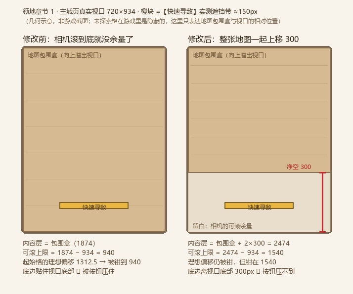

# 占城大师（zcds）表现层与领地专项规范

> **定位与适用范围**：
> - 本文档拆分自 [AI架构与代码规范.md](https://www.google.com/search?q=.%2FAI%E6%9E%B6%E6%9E%84%E4%B8%8E%E4%BB%A3%E7%A0%81%E8%A7%84%E8%8C%83.md) 原第 `7.3.3` ~ `7.3.11` 节，并已完整合并 `AGENTS.md` 截至 2026-10-16 的全部最新规则（含特效 `_lscale` 口径与 row8 胜利结算三段式扫场），是**对局表现层（`app/zcds/view`）与「冒险」领地页（`app/territory`）的唯一完整实现规格书**。
> - 凡涉及对局棋盘图层、地块激活/脉冲/卡牌/建筑动画、特效缩放、飘字曲线、自选主城、开局归属扩散波、胜利扫场、传说卡横幅以及领地页（含领地喷发 / 资源读数）的修改，必须先核对本文档中的**唯一写入口**、**不变量**与**回归测试判据**。

## 模块核心写入口与必跑单测速查表

| 功能域 | 关键文件 / 唯一写入口 | 必跑单测判据（`npx tsx --test <路径>`） |
| :--- | :--- | :--- |
| 棋盘图层与城墙 y 排序 | `ZCGameBoard.prefab` / `ZCGameRenderWorld.boardLayer`、`renderWallSystem` | `tests/zcds-progress.test.ts`、`tests/zcds-render-performance.test.ts` |
| 地块/建筑/资源图标缩放 | `ZCHexView.renderContent`（图标）、`applyBuildingScale`（建筑） | `tests/zcds-tile-icon-scale.test.ts`、`tests/zcds-building-icon-scale.test.ts`、`tests/zcds-resource-icon-scale.test.ts` |
| 中立资源抬层与兵团落点 | `ZCHexView.setResourceIconRaised`、`applyIconPosition`、`layoutResourceUnits` | `tests/zcds-resource-icon-layer.test.ts`、`tests/zcds-resource-unit-preview.test.ts` |
| 地块激活（脉冲∥缩没→卡牌→建筑） | `ZCHexView.hexActivationFx`、`hexPulseShrinkFx`、`applyTileTransform` | `tests/zcds-hex-activation.test.ts`、`tests/zcds-card-reveal-pop.test.ts`、`tests/territory-hex-flip.test.ts` |
| 点击脉冲的 5 帧序列（对齐缩放 / 一次性退场） | `ZCHexView.applyPulseRipple`、`HexFlipPresentation.hexPulseFx`（`pulseFrame`） | `tests/zcds-hex-activation.test.ts` |
| 单位出生抖动 & 建筑产兵/产金抖动 | `ZCUnitView.playSpawnShake` / `ZCHexView.playBuildingShake`、`drainBuildingShakes` | `tests/zcds-unit-spawn-shake.test.ts`、`tests/zcds-building-spawn-shake.test.ts` |
| 新扩展邻格生成动画（与脉冲同起） | `ZCHexView.noteDevelopableSpawn` / `advanceDevelopableSpawn`、`ZCGameRenderWorld.renderDevelopableSpawns` | `tests/zcds-hex-neighbor-spawn.test.ts` |
| 出生 / 受击 / 阵亡特效缩放 | 各特效 `.prefab` 根 `_lscale` / `ZCEffectPool.playSpawnFx`、`playDeathFx`、`playHitFx` | `tests/zcds-hit-fx.test.ts` |
| 受击特效总时长锁 0.15s（加速、无定格） | `ZCEffectPool.HIT_FX_TARGET_SECONDS` / `state.speed`、`ZCGameModel.HIT_FX_SECONDS` | `tests/zcds-hit-fx.test.ts` |
| 出生特效锁总时长 1.25s（speed 由 clip 反推） | `ZCEffectPool.SPAWN_FX_TARGET_SECONDS` / `state.speed` | `tests/zcds-spawn-fx.test.ts` |
| 传说卡出场横幅（金卡 tier 4） | `ZCGameLegendBanner.prefab` / `legendRoleProgress`、`legendRoleEase` | `tests/zcds-legend-banner.test.ts` |
| 「冒险」领地页与台面中心对齐 | `TerritoryPresenter.ts` / `TerritoryMapView.cellCenter`、`applyIconPlacement` | `tests/territory-presenter.test.ts`、`tests/territory-page-split.test.ts`、`tests/territory-cell-center-align.test.ts` |
| 敌方单位顶点色置灰 | `ZCUnitView.applyVisualTint` | `tests/zcds-unit-view-render.test.ts` |
| 自选主城（选择基地模式） | `ZCSpawnSelection.defaultHexFor`、`isPlacing` / `borrowSpawnConfirmButton` | `tests/zcds-spawn-base-confirm.test.ts` |
| 战斗飘字「快进慢出」与收尾漂移 | `ZCFloatTextView` / `floatTextEntrance`、`floatTextFade`、`floatTextDrift` | `tests/zcds-float-text-gold-icon.test.ts`、`tests/zcds-progress.test.ts` |
| 开局归属扩散波 | `ZCClaimWave` / `buildClaimWavePlan`、`ZCHexView.setClaimWave` | `tests/zcds-territory-claim-wave.test.ts` |
| 胜利结算三段式扫场（铺场/回正/脉冲） | `ZCVictorySweep` / `zcDeepFactionColor`、`setSweepOwner`、`appendHexPulseOutlineSegments` | `tests/zcds-progress.test.ts`、`tests/zcds-outline-layer.test.ts` |
| **废墟地块底色按归属方混合灰**（2026-10-29） | `ZCTheme.zcRuinsFactionColor` / `ZCHexView.territoryTint`（`ZCHexView.TERRITORY_FILL_ALPHA`） | `tests/zcds-ruins-tile-color.test.ts` |
| **废墟建筑不再产金**（主城那一路原来无条件发钱，2026-10-29） | `ZCEconomySystem.tickIncome` / `isIncomeSource`、`isBuildingOperational` | `tests/zcds-ruins-income.test.ts` |
| 开局金矿格整圈描边呼吸（绿色 · 9px · 棋盘最上层） | `ZCGameViewUtil.zcNeutralHintAlpha` / `ZCHexView.strokeHintOutline` / `ZCGameRenderWorld.ensureHintOutlineGraphics` | `tests/zcds-neutral-hint-outline.test.ts` |
| 对局中立资源奖励**格心金币喷发**（12 枚 · ±26° · 翻面）+ 读数在上方 40px（2026-10-26，替换旧「飞向金币栏」） | `model/ZCNeutralBurst.zcNeutralBurstLaunch / zcNeutralBurstParticle / zcNeutralBurstLabelFrame` / `view/ZCNeutralRewardFx`（金币段） / `ZCBattlePresentationQueue.ZC_NEUTRAL_REWARD_TOTAL_SECONDS` | `tests/zcds-neutral-reward-fx.test.ts` |
| 领地随机资源格「翻开」（**原地碎裂**，2026-10-16 起只剩这一套） | `core/hex/HexFlipPresentation.hexShatterFx` / `TerritoryHexFlip.applyFace`、`applyReveal` | `tests/territory-hex-flip.test.ts` |
| 领地建筑**生成抖动**（先 Y 后 X，120%）+ **展示滞后到翻转结束** | `core/hex/ShakePresentation` / `TerritoryStationView.playBuildingShake`、`TerritoryMapView.pendingBuildingReveal`、`ITerritoryStationRender.hidden` | `tests/territory-building-shake.test.ts` |
| 领地「获得银币 / 体力」**格心抛物线喷发（12 颗 · ±26° · 自身上下翻面）** + 读数在其**上方 40px**（row17，2026-10-17 细化） | `model/TerritoryResourceGain.territoryBurstLaunch / territoryBurstParticle` / `view/TerritoryGainBurst` / `TerritoryMapView.playResourceGain`、`ensureBurstRoot` | `tests/territory-resource-gain.test.ts` |
| 领地奖励**图标解析**：`roleProperty` + `item` **两张表**、`item` 图在 `main-pages` 分包 + 随机格**读数合成一条**（2026-10-26） | `ResTypes.resBarCellOfRefId` / `ResTypes.resBarIconSpritePath` / `MainTerritoryMap.ensureRewardIcon`、`refRows` / `TerritoryMapView.playResourceGain` 的 `readout` | `tests/res-types.test.ts`、`tests/territory-resource-gain.test.ts` |

## 对局资源与控制器生命周期（2026-10-30）

- 匹配、大地图、章节地图均通过 `createZCBattlePreload(battle, options)` 准备对局；入口只交战斗 Promise、人数与波次，不再注入独立 AssetService / ConfigService。
- 战斗准备创建 `ComponentController`，沿用 `ControllerBase` 从既有 GameContext 取得必需服务、优先使用会话复用资源。加载器只接收统一的只读资源契约。
- `ZCGamePreload` 独立 scope 归属加载资源和准备控制器。取消或失败释放；移交后匹配退出不释放，战斗流程退出才释放。显式 scope 必须穿透控制器的默认 scope。
- 直接进入战斗时，`ProcedureGame.onPreload` 将准备控制器登记到本次流程 scope；取消后不得写入 preparedResources。流程上下文缺失须明确报错。
- `ZCGame` 单独持有运行时补图控制器，玩家头像、角色卡面、首领头像及结算奖励图经其 AssetService 加载；继续复用公共头像解析、图标缓存和奖励换算规则。异步返回仍检查离场状态，`shutdown()` 先关闭弹窗和展示节点，再释放控制器并清空帧表，重复退出幂等。
- 回归：`tests/zcds-controller-resources.test.ts`、`tests/battle-preparation-entry.test.ts`、`tests/zcds-matching-preload.test.ts`、`tests/zcds-game-preload.test.ts`、`tests/zcds-map-loading.test.ts`、`tests/zcds-sprite-frame-loader.test.ts`、`tests/cocos-resource-lifecycle.test.ts`、`tests/controller-resources.test.ts`。

## 1. 对局棋盘的图层结构与地块表现（`ZCGameBoard.prefab`）

### 1.1 声明式棋盘图层（代码不拼层）与城墙排序

`ZCGameRenderWorld` **禁止在代码中 `new Node` 拼图层**。地图层下的结构固定声明在 `ZCGameBoard.prefab` 中，**子节点顺序 = 渲染顺序**（后画的压在上面）：

```text
mapLayer（= ZCGameHUD.prefab 的 content）
└─ ZCGameBoard          ← ui/game/ZCGameBoard.prefab（ZCGameLoader 加载 → ZCGame 实例化后挂进来）
   ├─ MapWater          水面：cc.Graphics，矩形在 initialize 里按地图包围盒画
   ├─ HexLayer          地块实例挂这里
   ├─ OutlineLayer      整盘共享的领地轮廓：一个 cc.Graphics（ZCOutlineLayer 逐边描线）
   ├─ (ZCGameWallLayer) ← 城墙砖层来自独立 prefab，initialize 时插到 OutlineLayer 之后（outlineLayer.getSiblingIndex() + 1）
   ├─ ResourceLayer     中立资源图标：从地块节点里抬上来的（压得过墙砖，防图标被墙线切断）
   ├─ DecorLayer        自由装饰：ZCGameDecor.prefab 的条目挂这里
   ├─ BuildingOverlay   建筑剪影（从地块节点里提升上来的）
   └─ CooldownOverlay   生命条 + 冷却圈
```

- **硬约束**：
  1. 层的引用一律走 `board.getChildByName('<层名>')`（`ZCGameRenderWorld.boardLayer()`），严禁再用 `siblingIndex` 现算层序或 `new Node` 建同名层。
  2. 城墙层插入锚点必须是 `OutlineLayer + 1`（若插在 `HexLayer + 1` 会导致轮廓线从墙砖里穿出来）。
  3. 各层（含水面）的 `layer` 必须全部为 `UI_2D`。
  4. `destroy()` 只摘 ECS 实体与装饰节点；**board 与城墙层归调用方（随 HUD 销毁）**，渲染层内严禁拆毁。
- **中立格只做矢量绘制（2026-10-16）**：中立格**不铺地块底图**（`ZCHexView.NEUTRAL_FILL_ALPHA = 0`，
  `setSprite` 见 alpha 0 连 Sprite 都不启用）⇒ 棋盘底图直接透出来；格子感全部由 `OutlineLayer`
  的矢量线提供 —— 中立格自己画**暖棕细线**（`ZCOutlineLayer.NEUTRAL_GRID_LINE_WIDTH/COLOR`，
  半透明深色叠在底图上、颜色随底图走），与阵营交界的那条边仍由阵营方的粗线负责
 （`buildTerritoryBoundaryMasks` 已把它从这一格的 mask 里剔掉）。
- **城墙砖全盘按屏幕 y 降序排列**：
  - `ZCGameRenderWorld.renderWallSystem` 在铺砖前必须把**全盘**墙段按 `segment.y` **降序**排一遍（y 小的后画 ⇒ 越下方的城墙层级越高、恒压住上方的城墙）。
  - ⚠️ **必须整盘一起排**，严禁按格或按连通簇分段排（分段会让环形城墙接角处的上下关系随遍历顺序漂移，出现“有的角对齐、有的角带台阶”）。
  - ⚠️ 排序会打乱 `segmentIndex` 与六边形 edge 的对应关系，共享材质帧槽号也按新顺序分配 ⇒ 单测必须**按落点坐标反查边号**，不得写死 `records[edge]` 或 `rightUp = 0`。
- **判据**：`tests/zcds-progress.test.ts`（图层顺序与 `_layer`）、`tests/zcds-render-performance.test.ts`（跨格城墙按屏幕 y 降序）、端到端探针 `tmp/_board_probe.mjs`。

### 1.2 地块图标缩放、中立资源抬层与落点

- **地块与建筑图标缩放由代码唯一决定（只改 Prefab `_lscale` 会被静默覆盖）**：
  - `iconSprite` 同时承载地块类型图标（`icon_jk/by/wh/em`）与中立资源点图标，唯一缩放写入口为 `ZCHexView.renderContent`：类型图标写 `TILE_ICON_SCALE = 0.8`，资源图标按 `resourceIconScale` 缩放到格子边长。
  - 已建建筑唯一缩放写入口为 `applyBuildingScale`（基准 `BUILDING_ICON_SCALE = 0.72`）。
  - 金币图标 `BuildingLayer/PriceIcon` 与价格数字 `BuildingLayer/IconLabel` **不参与**上述缩放。
  - **判据**：`tests/zcds-tile-icon-scale.test.ts`、`tests/zcds-building-icon-scale.test.ts`、`tests/zcds-resource-icon-scale.test.ts`。
- **中立资源图标必须抬到 `ResourceLayer`（防邻格切边）**：
  - **物理原因**：地块整图 130×119、格距仅 92.25×90（相邻格整图重叠）；资源图标 128×128 大于地块顶面 123×90，若留在格节点内必然被后画的邻格沿格边线齐刷刷切掉一半。
  - **唯一入口**：`ZCHexView.setResourceIconRaised`（唯一写 `parent` 入口）将其抬至 `ResourceLayer`，并由 `applyIconPosition`（唯一写坐标入口）换算为棋盘层局部坐标（`格节点位置 + BuildingLayer 偏移 + 图标偏移`）。
  - 地块类型图标字形仅 33×33 落在顶面内，**不抬层**。激活表现的「整格隐藏」段需在 `applyActivationFx` 中同步控制已抬层资源图标的显隐。
  - **判据**：`tests/zcds-resource-icon-layer.test.ts`。
- **地块类型图标落点与兵团资源落点**：
  - `ZCHexView.DEFAULT_TILE_ICON_POS` 与 `ZCGameHex.prefab` 的 `BuildingLayer/BuildingIcon._lpos` 必须同值：当前 `y = 4`（下界 `y >= 1.4`，再小会切到底部 `y = -26.376` 的金币图标）。注意 `BuildingLayer` 挂有 `cc.Widget`，运行时局部 `y = 15.101`（早期注释中的 `2.342` 已作废）。
  - 中立兵团资源点（`unit_cap`）格内兵团纵向落点为 `ZCHexView.RESOURCE_UNIT_POS_Y = 12`（横向间距 `RESOURCE_UNIT_SPACING = 16`、目标高 `RESOURCE_UNIT_TARGET_HEIGHT = 48.6` 保持不变），防止小兵陷进地块下半部被侧壁遮挡。
  - **判据**：`tests/zcds-resource-unit-preview.test.ts`。

### 1.3 地块激活表现：点击动画（阶段 1 脉冲 → 阶段 2 缩没，0.7s）→ 卡牌弹出 → 建筑同拍由小变大

`ZCHexView.hexActivationFx` 将总时长 `ZC_HEX_ACTIVATION_SECONDS = 1.856s` **按秒切成两段**（总长由固定段长相加得出：`ZC_HEX_ACTIVATION_SECONDS = ZC_CARD_START_SECONDS(0.7) + ZC_CARD_REVEAL_SECONDS(1.156)`；卡牌段固定 `1.156s` 以保证淡出窗恒大于建筑生长时长，与点击动画段解耦）：

| 阶段 | 时间窗口 | 核心行为与不变量 |
| :--- | :--- | :--- |
| **① 点击动画段** | `[0, ZC_CARD_START_SECONDS = 0.7s)` | 合成函数 `hexPulseShrinkFx`，**两阶段先后**（2026-10-19）：<br>**阶段 1** `[0, 0.2s)` 只播脉冲 —— `GroundGlow` 按 `pulseFrame` 播 5 帧美术序列（10fps、一道波 `0.5s`；放大与淡出**烘焙在图里**），格子连图标 + 价格数字**原尺寸不动**（`tileScale` 恒 1）；<br>**阶段 2** `[0.2s, 0.7s]` 脉冲继续（0.5s 处自然退场），格根同时原地等比缩至 `0.1`。全程 `tileLift = 0` 零位移、`buildingPopScale = 0` 保持开发前价格外观 |
| **② 卡牌弹出段** | `[0.7s, 1.856s)`（长 `1.156s`） | `0.7s` 当帧显形（`now < startedAt` 时写绝对 `node.active = false`，严禁可见静止干等），按 `elasticPopScale`（`0.2 → 峰值 1.2 → 下探 0.92 → 1`）弹出，`progress = 0.62` 起淡出 |
| **③ 建筑同拍生长** | 卡牌最后 38% 淡出窗（`0.43928s`）内 | 卡牌开始淡出那刻地块原尺寸回场，建筑在 `ZC_HEX_BUILDING_SECONDS = 0.36s` 内从 `0.15` 经同一条 `elasticPopScale` 长到 `1`（`0.36 < 0.43928` 保证卡牌淡完时建筑已长齐） |

- **点击动画段六条硬约束**：
  1. **只由缩没写格根 `tileScale`**：`hexPulseFx` 的 `tileScale` 恒为 `1`；缩没由 `hexPulseShrinkFx` 在 **阶段 2** 才写入 —— 起点 `HEX_PULSE_SHRINK_START_SECONDS = 0.2s`（= 5 帧里的**中间帧**第 2 帧开始那一刻，`HEX_PULSE_FRAME_SECONDS × 2`，别写成 `WAVE/2` 差半帧），跨度 = `ZC_HEX_SHRINK_SECONDS - 0.2 = 0.5s`，末刻收到 `HEX_SHRINK_MIN_SCALE = 0.1`。**段长仍恒 0.7s**（卡牌弹出 / 首批兵 / 邻格按住窗都锚它），严禁把整段也改成 0.5s。
  2. **脉冲层必须抵消父节点缩放与位移**：脉冲节点 `GroundGlow` 是格根的子节点，格根缩小时，`applyPulseRipple` 必须写入 `局部缩放 = 对齐换算 / 格根缩放`、局部 y 写入 `ZC_LAND_TOP_CENTER_LIFT / 格根缩放`。对齐换算是**常量**：把美术图里 `164×142` 的本体摊成格面 `123×90` ⇒ `x = 123/164`、`y = 90/142`（本项目格面 1.367 比正六边形 1.155 更扁，**不许等比**）。节点 `contentSize` 必须按整张 `320×320` 画布给（波最大约 `292×253`，只给格面尺寸会把波挤扁）；离开脉冲段由 `restorePulseLayer` 把缩放归 1、`contentSize` 写回 prefab 的 `130×239`。
  3. **只换帧，不叠 scale / opacity**：美术已把放大（1.00 → 1.78）与不透明度（70% → 15%）烘焙进图，`hexPulseFx` 只产出 `pulseFrame`（5 帧、10fps、`0.1s/帧`）；**不许**在节点上再写缩放 / 透明度动画（等于放大两次、虚化两次），也不再使用 `shaders/hex-pulse.effect` 的径向虚化（旧 30 帧 `fkz_*` 那套已整条退役）。一道波 `0.5s` 播完 ⇒ `pulseFrame = HEX_PULSE_FRAME_HIDDEN(-1)` 直接退场，段尾剩下 `0.2s` 只有缩没在走（**不许**举着末帧当静止波）。
  4. **全程零位移（`tileLift = 0`）**：保持地块与图标中心点坐标不变；底光序列帧（依赖 `tileLift > 0`）与换父置顶（`setRaised`）在对局点击段天然不触发，**严禁为点亮底光而把 `tileLift` 改回非零**。
  5. **无卡牌路径（`hasCardReveal = false`）**：点击动画（两阶段）照常播放，播完直接回常规定格（`HEX_FLIP_IDLE_FX`），不进隐藏段。
  6. **浮点容差与负数保护**：段末比较必须带 `HEX_ACT_SECONDS_EPSILON = 1e-9`；`progress < 0` 必须先返回 idle，严禁交给 `clamp01` 折成 0（否则会把正常建筑 `buildingPopScale` 置 0 藏起来）。
- **判据**：`tests/zcds-hex-activation.test.ts`（含阶段 1 `tileScale` 恒 1、阶段 2 才缩且末刻到 0.1、`pulseFrame` 按 10fps 等宽推进 / 播完退场、对齐缩放恒定、零位移、淡出窗 > 建筑生长时长）、`tests/zcds-card-reveal-pop.test.ts`、`tests/zcds-building-icon-scale.test.ts`、`tests/territory-hex-flip.test.ts`。

### 1.4 单位出生抖动、建筑产兵/产金抖动与新邻格生成动画

- **单位出生抖动（110%）**：
  - `ZCUnitView.playSpawnShake(now)` 只记起点，`render` 按 `now - 起点` 调 `spawnShakePulse`（先 Y 轴拉至 `1 + SPAWN_SHAKE_STRETCH(0.1) = 1.1` 回落，再 X 轴拉至 `1.1` 回落，各 `SPAWN_SHAKE_PHASE_SECONDS = 0.12s`），叠乘在朝向翻转之上（含描边副本 `applyOutlineCopyScale`）。由 `renderUnitEntity` 的 `isBirth` 分支触发。
  - **判据**：`tests/zcds-unit-spawn-shake.test.ts`。
- **建筑抖动（产兵 + 产金共用曲线，拉伸量 120%）**：
  - 详见第 9.5 节：`ZCHexView.playBuildingShake(now)` 使用 `BUILDING_SHAKE_STRETCH = 0.2`（120%），因子乘进唯一写入口 `applyBuildingScale`，挂 `renderDynamic` 逐帧推进。
  - **判据**：`tests/zcds-building-spawn-shake.test.ts`。
- **新扩展邻格生成动画与脉冲同步（2026-10-26 改口径，**取代** row6 的 0.9s 按住窗）**：
  - 需求原话：「战斗中，新格子的生成动画和地块脉冲动画同步播放」。旧口径「延迟 0.2s、等卡牌生成动画开始后再展示」（`ZC_HEX_NEIGHBOR_HOLD_SECONDS = ZC_CARD_START_SECONDS + 0.2`）已**删除**，不要加回来。
  - **不再按住**：新点亮邻格的图标 / 价格数字 / 玩家色染色 / 共享轮廓描边在**点击那一拍**就跟脉冲一起出现（渲染世界与地块视图在同一次静态刷新里各自写，天然同帧，见第 9.2 节）。
  - **生成动画**：只动 `buildingLayer`（= 地块图标 + 价格图标 + 价格数字的容器）。缩放沿 `elasticPopScale(t, DEVELOPABLE_SPAWN_FROM_SCALE = 0.6)`（`1.2` 峰值 → `0.92` 下探 → `1`），透明度走 `developableSpawnOpacity`（前 `DEVELOPABLE_SPAWN_FADE_END = 0.55` 线性淡入，之后恒 1）。时长 `ZC_HEX_NEIGHBOR_SPAWN_SECONDS = HEX_PULSE_WAVE_SECONDS = 0.5s`，与那道波**同起同收**；**别**把它写成脉冲段长 0.7s（那会把邻格拖到卡牌起点之后才长齐）。
  - **起点锚脉冲起点**：`ZCHexView.noteDevelopableSpawn` 只在 `canDevelop` **由假变真**那一拍登记，起点取 `presentation.developPulseStartedAt`（渲染层用本帧 `hexActivations` 里最新的 `startedAt` 填），拿不到才退回 `now`。⚠️ 锚 `now` 会让生成动画整体滞后于脉冲（地块走 0.15s 静态节流）。
  - **逐帧推进**：`ZCGameRenderWorld.renderDevelopableSpawns`（挂 `renderDynamic`）+ `developableSpawnHexes` 集合，与 `renderBuildingShakes` 同款：`renderHexSystem` 里 `isDevelopableSpawning()` 入队、`advanceDevelopableSpawn` 返回 `false` 出队并复位 1 / 255。
  - `UIOpacity` **懒挂**在 `buildingLayer` 上（只有真播过生成动画的格子才多这个组件）；`initialize` 必须复位 `developableSpawnStartedAt / lastCanDevelop / developableBootstrapped`，并调 `applyDevelopableSpawn(0)` 把缩放 / 透明度落回基准。
  - **判据**：`tests/zcds-hex-neighbor-spawn.test.ts`。

### 1.5 特效（出生光柱 / 受击 / 阵亡）的显示大小由 Prefab 根 `_lscale` 唯一决定

与地块/建筑图标（由代码定缩放）**正好相反**，特效的显示尺寸完全归属美术 Prefab 根节点 `_lscale`，**在代码里写 `setScale` 或 `setPosition(0,0,0)` 会静默破坏表现**：

| 特效类型 | 图片像素 / 固定显示画布 | Prefab 根 `_lscale` | 屏上显示尺寸 | 代码端硬约束（`ZCEffectPool`） |
| :--- | :--- | :--- | :--- | :--- |
| **出生特效** | 110×137 / 266×330 | `0.4144` | 110.2×136.8（基准宽 ~110px） | `playSpawnFx` **严禁写 `setPosition` 或 `setScale`**（Prefab `_lpos = (0, -28.2)` 是美术将光柱重心从头顶压到胸口的偏移，写 `(0,0,0)` 会静默覆盖） |
| **受击特效（五组）** | 约 62–77px / 原显示画布 | 按原图折算后再 **×0.7** | 屏上宽 **77px**（战士 61.6，= 110 基准 ×0.7 ×0.8） | 缩图后固定显示画布，改大小只动 Prefab `_lscale` |
| **阵亡特效（唯一例外）** | 88×180 / 535×1092 | **`0.16448`**（`= 0.2056 × 0.8`） | **88×179.6**（比 110px 基准小 20%） | `playDeathFx` 只写 `x/y`（阵亡 Prefab `_lpos` 本就是 `(0,0,0)`），**严禁写 `scale`**（池化复用节点每播一次乘一次会逐次缩水；且**严禁顺手把阵亡特效“统一口径”改回 110px**，它刻意缩小 20% 以免抢单位本体视觉重心） |

- **2026-10-28 用户要求降低资源包**：出生、五组受击及阵亡特效帧按常规显示尺寸缩图；Sprite 改为 `CUSTOM` + `trim=false`，保留原 UITransform 画布、根缩放、位置与帧 UUID。逐帧换图不得让画布跟着新图像素尺寸变化。
- **判据**：`tests/zcds-hit-fx.test.ts`（同一条用例同时断言**缩放倍数**与**屏上像素尺寸**，防止原图基数变动漏检）。 `tests/zcds-unit-fx-resolution.test.ts` 核对缩图和固定画布。

### 1.6 受击特效：总时长锁死 0.15s，且不许有定格（2026-10-17）

三条硬约束，缺任何一条都会出现「闪一下之后还剩一坨末帧杵在角色身上」：

| 关注点 | 唯一真源 | 说明 |
| :--- | :--- | :--- |
| **总时长 0.15s** | `ZCEffectPool.HIT_FX_TARGET_SECONDS` + `ZCGameModel.HIT_FX_SECONDS` | 两处必须同值（视图层不 import 模型层常量）；`tests/zcds-hit-fx.test.ts` 有源码级断言钉住 |
| **加速而不是截断** | `state.speed = clip.duration / 0.15` | 资产 `_duration` 仍是美术真值「帧数/18fps」（射手 0.4444s、法师 0.7222s）。改 `clip.duration` / `state.duration` 是**丢帧**，改 `speed` 才是加速 |
| **回收点跟着加速后的时长** | `playHitFx` 里 `duration: HIT_FX_TARGET_SECONDS` | 还按 `clip.duration` 回收 ⇒ 动画 0.15s 就播完、节点留到 0.44s，`wrapMode = Normal(1)` 把**末帧定住** |

- **`play()` 必然 seek 回 0**：`Animation.play(name)` → `crossFade(name, 0)` → `clear()` → `AnimationState.onPlay()` → `setTime(0)`。所以 ① 池化复用节点不会先闪一帧旧画面，无需额外 `stop()`；② **渲染循环里绝不能逐帧调 `playHitFx`**，必须走 `syncHitFx` 按 fx 对象引用去重，否则动画被钉死在第 0 帧。
- **`speed` 只在 `AnimationState.initialize()` 里从 `clip.speed` 取一次**，`play()` / `stop()` 都不重置 ⇒ 每次播放重算 `clip.duration / 0.15` 是幂等的，池化复用不会累乘。3.8.8 的 `play(name?)` **没有** `startTime` 第二参（`animation-component.ts:200`）。
- **判据**：`tests/zcds-hit-fx.test.ts`（`state.speed` 逐个职业断言 + 0.149s 未回收 / 0.15s 必回收 + 两处常量同值）。

### 1.7 出生特效：锁总时长 1.25s（2026-10-19，两次收紧）

用户口径两轮：「播放速度加快，动画总时长缩短成 80%」（2.0s → 1.6s）→「再加速，**1.6s → 1.25s**」。

- **唯一真源** `ZCEffectPool.SPAWN_FX_TARGET_SECONDS = 1.25` —— **锁总时长**，倍速由 clip 反推：
  `state.speed = clip.duration / 1.25`（美术原速 2.0s ⇒ **1.6×**，24 帧 / sample 12）。
  和受击那 0.15s 是同一套做法（见 §1.6）：只动 `speed`，**不改资产 `_duration`**
  （那是「帧数 / sample」的美术真值，改它等于把后半段关键帧丢掉，时间戳不会重排）。
- **回收点就是目标时长**：`duration = SPAWN_FX_TARGET_SECONDS`。`wrapMode = Normal(1)` 播完会**停在末帧**，
  还按 2.0s 回收就多出 0.75s 冻住的残影。拿不到 clip 时也按这个值占位。
- ⚠️ 尺寸 / 位置仍归 Prefab（§1.5），加速**只碰 `speed`**，别顺手写 `setScale`。
- **判据**：`tests/zcds-spawn-fx.test.ts`（`state.speed === 1.6`、1.2s 不回收 / 1.25s 必回收）。

### 1.8 中立资源奖励：**格心金币喷发**（2026-10-26，替换旧「飞向金币栏」）

需求原文（2026-10-26 截图）：「点击地块后，资源奖励**粒子喷发**的动画丢失了，重新找回实现，
喷射对应的粒子资源的动画」。

也就是：**点开出金币堆 / 宝箱那一格 ⇒ 从格心喷出一束金币（抛物线倒锥 + 自身上下翻面）**，
「+N」读数在这一束的**上方 40px** 同步升起并淡出。

#### 一、为什么动的是这一段

2026-10-20 那版是 `ZCNeutralRewardFx` 把一把金币从格子**拉到 HUD 金币栏**（`+N` 也在栏位上飘）。
用户给的截图却是**格子原地喷一束**，读数也在格子上方 —— 和领地页 §3.5 那条喷发同一个观感。
两条是**同一次反馈**，叠加播放会变成「喷完还要再飞一遍」，所以这里**替换而不是叠加**
（2026-10-26 用户三选一确认：只要格心喷发）。

⇒ 结论：**金币段不再需要 HUD 落点**。`IZCNeutralRewardFxTargets` 里已经**没有** `goldCounter`，
`ZCGameRenderWorld` 的 `goldCounterNode` 选项也已删掉（不要再加回来）；只有神器那条还飞向神器按钮。

#### 二、分工表

| 需求里的东西 | 落点 |
| :--- | :--- |
| 「喷发多个图标」 | `ZC_NEUTRAL_BURST_COUNT = 12` 枚粒子（**每枚都是一张金币图**，不是一颗带动画的图） |
| 「倒圆锥」 | `ZC_NEUTRAL_BURST_HALF_ANGLE_DEG = 26` —— 约束的是**出射方向**与竖直轴的夹角 |
| 「喷发坐标点 = 点击地块中心」 | `ZCNeutralRewardFx.buildEntry`：金币段的根节点 `setPosition(start.x, start.y)`，其余位移都写子节点局部坐标 |
| 「数字 ui 在上方间隔 40px」 | `ZC_NEUTRAL_BURST_LABEL_LIFT_PX = 40`，读数节点 `setPosition(0, 40 + rise.offsetY)` |
| 「icon 自身上下翻面」 | `zcNeutralBurstParticle` 的 `scaleX / scaleY`，视图只 `setScale(scaleX, scaleY, 1)` |

#### 三、曲线参数（与领地同值 —— 两张图共用 `core/hex/HexGridLayout` 的 123×90 格面）

| 符号（`model/ZCNeutralBurst`） | 值 |
| :--- | :--- |
| `ZC_NEUTRAL_BURST_COUNT` | `12` |
| `ZC_NEUTRAL_BURST_HALF_ANGLE_DEG` | `26` |
| `ZC_NEUTRAL_BURST_SPEED` / `_SPEED_JITTER` | `650` / `0.12` |
| `ZC_NEUTRAL_BURST_GRAVITY` | `1500` |
| `ZC_NEUTRAL_BURST_STAGGER_SECONDS` | `0.025`（12 枚铺开 0.275s，**绝不同一帧全冒出来**） |
| `ZC_NEUTRAL_BURST_LIFE_SECONDS` / `_LIFE_JITTER` | `1.1` / `0.15` |
| `ZC_NEUTRAL_BURST_FADE_SECONDS` / `_SURFACE_FADE_SECONDS` | `0.25` / `0.12` |
| `ZC_NEUTRAL_BURST_SCALE_JITTER` | `0.2`（基础缩放 0.8~1.2） |
| `ZC_NEUTRAL_BURST_FLIP_MIN_HZ` / `_MAX_HZ` | `2` / `4` |
| `ZC_NEUTRAL_BURST_LABEL_*` | `SECONDS 1.15` / `RISE_PX 96` / `LIFT_PX 40` / `ENTRANCE_RATIO 0.32` / `POP 1.18` / `FROM 0.6` |

🔴 **三条红线**（与 §3.5 同一套，别在对局里另出新口径）：

1. 轨迹用**解析式** `y = vy·t − ½·g·t²`，**不写成逐帧累加**（落点会随帧率漂）。
2. 抖动**不用 `Math.random()`**：同一 `(seed, index)` 必须恒等。`seed` 取事件 id（每次发奖都不同）。
3. **翻面只压 `y`**：`setScale(baseScale, baseScale·cos, 1)`；叠 `angle` 会读成「一边翻一边歪」。
   另外 **落地后位置冻住**（横向也不许再滑，否则读成「贴着地皮滑一段」）。

⚠️ **金币事件的总时长必须盖住整段喷发**：`ZC_NEUTRAL_REWARD_TOTAL_SECONDS` 取「神器飞行」与
`zcNeutralBurstTotalSeconds(12)`（≈1.54s）里**较长**的那条。旧值是 1.4s —— 比喷发还短，
模型 `prune` 会先一步把事件摘掉 ⇒ 实机正是「粒子刚喷出来整束消失」。

#### 四、判据

`tests/zcds-neutral-reward-fx.test.ts`（19 条）：队列时长必须 ≥ 喷发上限；出射确定性 / `|phi| ≤ 26°`
/ `|vx|/vy ≤ tan26°` / 初速 ±12% / 左右都铺开且 200 次喷发整体无水平偏向；抛物线上升段单调、
`y ≥ 0` 不穿模、峰值 ≈ `vy²/2g`、落点横向不超 `4·tan·apex`；错峰（首帧最多 1 枚）；落地横向纵向
都冻住且 0.12s 淡出后为 `null`；翻面三态齐全、`scaleX` 恒等、相邻帧无硬切、12 枚不同步；读数
`t=0` 就在（**不等最后一枚落地**）、easeOut 上飘、末段淡出；特效类整喷落在格心、12 枚 + 1 label、
无 HUD 落点也照喷、事件过期即销毁；源码级别不许出现 `tween(` / `instantiate(`。

#### 五、神器领取的格心爆炸：屏上边长 **90px**（2026-10-27）

`ZC_ARTIFACT_CLAIM_BURST_SIZE` 只决定**屏上大小**（`Sprite` 是 `CUSTOM` + `trim = false`，按 `UITransform` 拉满），与源图像素无关；2026-10-28 按用户要求将 18 帧从 300×300 缩至 90×90，原始尺寸仅用于下方历史问题说明。取值演进：

| 日期 | 值 | 口径 |
| :--- | :--- | :--- |
| 初版 | 220 | ≈1.7 格 —— 盖住邻格资源图标与造价数字 |
| 2026-10-26 | 150 | ≈1.15 格（「特效太大了」第一次收） |
| **2026-10-27** | **90** | **0.6 × 150，稳在一格之内**（0.73 × 顶面 123） |

- **上限口径**：一格顶面 `123×90`（`core/hex/HexGridLayout`）、地砖脚印 `130×119`（`ZCGameHex.prefab` 的 `TileBackground`），取最紧的 **123** 当红线 —— 用例直接断言 `≤ 123`。
- 🔴🔴 **这三次改动在屏上全都没生效过（2026-10-27 二次返工查出）**：`ZCNeutralRewardFx.createSprite`
  原来是「先 `transform.setContentSize(size)` → `addComponent(Sprite)` → **赋 `spriteFrame`** → 最后才
  `sizeMode = CUSTOM`」。`Sprite._sizeMode` 出厂是 `TRIMMED`，**赋图那一刻**引擎走
  `_applySpriteFrame() → _applySpriteSize()`，TRIMMED 分支直接 `setContentSize(rect.width, rect.height)`
  把节点写成**原图 300×300**；而 `sizeMode = CUSTOM` 的 setter 只在非 CUSTOM 时重算，**不会把尺寸还回来**。
  ⇒ 用户看到的始终是 300px（≈2.4 格），所以「怎么改都没变小」。
  修法：**先 CUSTOM + `trim = false` → 再赋 `spriteFrame` → 最后兜一次 `setContentSize`**。
  同一个 helper 建的三样都受影响，修好后一起生效：爆炸 300 → **90**、神器图标 230 → **40**
  （`ZC_NEUTRAL_REWARD_ARTIFACT_SIZE`）、金币 43 → **34**（`ZC_NEUTRAL_REWARD_COIN_SIZE`）。
- ⚠️ **别只用 `contentSize` 断言**：测试夹具里的 `cc.Sprite` 是空类，不模拟这条回写 ⇒
  「先设尺寸后 CUSTOM」的老写法在桩里照样绿。用例现在额外钉**赋值顺序**
  （`sizeMode` 的位置必须早于 `spriteFrame`，兜底的 `setContentSize` 必须晚于它）。
- 🔴 **问号状态不跟着缩**：图 1 那个「六边形底 + 问号指示器」是 `ZCHexView.artifactHexSpine`（prefab 里 **168×166.8**、Spine 循环动画，`artifact_charge` 专用），代码只切显隐与动画名、**一行尺寸都不写** ⇒ 改爆炸常量动不到它。
- 判据：`tests/zcds-artifact-claim-burst.test.ts` 的「爆炸屏上边长 90px（0.6 × 150、不超一格），问号态的六边形 Spine 尺寸不动」——同时钉住 `90 == 0.6 × 150`、`≤ 123`、节点实际 `contentSize`、`createSprite` 的赋值顺序、以及 `ArtifactHexSpine` 仍为 168×166.8。

### 1.9 废墟：底色按归属方混合灰，且**不再产金**（2026-10-29）

用户口径两条：

> 1.「战斗中形成废墟后，废墟的地块颜色需要和归属玩家的一致」
> 2.「形成废墟的建筑不会再生产金币，现在前端还有播放金币生成的动画」

**① 底色（`ZCHexView.territoryTint` + `ZCTheme.zcRuinsFactionColor`）**

- 改前：`state.state === 'ruins'` 时**无条件**返回 `ZC_CLIENT_COLORS.ruins`（`#5E656C` 一块中立灰），
  `state.owner` 完全没参与取色 ⇒ 谁的地被打成废墟都变成同一块灰，看不出这块废墟原来属于谁。
- 改后：`zcRuinsFactionColor(owner)` = **阵营色往废墟灰里线性混 `ZC_RUINS_GRAY_MIX = 0.45`**。
  实测 我方 `#7e82ff → #7075bd`、敌方 `#fb4969 → #b4566a`、3 号 `#fbcc49 → #b0a05a`、4 号 `#bd49fb → #8f56bd`。
  `0` = 跟完好领地一样（看不出废了）、`1` = 退回老 bug（全都一块灰）—— 两端都别取。
- `owner === 'neutral'` **原样返回废墟灰**：中立没有阵营色可混（`zcFactionColor('neutral')` 是浅石板色，
  混出来比灰还亮、反倒像"崭新"），中立废墟就是"没有归属的废墟"。
- alpha 不在函数里写死：`ZCHexView.TERRITORY_FILL_ALPHA` 由视图给，与普通领地同一口径（透明度的语义是
  「这格是不是领地」，不是「是不是废墟」）。取色优先级不变：扫场 `sweepOwner` → 开局扩散波 `claimWave` → 废墟 → 常规。
- 判据：`tests/zcds-ruins-tile-color.test.ts` —— 纯函数逐通道按公式复算、四席位废墟色两两不同、
  视图真的按 `state.owner` 出 `tileSprite.color`、源码守卫禁止再出现 `ZC_CLIENT_COLORS.ruins.r/g/b`。

**② 产金（`ZCEconomySystem.tickIncome`）**

- 🔴 真凶是**主城**那一路：主城收入原来是**无条件**给 `context.owners` 每一方发钱、飘字坐标写死
  `homeId(owner)`。主城被打成废墟（`building='none'` + `state='ruins'` + `hp=0`）之后，只要这一方
  还有别的建筑（`developedCount > 0`，对局没结束），这段循环照跑 ⇒ **废墟格每一拍飘一次「金币 + 数字」、
  还带着建筑抖动**，看起来就是"废墟还在产金币"。
- 金矿那一路本来就有 `building !== 'mine'` 兜着，所以之前只在主城上露出来。
- 修法：主城先 `isIncomeSource(hexById(homeId), 'hq')` 判「主城还在且还在运转」，判不过 `continue`；
  金矿改走同一条闸 `isIncomeSource(mine, 'mine')`。`isBuildingOperational` 同时补齐
  `building !== 'none'` 与 `state !== 'ruins'`（存档 / 回放里两者只其一的脏数据也挡住）。
- **不是"把产金关掉"**：同一时刻还活着的金矿必须照常产出、照常飘字 —— 用例用反向守卫钉住这一点
  （只钉"废墟没有飘字"的话，删掉整条产金也能绿）。
- 判据：`tests/zcds-ruins-income.test.ts` —— 主城废墟 + 旁边活金矿 ⇒ 主城坐标 0 条产金飘字、
  金币增量**恰好**等于金矿飘出的数值之和；金矿废墟同理；外加 `tickIncome` 的赋值顺序守卫。

## 2. 抽到金卡的「传说卡出场横幅」（`ZCGameLegendBanner.prefab`）

抽到 `tier === 4`（金卡/传说）时，除地块上的小卡牌（`ZCGameCardReveal`，挂 `mapLayer`）外，同时在 **HUD 根节点 `options.overlayLayer`** 弹出全屏出场横幅 `ui/game/ZCGameLegendBanner.prefab`（四色底板与头像环按 `ZC_CLIENT_COLORS` 色相匹配 `owner`）。

- **宽度 = 屏幕宽度**（2026-10-19 用户口径「传说牌弹出的 UI 提示应该对齐屏幕的宽度」）：
  `applyLayout` 里 **根节点** = `viewWidth × (屏高 / 人数)`（它是「布局格子」，落位按它算），
  **底板 `Banner`** = `viewWidth × 417` —— 只跟宽度走，**高度永远是 prefab 的 417**，
  并强制回到 `x = 0`。设计稿 720 只是兜底（`DESIGN_WIDTH`）。
  - 只改根不改底板 ⇒ 底图仍是 720 宽、右边留一条缝（一次反馈的画面）；
  - 底板连高度也一起按「格子高」拉伸 ⇒ 2 人局被拉到 640，横幅平白长高一截、底边掉到屏幕中间
    （**另一次**反馈「横幅底部的高度被修改了」）。这两条都是实测踩过的，别合并成一次写入。
  ⚠️ 底板 / 标题 / 头像 / 卡名曾在 prefab 里被整体左移 62.6（左贴边、右空一截），已改回设计位；
  改这条链时别再把 `Banner` 往左挪。

- **四条静默失效硬约束**：
  1. **严禁挂 `mapLayer`**：必须挂 `options.overlayLayer`（HUD 根），否则会随棋盘 ScrollView 拖动并被 Mask 裁切。
  2. **立绘原尺寸**（2026-10-10 口径「不用放大了，就用 256×256」）：23 个兵种立绘均为 256×256 方形原图 ⇒
     `Role` 节点 `sizeMode = RAW(2)`、中心锚点、**视图一行都不写 `scale`**（恒 1）。
     早前「按 `frame.height` 等比缩放到高度 333」的口径已废弃（固定框会把方形原图纵向拉扁 30%）。
  3. **禁 Trim 尺寸覆写**：`CUSTOM` 尺寸的 Sprite 必须 `_isTrimmedMode = false`。
  4. **头像圆裁**：`Head` 节点挂载工程既有的 `CircleAvatar`（shader `circle-avatar`），禁止用 `cc.Mask`。
- **扇入与 Role 下落动画（row11）**：详见第 9.4 节。
- **异步头像晚注入**：`ZCGame.loadLegendPortraits()` 异步加载完成后，渲染层每帧 `renderLegendBanners` 里通过闭包取 `ProcedureGame.current?.resolveLegendPortrait(owner)` 喂给 `view.setPortraitResolver`；解析器更换时作废内容键、立刻重绘已弹出的横幅。加载失败则保留玩家色头像环，不阻断对局。
- **判据**：`tests/zcds-legend-banner.test.ts`、端到端探针 `tmp/_legendbanner_probe.mjs`。

## 3. 「冒险」领地页的职责边界（Prefab 骨架 + 视图 + MVC）

### 3.1 职责切分表

| 关注点 | 唯一归属模块 |
| :--- | :--- |
| 主城地图页骨架、布局、Widget 对齐 | `ui/main/MainTerritoryMap.prefab` + `app/main/MainTerritoryMap.ts` |
| 滚动 / 裁剪 / 拖拽 / 拖动中抑制子节点点击 | `cc.ScrollView`（挂在带 `Mask` 的 `MapViewport`，`content = MapLayer`，`cancelInnerEvents = true`） |
| 六边格 + 站点（按 `cellId` diff 复用） | `view/TerritoryMapView.ts` |
| 站点条目、图标 trim 补偿、未解锁格「银币图标 + 数值」排布 | `ui/territory/TerritoryStation.prefab` + `view/TerritoryStationView.ts` |
| 站点 / 待配置据点详情弹层 | `ui/territory/TerritorySiteDetail.prefab` + `view/TerritorySiteDetailPanel.ts`（页内 `instantiate` 持有，`Panel` 挂空 `cc.Button` 防点击穿透） |
| 配色真源 / 坐标换算 / 协议归一化 | `view/TerritoryTheme.ts` / `model/TerritoryMapLayout.ts` / `model/TerritoryMapConfig.ts` |
| 章节状态与业务规则（纯 TS） | `application/TerritoryModel.ts`，原 `TerritoryPresenter` 仅兼容导出 |
| 网络/缓存订阅、时钟、界面意图与会话生命周期 | `application/TerritoryController.ts`，页面单实例，退出时统一解除订阅并取消异步任务 |
| 章节 JSON、地图美术与弹窗补图资源归属 | `framework/controller/ControllerBase.ts` 提供必需展示资源契约并统一释放，页面不保存可空 AssetService |
| 章节加载器、Repository、存档与 MVC 装配 | `application/TerritoryEntry.ts`，页面传入已绑定 ResourceScope 的资源入口 |
| 引擎生命周期与渲染接线 | `app/main/MainTerritoryMap.ts` 消费展示快照与表现命令、派发操作意图；`MainTabHost.showPage` 必须在 `setParent` 前调用 `initialize(this.controller.resources)` |

章节地图事件释放遵循全局规范 §2.1.1：Controller 退出时退订 UI、网络、缓存与时钟，同步意图 / 广播 / 定时回调不重复判断 disposed。退出前的 `stopping` 仅用于平衡本会话 loading；`await` 后的有效性和取消检查继续保留。测试从事件入口验证解绑，不直接调用已保存的旧 handler。

### 3.2 七条硬口径

章节地图的关卡、首领和异步据点统一两步点击：未解锁且区域未通关时，点击先请求解锁；**主线关卡（stage / boss）解锁回包成功后立刻请求开战、直接进战斗**（2026-10-29 口径「只有解锁那一次直开」），异步据点与绑不到关卡的格子只解锁、不自动弹窗；再次点击**已解锁**站点才打开对应详情（异步据点为「玩家关卡」，主线为「关卡界面」）。已通关区域跳过重复解锁，保留重复挑战入口。验证见 `tests/territory-presenter.test.ts`。

章节地图已解锁的关卡 / 首领 / 玩家据点在建筑上方显示短编号气泡（显示配置中的 `chapterId-stage`，例如 `1-5`，**连字符两侧不留空格**）。2026-10-28 用户指定底图 `image/spawn-region/frame_03`：使用蓝色带尖角原图，88×45、15 号白字，文字局部 y=5 对齐气泡正文；Sprite 先 CUSTOM + trim=false 再赋帧，采用 SLICED 保留边角，白色顶点色保留原图蓝色。同日按美术效果图校正文字样式：字重改**加粗**（美术稿笔画约占字高 25%，常规体只有 14%）、字距走 `spacingX = -1` 收紧（美术稿三字紧贴）、行高 20、字号 15 保持不变（实测字高/气泡高 0.50，美术稿 0.53，差的不是字号）。⚠️ 间距**不许写进字符串**：空格宽度跟字号 / 字体绑定，一旦换字号就会整体漂移；四个样式值统一从 `app/common/MapMarkerBadge` 导出（`MAP_MARKER_BADGE_FONT_SIZE` / `_LINE_HEIGHT` / `_SPACING_X` / `_BOLD` / `_TEXT_Y`），`renderLevelBubble` 必须整组覆盖 —— prefab 里的 `12 / 16 / 常规体` 是旧角标口径，只改字号会留下旧字重与旧字距。美术由 `TerritoryPageAssets` 经页面作用域的 AssetService 加载，`BundleCatalog` 路由到 battle 分包，不从视图加载。底部尖角距建筑可见顶边 3px；跟随 trim 和 `buildSize` 后的可见高度定位。大地图仍使用原有 88×30 编号牌，两边共用 `app/common/MapMarkerBadge` 的宽度、字号和定位函数。未解锁格保留银币条件，资源点及缺少有效建筑 / 气泡帧 / 关卡配置的站点不画气泡。气泡在共享角标层按需创建，`getStationLayers` 必须把角标层移至透明命中层之后，避免相邻行的 128×128 命中区抢走编号点击。点击沿用 `STATION_TAP`，隐藏 / 在途 / 生成淡入与站点同步，回收时统一销毁。判据：`tests/territory-station-batching.test.ts`、`tests/territory-tile-frames.test.ts`、`tests/territory-level-bubble-style.test.ts`（字重 / 字距 / 行高 / 抬升的常量守卫）、`tmp/territory-level-bubble-probe.mjs`（包含真实鼠标点击）。

快速寻敌优先按当前推进顺序定位未通关 Boss；没有未通关目标时，定位当前章节关卡序号最高的已通关 Boss，同区域优先选建筑格。Boss 关卡、首领波次与异步据点允许重复挑战，区域已通关时跳过再次解锁；详情按钮与地图点击均请求服务端开战，保留在途判重与迟到回包校验。主线 Boss / 首领使用章节格子战斗参数；异步据点沿用服务端确认通关后切宝箱子类型的规则，奖励以服务端结算为准。

1. **滚动用 `cc.ScrollView`**：禁止手写触摸拖拽或建多余 `view` 子节点；切章回中心调 `scrollToOffset(Vec2.ZERO, 0)`。
   - **内容层尺寸 = 地图包围盒 + 四周留白**（2026-10-21 用户口径「整体一起上移，不要被按钮遮挡」）。
     唯一出口 `model/TerritoryMapLayout.territoryMapContentSize()`（`TERRITORY_MAP_CONTENT_PADDING = 300`）。
     ⚠️ 留白不是装饰，是**可滚范围**：`ScrollView` 的偏移被「内容层尺寸 − 视口尺寸」钳死，
     内容层 ≡ 包围盒时，贴到地图下边缘的目标格**再大的抬升量也抬不动**（第一章起始格在第 18 行，
     理想偏移 1312.5、上限只有 940，差 372.5 —— 正好是被【快速寻敌】压住的那一截）。
     加了留白后滚到底时地图底边仍在视口底部之上 300px，而且**格心坐标一个都不用动**，
     `buildTerritoryMapLayout` 与共享格心对齐的契约继续成立。
     判据：`tests/territory-map-layout.test.ts`「滚到地图最底部时，底边仍在视口底部之上留白那么多」。
   - 底图 `syncBackground` 的 cover 必须按**内容层尺寸**算，不能按包围盒 —— 否则滚进留白那 300px 会露空白。
   - 效果对照（左：内容层 ≡ 包围盒；右：内容层 + 2×300 留白）：

     
2. **节点按 `cellId` diff 复用**：`tickProgress` 每秒重绘，严禁 `destroyAllChildren` 全量重建。
3. **主城 HUD 与地图分层**：`MainTerritoryMap` 只保留地图与详情弹窗；主城顶部信息与导航由 `ArenaRoot` 承载。地图视口顶部贴页面顶边（`MapViewport.Widget.top = 0`），让格子云延伸到顶部 HUD 背后；底部仍预留 168px 导航区。`ArenaRoot` 的 `MapRoot` 排在 `TopHud` / `BottomHud` 前，确保 HUD 显示与按钮点击在地图之上，禁止再通过顶部视口留白裁掉云。进入地图先渲染本地存档，服务端状态后台单调合并，失败仅 `outputs.showTip`。
4. **`@property` 引用区分**：`{type: Node}` 直接是节点本身，组件引用才访问 `.node`。
5. **运行时不画站点解锁连线**：依赖连线仅存在于地图编辑器 `tools/map-editor/territory.html` 的 `g.layer-links` 开关。
6. **Presenter 纯度与单通知通道**：页内只走 `presenter.subscribe()` 一个**本地订阅**通道（纯 TS、返回退订函数、`dispose` 清空），严禁接全局 `FWEventCenter`；视图间跨组件通知统一走**节点事件**（`node.on` / `node.emit` + `view/TerritoryEvents.ts` 的 `TERRITORY_EVENTS` 常量表），监听挂组件自身节点、随节点销毁自动清理；`TerritoryPresenter` 剥掉 `import type` 后严禁 import `cc`、`framework` 或具体边界实现类。
7. **建筑/站点落在格子可见台面中心（`cellCenter` + trim 补偿 + 可见宽归一 70）**：
   - **台面偏移**：地块底图 `img_land_01_gray`（130×119）可见台面占 `y = 2~91`（高 90px），下方 28px 为侧壁；锚点在整图中心 `y = 59` ⇒ 台面中心比锚点高 `HEX_GRID_CONTENT_LIFT = 12.5px`。因此 `TerritoryMapView.cellCenter()` 必须返回 `{ x: point.x, y: point.y + HEX_GRID_CONTENT_LIFT }`（注意：`syncGrid` 中格子节点自身坐标仍为 `(point.x, point.y, 0)`，只偏移格内建筑/站点内容）。
   - **逐图 trim 偏移补偿与可见宽归一（`TerritoryStationView.applyIconPlacement`）**：读取动态合批安全的 `frame.rect / originalSize / offset` 补偿美术非对称留白，并将**trim 后目标可见宽统一归一为 `84`**（2026-10-19 用户要求「当前尺寸调大 120%」：70 × 1.2；可见高 65~75，占台面高 90 的 72~83%，判据 `可见高 <= 台面高 × 0.85`）。取值历史：100 ⇒ 顶满格子（严禁回去）；70 ⇒ 2026-10-15 的保守值；换尺寸只改这一个常量，同屏建筑等比缩放、比例关系不变。
   - **未解锁格的「银币图标 + 数值」成对排布（`TerritoryStationView.applyCaptionPlacement`）**：2026-10-16 需求 —— 图标 **×1.1**、数值 **×1.5**、两者间距**恒 2px**，且这一对**以格心为中心**（数字多一位是往左长、图标同步让位，不是整体右漂）。
     - 间距**不能写成两个固定偏移**（旧实现是图标 `−24` / 数值 `+22`）：那样间距随位数漂，钉不住 2px。改为按**实测文本宽**算 —— 与 `ZCFloatTextView.renderGoldIcon` 的 `GOLD_ICON_GAP` 同一套口径。
     - 数值在条件模式下必须切 `overflow = NONE`：prefab 里它是 `SHRINK` + 固定 `92` 宽、文本居中，**量到的是框宽不是文本宽**（`LayerActivityLayout` 的数量框同理）。写完字符串后立刻调 `refreshCaptionTextLayout()`（`Label.updateRenderData(true)`）把布局逼到**同一帧**，否则「按 A 宽度摆、按 B 宽度画」会让间距偏掉。
     - 引擎还没量过的那一帧（读到出厂宽 92）按**位数**估宽（`CONDITION_DIGIT_WIDTH = 9.5`，Arial 数字等宽 `0.556em`）。
     - ⚠️ 退出条件模式必须还原 `overflow` 与两个缩放：`CaptionLabel` 同时承担「名称底条」文案（那边靠 `SHRINK` 防超宽），且站点节点是**池化复用**的。
- **判据**：`tests/territory-cell-center-align.test.ts`、`tests/territory-map-layout.test.ts`、`tests/territory-map-config.test.ts`、`tests/territory-page-split.test.ts`、`tests/territory-presenter.test.ts`、`tests/territory-station-batching.test.ts`（间距恒 2px / 1·3·5 位数 / 出厂宽那一帧 / 退出模式还原）、`tmp/_territory_probe.mjs`。

### 3.3 随机资源格「翻开」：原地快碎裂（2026-10-16）

需求原文：「地块反转动画优化，**两种方案都做，点击后随机播放**，让我根据播放的结果判断只保留哪一种方案」⇒ 用户看完两套后拍板「**只保留地块破碎效果的方案**」。

于是**只剩一套**：曲线 `hexShatterFx`（`core/hex/HexFlipPresentation.ts`，纯函数、零 `cc`，可脱离引擎单测）+ `HEX_SHATTER_SECONDS = 0.68s`（碎裂段 + 新地皮放大段），由 `TerritoryHexFlip` 走**一条**接线（材质 → `apply` 写口 → `applyFace` 换脸）：

| 环节 | 做法 |
| :--- | :--- |
| 地块本体 | **原地**碎：全程 `tileLift = 0`（不抬起）、`tileFlip = 1`（不旋转）、`tileScale = 1`（不缩整格）—— 需求原文「**原地**快碎裂」，格心坐标与格根缩放全程不动 |
| 碎裂 | **片元级碎块腐蚀**（`shaders/hex-flip.effect`）：格内归一化坐标切 4×4 网格 → 3×3 邻域 Voronoi 取最近 / 次近抖动种子 → `border` 随进度往块心推（错峰碎裂）+ 薄圈裂缝提亮 |
| 换脸点 | `HEX_SHATTER_ERODE_END = 0.55`：到这里旧地皮**已经碎没**，同一帧换成新地皮（换帧看不见） |
| 新地皮 | `revealScale` 从 `HEX_SHATTER_REVEAL_START = 0.42` 起由 0 涨到 1（末尾轻微过冲 `HEX_REVEAL_POP` 再收回）—— 写在**子节点 `Reveal`** 上 |
| 起手 | `flash` 在 `[0, HEX_SHATTER_FLASH_WINDOW = 0.16]` 内冲上去再退掉（整格朝白推一下） |

- **删除的部分（2026-10-16，方案1「抬起后绕水平轴垂直翻转 360°」整条下线）**：
  - core：`hexTurnFx` / `makeTurnFx`、`HEX_TURN_SECONDS = 0.72` / `HEX_TURN_FACE_SWAP = 0.75` / `HEX_TURN_EDGE_FADE_COS = 0.32`、随机点将 `pickHexFlipVariant` + 类型 `ZCHexFlipVariant`、`IZCHexFlipFx.tileSin`、`HEX_FLIP_PERSPECTIVE`（顶点层透视除法）、`hexFlipBodyGlow` + `HEX_FLIP_BODY_GLOW`（正面开口补光）；
  - 视图：每格抽中的 `variant` / `lastVariant` / `totalSecondsOf`、`flipCos` / `flipSin` / `flipPerspective` / `turnParams` 四个材质参数、以及「抬起期间提到同层末位」的 `raise`/`reindex`（`siblingIndex` 不再被动画碰）；
  - 着色器：顶点层 3D 旋转 + 透视除法、片元层体积明暗（`vDepth` / `vTurn`）、侧视淡出（`turnParams.x` / `vCos`）、正面开口补光（`glowStrength` / `vLocalY` / `rim`）。
  - 🔴 这些删除都是**逐像素等价**的：碎裂全程 `tileFlip(cos) = 1`、`tileLift = 0` ⇒ 旋转角 0（透视因子 `q ≡ 1`）、`abs(sin) = 0`（`mix(1, shade, 0) ≡ 1`）、补光强度恒 0、`smoothstep(0, t, |cos|) ≡ 1`。**别只把曲线补回来** —— 着色器那几段已经不在了，翻整圈会退化成纯压扁；要回看走版本历史（SVN）。
- **旧地皮由 `TerritoryMapView.syncFlip` 显式传入**（`{ from: art.tileLocked, to: art.tileCleared }`）：点击那一帧 `paintHexes`（同一次 `renderMap` 里**先**跑）已按新进度把地皮换成草地，不传旧的就等于「从新地皮开始碎」，读不出「翻开」这件事。
  - ⚠️ 换脸点必须**每帧重写**：`paintHexes` 是幂等全量重绘、随时可能把 `spriteFrame` 直接写成新地皮，动画中途被顶掉就是「碎到一半突然换地皮」。每帧比一次引用即可自愈。
  - ⚠️ `settle()` 必须落回**新地皮**：动画被 `reset()`（换章 / 重建格节点）打断时，不收口会永远停在泥巴块。
- **`Reveal` 子节点**（`TerritoryMapView.createHex` 挂，`sizeMode = RAW`，默认收起）：**不动格根** —— 格根缩放归对局的缩没段，动它会把格面框 / 底光 / 建筑一起放大。池化复用前必须把倍率还原成 `1`（`hideReveal`）。
- **底光（`GroundGlow` 序列帧）恒灭**：那道光画的是「地块抬起来后露出的原格开口」，而碎裂**不抬起**（`tileLift ≡ 0`）⇒ `hexFlipGroundGlowStrength` 恒 `0`。保留通道是因为它与对局共用同一份 core 推导；**别为了让底光出现去伪造抬升量**（那等于把「原地」破坏掉）。
- **着色器 `shaders/hex-flip.effect`**：uniform 只剩 `flipCenter` / `flipHalfHeight` / `flipHalfWidth` / `flashParams` / `shatterParams` / `shardGrid`；碎裂整段挂在 `shatterParams.x > 0.5` 上（为 `0` 时**逐像素等价于「没有碎裂」**，起手那几帧与静止态都走这条）。碎块划分用**格内归一化坐标 `vQuad`**（世界坐标 ÷ 实际半尺寸），**不能用 `a_texCoord`**（SpriteFrame 可能裁剪 / 进图集）。裂缝亮线必须**乘完遮罩之后**再加（它就长在遮罩边缘上，先加会被自己那圈 `shardMask < 1` 抹掉）。顶点**不做任何形变**（只换算 `vQuad`）。
  - ⚠️ 顶点 / 片元两段的 `uniform HexFlip` 块必须**逐字一致**（成员与顺序）—— 不一致不会报错，只会静默错读。用例直接对账两份成员表。
  - 半尺寸由**格子实际 `UITransform` 尺寸 × 世界缩放**派生（帧到位后是 126×117，与设计常量 130×119 差一圈），取不到才退回整图常量。
- **时长归属**：`HEX_FLIP_SECONDS`（0.384s）**只属于对局**（`ZCBattlePresentationQueue.ZC_HEX_FLIP_SECONDS`）；领地**不定义自己的时长常量**，直接按 core 的 `HEX_SHATTER_SECONDS` 计时（禁止再造 `TERRITORY_HEX_FLIP_MAX_SECONDS` 这类别名 / 第二份字面量——时长只存在 core 一份）。
- **判据**：`tests/territory-hex-flip.test.ts`（19 条：碎裂的「原地」三恒定、碎裂与放大单调 + 过冲幅度、白闪窗口、底光两个帧序分支、接线守卫，以及**删除守卫** —— 方案1 的符号 / uniform / 着色器四段与 `raise`/`reindex` 一律不许残留）。

### 3.4 建筑生成抖动 + 建筑展示滞后到地块翻转结束（2026-10-16 row14）

需求原文：「冒险 / **建筑生成增加类似战斗系统的建筑抖动效果** / **建筑展示的时间需要滞后，等待地块反转结束**」。

#### 一、抖动曲线只有一处真源：`core/hex/ShakePresentation.ts`

这条「先 Y 后 X」两段脉冲原本只长在 `app/zcds/view/ZCGameViewUtil.ts` 里；领地的建筑也要播同一条，而 **`app/territory` 与 `app/zcds` 之间没有任何依赖**（领地是独立页面，不该反向吃对局的视图层）⇒ 与 `HexFlipPresentation` 一样落到 `core/hex`。

| 符号 | 值 / 含义 |
| :--- | :--- |
| `SPAWN_SHAKE_STRETCH` | `0.1` —— **单位**自己出生那一下（110%） |
| `BUILDING_SHAKE_STRETCH` | `0.2` —— **建筑**生成（120%，需求原文「建筑模型放大比例改成 120%」） |
| `SPAWN_SHAKE_PHASE_SECONDS` | `0.12` —— 单段（Y 或 X）时长 |
| `SPAWN_SHAKE_TOTAL_SECONDS` | `0.24` = 两段之和 |
| `spawnShakePulse(t, stretch)` | `1 + stretch · sin(π t)`，`t` 钳到 `[0,1]`（出手 / 收手零斜率，无尖点） |
| `spawnShakeScaleY/X(elapsed, stretch)` | 前段拉 Y（X 恒 1）、后段拉 X（Y 已回落）；段外恒 1 |

- `ZCGameViewUtil` **只做转发**（`export { … } from '../../../core/hex/ShakePresentation'`），对局侧既有的 `from './ZCGameViewUtil'` 写法与数值全部不变 —— 但**真源只剩 core 那一处**，判据直接对账两份导出逐个相等。
- 两边都是把因子**乘进各自的基准缩放**（对局 `0.72`、领地 `BUILDING_VISIBLE_WIDTH / 可见宽`），不是覆盖 ⇒ 「抖完建筑尺寸变了」这种漂移不会发生。
- 推进方式两边不同：对局由渲染世界每帧调 `advanceBuildingShake(now)`（对局静态渲染是 0.15s 节流，播不出 0.24s 的抖动）；领地的站点视图本来就是每帧的，由自己的 `update(dt)` 推进（没在抖时只做一次数值比较，百来个站点的开销可以忽略）。

#### 二、建筑展示滞后到翻转结束：`ITerritoryStationRender.hidden`

随机资源格翻开的那一帧，进度上已经是「已开启」，但地皮正在翻 ⇒ 建筑必须等翻转播完才出现。

- `TerritoryMapView.syncFlip` 在 `hexFlip.play(...)` **返回 true** 时才把 cellId 记进 `pendingBuildingReveal` —— 没注入 effect（`play` 返回 `false`）**不会**登记，建筑照旧立刻出现，不会变成「格子不动、建筑也不出来」。
- `syncStations` 对在待办里的格子改用 `{ ...content, hidden: true }` 渲染，并把**这一份 content** 存进 `pendingBuildingRender`（解除待办发生在 `update`，那时算不出 content）。
- `update(dt)` 里 `hexFlip.step(dt)` 之后立刻 `resolveBuildingReveal()`：这一格的 `isPlaying` 已经变 false ⇒ **同一帧**用存下的 content 重画一次（不带 `hidden`）并 `view.playBuildingShake()`。
- 换章 / 重建格子（`syncGrid` 的换图分支）必须 `clear()` 两张表，否则新图上同名格会永远等一个不会播完的翻转。
- 🔴 **`renderMap` 里 `syncFlip` 必须排在 `syncStations` 之前**：排后面的话站点会先按「已开启」画一帧，表现为建筑**闪一下就消失**（下一帧才被隐藏、要等 0.7s 再长出来）。

为什么不能靠 `icon: null` 实现隐藏 —— `TerritoryStationView.render` 里 `hasBuilding = !isCondition && content.icon !== null`，`icon` 一为空，名称底条 / 名称 / 角标三者的 `active` **全部变 true**（反而多出一条底条）。所以走独立的 `hidden` 闸：只关**四个视觉节点**的 `active`，并且 `button.interactable` 一并关掉。

⚠️ 也不能关 `this.node.active`：四个视觉节点在 `initialize` 里已被 reparent 到**共享 layer**（`StationIconLayer` 等），站点根节点上只剩命中区 —— 关根节点只关掉点击，视觉照旧留在屏幕上。

#### 三、判据

`tests/territory-building-shake.test.ts`（8 条）：core 零依赖 + 对局侧转发逐项相等 + 领地不出现 `zcds`；120% 与「先 Y 后 X」、段外恒 1；抖动**乘**在归一化基准缩放上、播完复位、`dispose` 停表；`hidden` 只关四个视觉节点（并反向钉「关根节点没用」）；翻开登记待办 → 翻转期间 `hidden` → 播完同一帧补建筑并抖一次；没翻格不登记；换章清空；`renderMap` / `update` 的顺序守卫。

### 3.5 领地「获得银币 / 体力」：格心喷发（抛物线倒锥 + 自身上下翻面）+ 读数在其上方 40px（row17，喷发口径 2026-10-17 细化）

需求原文（2026-10-16）：「获得银币或者体力时，播放**喷发**的效果，喷发**多个图标**，多个图片的喷发范围限制在一个**倒圆锥**的图形，喷发的坐标点对应**点击地块的中心点坐标**，图标和数字 ui 增加上移的动画放在例子效果坐标点的**上方间隔 40px**」。

2026-10-17 用户把喷发单独细化成一整套物理口径（12 颗 / 错峰 0.025s / ±26° / 初速 650±12% / 重力 1500 / 抛物线 / icon 自身上下翻面 / 落回台面 0.12s 淡出且不穿模），**喷发段已按新口径重写**，读数那条 1.15s 时间线一行没动。

#### 一、一句话分工：喷发一半，读一半

| 需求里的句子 | 落点 |
| :--- | :--- |
| 「喷发多个图标」 | `TERRITORY_GAIN_BURST_COUNT = 12` 颗粒子（**每颗都是一个资源图标**，不是一颗带动画的图） |
| 「限制在倒圆锥」 | `TERRITORY_GAIN_BURST_HALF_ANGLE_DEG = 26` —— **出射方向**与屏幕竖直轴夹角的上限 |
| 「喷发坐标点 = 点击地块的中心点」 | `TerritoryMapView.playResourceGain`：`originY = hex.position.y + HEX_GRID_CONTENT_LIFT` |
| 「图标和数字 ui … 上方间隔 40px」 | `baseY = originY + TERRITORY_GAIN_START_LIFT_PX`（该常量就是 `40`），仍由 `TerritoryResourceGainView` 升起 1.15s |
| 「icon 自身持续上下翻转」 | `territoryBurstParticle` 的 `scaleX / scaleY`（见第三节），视图只写 `setScale(scaleX, scaleY, 1)` |
| 「落回地块表面即淡出、不穿模」 | 抛物线落点 + `SURFACE_FADE_SECONDS = 0.12` + 位置冻在落点 |

🔴 **两处都必须加 `HEX_GRID_CONTENT_LIFT`（12.5），而且只加一次**：`hex.position` 是**蜂窝几何的布局点**，人眼看到的台面中心才在它上面 12.5px（`cellCenter()` 同一个口径）。读数的起点因此是「格心 + 40」，**不是**「格心 + 30」也不再是「布局点 + 70」—— 判据里有一条反向守卫钉死这个加法结构。

#### 二、倒锥约束的是**出射方向**，不是「任意时刻 |x| ≤ y·tan」

初版是「径向直线 + `easeOutCubic`」，所以 `|offsetX| / offsetY = |tan θ|` 全程成立。改成抛物线后**这条式子不再成立**：位置角从出射角开始一路变大，到顶点时 `x / y` 趋于无穷。真正的不变量只有出射速度方向：

```
phi = random(-1, 1) · 半顶角
vx  = speed · sin(phi)        vy = speed · cos(phi)
|vx| / vy = |tan phi| ≤ tan(26°)        ← 出射那一刻成立，之后不再约束
```

抛物线的实际边界（判据用的就是这个）：
- 顶点 `t = vy / g`，高度 `apex = vy² / 2g`（≈ 88~177px，取决于是 `-12%` 还是 `+12%` 的初速）；
- 落回台面 `t = 2vy/g`，此时 `|x| = |vx| · 2vy/g ≤ 2·tan(半顶角)·vy²/g = 4·tan(半顶角)·apex`。

| 符号（`model/TerritoryResourceGain`） | 值 / 含义 |
| :--- | :--- |
| `TERRITORY_GAIN_BURST_COUNT` | `12` —— 一喷几颗 |
| `TERRITORY_GAIN_BURST_HALF_ANGLE_DEG` | `26` —— 半顶角（判据的斜率就从它算 `tan`，测试里**不许另抄角度**） |
| `TERRITORY_GAIN_BURST_SPEED` / `_SPEED_JITTER` | `650` / `0.12` —— 初速与 ±12% 随机量 |
| `TERRITORY_GAIN_BURST_GRAVITY` | `1500` —— 重力（抛物线靠它把粒子拉回来） |
| `TERRITORY_GAIN_BURST_STAGGER_SECONDS` | `0.025` —— 相邻两颗的出发间隔；12 颗铺开 0.275s ⇒ **绝不与首颗同帧** |
| `TERRITORY_GAIN_BURST_LIFE_SECONDS` / `_LIFE_JITTER` | `1.1` / `0.15` —— 单颗存活时长 ±15% |
| `TERRITORY_GAIN_BURST_FADE_SECONDS` | `0.25` —— **生命先到期**时的末段淡出 |
| `TERRITORY_GAIN_BURST_SURFACE_FADE_SECONDS` | `0.12` —— **落回台面**后的快速淡出 |
| `TERRITORY_GAIN_BURST_BASE_SCALE` / `_SCALE_JITTER` | `1` / `0.2` ⇒ 基础缩放 0.8~1.2 |
| `TERRITORY_GAIN_BURST_FLIP_MIN_HZ` / `_MAX_HZ` | `2` / `4` —— 翻面频率区间 |
| `TERRITORY_GAIN_BURST_TOTAL_SECONDS` | `1.54` = 最后一颗的出发时刻 + **最长**生命。⚠️ 只是**硬上限**，视图真正的收尾判据是「一颗活的都没有」（实际 ≈1.2s） |
| `territoryBurstLaunch(seed, index)` | 纯函数：出射参数 `{ phi, speed, vx, vy, baseScale, flipHz, phase, life }`，同一 `(seed, index)` 恒等 |
| `territoryBurstParticle(seed, index, elapsed)` | 纯函数（零 `cc`）：`null` = 这颗**还没出发**或**已经消失**；`index` 不在 `[0, COUNT)` 整数值、`elapsed` 非有限/为负 ⇒ `null` |

🔴 **轨迹用解析式 `y = vy·t − ½g t²`，不要写成逐帧累加**：两者数学上等价，但累加会让落点随帧率变（30fps 两帧 ≠ 60fps 四帧），违反「动画一律 记录 startedAt + 纯函数算进度」这条全局约束。

⚠️ 抖动**不用 `Math.random()`**：同一 `(seed, index)` 必须给出同一组参数，否则倒锥判据没法验、池化复用的问题也没法复现。「每次点击不一样」由 `TerritoryMapView.burstSeed`（每次点击自增）提供。

#### 三、icon 自身上下翻面（「垂直反转」的实现）

需求原话：视觉循环是 **正面 → 侧立（最窄）→ 倒面 → 侧立 → 正面**，每帧令 `scaleY = baseScale · cos(ωt + phase)`、`scaleX` 始终 `baseScale`。

```
scaleX = baseScale
scaleY = baseScale · cos(2π · flipHz · t + phase)      flipHz ∈ [2, 4]，phase ∈ [0, 2π) 每颗独立
```

- 余弦**过零即侧立最窄**的中间态 ⇒ 不需要额外画「侧面」帧；负值即「倒面」。
- 🔴 **禁止在正负缩放之间硬切**（会跳变）—— 余弦天然连续，判据里按 1/60s 采样验「相邻帧 `ΔscaleY` 不超过 `0.75·baseScale`」。
- 🔴 `scaleX` **不许跟着压**：翻面只压 `y`。写成 `setScale(s, s·cos, 1)` 而不是 `setScale(s·cos, s·cos, 1)`，否则读成「整体缩小」。
- 🔴 **不做平面自转**（不叠加 `angle`）：与翻面同帧叠加会读成「一边翻一边歪」。
- 12 颗的 `flipHz` 与 `phase` 都两两不同（各取一次哈希）⇒ 不会同步翻。

#### 四、怎么收：先到的那条说了算

| 条件 | 触发时刻 | 淡出窗口 | 位置 |
| :--- | :--- | :--- | :--- |
| 落回台面 | `2vy/g`（≈0.69~0.97s） | `0.12s` | **冻在落点**（`offsetY` 恒 0、横向也不再滑） |
| 生命到期 | `life`（1.1s ±15%） | 末段 `0.25s` | 落点 / 空中 |

- 两条取**先到的**。实测只有 **0.3%** 的样本是「生命先到期」（要初速贴近 +12% 上限**且**生命贴近 −15% 下限），绝大多数都是落回台面。
- 落地后位置**冻住**而不是只夹 `y`：只夹 `y` 会读成「图标贴着地皮横滑一段」。
- 收尾前的最后一帧必须几乎全透明（`opacity < 0.02`）⇒ 回收时是「淡没」不是「跳没」。

#### 五、粒子组：纯类、逐帧、无 prefab

`view/TerritoryGainBurst.ts`（**不是** `Component`，与 `TerritoryHexFlip` 同一套路）：

- 一次喷发 = **一个原点容器** + 12 颗粒子；容器摆在喷发原点，粒子的位移直接写成容器的局部坐标 ⇒ 「相对原点」只在一个地方表达。
- 每颗粒子**各自**挂一个 `UIOpacity`（错峰 + 各自淡出决定了它们不能共用根上那一个），`Sprite` 用 `sizeMode = CUSTOM` + `trim = false`，尺寸 `TERRITORY_GAIN_BURST_ICON_SIZE = 64`（需求默认值；觉得 12×64 太满只改这一个数，喷发曲线不受影响）。
- 图标按 `entries` **轮流取**（同时给银币 + 体力 ⇒ 两种图各喷一半）；`frames` 为空（图没加载出来）只是那几颗是空的，**不是**把整喷关掉 —— 与飘字「缺图仍照常升」同一口径。
- 逐帧 `step(dt)` 由 `TerritoryMapView.update` 推进，**禁用 tween**（池化复用的节点上挂 tween 会在回收后继续跑，规则 106 / 247）。`stop()` 把容器**和每颗粒子**一起复位（只收容器会留下上一喷的残影）。
- `step` 的收尾判据是 `apply()` 返回「还有没有活着的粒子」，`TOTAL_SECONDS` 只作硬上限兜底 —— 死等上限会让容器白挂 0.3s 空帧。
- 🔴 **粒子层必须是 `GainLayer` 的第一个子节点**（`TerritoryMapView.ensureBurstRoot` 里 `setSiblingIndex(0)`）：子节点顺序 = 渲染顺序，飘字节点是后建的，排在后面 ⇒ 粒子画在「+N 读数」**之下**；这条顺序只在建层那一刻定一次，之后两个池都不再动兄弟序。
- **为什么不建 prefab**：一粒粒子只有「一张可换的图 + 位置 / 两个缩放 / 透明度」，没有任何图集布局参数，而图本来就要由页面注入（飘字 prefab 里「帧由代码注入，prefab 里不许写死」的同一理由）⇒ 建 prefab 等于把同一张图的占位写十二遍。

#### 六、判据

`tests/territory-resource-gain.test.ts`（26 条，其中喷发占 15 条）：
- 出射：12 颗 / 0.025s 错峰 / 绝不与首颗同帧 / 总时长 = 出发时刻 + 最长生命；
- 倒锥：`|phi| ≤ 半顶角`、`vx = speed·sinφ`、`vy = speed·cosφ`、`|vx|/vy ≤ tan26°`、初速 ±12%、左右都铺开且**200 次喷发整体无水平偏向**；
- 抛物线：上升段单调、不穿模（`y ≥ 0`）、峰值 ≈ `vy²/2g`、横向不越过 `2·tan·vy²/g`；
- 翻面：`scaleX` 恒等、`scaleY` 逐位等于余弦式、`|scaleY| ≤ baseScale`、相邻帧无硬切、正面/倒面/侧立三态都出现、12 颗频率与初相两两不同；
- 收尾：落台面 0.12s（位置冻在落点）与生命末段 0.25s 两条分支各自命中、收尾帧几乎全透明；
- 确定性、脏输入全 `null`；粒子组沙箱（真代码 + `cc` 打桩）验容器落在原点、粒子数 = 常量、逐帧节点值逐位等于模型、错峰可见、放完提前收起、复用能重新点亮；接线守卫（`originY` / `baseY` 的加法结构、喷发只喷一次且排在飘字之前、`setSiblingIndex(0)`、`stepBursts`）、以及「粒子组不许 instantiate prefab / 不许出现 tween」。

### 3.6 领地奖励图标：**必须查两张表**，`item` 的图在 `main-pages` 分包（2026-10-26）

现场：点开随机资源格 → 4 条 `+165 / +143 / +141 / +151` 飘字**前面全没有图标**，一格 12 颗喷发粒子
**一颗都看不见**。用户的第一反应是「是不是策划表没转 JSON、所以找不到 icon」。

**结论：表没坏、图也没缺，是解析链断了两处。**

| 环节 | 真源 | 证据 |
|---|---|---|
| 表 | `assets/remoteRef/roleProperty.json`（17 行）、`assets/remoteRef/item.json`（389 行） | 都在盘上，`RefUtil` → `remoteRef` bundle 正常（HUD 货币条就是同一张表） |
| 图 | `roleProperty` 图在 `assets/resources/icons/{resource,common}`、`image/main/resbar`；`item` 图在 **`assets/bundles/main-pages/icons/{item,equip,gem,skill,hero}`** | 截图里格子上的银币小图标渲染正常 ⇒ 首包那条链是通的 |

#### 一、两个断点（是**同一个**症状的两个必要条件）

1. **`ensureRewardIcon` 只查 `roleProperty`**：`resBarCellOfRefId(resId, rows)` 的 `itemRows` 留空 ⇒
   `itemRowOfResId(undefined, …)` 恒 `null` ⇒ `kind` 只能是 `roleProperty` / `unknown`，
   **`item` 分支是死代码**。随机池发的恰恰是道具（`16001` 精灵弓箭手、`16014` 天赋石…，只在 `item` 表里）
   ⇒ 全部 `unknown` ⇒ `frame = null`。
2. **`item.icon` 的图不在首包**：存的是 `icons/item/图标_兵书弓兵`，实盘在 `assets/bundles/main-pages/`。
   老代码 `assets.load(cell.icon, SpriteFrame)` 两坑都踩：少拼 `/spriteFrame`（Cocos 索引里只有
   `xxx/spriteFrame`，报 `Bundle resources doesn't contain …`，**不是 404**）+ 当成 `resources` 相对路径。

**为什么「图标没有」和「粒子没有」是一起发生的**：`TerritoryMapView.playGainBurst` 与飘字用
**同一批** `gainIcons` frame，`Sprite` 没有 `spriteFrame` 就什么都不画 —— 不是两套表现各坏一次。

#### 二、口径（唯一出口）

```ts
const [propRows, itemRows] = await Promise.all([
    this.refRows<IResPropertyRow>(ROLE_PROPERTY_TABLE),
    this.refRows<IItemRefRow>(ITEM_TABLE),
]);
const path = resBarIconSpritePath(resBarCellOfRefId(resId, propRows, itemRows));
if (path) frame = await assets.load(path, SpriteFrame);   // bundle 由 CocosAssetService 自动路由
```

- `ResTypes.resBarCellOfRefId`：**`roleProperty` 优先、其次 `item`**（与货币条、奖励格同口径）。
- `ResTypes.resBarIconSpritePath`（本轮新增）：把 `IResBarCell` 拼成**可 load 的全名**。
  - `roleProperty` 裸名 `图标_铜币` → `spriteFramePath(resIconRoot(name), name)`（三张例外查覆盖表）；
  - `item` 路径 `icons/item/x` → `spriteFramePathOf(path)`（幂等补 `/spriteFrame`）。
  - **bundle 路由不在这层做**：`CocosAssetService` 按 `BundleCatalog.bundleForPath` 前缀自动选包，
    没加载的包它自己 `loadBundle`（所以 `main-pages` 不用页面预先拉起）。
- 表按名记忆 **Promise**（`refRows`）：一格 3~5 种资源、连开几格时只有第一次真的读表。

#### 三、红线

- 🔴 **不许为「看起来有东西」放假图**。`item` 表 389 行里当前有 11 行没填 `icon`、1 行图两边都没有
  （`10118` 图标_随机宝石宝箱）⇒ 这些奖励**只有数字、没有图标**。飘一个金币去代表「图纸」比没有图更误导；
  全工程口径一致（奖励格缺图就只剩品质框）。缺图打一条带 `resId` 的 `console.warn`，催美术时有据可查。
- 🔴 **缺图不等于关掉表现**：喷发照播、`+N` 照飘、奖励照发。
- 🔴 **不许再出现两参 `resBarCellOfRefId(resId, rows)`**：任何"随机池 / 服务端回包"给的 `resId` 都可能落在
  `item` 表里。

#### 四、判据

- `tests/res-types.test.ts`（3 条）：`roleProperty` 裸名 → 首包目录（含 3 / 13 / 14 三张覆盖表例外，逐条对实盘）；
  `item` → `main-pages` 且后缀幂等；`item` **全表 389 行逐行对实盘**（首包或 `main-pages` 至少一处有图，
  缺图行数 ≤ 12，涨了就红）。
- `tests/territory-resource-gain.test.ts`（2 条，源码守卫）：`refRows<IItemRefRow>(ITEM_TABLE)` 必须出现、
  `resBarCellOfRefId` 必须**三参**、两参写法与 `assets.load(cell.icon` 不许回潮、拼路径必须走
  `resBarIconSpritePath`；缺图只缓存 `null` + warn，且**不许拿银币图顶替**。

#### 五、读数合成一条：统一图标 + 数量之和（2026-10-26 追加）

图标修好之后现场变成另一个样子：随机格一次发 4 种种族经验（僵尸 / 盆栽 / 花果 / 蘑菇），
实机是「**4 行飘字、4 个不同的球、4 个数字**」—— 玩家读不出总量，也不懂图为什么不一样。

口径（用户原话）：「将 icon 和数字 UI 的部分统一使用【种族经验球_随机】的 icon，数字则是
全部加起来之和，粒子喷发使用对应的 icon 规则保持不变。」

| 部分 | 改成什么 | 落点 |
|---|---|---|
| **读数**（icon + 数字） | **一条**：图标统一 `种族经验球_随机`，数字 = **全部数量之和** | `TerritoryMapView.playResourceGain` 的 `readout` 参数 |
| **喷发粒子** | **不变**：仍按每种奖励**各自的图**轮流喷、个数仍按数量之和分级 | `playGainBurst`（一行没动） |

- 统一图标是**写死的美术路径** `TERRITORY_RANDOM_GAIN_READOUT_ART = 'icons/item/种族经验球_随机'`
  （`ArtPaths`）—— 当前 `item` / `roleProperty` 两张表里**没有任何 resId 指向这张图**，它是美术给
  「随机种族经验值」这个槽位出的占位图，所以不去表里查 `resId`。图同样在 **`main-pages` 分包**。
- 为什么**喷发不跟着统一**：喷发是「这一格给的是混合资源」的视觉证据，4 种球各喷几颗比全喷同一种更准确；
  而且用户明确要求这块「规则保持不变」。
- 合成模式**不叠加**：读数落在 `originY + 40px` 那条起点线上（`index = 0`），不吃
  `TERRITORY_GAIN_STACK_GAP_PX`；逐条模式（银币 / 体力那条 `settleRewards` 路）行为完全不变。
- **合成读数的起点再抬 30px ⇒ 70**（2026-10-26 第三张截图口径：「金球加数字 UI 的初始位置
  增加 30px，不会遮挡粒子效果」）。种族经验球那张图比银币大，贴着 40px 会和格心喷出的那把粒子
  挤在同一片区域。常量：`TERRITORY_GAIN_READOUT_EXTRA_LIFT_PX = 30`、
  `TERRITORY_GAIN_READOUT_LIFT_PX = TERRITORY_GAIN_START_LIFT_PX + 30 = 70`。
  🔴 **`TERRITORY_GAIN_START_LIFT_PX` 仍是 40**（row17 需求原值 + §3.5 / `territory-cell-center-align`
  的判据都锚它）—— 这里只多出一个「合成读音专属」的抬升，不许把 40 直接改成 70。
- 取不到图 ⇒ `readout.frame = null`，读数只剩数字（`+550`），喷发与发奖照旧 + 一条 warn。

判据：`tests/territory-resource-gain.test.ts` 追加 5 条 —— 合成模式只出一条 / 不叠加 / 不再 `forEach`；
**喷发仍按 `entries` 各用各的图**且先于读数；页面 `gains.reduce` 求和后只传一条 `readout`；
统一图标常量必须等于 `icons/item/种族经验球_随机` 且实盘在 `main-pages` 里；
合成起点恒等 `40 + 30 = 70` 且**逐条模式仍是 40**。

### 3.7 宝箱图标飞进资源栏 + 资源栏跳动/闪光（2026-10-26 第四张截图）

用户两条并列需求：

> ① 「更换资源栏的图标，资源栏的按钮分别对应 银币 icon 和 体力 icon」
> ② 「宝箱打开的体力或银币 icon 飞到对应的资源栏中，资源栏的 icon 和数字有跳动增加的反馈，资源栏整体闪光」

⚠️ ② 里的「整体闪光」**当天就被收窄成「只有命中的那一格闪」**（用户第六张截图，见下面的「二（续）」）。
本节正文保留原话只为记录需求演进，落地口径以「二（续）」为准。

#### 一、① 改的是一行 prefab 覆盖值，不是代码

HUD 那条货币条是 `common/ResBar` 的**嵌套实例**（`ArenaRoot/TopHud/ResBarLayer/ResBar`），
格数与顺序的唯一真源就是实例上覆盖的 `resKeys`：

| | 改前 | 改后 |
|---|---|---|
| `ArenaRoot.prefab` 的 `resKeys` 覆盖 | `gold,gem` | **`gold,end`** |
| 第 1 格 | `gold` = 银币（`图标_铜币`） | 同左 |
| 第 2 格 | `gem` = 晶石（`图标_灵石`） | **`end` = 体力（`图标_体力`）** |
| 第 3 格 | `render(null)` 整格隐藏 | 同左 |

- `plus`（补货加号）只按 `key === 'end'` 亮 ⇒ 改完只有**体力格**带加号（`MainResBarTypes.buildResBarSlots`）。
  ⚠️ HUD 这两个槽上还覆盖着 `alwaysShowPlus = true`（银币格也有加号），这是 HUD 自己的版面，别动。
- 🔴 `MainResBarTypes.RES_BAR_KEYS`（`gold,gem,end`）**不再代表 HUD** —— 它只服务
  `buildResBarView` 的默认参数（`MainResBar` 算出来的 `slots` 按设计不渲染）。
  别再拿它去比 prefab，两处已经不是一一对应。

##### 一（续）、图标也要跟着换 —— 而且必须「由 keys 驱动」（2026-10-26 第五张截图）

> 「资源栏这两个图标保持大小不变，分别更换成 图标_银币和 图标_体力」

改完 `resKeys` 后现场是：数值已经是体力口径（`59/30`），**两格图标却还是同一枚金币**。

根因不是 `resKeys`，是宿主把两格的图标**写死**了，而且是**两道**：

| 覆盖项 | 归属 | 后果 |
|---|---|---|
| `iconOverride` = `hud_coin_icon`（HUD 专用金色硬币） | `MainResBarSlot` | `render()` 里 `if (this.iconOverride) return;` **直接短路**，表里的图永远不会用 |
| `_spriteFrame` = `hud_coin_icon` | 格子里的 `Icon` Sprite | 即使去掉上一条，异步加载失败/未完成时也还是那枚金币 |

⇒ 两条一起处理：

1. **摘掉 `iconOverride` 覆盖项**（`propertyOverrides` 里那 2 条），让图标回到
   `resKeys → roleProperty.icon → resIconRoot()` 这条唯一出口 —— 以后再改 keys，图标自动跟随。
   ⚠️ 摘除只从 `propertyOverrides` 数组里去掉引用，`CCPropertyOverrideInfo` / `TargetInfo`
   对象留在原地（`__id__` 编号不能动）；它们变成无引用的死数据，编辑器下次保存会自动清掉。
2. **`Icon` 的 `_spriteFrame` 换成表里那两张**（`图标_铜币` / `图标_体力`）：它是**首帧占位图**
   ——异步加载完成前先画对的那张，不会闪一下旧图。

##### 「保持大小不变」是怎么落到 44×44 的

| 图 | 画布 | 可见区 | 可见占比 |
|---|---|---|---|
| 旧 `hud_coin_icon` | 38×37 | 38×37 | **100%** |
| `图标_铜币`（银币） | 100×100 | 86×86 | 86% |
| `图标_体力` | 100×100 | 90×81 | 90% × 81% |

旧图无透明留白，节点 38×37 ⇒ 可见硬币 **≈ 38px**。游戏内图标带留白，若节点仍给 38
可见只剩 **≈ 33~34px**（肉眼小一圈）。所以 `Icon` 的 `_contentSize` 覆盖改成 **44×44**：

- `44 × 0.86 = 37.8` ≈ 38（银币）
- `44 × 0.90 = 39.6` / `44 × 0.81 = 35.6`（体力）

**改尺寸的是节点、不是美术** —— 不要为了"看起来一样大"去重切图。

#### 二、② 的链路：三步，各在一个文件

```
MainTerritoryMap.wireRewardCatch()          页面：resId → 资源栏哪一格（业务口径）
  ├─ ResBar.slotWorldPositionOf(key)        资源栏：那一格的世界坐标
  └─ TerritoryMapView.setRewardCatchWorldPoint(resId, world)  换算成覆盖层局部坐标
        └─ TerritoryChestView.setCatchPointOf(resId, x, y)    每枚图标各自飞向自己的格子
TerritoryChestView.step() → fireLandings(t) 到达时刻 = flyStart + i×stagger + flySeconds
  └─ TerritoryMapView.setRewardLandedHandler → ResBar.playGainFeedback(key, amount)
        ├─ MainResBarSlot.playGainFeedback  图标弹一下 + 数字滚动
        └─ ResBar.flash(slot)               **那一格**闪光（Graphics，无美术资源）
```

| 关注点 | 真源 | 备注 |
|---|---|---|
| `resId → key` | `TerritoryResourceGain.TERRITORY_WALLET_RES_KEY`（`7→gold` / `9→end`） | 与 `roleProperty.json` 的 `key` 列一致，单测逐行比对 |
| 到达时刻 | `territoryChestFlyArriveAt(spec, i, flyCount)` | 不许用「上一帧还在、这一帧没了」反推（逐帧累加会漏最后一枚） |
| 反馈曲线 | `MainResBarFeedback`（`resBarHitFx` / `resBarFlashFx`） | 纯函数，零 `cc`；视图只「取 fx → 写节点」 |
| 闪光区域 | **命中的那一格**的框 + 8px（`ResBar.computeGlowRect(target)`） | 见下面第四节：不许回退成整条，否则银币格会跟着体力格一起亮 |

🔴 **这四步必须都在盘上**：2026-10-26 复查时发现页面侧那一段（`wireRewardCatch`）**整段缺失** ——
视图 API 齐了但零调用，图标只飞默认落点、资源栏从不跳也从不闪，而且**一句错都不报**。
判据已补在 `tests/territory-chest-animation.test.ts`（「页面接线」那条），别再删。

#### 二（续）、闪光只闪**命中的那一格**（2026-10-26 第六张截图）

> 「宝箱打开获取体力资源，只有对应的资源条闪烁，银币资源栏不闪烁」

上一版写的是「资源栏**整体**闪光」（第二节原话就来自用户的第五张截图）。实机表现是：只发体力时，
**银币格跟着一起亮** —— 玩家反而读不出到底涨的是哪个资源。这是"整条闪"的固有缺陷，不是参数问题。

根因在 `ResBar` 的两行：

| 位置 | 改前 | 改后 |
|---|---|---|
| `playGainFeedback` | `this.flash();` | **`this.flash(slot);`** |
| `computeGlowRect()` | 无参，遍历 `hostSlots()` 取**所有显示中格子**的包围盒 | `computeGlowRect(target)`，有 `target` 只算那一格 |

细节：

- `flash(target?)` 保留无参形态（= 整条，老口径）**只作兼容**；本工程唯一的调用点必须传槽位。
- `target` 不可见 / 没有 `UITransform` ⇒ 返回 `null`（**这一帧不闪**），
  🔴 **绝不回退成整条包围盒** —— 那正是本轮要修的病，回退等于白改。
- 闪光只有一层 `Graphics`：连续命中**不同格**时后一次直接改写 `glowRect` + 重启时间轴，
  光「跳」到新格上，而不是两格同时亮（"哪格涨了闪哪格"才是玩家的判据）。
- `playGainFeedback(key, amount)` 增加早退：`amount <= 0` / 非有限数 ⇒ **整段跳过**。
  开箱奖励是配表来的，0 值行存在；不拦会出现「这一格亮了一下、数字一动不动」。
- 曲线本身（`resBarFlashFx` / `RES_BAR_FLASH_SECONDS` / `RES_BAR_FLASH_PEAK_ALPHA`）**一个数都没动**，
  改的只是画框 —— 时长与亮度是手感，作用域是语义，别混在一起调。

判据：`tests/main-resbar.test.ts` 新增 1 条源码契约 —— `playGainFeedback` 必须 `this.flash(slot)`；
全文件不许出现无参 `this.flash()`；`computeGlowRect` 必须按槽位算框且算不出时 `return null`。

#### 三、红线

1. **不许用 tween**（规则 106/247）：`ResBar.update` 是唯一心跳，`MainResBarSlot` 自己**不挂** `update`。
2. **每种资源只通知一次落地**（`landedResIds`）：30 枚图标里同一资源占 15 枚，按枚通知会把数字「击」15 次。
3. **落地通知必须排在停播判断之前**：最后几枚是在收尾段落地的，放到 `stop()` 之后就永远收不到。
4. **数字滚动期间 `render()` 只暂存不直写**（`pendingValueText`）：`CmdRole` 推包正好落在滚动途中时，
   直接重写会表现成「滚到一半跳回新值」。
5. **找资源栏要「从本节点往上逐层问」**，不许从场景根 `getComponentInChildren` ——
   商城 / 天赋页内嵌同一个公共件，从根搜很容易先命中被盖住的那一份（图标飞过去就没了）。
6. 拿不到资源栏（独立预览 / 版面被改）⇒ 保持默认落点 `(0, size.height/2 - 46)`，**发奖不受影响**。
7. **反馈的视觉范围 = 语义范围**：涨的是哪一格就只动哪一格（跳动、数字、闪光三者一致）。
   任何"帮玩家看得更清楚"的整体高亮都是在削弱可读性 —— 玩家是靠"哪格在动"认资源的。

#### 四、判据

- `tests/main-resbar-feedback.test.ts`（11 条）：窗口外 `null`、起手恒等 1、图标峰值 = `1 + 0.34`、
  数字峰值更小、收尾回到 1、`countRatio` 单调、体力后缀 `/上限` 不丢、滚动首尾精确。
- `tests/territory-chest-animation.test.ts`（+4 条）：`flyArriveAt` 相邻差 = 错峰；
  **最后一枚必须早于 `territoryChestEndSeconds`**；脏 index 给 `Infinity`；
  视图里 `fireLandings` 必须排在停播判断之前、`landedResIds` 每场清空。
- `tests/territory-resource-gain.test.ts`（+4 条）：`7→gold` / `9→end`、覆盖面与钱包资源完全一致、
  与 `roleProperty` 表逐行一致、**HUD 的 `resKeys` 必须真的摆着这两格**（改回 `gold,gem` 会让体力无处可落）。
- `tests/main-resbar.test.ts`：`ArenaRoot` 实例的 `resKeys` 断言改成字面量 `gold,end`；
  另加一条「两格图标跟 `resKeys` 走」——**宿主不许再覆盖 `iconOverride`**、
  `Icon` 的占位 `_spriteFrame` 必须逐字等于 `roleProperty` 里 `gold`/`end` 那张图的 uuid、
  `Icon` 尺寸必须 `44×44`。

### 3.8 建筑体量倍率 `buildSize`（表「模型大小」，**可以是小数**）（2026-10-27）

#### 一、链路：改一处表，四棵棕榈树就跟着变

```text
doc/塔防数据配置/PVP-建筑.xlsx（「装饰建筑」表 D 列「模型大小」）
  → doc/塔防数据配置/json/client/build.json        （策划转表产物）
  → assets/remoteRef/build.json                    （ref_compress_json.py 压缩成 k/v/c）
  → TerritoryPageAssets.buildScales                （Number(row.buildSize)，≤0 或非数 → 1）
  → TerritoryMapView.buildScaleOf → TerritoryStationView.iconSizeScale
  → scale = (BUILDING_VISIBLE_WIDTH / 可见宽) × iconSizeScale
```

- **纯客户端字段**：`json/sever/build.json` 里**没有** `buildSize`（只有 `buildId` / `buildresource`），改体量不用动服务端表。
- **类型行要跟着改**：xlsx 第 6 行是类型声明行，写小数时 D 列必须写 **`float`**，否则转表工具按 `int` 读会把 `0.8` 抹成 `0`（然后被 `rawSize > 0 ? ... : 1` 兜回 1，表现为「改了表但没变化，零报错」）。
- **它是乘在归一系数之上，不是替换**：`buildSize = 1` 时与旧行为逐像素一致；>1 变大、<1 变小。替换会让同屏建筑忽大忽小，见 `tests/territory-cell-center-align.test.ts` 第四层。

#### 二、改体量**不会**破坏居中对齐（判据的数学依据）

缩放是围绕 `Icon` 节点锚点（= 节点中心）等比进行的，而 trim 补偿量与缩放同源：

```ts
const scale  = (BUILDING_VISIBLE_WIDTH / visibleWidth) * this.iconSizeScale;
const shiftX = frame.offset.x * canvasScaleX * scale;   // ← scale 里已经含 iconSizeScale
const shiftY = frame.offset.y * canvasScaleY * scale;
node.setPosition(mapX - shiftX, mapY - shiftY, mapZ);
```

缩放后「可见区中心偏离画布中心」= `offset × canvasScale × scale`，补偿量**正是同一个式子** ⇒ 残差恒为 **0**，与 `buildSize` 取什么值无关。落点本身由 `cellCenter`（`+ HEX_GRID_CONTENT_LIFT = 12.5`）抬到 2.5D 台面中心，也不受体量影响。

> 所以「缩小 + 对齐中心」这两件事里，**对齐是本来就成立的**，不需要额外改代码；要动的只有表里的倍率。

#### 三、2026-10-27：69010~69013 四棵棕榈树 `1 → 0.8`

`PVP-建筑.xlsx`「装饰建筑」表 69010~69013 = 装饰棕榈树 1~4（`territory_decor_03_v1 … 06_v1`）。
按「归一宽 84 × buildSize」复算的实际渲染尺寸（台面 123×90）：

| buildId | 素材 | buildSize | 实际可见 宽×高 | 高/台面 |
| :-- | :-- | :-- | :-- | :-- |
| 69010 | `territory_decor_03_v1` | 1 → **0.8** | 84×90.1 → **67.2×72.1** | 80.1% |
| 69011 | `territory_decor_04_v1` | 1 → **0.8** | 84×101.0 → **67.2×80.8** | 89.8% |
| 69012 | `territory_decor_05_v1` | 1 → **0.8** | 84×117.7 → **67.2×94.2** | 104.6% |
| 69013 | `territory_decor_06_v1` | 1 → **0.8** | 84×122.9 → **67.2×98.3** | 109.3% |

⚠️ 69012 / 69013 缩到 0.8 后**可见高仍大于台面高 90**（= 截图上「树顶出格子」那两张）。要压进台面还需要再降一档
（`0.7` ⇒ 82.4 / 86.0；`0.65` ⇒ 76.5 / 79.9），属美术口味，未擅自改。
同类还有 `territory_decor_12_v1`（69019，92.5，未动）。

### 3.9 装饰建筑「底部对齐格子中心点」（只留 69010~69013，2026-10-27 两轮收敛）

#### 一、现象与真因

截图读作「树没居中、浮在格子上」，**不是锚点坏了、也不是代码没对齐**：

1. `.meta` 的 `rect / offsetX / offsetY` 与 PNG 实测 alpha bbox **逐项一致**（12 张全过）；
2. `applyIconPlacement` 把**透明包围盒（trim）中心**压到格心，残差恒 **0**（`tests/territory-cell-center-align.test.ts` 第二层钉住）。

真因是**像素重心 ≠ 包围盒中心**：物体越高，"站在地上"的构图让重心越偏底部。换算到地图像素
（已乘 `buildSize`）后纵向偏差：`decor_03` **−14.6**、`decor_05` **+13.4**、`decor_04` **−6.4**，
而树桩 / 石块类只有 −1.6 ~ −2.3 —— 正好解释「树歪、树桩正」。

#### 二、口径：可见**底边**压格心

```ts
const visibleHeight = trimmed.height * canvasScaleY;          // 归一前的可见高
const anchorLiftY  = this.bottomAnchored
    ? visibleHeight * scale * 0.5 - TERRITORY_BOTTOM_ANCHOR_DROP_PX   // 4px
    : 0;
node.setPosition(mapX - shiftX, mapY - shiftY + anchorLiftY, mapZ);
```

推导：可见中心原本被摆在格心 ⇒ 可见底边在「格心 − 可见高/2」；要让**底边 = 格心**，节点须再上抬「可见高/2」（缩放后）。

再减 `TERRITORY_BOTTOM_ANCHOR_DROP_PX = 4`：树干底下还有一圈**落地影子**，影子算进了包围盒
⇒ 严格按"可见底边"对齐时本体被抬起约 4px。用户 2026-10-27 验收：「69010~69013 的对齐中心点往下偏移 4px」。
⚠️ 这 4px 是**地图像素**，不乘 `buildSize`（位置写在父节点空间，与 `Icon` 缩放无关）。

| 要点 | 口径 |
| :-- | :-- |
| 抬升量 | `可见高(trim × canvasScaleY) × scale ÷ 2 − 4`，前一项**含 `buildSize`**、后一项不含 |
| 影响面 | 只改**纵向落点**，横向与缩放完全不动（`tests/territory-bottom-anchor.test.ts` 逐项钉住） |
| 白名单 | `TERRITORY_BOTTOM_ANCHOR_BUILD_IDS = 69010…69013`（**四棵棕榈树**），判定函数 `territoryUsesBottomAnchor()` |
| 传参 | `ITerritoryStationRender.bottomAnchor?`，由 `TerritoryMapView` 两条路各传一次：站点 `Number(site.buildingId)`、随机格 `Number.isFinite(buildingId) && …` |
| 写入时机 | `render()` 里必须在 **`applyIconPlacement()` 之前**写 `this.bottomAnchored`（站点节点池化复用，晚写就用上一格的口径） |

#### 三、🔴 不要走「让美术把内容往下平移」这条路

`trim` 会自动裁到 alpha bbox，内容平移后 bbox 跟着走，代码照 bbox 中心对齐 ⇒ **屏幕上一个像素都不变**。
视觉重心的偏差只能靠**落点口径**（本节）或**改构图本身**（让 bbox 中心与重心重合）解决。

#### 四、第二轮的取舍：谁留、谁退回居中

用户按**逐图对位图**验收（`docs/章节地图装饰建筑对位-线上规则.png`，`python tools/preview_decor_alignment.py rules`）：

| buildId | 素材 | buildSize | 验收 | 现在 |
| :-- | :-- | :-- | :-- | :-- |
| 69008 | `decor_01` 宝箱屋 | 1.0 | ✗ | **居中**（底边对齐把本体抬太高） |
| 69009 | `decor_02` 圆顶哨站 | 1.0 | ✗ | **居中** |
| 69010 | `decor_03` 棕榈 1 | 0.8 | ✓ | 底部对齐 −4px |
| 69011 | `decor_04` 棕榈 2 | 0.8 | ✓ | 底部对齐 −4px |
| 69012 | `decor_05` 棕榈 3 | 0.8 | ✓ | 底部对齐 −4px |
| 69013 | `decor_06` 棕榈 4 | 0.8 | ✓ | 底部对齐 −4px |
| 69014 | `decor_07` 树桩 | 1.0 | ✗ | **居中**（扁平对称，本身重心就在中间） |
| 69015 | `decor_08` 树桩+草 | 1.0 | ✗ | **居中** |

规律：**只有"高、细、明显站在地上"的棕榈树需要底边对齐**；屋子/哨站/树桩的重心本来就靠中间，
底边对齐反而把它们整体抬高。`decor_09…12`（草丛 / 树桩花 / 宝箱）一直是居中口径。

#### 五、判据

`tests/territory-bottom-anchor.test.ts`（11 条，真实模块 + 真实 VM 渲染）：

- 白名单恰好 `[69010, 69011, 69012, 69013]`；`69008 / 69009 / 69014 / 69015 / 69007 / 69016 / 0 / −1 / 69010.5 / NaN / ±Infinity` 一律 `false`；
- 抬升量 = 21.2（可见高 60、scale 0.84、−4）、随可见高变（40 → 12.8）、随 `buildSize` 变（0.8 → 16.16，
  **−4 不缩**，若误乘会得 12.16）、与 `trim` 偏移互不干扰；
- 池化复用：先 `bottomAnchor: true` 再 `false`，抬升必须被完整清掉，且缺省与显式 `false` 逐像素等价；
- 接线：`bottomAnchored` 的赋值早于 `applyIconPlacement()`；`TerritoryMapView` 两条路都传且渲染层**不许出现 id 字面量**。

### 3.10 地图拖拽**上下**限：地块边缘停在个人信息框下方 15px（2026-10-27 三轮）

#### 一、用户口径

> 第一轮：「最底部的地块可以被拖动到 UI 框的下方，间距约 15px」
> 第二轮：「**顶部**的格子还是无法拖动到个人信息框的下方」
> 第三轮：「当前顶部留白已经实现，但是仍然需要可以下拉多大约 **60px**」

⇒ 滚到**下**极限时，地图**底边**停在「顶部 HUD 框底边 + 15px」；
   滚到**上**极限时，第一排地块的**可见顶边**停在「HUD 底边 + 15 + 60」。
（HUD 框 = 指挥官栏 + 好友/邮件/排行榜/邀请那一块，即 `ArenaRoot/TopHud`。）

| 边 | 看什么 | 公式（`hudBottom` = HUD 底边到视口顶部的距离） |
| :-- | :-- | :-- |
| 底部 | 地图包围盒底边 | `视口高 − hudBottom − 15` |
| 顶部 | 第一排的**可见顶边** | `hudBottom + 15 + 半个格面高(45) + 呼吸量(60)` |

⚠️ 顶部那两截**必须分开表达**，别合并成 `+105`：

| 常量 | 值 | 性质 | 变不变 |
| :-- | :-- | :-- | :-- |
| `TERRITORY_MAP_TOP_FACE_RISE` | `HEX_GRID_FACE_HEIGHT / 2` = 45 | **几何**：格面以格心为中心，图上探半格 | 改行高就得跟着变 |
| `TERRITORY_MAP_TOP_BREATH` | 60 | **手感**：完整露出来之后还能再拖多远 | 跟几何无关，随时可调 |

只加 15 ⇒ 格心在下巴下面 15px、第一排的**上半张脸**仍压在面板后（第二轮报的）；
加够 45 但不再留 ⇒ 第一排刚好贴着面板口，读起来还是"没拖完"（第三轮报的）。

#### 二、机制：留白就是硬上限，不是"回弹前的临时越界"

拖拽归 `cc.ScrollView`，它只按「内容层高 − 视口高」钳范围；`MainTerritoryMap.prefab` 里
`elastic = **false**` ⇒ **拖不过去，松手也不回弹**。所以上限完全由内容层底部留白一个数决定：

```text
滚到最底 ⇒ 内容层底边贴视口底边 ⇒ 地图底边在视口底部上方 pad
         ⇒ 地图底边距视口顶部 = 视口高 − pad
要让这条边落在 hudBottom + GAP：
  pad = 视口高 − hudBottom − GAP          （GAP = TERRITORY_MAP_HUD_GAP = 15）
```

顶部同理，只是看的是**可见顶边**：

```text
滚到最顶 ⇒ 内容层顶边贴视口顶边 ⇒ 地图包围盒顶边距视口顶部 = padTop
可见顶边 = padTop − FACE_RISE        （FACE_RISE = HEX_GRID_FACE_HEIGHT / 2 = 45）
要让它在 hudBottom + GAP + BREATH：
  padTop = hudBottom + GAP + FACE_RISE + BREATH    （BREATH = 60）
```

两个式子一起实现为 `territoryMapContentPaddingBottom(viewportHeight, hudBottom)` /
`territoryMapContentPaddingTop(hudBottom)`，都夹在 `[0, ∞)`。

⚠️ 两边**不对称是故意的**：底部看的是「地图包围盒底边」（格心），而地块侧壁在格心**下方** 71px，
格心停在 `hudBottom + 15` 时整块地块自然已经在面板下方；顶部相反，可见部分在格心**上方**。

#### 三、链路

```text
ArenaRoot/TopHud（四边 Widget，顶对齐 16）+ 长屏适配 MainHudLayout
  → MainTerritoryMap.findTopHud()          （从本页往上找同名兄弟，和 BigMapEntry 同款）
  → topHudBottom()：两个 getBoundingBoxToWorld() 相减 = HUD 底边到视口顶部的距离
  → territoryMapContentPaddingBottom(viewport.height, hudBottom) / territoryMapContentPaddingTop(hudBottom)
  → TerritoryMapView.setContentPaddingBottom(pad) / setContentPaddingTop(padTop)
  → 三处消费（必须同源）：
       syncContentSize / syncBackground → territoryMapContentSize(layout, pad, padTop)
       applyContentShift              → territoryMapContentShiftY(pad, padTop) = (pad − padTop) / 2
       MainTerritoryMap.scrollToCell  → territoryMapOffsetForCell(..., { paddingBottom, paddingTop })
```

⚠️ **量世界包围盒，不抄 prefab 数字**：TopHud 挂 Widget + 长屏适配（`MainHudLayout` 按安全区改
`top`）⇒ 底边随屏幕比例变，抄死数值在长屏上会差几十像素。
⚠️ **`canvas-resize` 回调要延一帧**再量：`MainHudLayout` 也在同一事件里排 TopHud 的 Widget，
两个组件顺序不保证，同帧量到的可能还是旧底边。
⚠️ 改留白只能走 setter：偏移是 `(bottom − top)/2`，直接赋字段会让内容层错位。
⚠️ **两份留白必须一起传**：只传底部 ⇒ 内容层高与偏移各少一截，滚到顶时第一排地块又钻回面板后面。

#### 四、标准 720×1280 屏的实算

| 量 | 值 |
| :-- | :-- |
| `MapViewport` | 720 × **1112**（四边 Widget，bottom = 168） |
| `TopHud` 底边到视口顶部 `hudBottom` | 16 + 130 = **146** |
| 底部留白 `pad` | 1112 − 146 − 15 = **951**（旧值恒 300） |
| 顶部留白 `padTop` | 146 + 15 + 45 + 60 = **266**（旧值恒 0 → 上轮 206） |
| 内容层高（18 行图，1694） | 1694 + 951 + 266 = **2911**（旧 1994 → 上轮 2851） |
| 内容层偏移 `shift` | (951 − 266) / 2 = **342.5**（旧 475.5 → 上轮 372.5） |
| 拖到最底时地图底边距屏幕顶部 | **161**（= HUD 底边 146 + 15，不受顶部改动影响） |
| 拖到最顶时第一排**可见顶边**距屏幕顶部 | **221**（= 146 + 15 + 60） |
| 拖到最顶时格心距屏幕顶部 | 266（可见顶边再减 45） |

> 副作用（可接受但记一笔）：内容层变高 ⇒ 底图 cover 系数变大（横向裁剪更多）、
> 云填充面积同步变大（两侧各多半份留白）。滚到最底时地图下方那一大片是**底图 + 云**，不是白底；
> 滚到最顶时面板下方会露出约 120px 的云（`266 − 146`），读作"还没探索的边境"，不是裸底图。

#### 五、判据

`tests/territory-map-bottom-inset.test.ts`（17 条）：

- 两条反算公式与边界（HUD 高过视口 / 非有限值 / 负数一律夹到合法值）；
- **两条不变量**：滚到最底地图底边 = `hudBottom + 15`；滚到最顶第一排**可见顶边**
  = `hudBottom + 15 + 60`（并反证"只加 15 不加 45"会落进面板里、并钉死 45 与 60 是两个常量）；
- 两份留白一起决定 `内容层高` 与 `偏移 = (bottom − top)/2`，缺省仍是 `300 / 0`；
- 顶部留白真的撑大了可滚上限（`scrollToOffset` 不被钳在半路）；
- 视图 `contentPaddingTop` 字段 + `setContentPaddingTop` setter 都同步重写偏移；
- 页面从宿主页找 TopHud 量包围盒、**两份留白用同一个 `hudBottom` 反算**、注入早于 `initialize`、
  `scrollToCell` 两份都传。

### 3.11 云层散场：判据用「已激活」，收工先演镜头，雾逐朵退场（2026-10-27）

#### 一、两条判据**故意不同源**

| 判据 | 管什么 | 用什么 |
| :-- | :-- | :-- |
| 逐格 | 这一格的云要不要**散** | `revealed`（`territoryRevealedCells`；格子一露就让开） |
| 整片 | 铺满层（背景那层雾）什么时候**收工** | **已激活**（打通才算） |

`revealed` 里有一类是"看得见、还没开"的格（已占领格**前沿**的随机候选格 + 前置满足的站点）。
拿它当收工判据 ⇒ 玩家还有一格没激活，雾就散了。激活口径：

```text
激活 = progress.isCellUnlocked(cellId)     // 服务端允许点
    || progress.isOwned(cellId)            // 已占领
    || progress.isAreaPassed(cellId)       // 同 configId 已通关
```

三条都是服务端确认过的状态 ⇒ 判据**不会死锁**。
⚠️ 别拿 `isCellPassed` 当唯一判据：宝箱要"领完"、`bonus` 根本不走 `isAreaPassed`
（`areaPeers` 只认 stage/boss/asyncPvp），卡在最后那一格就永远收不了官。

#### 二、收工演出：拉远 → 看雾散 → 拉回

| 段 | 时长 | 常量 |
| :-- | :-- | :-- |
| 拉远（抬到整张图入画，`easeOut`） | 1.1s | `TERRITORY_CLOUD_DOLLY_OUT_SECONDS` |
| 淡出（在拉远视角里慢慢淡，**逐朵错峰**） | **2s** | `TERRITORY_CLOUD_DOLLY_FADE_SECONDS` |
| 拉回（`1 - easeOut` 对称落回） | 0.7s | `TERRITORY_CLOUD_DOLLY_IN_SECONDS` |

总时长 `territoryCloudDollyTotalSeconds()` = **3.8s**（别写死，跟着三段走）。

- 淡出时长**单独一份**，不复用 `TERRITORY_CLOUD_FILL_FADE_SECONDS`（0.5s）：那个是"没人看"时的
  默认值，且刻意与最后一朵云的消散同长；进了演出必须放慢，否则读不出"逐渐消失"。
- 起淡时机 = **拉远到位那一刻**（`territoryCloudDollyFadeDue`），起早了玩家还没看清全图。
- 入画倍率 `territoryCloudDollyFitScale(mapW, mapH, vw, vh)`：≤ 1 **只缩不放**，余量 0.94，
  分母是「包围盒 + 一整格」（包围盒量的是格心，最外圈地块的图还往外探半格）。
- 时钟只放**一只**（`TerritoryCloudView.dollyElapsed`）：地图视图每帧读 `dollyZoom` / `dollyScale`
  去推 `MapLayer`，两边各持一只表必然漂。
- 镜头**复用宝箱那套基准**：`applyChestCamera(1 + (fit - 1) * zoom, zoom)`，对焦点 = 地图包围盒中心。
  `f: 0→1` 把地图中心挪到屏幕正中，`k: 1→fit` 缩到入画，`(0, 1)` 正好是恒等 ⇒ 首末两帧都精确回原位。
- 收尾只留一条：`cameraBusy = 开箱在播 || 散场在播`，为真时既不还原镜头也不解锁输入。
- 退化：`fitScale >= 1`（图本来就比视口小）/ 页面没注入视口 ⇒ 不演镜头，走 0.5s 淡出；
  取不到覆盖层 ⇒ 只演雾散、镜头不动。**换章 / 回退 ⇒ 演出立刻收，雾立刻复原**（回退不带动画）。

#### 二之二、雾**逐朵**退场：靠近地块的先散，越远越慢（2026-10-27 同日第二次）

需求：「从靠近地块的云雾先消失，离地块远的消失的慢，形成一个消失扩散的视觉效果」。

老口径是整层一个 `UIOpacity` ⇒ 几百朵雾同一帧起淡、同一帧淡完，读成"整层灰整体变薄"。
现在每朵按自己的**波次**（`0` = 贴着地块、`1` = 最远）各拿一条窗口：

```text
distance → 波次    territoryCloudFillWaveOrder(distance, maxDistance)     // 0~1，脏参数一律 0
波次     → 窗口    territoryCloudFillWaveWindow(order, total)             // { delay, duration }
已用时   → 透明度  territoryCloudFillWaveOpacity(seconds, order, total)    // 复用 easeOut
```

| 量 | 公式 | 近端 | 远端 |
| :-- | :-- | :-- | :-- |
| `delay` | 波次 × `STAGGER`(0.25) × 总时长 | 0 | 0.25T |
| `duration` | 总时长 − delay − `SPREAD`(0.45) × 总时长 × (1 − 波次) | 0.55T | 0.75T |
| 淡完 | delay + duration | 0.55T | **1.00T** |

三条硬约束：

1. **"起得早"和"淡得更快"必须同时有**：只错开起淡时间，观感是"整片雾匀速变薄、只是先后不同"，
   远的那圈并不比近的慢。
2. **右端不许超过整条时长**（远端正好等于它）：铺满层是"整条走完"才 `active = false` 的，
   只要有一朵没淡完就被收起来，那朵就是"啪"一下没。
3. `STAGGER` **必须小于** `SPREAD`：否则窗长随距离**变短**，远的反而先没（单测钉了这条单调性）。

实现要点：

- 波次在**起淡那一刻**编一次（`prepareFillWave`；全解锁时地块位置已是终态），
  逐帧只做一次除法 —— 每帧拿几百朵 × 几百格求最近距离是白烧 CPU；
- 逐朵透明度走 `Sprite.color.a`（`writeOpacity`），**不挂 `UIOpacity`**：几百个组件会让节点
  退出静态合批。影子在另一个节点里，用**同一个读数**一起写；
- 编不出波（没有地块坐标 / 节点数与波次不齐）⇒ 整层退回"一条曲线"的老口径，
  宁可没有扩散感，也不要让某一朵停在半透明上。

#### 三、判据

`tests/territory-cloud.test.ts`（50 条）：三段时长与总时长、拉远曲线的形状与单调性、起淡时机、
入画倍率的独立复算与"只缩不放"与四个脏入参、视图里"拉远未到位雾不淡 / 起淡即 2s / 3.8s 收工回 0"、
**前沿格不算激活（等 5 秒也不散）**、无余量不演镜头、回退与换章立刻收、演出中不接受新倍率、
波次归一化与脏参数、波窗口的单调性与右端不越界（`STAGGER < SPREAD`）、
波透明度"同一时刻近 < 中 < 远、整条走完全 0"、视图层逐朵错峰（近的比远的先散、最远的仍 255、
收工全 0、影子同读数），以及接线（探针参数、`stepCloudDolly` 排在 `clouds.step` 之后、页面注入视口）。

> 过程与"为什么不是这样"的长版见 `docs/章节地图动画与点击反馈实现说明.md` §8.14~§8.16。

### 3.12 未解锁的关卡格：解锁那一次**直开**，之后仍弹窗（2026-10-29 更新）

#### 一、用户口径（两轮，后一轮覆盖前一轮的第二步）

2026-10-28：

> 「当关卡地块未解锁时（显示银币和数字 ui 时），点击地块消耗银币，播放地块切换成关卡地块的
>  动画（与其他新生成的地块动画一致），**不要**直接改成点击银币弹出【领地关卡弹窗】」

2026-10-29：

> 「章节地图，首次解锁关卡，立即发送请求给服务器开战，不用弹窗」
> 追加确认口径：**「只有解锁那一次直开、之后仍弹窗」**。

背景：2026-10-27 为了做「关卡界面」（目标 / 奖励 / 感叹号），把关卡格改成**点一次就弹窗**；
2026-10-28 改成「点一下只解锁」，于是玩家要**点两次**才进得去第一场战斗（解锁一次、开界面再点一次）。
2026-10-29 收口成：**解锁那一下直接进战斗**，解锁之后回到「弹窗 → 点开始战斗」的老路。

#### 二、口径：按解锁状态 + 站点类型分三段

| 这一格 | 入口 | 结果 |
| :-- | :-- | :-- |
| **未解锁** + 绑得到关卡（`stage` / `boss`） | `handleUnlockThenBattle` | 校验前置 / 银币 / 体力 → `unlockCell` → **回包 `ok` 后立刻 `CmdStartBattleReqMsg`** → 进战斗；界面不弹 |
| **未解锁** + 绑不到 campaign 行 / `asyncPvp` | `handleUnlockOnly` | 只解锁 + 「已解锁，点击查看关卡」提示（asyncPvp 的弹窗带侦查，要留给人点） |
| **已解锁 / 区域已通关** | 打开对应详情 | 窗里「开始战斗」→ `requestBattle` |

判据两段（`selectSite`）：

- 进不进锁态分支：`!progress.isCellUnlocked(cellId) && !progress.isAreaPassed(cellId)`。
  `isAreaPassed` 必须有：同 `configId` 的格子共享通关状态，只判 `isCellUnlocked` 会让
  "区域已通关、本格没单独解锁"的格子反复走解锁请求。
- 直不直开：`stageByCell.get(cellId)` 有值 **且** `isLevelSite(site)`（`stage` / `boss`）。
  🔴 **不要**再按 `isOwned` / 是否打过二次分流 —— 「未通关」不是「该直开」的条件，
  否则玩家退出战斗后再点它又是直开、永远看不到关卡界面。

**开关**：`gameConfig.chapterLevelAutoStartConfig`（策划表 `S-数据配置` 原话：
「章节地图【首次】激活关卡地块，自动进入战斗（1开 0关」）。

| 值 | 行为 |
| :-- | :-- |
| `1`（表里当前值） | 锁着的主线关卡点一下 = 解锁 + 立刻开战 |
| `0` | **完整退回**改之前的两步：只解锁 + 「已解锁，点击查看关卡」，界面不弹、不发开战 |

读表口径 `readTerritoryLevelAutoStart`：**`0` 是唯一表示「关」的值**；缺行 / `''` / `'  '` / `null`
一律退回缺省 `TERRITORY_LEVEL_AUTO_START_FALLBACK = true`。
🔴 缺省必须取**开**：取关会让「配置没同步」表现成功能静默失效（点了只解锁、零报错）；
🔴 别直接 `Number(raw)` —— `Number('')` 是 `0`，表里多一个空格就把功能静默关掉。
环节：`loadTerritoryCampaign`（读表）→ `TerritoryChapterLoader`（搬进 bundle）→
`ITerritoryChapterContext.levelAutoStart` → `selectSite` 那一处判据。

#### 三、动画：为什么要单开一份「已解锁」快照

视图的生成动画（`hexSpawn`）原本只认 **`revealed` 的 diff**。这不够用：

```text
revealed = owned ∪ unlocked ∪ 前置满足的站点 ∪ **前沿可见的随机候选格**
```

关卡格从「锁着（银币 + 数字）」变「已解锁（关卡建筑）」时，它**前后都在 `revealed` 里**
⇒ diff 恒为 0 ⇒ 外观直接换、没有过渡，读作"点了一下什么都没发生"。

所以 `TerritoryMapView.syncHexSpawn` 现在有**两条触发**，合到一个去重集合里：

| 来源 | 判据 |
| :-- | :-- |
| 新露出 | `revealed` 里上一帧没有 |
| **新解锁** | `isCellUnlocked` 这一帧才变 true（`unlockedSnapshot` 的 diff）|

- 两条可能同帧命中（新露出 + 同帧解锁）⇒ 用 `entered` 集合去重，否则同一格播两次、缩放打架。
- `unlockedSnapshot` 与 `revealedSnapshot` **同生共死**：每帧更新、换章 / 布局重建一起 `clear()`。
- 正在翻格的格子仍然让给翻格（`hexFlip.isPlaying` ⇒ `continue`），随机资源格不会播两套。
- ⚠️ 2026-10-29 起解锁成功会**马上 navigate 进战斗**，生成动画只在「后端的解锁推送先到、开战回包还没回」
  这一小段里可见；不要为了看动画而延后开战请求。

#### 四、红线

- 🔴 **两个请求共用一具骨架**：`unlockCell` 与 `startBattle` 都写在**同一个** `runCellWrite` 的
  `request` 里串行发（一次 pending 登记、**一层** loading、一个交互号）。
  两次 `runCellWrite` 嵌套会让 loading 在中间归零闪一下，且第二段取到的是新交互号 ⇒
  玩家中途点别的格作废不掉这条开战。
- 🔴 解锁回包**必须是 `ok` 才发开战**：`offline` / `failed` 一律不发（解锁状态是服务端权威，
  没确认就开战会被按「未解锁」拒绝）。这里**不套用** `startBattle` 的 fail-open ——
  那条放行的是纯本地开战，不发 `CmdStartBattleReqMsg`，两者不是一回事。
- 🔴 `battleParams` 唯一构造入口是 `battleParamsFor(site, chapterId)`；弹窗按钮与直开两条路共用，
  不许各拼一遍（漏一条就是「某种入口点进去服务端说配置错误」）。
- 🔴 开战被拒：只提示 `TERRITORY_TEXTS.bossBattleStartFailed`，格子**已解锁照常记账**，
  下一次点击回到关卡界面（不会因为一次拒绝把这格锁死）。
- 🔴 交互号：`runCellWrite` 取当下的 `this.interactionId`；串两段时**不能**中途换号，
  否则「点 A 在途 → 点 B」作废不掉 A 的开战。
- 文案：直开路径**不发**「已解锁」提示（这一下直接进战斗，提示会先闪一句再被 loading 盖掉）。

#### 五、判据

- `tests/territory-presenter.test.ts`：
  - `chapterLevelAutoStartConfig = 0：锁着的关卡点一下只解锁，不弹窗也不开战` —— 开关关掉必须完整退回两步。
  - `an initially locked stage unlocks and starts the battle on the first click` —— 解锁 1 + 开战 1 + `nav = 1` + `detail.levelInfo === null`；再点 → 才出现 `detail.levelInfo` 且**不再**自动开战。
  - `★首次解锁直开被拒：…再点回到关卡界面` —— 拒绝时 `nav = 0` / `beginBattle = 0` / 解锁照常记账。
  - `解锁请求在途：…同一层 loading 继续盖着开战请求` —— `busy` 全程只有一对 show/hide（不闪），文案「开战中…」。
  - 327 / Boss 两条两步式用例、真机 309 用例已按三段式改写。
- `tests/territory-campaign-config.test.ts`：`chapterLevelAutoStartConfig：1 开 / 0 关；缺行或脏值退回缺省（开）`
  —— 含「真表里这行必须是 1」的守卫（删表行 / 改值会红）。
- `tests/territory-boss-and-random-building.test.ts`：源码钉住 `selectSite` 走
  `handleUnlockThenBattle(site, lockedStage)` 且受 `lockedStage && isLevelSite(site)` 守卫；
  `battleParamsFor` 内部仍走 `chapterCellBattleParams`。
- `tests/territory-hex-spawn.test.ts`：源码钉住 `unlockedSnapshot` 的三件事
  （首帧快照 / 每帧推新 / 换章清空）+ `entered` 去重 + 「刚解锁要进场」那一条判据。

## 4. 其他玩家席位的视觉区分：顶点色相乘灰
- **统一判据**：`owner !== 'player'`（与领地染色、城墙敌我同口径）。
- **实现方式**：在 `ZCUnitView.applyVisualTint` 中通过 `Sprite.color` / `Skeleton.color` 顶点色相乘叠 `#828282`（`OTHER_PLAYER_TINT = 0x82`），保留美术明暗体积，不额外建节点。
- **状态枚举与优先级**：使用枚举 `TINT_WHITE / TINT_OTHER_PLAYER / TINT_DEAD`，优先级为 **阵亡（alpha 190） > 其他玩家（`#828282`） > 原色**。
- **双分支强制**：必须写 `if (sprite) ... else if (skeleton) ...`，确保序列帧与 Spine 单位均生效。
- **判据**：`tests/zcds-unit-view-render.test.ts`。

### 4.1 敌我标识：阵营色 + 描边 + 四色血条（R25「【战斗】敌我标识」）

需求两条：①「根据不同得阵营，叠加对应的颜色和描边」②「不同阵营区分不同的血条」。

① 早已闭环，本轮只做核对（口径分散在三处，别以为要新加一套）：

| 载体 | 入口 | 说明 |
| --- | --- | --- |
| 领地填充 | `ZCHexView` 的 `zcFactionColor(owner)` | 60% 透明；结算铺场用 `zcDeepFactionColor` |
| 领地轮廓 | `ZCOutlineLayer` 的 `zcFactionColor(owner)` | **整盘共享一层绘制**（不是每格一个 `Graphics`），100% 不透明 |
| 单位外轮廓 | `ZCUnitView.renderOutline` → `OWNER_EDGE_COLOR[owner]` | 只给「非我方且未阵亡」的单位；颜色读共享主题 `ZC_CLIENT_COLORS.*Edge`，不复制值 |

② 是本轮的实际改动。原先 `pickHealthBarFill` 只接三张图，`enemy3` 与 `enemy` **共用红色**（蓝湖「多队伍」稿只出了三队配色），四家同场时两条红条分不清谁是谁。

- `ZCGameViewUtil.pickHealthBarFill(owner, player, enemy, enemy2, enemy3)` 改成**五参**，穷举 `switch`；`default` 只兜 `neutral`（没有阵营色概念，按敌方红）。
- `ZCUnitView`（单位）与 `ZCHexView`（建筑 / 城墙）各加一个 `@property barFillEnemy3`，prefab 同步绑定。
- 紫图取**项目里已有但一直没人用**的 `resources/image/buildings/jindutiao_p.png`（实测 `#8b5af5`，与 `ZC_CLIENT_COLORS.enemy3Edge` 的 `#bd49fb` 同色相系）⇒ **不需要新美术、不需要重出图集**。
  该图 20×10、九宫格 `3/7`，与 gameui 那三张（30×8、`4/4`）源尺寸不同，但血条节点是 `SLICED` + `CUSTOM` 画在 68×8（`barFillHeight = 8`），实际观感一致。
- ⚠️ 另有一整套**四色且尺寸统一**的 `resources/image/buildings/jindutiao_{b,r,y,p}.png`（均 20×10）**全部未被引用**。本轮**刻意不用**它们替换现有三张：那会改掉已验收的我方 / 敌方 / 敌2 观感。

判据：`tests/zcds-progress.test.ts` 的「血条使用 ProgressBar，裁切非法比例并按阵营换填充图」——四家映射两两不同 + `neutral` 兜底 + `Set(size) === 4`。

### 4.2 血条尺寸：单位「矮一点、短 20%」，城墙/建筑「高 2px、短 40%」（2026-10-26）

战场上单位挨得近，原稿（蓝湖「多队伍」76×17 / 86×17、地块 94×17）的条会**互相糊在一起、还比分身宽**。两类载体按不同口径收：

| 载体 | 外框 | 填充 | `totalLength` | 填充左缘 |
| --- | --- | --- | --- | --- |
| 单位·普通 | 76×17 → **60.8×17**（高不动、宽 ×80%） | 68×8 → **52.8×8** | 68 → **52.8** | −34 → **−26.4** |
| 单位·英雄 | 86×17 → **68.8×17** | 78×8 → **60.8×8** | 78 → **60.8** | −39 → **−30.4** |
| 城墙 / 建筑 | 94×17 → **56.4×19**（高 +2px、宽 ×60%） | 86×8 → **51.6×10** | 86 → **51.6** | −43 → **−25.8** |

两条容易踩空的地方：

1. **单位条的真源是脚本字段**，不是 prefab。`ZCUnitView.renderHealthBar` 的写法是「尺寸变了才写一次」，所以只改 prefab 会在第一帧渲染时被 `barWidth / barWidthHero / barHeight / barFillHeight` 覆写回原值 —— 必须改 `@property` 字段，再把 prefab 序列化值同步成同一组数（否则编辑器里看到的是旧宽）。地块条没有对应字段（`ZCHexView` 的血条尺寸完全由 prefab 决定），只改 prefab。
2. **`barFillInset`（单位条左右内缩）保持 4px 不缩**：它跟的是外框边框的**像素厚度**，而外框高度没变（仍 17），缩它会让描边和填充贴到一起。地块条没有 inset 字段，左右各 4px 是随宽度 ×0.6 一起缩成 2.4px。

验收口径（数字必须两端一致）：`HealthBar` 外框 / `Bar` 填充 / `ProgressBar._totalLength` 三者自洽 —— `totalLength === 外框宽 − 2 × inset`、`Bar._lpos.x === −外框宽 / 2 + inset`。

### 4.3 扣血白条：被扣掉那段先变白，**0.13s 从右往左**缩没（2026-10-27）

需求：「血条扣血增加一个缓动动画，被扣除部分显示成白色，白色部分在 0.13s 内从右往左缩短消失，暴露出黑色底框」。

实现 = `view/ZCHealthBarDamageTrail`（纯类，**单位条与城墙/建筑条共用**）+ `ZCGameViewUtil` 的三条纯函数：

| 符号 | 值 / 口径 |
| --- | --- |
| `HEALTH_BAR_DAMAGE_TRAIL_SECONDS` | **0.13**（时间真源，别在实现里再写一份） |
| `healthBarDamageTrailScale(elapsed)` | `1 → 0`，用 **smoothstep** `1 − t²(3−2t)`（两端速度都为 0 才像"被吸回去"，线性在 0.13s 上会看出起停硬边） |
| `healthBarDamageTrailWidth(len, progress, from, elapsed)` | `len × (from − progress) × scale`；回血 / 没掉血 / `progress` 非有限 ⇒ **0**（不画） |
| `healthBarRatio(hp, maxHp)` | 血条比例的**唯一**入口（血条本体、白条、可见性共用一套钳位） |

几何与层级（三条都是踩过就知道的）：

1. **白条是"被扣掉的那段"，不是"旧血量"**：左缘钉在填充条的**当前右缘**（`barSprite.node.position.x + totalLength × progress`），右缘是**扣血前那条边**。宽度收窄时只有右缘往左走 —— 这正是需求的方向；把左缘也一起缩就变成"从中间塌"。
2. **画布懒建在 `HealthBar` 的第一个子节点**（`Graphics` + 白 `rect` + `fill`，垫在填充条下面）：子节点序 = 渲染顺序，左缘与填充右缘重合处的亚像素重叠永远由填充压住，不会出现"白条吃掉一点血"。
3. **高度取填充条自己的高**（单位 8 / 地块 10），只改宽度 —— 不去猜 prefab 的槽高。

时间轴挂哪（**这条最容易做错**）：

- **单位条**：`ZCUnitView.render` 走 `renderDynamic`，每帧一次，直接喂 `damageTrail.render(bar, ratio, now)`。
- **城墙 / 建筑条**：`ZCHexView.render` 走 `renderStatic`（**0.15s 节流**）—— 白条只有 0.13s，留在静态刷新里会「闪一帧就没」。所以按 `developableSpawnHexes` 的同一套机制：静态刷新时 `isHealthBarTrailAnimating()` 登记进 `ZCGameRenderWorld.healthBarTrailHexes`，动态帧 `renderHealthBarTrails` 调 `advanceHealthBarTrail(now)` 推进，播完返回 `false` 出队。集合平时为空 ⇒ 零开销。
  - 比例仍只在静态刷新里算一次（`lastBarRatio`）：动态帧不重复读模型、不写 `ProgressBar`。代价是白条最多晚一个静态拍（≤0.15s）起手 —— 但**填充条的掉血本来就只在那一拍发生**，两者同步，观感上不会"白条比血先动"。
- 复用复位：`ZCUnitView.resetForReuse` / `ZCHexView.initialize` 都要 `damageTrail.reset()`，否则回池第一帧会按上一条命的比例闪一条白。

判据：`tests/zcds-health-bar-damage-trail.test.ts`（8 条）—— 曲线两端慢 + 单调、宽度区间（回血/脏参数为 0）、单位条起步位置与半程宽度、中途再挨打重新计时、回血不起白条、复位、以及「白条推进必须挂 `renderDynamic`、不许挂回 `renderStatic`」的源码守卫。

### 4.4 出局玩家的头像压黑（HUD 左侧玩家行，2026-10-27）

需求：「玩家被击杀后，该名玩家的头像需要参考美术效果叠加一点颜色遮黑」。

| 项 | 口径 |
| --- | --- |
| 颜色真源 | `ZCTheme.ZC_HUD_DEAD_AVATAR_TINT = Color(72, 72, 72, 255)`（≈0.28 亮度，想调深浅只改这一处） |
| 压谁 | `headIcon`（头像）+ `headFrame`（席位圆盘）**一起**压 |
| 不压谁 | `nameText` 仍按 `zcFactionColor(owner)` —— 出局后「这是谁」这条信息不能丢 |
| 判据 | `territoryCountOf(owner) <= 0`，与顶部四格「红 X」的 `finished` **同一帧同一个数**（复用 `render` 里刚算好的 `counts[i]`） |

三个实现要点：

1. **用 `Sprite.color` 相乘，不盖半透明黑块**。相乘保留原画的明暗与轮廓（与单位「阵亡色」`ZCUnitView.UNIT_DEAD_TINT` 同一套机制）；盖黑块会把圆盘的席位色一起洗成灰，还得多挂一个节点/图。
2. **只在状态翻转时写一次**（`ZCGameHudPlayerRow.appliedDead` 缓存）。颜色是乘进顶点色的，每帧重写同一个值也会把材质标脏。行节点由虚拟列表复用，缓存跟着组件一起被复用，所以不会出现"上一席的黑留在这一席"。
3. **判据从 `ZCGameHUDView.render` 注入**（`paintPlayerRows` 第三参 `deadOf`）。`setSeatProfiles` 调 `paintPlayerRows(owners)` 时不传 ⇒ 选点阶段（还没开打、连 `model` 都没有）四行都不压黑。

判据：`tests/zcds-hud-dead-avatar-tint.test.ts`（7 条）—— 常量口径（三通道相等、够深但不至于全黑）、机制守卫（改 `Sprite.color`，禁 `UIOpacity`/黑块）、头像与圆盘同步翻转、只在翻转时写、名字色不变、虚拟列表复用归位、以及「判据必须复用同帧 `counts`」的源码守卫。

## 5. 自选主城（选择基地模式）：World 层表现 + 跟随基地的确认按钮

沿用既有 `cityMode: 'select'` 的 `ZCSpawnSelection` + `ZCSpawnSelectionView`，仅在 World 层挂载表现，**严禁新建第二套选点状态机或第二颗确认按钮 Prefab**：

1. **预置玩家默认落点（零随机源消耗）**：构造期 `ZCSpawnSelection.defaultHexFor('player')` 优先取 `map.homes[0]`，不合法则退回 `legalHexes()[0]`；**只预置玩家、不预置 AI，且严禁消耗随机源**（构造期随机源消耗次数恒等于 `owners.length - 1`）。
2. **基地相邻 6 格深蓝高亮**：取 `selection.baseNeighborIds('player')`（仅我方），由 `ZCHexView` 渲染 `SPAWN_BASE_NEIGHBOR_FILL`（`#1D24C8`，alpha 170），**优先级：基地邻格高亮 > 受阻红 > 半区/中立色**。
3. **借用 HUD 绿勾按钮改挂世界层 `mapLayer`**：
   - 由 `ZCGame.borrowSpawnConfirmButton()` 借出 `ZCSpawnSelection.prefab/ConfirmSpawn`（`btn_gou.png`）改挂 `hudView.mapLayer`，由 `renderSpawnConfirmButton` 逐帧写坐标至**基地中心正下方 2 个行距**（`SPAWN_BASE_CONFIRM_ROW_OFFSET(2) × HEX_GRID_VIEW_ROW_SPACING(90) = 180px`，严禁乘列距 92.25）。
   - **借还三铁律**：① 借出时必须关掉其自带的 `cc.Widget`；② 在 `spawnSelectionView.node.destroy()` **之前**必须调 `restoreSpawnConfirmButton()` 归还父级、兄弟序、坐标与 Widget（并把世界层引用置 `null`）；③ 若 `shutdown` 时原父级已失效则直接销毁。
4. **显隐判据用 `isPlacing('player')`**：我方点击确认后高亮与按钮立即收起，严禁用 `snapshot.finished`（否则等待 AI 确认期间仍会多亮几秒）。
5. **顶栏三行式（2026-10-17 按线框图重排）**：`SpawnInfoBand`（663×130）内自上而下 = **倒计时数字 48 号（加粗）`y=+35`（第一行、水平居中）→ 标题 25 号 `y=-9`（第二行）→ 进度条 200×23 `y=-46`（第三行）**；等待态收掉数字与进度条，标题回到 `y=0` 居中（`SPAWN_HINT_PICKING_Y / SPAWN_HINT_CENTER_Y`）。
   两个必踩的坑：
   - 🔴 **「字比数大」**：汉字满字高 ≈ 0.95em，阿拉伯数字只有大写高 ≈ 0.72em（无降部）。所以「数字 30 号 + 标题 28 号」实际是**标题看着更大**（视觉高 21.6 : 26.6），这也是调整前截图里「7 比标题还小」的根因。配字号必须按**视觉高度**算：48 : 25 ⇒ 34.6 : 23.8 ≈ 0.69（48 : 30 那版是 0.82）。
   - 🔴 **`SHRINK` 静默缩字**：Label 是 `overflow=SHRINK`，框小就把字号压回去而不报错。旧标题框 221 装不下 8 字 × 28 号，`prefab` 里 `_actualFontSize: 22` 就是被压过的证据 —— **换字号必须同时放宽框**（现 300×38，框高还要 ≥ `lineHeight`）。
   - 进度条几何：先按需求**长度 −35%、高度 −5%**（398×32 → 259×30），再经用户两次手定 **230×23 → 200×23**（填充 194×16，四边留 2~6px）；视图只写 `fillRange`，几何一律在 prefab。
- **判据**：`tests/zcds-spawn-base-confirm.test.ts`（12 条）、`tests/zcds-spawn-selection-view.test.ts`（12 条，含三行式排版与光学字号判据）。

## 6. 战斗飘字「快进慢出」：前 45% 入场，后 55% 淡出

⚠️ 这一节讲的是**伤害 / 治疗 / 暴击…**那一类飘字。**金币是唯一的例外**，而且金币内部还分两条
方向相反的路（2026-10-27 拆开，见 §6.3 / §6.4）：

| kind | 来处 | 曲线 | 数字 | 方向 |
| --- | --- | --- | --- | --- |
| `gold` | 击杀单位 / 拆建筑**掉落** | `floatTextGoldDrop` | 无 | 往下落（`drop >= 0`） |
| `goldincome` | 主城 / 金矿**产出** | `floatTextGoldRise` | `+N` | 往上升（`rise >= 0`） |

两条曲线**方向必须是反的**，各自有单测按符号卡（掉落一旦往上飘、产金一旦往下掉 = 接错了曲线）。

总时长常量 `FLOAT_TEXT_DAMAGE_SECONDS = 0.85`（金币另有 `FLOAT_TEXT_GOLD_SECONDS = 0.62` 与
`FLOAT_TEXT_GOLD_INCOME_SECONDS = 0.9`），由单旋钮 `entranceProgress = FLOAT_TEXT_ENTRANCE_PROGRESS = 0.45`
统一划分前后两段（三条纯函数均在 `ZCGameViewUtil.ts`）：

1. **前 45% 入场（`floatTextEntrance`）**：`progress / entranceProgress` 套 `easeOutCubic`，入场结束后恒为 `1`。**散落、下坠、摇摆、弹出缩放一律喂 `enter`（严禁喂整条 `progress`）**。
2. **后 55% 匀速淡出（`floatTextFade`）**：入场段恒为 `1`，之后在剩余 55% 时长内**线性**降到 `0`。
3. **后 55% 同向收尾漂移（`floatTextDrift`）**：入场段恒为 `0`，之后按 `easeOutQuad` 沿入场同向（伤害继续下沉）再漂移 `driftDistance = 7`（落在 `5~10px` 护栏内），消除静止调透明度的生硬感。
4. **Prefab 序列化同步**：修改 `entranceProgress (0.45)` 或 `driftDistance (7)` 必须同步更新 `ZCGameFloatText.prefab` 上的序列化值。
- **判据**：`tests/zcds-float-text-gold-icon.test.ts`、`tests/zcds-float-text-gold-drop.test.ts`、`tests/zcds-progress.test.ts`。

### 6.1 各阶段时间表（按 0.45 切分，伤害 `0.85s`）

| 阶段 | 伤害飘字（`0.85s`） | 该段里发生什么 |
| --- | --- | --- |
| ① 出现 | `0.000` | 弹出缩放 **1.25**、`alpha 255`；起点在头顶 `y=+55` |
| ② 入场段 | `0.000 → 0.3825` | `easeOutCubic` 走完位移 + 缩放 1.25→1 |
| ③ 淡出段 | `0.3825 → 0.8500` | `alpha` 线性 255→0；位置**只**再沿同向漂 7px（`easeOutQuad`） |
| ④ 回收 | `≥ 0.8500` | 模型侧 `now >= startedAt + durationSeconds` 即摘除（`ZCBattlePresentationQueue`） |
| 段长 | 入场 `0.3825` / 淡出 `0.4675` | 淡出恒为总时长的 55% |

关键节点实测（伤害，`row 0` / 中轨）：

| 时刻 | 进度 | 入场进度 `enter` | `alpha` | 缩放 | `y`（起点 +55） |
| --- | --- | --- | --- | --- | --- |
| `0.0000s` | 0% | 0.000 | 255 | 1.250 | +55.0 |
| `0.0850s` | 10% | **0.530** | 255 | 1.118 | +2.1 |
| `0.1700s` | 20% | 0.829 | 255 | 1.043 | −27.9 |
| `0.3825s` | 45% | 1.000 | 255 | 1.000 | −45.0 |
| `0.6162s` | 72.5% | 1.000 | 128 | 1.000 | −50.3 |
| `0.7650s` | 90% | 1.000 | 46 | 1.000 | −51.8 |
| `0.8500s` | 100% | 1.000 | 0 | 1.000 | −52.0 |

「快进」的量化证据：**10% 的时间（85ms）里已经走完 53% 的位移**、20% 时走完 83%，
剩下 55% 时长只挪 7px —— 所以读起来是「啪」地落到位再慢慢消失，而不是一路匀速飘。

### 6.2 文案：伤害不再带负号，前缀单独一条小字号 Label（2026-10-17）

| kind | 数值 Label | 前缀 Label（`Text/Prefix`） | 前缀字号 |
| --- | --- | --- | --- |
| `damage` | `25` | —— | —— |
| `critical` | `25` | `暴击` | 17（数字 34 的一半） |
| `restraint` | `25` | `克制` | 15（数字 30 的一半） |
| `resisted` | `25` | `抵抗` | 15 |
| `execute` | `25` | `秒杀` | 17 |
| `heal` | `+25` | —— | —— |
| `gold` | **（无文字）** | —— | —— |
| `goldincome` | `+25` | —— | —— |
| `miss` | `MISS` | —— | —— |

- **负号已删**（`-25` → `25`）：飘字本来就长在挨打的目标身上，负号只多占一个字宽。`+` 保留 —— 它标的是「加」这个语义。
- **`gold`（掉落）连 `+` 和数字一起去掉了**（2026-10-23 用户：「移除金币的加号和数字 UI」）：`battleText` 对 `gold` 返回空串，
  `textLabel.enabled` 每帧置 `false`（**不是** `node.active = false` —— 金币图标是 `Text` 的子节点，关节点会把硬币一起关掉）。
- **`goldincome`（建筑产出）恰好相反：必须有数字**（2026-10-27 用户：「播放金币 icon 和**对应的数字 UI**」）。
  数字带 `+`（标"到账"），硬币不自转、排到数字左侧 —— 这条有文字，硬币再居中就会把加号盖掉。
- **前缀为什么要拆**：`cc.Label` 一条字符串只有**一个**字号，「克制」与「31」写在一句里就只能同号；需求「前缀约只有数字一半高」在单 Label 上无解（换 `RichText` 会连带改锚点与自适应宽度的行为，不值）。
- 前缀挂在 `Text` 之下 ⇒ 位置、弹出缩放、上下散落自动继承；水平位置按数字**实际宽度**反推（`-(数字宽/2 + 6 + 前缀宽/2)`，间距 6 是留了描边的余地）。前缀恒为 2 个汉字，宽度直接按「字数 × 字号」算（不读 `UITransform`，那条路有一帧延迟）。
- 字号真源 `ZCFloatTextView.PREFIX_FONT_RATIO = 0.5`：数字按 0.72em 的大写高、汉字按 0.95em 算，30 → 15 时视觉高度是 `21.6 : 14.25 ≈ 0.66`；要更贴「一半高」把它改成 `0.4`（30 → 12）即可，只此一处。

### 6.3 金币飘字（掉落 `gold`）：只有硬币，从角色中心上方落到中心点缩没（2026-10-23）

> ⚠️ 本节只讲**击杀 / 拆建筑掉落**（`kind: 'gold'`）。**建筑产金**是另一条路，见 §6.4。

同一天两轮口径，最终形态：

| 项 | 口径 |
| --- | --- |
| 文字 | **没有**：加号、数字都不显示（`battleText('gold')` 返回空串 + `textLabel.enabled = false`） |
| 图标 | 唯一可见物：`GoldIcon` 挂在 `Text` 节点**原点**（`x = y = 0`），不再按文字宽度往左偏 |
| 落点 | **角色中心**：`goldCenterY = damageTargetSize / 2 = 49`（单位根节点是**逻辑脚点**，画布中心在它上方 ≈ 45.7~49px） |
| 起手 | 中心上方 `FLOAT_TEXT_GOLD_DROP_PX = 18`（即 `y = +67`），之后只往下走 |
| 时长 | `FLOAT_TEXT_GOLD_SECONDS = 0.62s`（比伤害 0.85s 更快，"迅速消失"） |
| 曲线 | `ZCGameViewUtil.floatTextGoldDrop`：掉落 30%（`k²` 加速）→ 停住 15% → 缩没 55%（`scale` 与 `fade` 同步 `1-k²`） |

- ⚠️ **不是** `offsetY`：那个值（26）只到小腿/腰，读起来是「金币掉在脚边」；2026-10-23 后 `offsetY` 已废弃（仅留 prefab 序列化兼容）。
- ⚠️ **建筑产出不再走这条**（2026-10-27 起改 `goldincome`）：`grantGold` 有 4 个调用点，只有
  `economyContext.grantGold`（主城 / 金矿周期产出）传显式的 `'goldincome'`，击杀与拆建筑两处走缺省 `'gold'`。
- **判据**：`tests/zcds-float-text-gold-drop.test.ts`（8 条）、`tests/zcds-float-text-gold-icon.test.ts`（7 条）、`tests/zcds-progress.test.ts` 的「飘字整链 / 慢出段漂移」两条。

### 6.4 建筑产金飘字（`goldincome`）：硬币 + 数字从建筑顶部升起 50px 并淡出（2026-10-27）

用户口径：「建筑生成金币的动画效果需要和单位被击杀掉落金币的动画效果区分开来，建筑生成金币动画是播放
金币 icon 和对应的数字 UI 从建筑的顶部往上升起 50px，并且变透明消失」。

改前两种金币**共用一个 kind**，所以建筑产出也在播「落到地面 → 停一下 → 缩小消失」而且没有数字 ——
读起来像"从地里掉出来一枚硬币"，与"建筑在产钱"这件事完全对不上。

| 项 | 口径 |
| --- | --- |
| kind | `goldincome`（`ZCFloatTextKind` 里与 `gold` 并列，因为**来处不同、动画语义相反**） |
| 文字 | `+N`（`battleText` → `` `+${value}` ``），Label **保持可见** |
| 硬币 | `GoldIcon` 在数字**左侧**：`x = -(数字宽/2 + GOLD_ICON_TEXT_GAP 4 + GOLD_ICON_HALF_SIZE 15)`，不自转 |
| 起点 | **建筑顶部**：格心 + `FLOAT_TEXT_GOLD_INCOME_TOP_PX = 48` |
| 上升 | `FLOAT_TEXT_GOLD_RISE_PX = 50`，缓动 `k(2-k)`（起手快、快到顶收住，不是匀速电梯） |
| 淡出 | 30% 起淡，`1 - u²` 加速收到 0（前三成保持全不透明，"数字先看清再散"） |
| 时长 | `FLOAT_TEXT_GOLD_INCOME_SECONDS = 0.9s`（50px 塞进 0.62s 会像被弹出去） |
| 曲线 | `ZCGameViewUtil.floatTextGoldRise`，返回 `{ rise, fade }` |

- 🔴 **`48` 不是手填的审美值**，是地块 prefab 里 `buildingSprite` 那个节点的上边缘：
  `lpos.y 15.651 + 高 90 × BUILDING_ICON_SCALE 0.72 / 2 = 48.05`。换建筑图 / 改 `BUILDING_ICON_SCALE`
  必须重标，`tests/zcds-float-text-gold-income.test.ts` 会**直接读 prefab 算一遍**来卡这个常量（容差 1px）。
  prefab 里有两个同名 `BuildingIcon`，要用 `ZCHexView.buildingSprite` 那条绑定去找，别按名字猜。
- 🔴 **硬币与数字一起升靠父子关系**，不是各算一遍：`GoldIcon` 是 `Text` 的子节点，移动 `Text` 两者同步动。
  这也解释了为什么只能改 `textLabel.enabled`、不能关 `Text` 节点（关了硬币一起没）。
- **必须显式 `setScale(1,1,1)`**：节点来自对象池，上一条可能是 `gold`（末尾 `scale` 收到 0），
  不写回 1 就会得到「透明度满但看不见」的一条。
- **判据**：`tests/zcds-float-text-gold-income.test.ts`（13 条）。

## 7. 开局归属扩散波：归属格直接切换、中立格逐个替换

自选主城局选点结束进入战斗那一帧（`ZCGame.finishSpawnSelection`），纯表现层过渡（绝不回写模型）：

1. **执行顺序铁律**：必须**先调 `this.renderWorld.render(this.model)`**（让主城+6邻格共 14 个开局归属格一帧直接切到归属色），**再调 `this.renderWorld.startTerritoryClaimWave(this.model, selection)`**（把本半区中立可通行格压回选点半区色并启动扩散波，`selection` 必须传局部引用）。
2. **入波过滤条件（`buildClaimWavePlan`）**：仅收录 `ownerOf(hexId) === 'neutral' && sectionOwnerOf(hexId) === 主城方 && playable !== false` 的格子（`select_river` 实测两侧各 76 格共 152 格，14 个归属格绝不入波）。
3. **单一真源**：起点半区色唯一取自 `ZCSpawnSelection.regionOwnerOf`；终点战斗底色与地块底图、领地轮廓三处同源调用 `ZCGameViewUtil.territoryTintOwner(owner, canDevelop)`。
4. **时间表与幂次加速**：各主城独立做 BFS 环号分层 + 同环按极角 `atan2(dy, dx)`（值域 `(-π, π]`，`+π` 为最大角）升序排列；归一化名次 `r = rank / (total - 1)`，到达时刻 `= ZC_CLAIM_WAVE_SECONDS(1.0) × r^ZC_CLAIM_WAVE_ACCEL_POWER(0.65)`（相邻间隔单调递减，从 ~60ms 加速至 ~8.7ms），每格再做 `ZC_CLAIM_WAVE_FADE_SECONDS = 0.1s` 线性换色。
5. **绕过指纹闸门与收尾清理**：挂 `renderDynamic`；`ZCHexView.setClaimWave({ from, to, progress })` 绕过 `contentSignature` 直接写色，内部按 `written` Map 跳过未变进度；播完自动调 `clear()` 传入 `null` 并**清空 `this.contentKey = ''`** 强制下一帧常规重画；`ZCGame.destroy` 时也必须调 `clearTerritoryClaimWave()`。
- **判据**：`tests/zcds-territory-claim-wave.test.ts`（17 条）。

## 8. 点击脉冲：5 帧美术序列（2026-10-19 换美术，旧着色器整条退役）

- **这套是唯一实现**：`assets/resources/image/effects/hex_pulse_seq/hex_pulse_0..4.png`（320×320 透明底），
  由 `ZCGameLoader` 扫目录按名排序注入 → `ZCGameRenderWorld` → `ZCHexView.setHexPulseFrames`。
- 🔴 **落地的图被处理过（本体压到 35% 不透明度）**：美术原稿中心那块六边形是**实心不透明**的
  （画的是「地块本体」参考色 `#D9CDE2`），5 帧都带着它。直接盖到地块上会把整块地皮盖成淡紫、播完再弹回
  原色 —— 等于闪屏；但**彻底挖空**（alpha=0）又显得中间空得发虚（2026-10-19 先试过这一版）。
  最终口径：`tools/gen_hex_pulse_layer.py` 按第 0 帧量出的本体多边形（165×144 平顶六边形）**向心内缩
  `3px`**（留出帧 0 的贴边亮边），把这一区的 alpha **乘 `BODY_ALPHA = 0.35`**，外圈的波**原样不动**
  （它自带 70%→15% 的逐帧淡出）。⇒ 地块的阵营色 / 图标 / 价格透得出来，波又有个「发光的本体」托底。
  换图时**必须**重跑这个脚本（或在美术侧直接出「本体 35%」的图），否则会退化成「点击闪一下淡紫」。
- **美术自带曲线**（`六边形脉冲序列帧需求` §六）：帧 0 本体边缘 70% 白边 → 逐帧放大到 1.78 倍、淡到 15% →
  **直接消失**；5 帧每帧都有波、没有静止帧。所以视图侧**只换帧**：
  - 帧号由 `hexPulseFx(seconds).pulseFrame` 给（`0..4`，`-1 = HEX_PULSE_FRAME_HIDDEN` 退场）；
  - 节奏 `HEX_PULSE_FRAME_SECONDS = 0.1s`（10fps），一道波 `HEX_PULSE_WAVE_SECONDS = 0.5s`；
  - 严禁在节点上再写 scale / opacity 动画（图里已经有了，叠上去就是放大两次、虚化两次）。
- **对齐换算**：图上本体 `164×142` ↔ 格面 `123×90` ⇒ `HEX_PULSE_SCALE_X = 123/164`、`HEX_PULSE_SCALE_Y = 90/142`。
  节点 `contentSize` 按整张 `320×320` 给（波最大约 `292×253`）。`GroundGlow` 的 `_sizeMode = CUSTOM`，
  引擎不会自动改尺寸 ⇒ 这两件事都必须由 `applyPulseRipple` 写，离开段时由 `restorePulseLayer` 写回 `130×239`。
- **与段长的关系**：点击动画段仍是 `ZC_HEX_PULSE_SECONDS = 0.7s`（卡牌 / 首批兵 / 邻格按住窗都锚它），
  波只占前 `0.5s`；段尾 `0.2s` 波已退场，只剩缩没在收格子。
- **染色 = 卡牌品阶**（用户 2026-10-19）：`pulseTintForRarity(rarity)` —— `1` 绿 `#5AE28A`、
  `2` 蓝 `#4894FF`、`3` 紫 `#B26CFF`、`4` 金 `#FFC43C`，`0`（没抽到卡）/ 越界 / 非数字一律绿。
  品阶来自激活事件 `ZCHexActivation.cardRarity`（`ZCGameModel.developFor` 用 `ZC_RARITY_RANK[card.rarity]`
  填，没抽到卡填 0），由 `renderActivation` **每帧**写进 `pulseTint` —— 不能像旧版按 `state.tileType`
  在 0.15s 的 `render` 里缓存（品阶是「这一次开发」的结果，不是格子的静态属性）。
  ⚠️ 「抽到卡但建不上」（`!result.building`）仍有品阶、只是没有卡牌揭示（`hasCardReveal` 是另一件事）。
- **已退役**：旧 30 帧 `fkz_00..29`（155×144 灰度图）+ `shaders/hex-pulse.effect` 的径向虚化 / 保底乘抬亮，
  以及 `ZCHexView` 里的 `ensurePulseMaterial` / `applyPulseMaterial` / `applyPulseFade` / 每格克隆材质。
  文件和 effect **还留在盘上**做对照，但**代码不再加载**（`ZCGameLoader` 已删 `loadHexPulseMaterial`）。
  想回退先把 `HEX_FLIP_PULSE_ART_ROOT` 指回 `effects/hex_pulse` 并恢复那条材质链 —— 别只改一半。
- **判据**：`tests/zcds-hex-activation.test.ts`（`pulseFrame` 等宽推进 / 播完退场 / 对齐缩放恒定 / 旧材质链已删）。
  本体透明度属于美术产物，靠 `tools/gen_hex_pulse_layer.py` 写出的 `_preview_dark.png` / `_preview_tile.png` 肉眼验收。

## 9. 体验反馈专项（row8~row13）：结算扫场 / 描边同步 / 金矿提示 / 横幅扇入 / 产金抖动

### 9.1 row8 胜利结算三段式填充动画：深色铺场（带闪烁）→ 回正 → 线条脉冲（2026-10-16 最新口径）

1. **方向判据唯一看「赢家身份」（不看单格归属）**：
   - `winner === 'player'` ⇒ 层号 `step = maxRow - row`（**从下往上**）。
   - 其他玩家（`enemy` / `enemy2` / `enemy3`）⇒ 层号 `step = row - minRow`（**从上往下**）。
2. **三段式时序与重叠规则**：

| 阶段 | 起点与步长 | 行为与关键常量 |
| :--- | :--- | :--- |
| **① 深色铺场 + 闪烁** | `t = 0` 起，每 `ZC_VICTORY_SWEEP_STEP_SECONDS = 0.06s` 推进一行 | 填入 `zcDeepFactionColor(owner)` 深色，并叠加 `victorySweepShimmer` 三角波偏白闪烁 |
| **② 起始点回正** | 铺过 **`ZC_VICTORY_SWEEP_REVERT_LEAD_ROWS = 2` 个填充步**即起跑（与总行数无关；行数不足则 `Math.min` 兜底） | 小数游标 `victorySweepRevertCursor` 同速推进，屏幕上恒留 `LEAD_ROWS + 1 = 3` 行闭区间 `[cursor, litStep]` 深色带；由深色插值回阵营当前色（结束时刻用 `victorySweepRevertEndSeconds`） |
| **③ 共享轮廓线条脉冲** | ② 回正全部收手后立即起跑，速度 `PULSE_STEP_SECONDS = 0.035s/行` | 底色不再改动；在 `OutlineLayer` 上沿同方向扫过一道波带半宽 `PULSE_BAND_ROWS = 1`、对称三角形态的亮线（总结束时刻为 `victorySweepDuration`） |

3. **深色计算铁律（`zcDeepFactionColor`，`ZCTheme.ts`）**：
   - **全程纯 RGB，严禁走 HSV**（防中立灰丢色相及测试桩兼容）。
   - **顺序严禁写反：必须先推饱和 clamp 到 `[0, 255]`，最后再乘压暗系数 `ZC_DEEP_DARKEN = 0.9`**（2026-10-16 由 `0.78` 上调至 `0.9`；注意 `ZC_DEEP_DARKEN` 上界必须 `< 1`，否则深色退化为当前色）。
   - **五档标准深色值（供回归核对）**：
     - `player`: `#7e82ff → #6a70e6`
     - `enemy`: `#fb4969 → #e62b54`
     - `enemy2`: `#fbcc49 → #e6b80d`
     - `enemy3`: `#bd49fb → #c32be6`
     - `neutral`: `#c4dae5 → #aac6d5`
4. **铺场闪烁铁律（`victorySweepShimmer` + `zcTowardWhite`）**：
   - **用三角波不用正弦**：周期 `ZC_VICTORY_SWEEP_SHIMMER_CYCLE_SECONDS = 0.15s`、峰值 `SHIMMER_MAX = 0.5`、相邻行相位差 `1/3` 周期，整周期恒非负且 `elapsed = 0` 为 0。
   - **只偏深色那一端**：`sweepFill` 算 `lerp(zcTowardWhite(deep, shimmer), current, mix)` ⇒ `mix = 1`（回正完成）时闪烁自动归零，无需单独停闪逻辑。
   - **指纹量化与剔除**：`ZCHexView.setSweepOwner(owner, mix = 0, shimmer = 0)` 中 `mix` 按 **32 档**、`shimmer` 按 **16 档**量化进 `sweepKey`；**当 `mix >= 1` 时必须将 shimmer 剔出指纹**，避免已回正的格子每帧无故重绘。
5. **第 ③ 段线条脉冲三处同步守卫（`ZCVictorySweep.pulseLevelOf` → `appendHexPulseOutlineSegments`）**：
   - 脉冲强度量化为 `PULSE_LEVELS = 4` 档、最亮档往白偏 `PULSE_MAX_MIX = 0.55`、线宽 `PULSE_LINE_WIDTH = 7`；`victorySweepPulseMix` 起跑判据必须写 **`cursor >= 0`**（写 `> 0` 会漏掉起跑当帧）。
   - ⚠️ **修改脉冲参数时必须同步的三处**：
     1. `redrawSharedOutline` 的探针每格压入 **4 个数**（`id / 阵营 / mask / 脉冲档位`），且传参时必须**按档位预建 `Color` 实例复用**（严禁逐格 `new Color`，否则每格拆成一个 `Graphics` subModel 破坏合批）；
     2. `ZCOutlineLayer` 的 `MAX_BUCKETS` 设为 **16**（原为 12）；
     3. `tests/zcds-progress.test.ts` 中读取轮廓探针的步长固定为 **4**。
   - `ZCVictorySweep.advance` 的重画判据共 4 项：填充步号、回正游标、闪烁相位档位（`victorySweepShimmerTick`）、脉冲波前。
- **判据**：`tests/zcds-progress.test.ts`（含 3/4 号席位方向、铺过 2 步起跑、深色带宽度、闪烁曲线、只偏深色端、脉冲曲线与探针共 7 条，注意用例须用 `advanceTo` 按绝对时刻推进）与 `tests/zcds-outline-layer.test.ts`（脉冲六边全描 / 同档合批 / 坐标对齐）。

### 9.2 row9 地块描边与地块图标同帧展示

- **2026-10-26 起不再有「按住窗」**：`ZCHexView.resolveDevelopableHold` 与 `ZC_HEX_NEIGHBOR_HOLD_SECONDS` 一并删除。新点亮邻格的图标 / 价格在点击那一拍就出现（只叠一段缩放 + 淡入的生成动画，见第 1.4 节），所以 `ownerForHex` 直接按 `model.canPlayerDevelop()` 判色即可 —— 它与地块视图在同一次 `renderHexSystem` 里写，描边不可能比图标早。
- 生成动画只改 `buildingLayer` 的缩放 / 透明度，**不改归属**，因此不存在「轮廓先变蓝、图标还在半透明」以外的任何错位；真要再出现割裂，先查是不是有人把延迟/按住加回来了。
- **判据**：`tests/zcds-hex-neighbor-spawn.test.ts`（★row9 用例：视图桩故意不提供 `resolveDevelopableHold`，加回旧逻辑即炸）。

### 9.3 row10 开局金矿格的整圈描边**呼吸**（2026-10-26 改口径）

- **纯函数曲线 `ZCGameViewUtil.zcNeutralHintAlpha(elapsed)`**：
  - 🔴 **没有窗口**：旧口径「`周期 1.1 × 4 次 = 4.4s` 闪完就停」已删除（连同 `ZC_NEUTRAL_HINT_CYCLES` / `ZC_NEUTRAL_HINT_SECONDS`）。现在只要 `elapsed >= 0`，就一直返回 `[MIN, 1]` 之间的呼吸值 —— 「什么时候收手」只由**目标还在不在**决定（见下一条）。用户的补充口径：**一直呼吸到金矿被点**。
  - 节奏放慢加深：`ZC_NEUTRAL_HINT_CYCLE_SECONDS = 1.6`（原 1.1，1.1 读起来是「闪」）、`ZC_NEUTRAL_HINT_MIN_ALPHA = 0.15`（原 0.35）；相位用 `cos` 保证 `elapsed = 0` 最亮。
  - 旧版末段的 `(1-u)²` 收尾包络**已删除**（没有窗口就没有收尾淡出）；负值 / NaN / Infinity 仍返回 0。
- **绘制落点与生命周期**：
  - 🔴 **目标是「金矿地块」而不是只认资源点**（2026-10-26 二次修）：`findMineHintTarget` 先找 `canDevelop && tileType === ZCPvpTileType.Mine` 的格子（就是开局那圈里画 `icon_jk` + 造价「50」的那一格 —— 玩家口中的「初始生成的金矿图标」），找不到才退到中立金矿**资源点**（`neutralResourceVisualOf(neutralResourceId) === ZCNeutralResourceVisual.Mine`）。判据随目标类型走（`hintTargetKind: 'tile' | 'resource'`）：地块类看「还 `canDevelop` 吗」，资源类看「`neutralResourceId` 还是金矿吗」。
    - 旧口径只认资源点，而实战地图的金矿主要表现成**地块类型** ⇒ 目标一次都没找到，描边一格都没闪过（用户反馈「没看到效果」的根因）。
  - 🔴 **画在棋盘最上层的共享画布上**（2026-10-26 三次改，用户口径「描边需要覆盖在最上层」）：`ZCGameRenderWorld.ensureHintOutlineGraphics` 惰性建一个 `ZCHintOutline` 节点（`cc.Graphics`）挂到 **`CooldownOverlay`** —— prefab 子节点序的**最后一个图层**（`MapWater / HexLayer / OutlineLayer / ResourceLayer / DecorLayer / BuildingOverlay / CooldownOverlay`），`setParent` 追加到该层子节点序末尾 ⇒ 一定压在所有地块、城墙、资源图标、建筑与冷却环之上。画布节点位置每帧跟着**目标格心**走（顶点是格心局部坐标），整局复用一份。
    - 旧做法画在单格自带的 `TerritoryOutline` 上 —— 那份和地块同层，相邻格的底色与建筑按绘制顺序把提示线盖掉半圈（用户截图里线被切掉）。该 `Graphics` 现在**永久停用**（`initialize` 里 `clear + enabled = false`），只留字段承接 prefab 已序列化引用。
  - 样式（2026-10-26 用户口径「换成绿色更显眼、描边大小增加 2px、提示线用 0.94 左右」）：颜色 `ZC_CLIENT_COLORS.hint`（`#3EE36F` 绿，原金色在中立土黄底上同色系看不见），线宽 **9**（领地轮廓 6px + 2px），顶点仍复用 `ZC_OUTLINE_HEX_POINTS` 但**内缩用自己的 `HINT_OUTLINE_INSET_SCALE = 0.94`**（不是领地轮廓的 `OWNED_OUTLINE_INSET_SCALE = 0.98`）：9px 的线在 0.98 下外沿会探出格界 4~5px、盖住邻格的造价数字，0.94 让外沿基本落在格界内侧。几何在 `ZCHexView.strokeHintOutline(graphics, alpha, previousAlpha)`（画布由调用方给，视图只负责 6 条边），带 2% 死区与 `graphics.enabled` 闸门。
  - **外发光（2026-10-26 用户口径「增加 2px 左右的边缘发光」）**：`cc.Graphics` 的描边**没有渐变**（`strokeColor` 只有一个颜色），项目里也没有适用于矢量线的发光材质 / 后处理 ⇒ 按用户给的第二方案「叠加透明度过渡到边缘」实现：同一圈六边形按 **4 环 + 1 核心**共描 5 笔，宽度 `13 / 12 / 11 / 10 / 9`（核心 9 + 单侧 2px），透明度系数 `ZC_HINT_GLOW_RING_ALPHAS = [0.08, 0.11, 0.15, 0.20]`（由外到内递增）再乘呼吸值。核心线**最后画**，压在光晕之上。
    - 5 笔共用**同一份顶点**（`traceHexEdges(graphics, inset)`），否则光晕会在格角错开。
    - `lineCap = ROUND`：六边形是 6 条独立线段，平头会在每个顶点留楔形缺口（光晕的缺口尤其明显）；共享轮廓层 `flushOutlineSegments` 也是 ROUND，两条线在格角才长得一样。
    - 环系数必须严格递增，任何一环取 1 都会把光晕画成一条实心粗线（有用例钉死）。
  - `ZCGameRenderWorld.renderNeutralHint` 挂 `renderDynamic`，时间锚定 `visualTime`。**目标 id 只找一次**（`hintTargetHexId` 缓存，不做每帧全盘 find —— 提示现在是整局常驻到被点），之后每帧只查 `hexesById` 里那一格还值不值得提示。
  - 收手条件只有三条：**目标被开发 / 被领走**、**对局已结束**（`snapshot.status !== 'playing'`，避免压在胜利扫场上）、换局复位 ⇒ 置单向闩锁 `hintOutlineSettled = true` 并清空关闭 `Graphics`；换局在 `initialize` 里把 `hintTargetHexId` / `hintTargetKind` / `hintOutlineSettled` / `hintOutlineAlpha` 一起复位。
  - ⚠️ **「这一帧没找到目标」不许结账**：开局头几帧目标格可能还没翻成 `canDevelop`（归属扩散波未铺完）/ 资源还没落位，一收手整局就再也起不来。没找到就只是这一帧不画，下一帧继续找。
- **判据**：`tests/zcds-neutral-hint-outline.test.ts`。

### 9.4 row11 传说牌横幅 `ZCGameLegendBanner`：从左往右扇入 + Role 下落生成

- **统一方向**：一律从屏幕左侧外部（`-viewWidth / 2 - halfWidth`）往右扇入，已删除敌我分方向的 `isLeftSide`。
- **Role 节点生成时序（`legendRoleProgress(elapsed, slideSeconds)`）**：
  - 横幅扇入期间 Role 进度恒为 `0`（完全透明）；扇入完成后在 `LEGEND_ROLE_GENERATE_SECONDS = 0.7s` 内按**已用秒数**线性推进 `0 → 1`，下落与淡入共用缓动 `legendRoleEase = easeOutCubic`。
  - 🔴 **Y 轴 `LEGEND_ROLE_DROP_Y = 80 → 0` 是相对 Prefab 静止位的偏移**：Role 节点静止位 `roleRestY = -28.24` 在首次写入前惰性捕获，实际写入 `roleRestY + 80 * (1 - ease)`（写成绝对 0 会把角色永久抬高 28px）。
  - 透明度直接写 `roleSprite.color.a`（不挂 `UIOpacity`，且与 `renderContent` 互不冲突）。
- **判据**：`tests/zcds-legend-banner.test.ts`（★row11 采样用例）。

### 9.5 row12 + row13 建筑抖动扩展至产金，且建筑档拉伸量抬至 120%

1. **两档拉伸量分离**：
   - `SPAWN_SHAKE_STRETCH = 0.1`（110%）：仅供**单位自身出生**（`ZCUnitView.playSpawnShake`）使用，也是 `spawnShakePulse / ScaleX / ScaleY` 的默认参数。
   - `BUILDING_SHAKE_STRETCH = 0.2`（120%）：供**建筑抖动**（`ZCHexView.playBuildingShake`）使用，因子乘入唯一入口 `applyBuildingScale`（注：建筑生长曲线 `elasticPopScale` 的 `POP_PEAK_SCALE` 本就是 `1.2`，保持不变）。
2. **两个触发源与唯一挂点**：
   - **产兵触发（row5）**：`renderUnitEntity` 的 `isBirth` 分支检查 `unit.sourceHexId` 所在格 `building === 'barracks'` 时，直接调 `triggerBuildingShake(hexId, now)`（严禁用“是否有冷却环”作判据，否则主城/金矿也会误判为产兵）。
   - **产金触发（row12/row13）**：挂在 `economyContext.grantGold`（僅主城与金矿调用；**严禁挂私有的 `grantGold`**，否则击杀/拆建筑奖励也会让基地乱抖），当金额合法且 `> 0` 时向 `ZCBattlePresentationQueue` 推入 `ZCBuildingShake { id, hexId }`。
3. **取走即空队列（`drainBuildingShakes`）**：
   - 因 `playBuildingShake` 会重置起点（非幂等），队列**不参与按时间 `prune`**，而是由 `renderBuildingShakes`（挂 `renderDynamic`）每帧调 `takeBuildingShakes() / drainBuildingShakes()` **原子取走原数组并换新数组接手**（因此 `buildingShakeQueue` 不能标 `readonly`；空队列返回共享 `EMPTY_BUILDING_SHAKES`，上限 `BUILDING_SHAKE_CAP = 32`）。
- **判据**：`tests/zcds-building-spawn-shake.test.ts`（6 条）。

## 10. 战斗相机（R22「【战斗】相机」，2026-10-16）

需求原文（`v0.1战斗DEMO` 第 22 行）四条，分工与落点如下 —— **四条里只有第 1、3 条是这一轮新做的**：

| # | 需求 | 落地 | 备注 |
| :- | :--- | :--- | :--- |
| 1 | 局内战斗的支持地图缩放（每个地图配置对应的最大和最小倍率） | `ZCMapConfig.resolveZCMapZoom` → `ZC_MAP_ZOOM_MIN/MAX` → `ZCMatchConfig.map.zoom*` → `ZCGameHUDView.setMapZoomRange` | **新做**：地图 JSON 的 `zoomMin / zoomMax` |
| 2 | 开场动画：进入战场推镜头（展示全地图，推进放大到默认的相机高度） | `ZCGameHUDView.playMapIntro`（既有） | 收尾倍率改为 `mapSettleScale`（夹进本图区间），不再是硬编码的 `ZC_MAP_PRESENTATION_SCALE` |
| 3 | 镜头一键复位，回到初始点位，主城位于中心点下方100px | `ZCGameHUDView.resetCamera` / `mapRestCenterAtScale` + `leftPanel/ResetCameraBtn` | **新做**：`ZC_MAP_HOME_CENTER_OFFSET_Y = 100` |
| 4 | 结算拉高镜头看占据格子变化动画 | `ZCGameHUDView.startSettlementOverview`（既有，见 `docs/ZCGameHUD.md` §结算演出） | **不动**：全景 / 结算镜头是**脚本演出**，不受玩家缩放区间约束（地图把 `zoomMin` 配到 0.6 而"看清整盘"要 0.35 时，夹进去就看不到全图了） |

### 10.1 倍率区间的真源只有一份

- **地图 JSON** 的 `zoomMin` / `zoomMax` 是唯一真源；缺省 `0.6 / 1.2`（`ZC_MAP_ZOOM_MIN/MAX_DEFAULT`），
  硬边界 `0.3 ~ 1.5`（`ZC_MAP_ZOOM_HARD_MIN/MAX`）。
- `resolveZCMapZoom` 的口径：**越界 / 非数字 / 上下限颠倒一律抛错，不静默夹取**
  —— 夹取会让"地图配错了"这件事从表现上完全看不出来（只是手感怪一点）。
- HUD 侧**不写第二份默认值**（`mapZoomMin/Max` 初值就取 `ZC_MAP_ZOOM_*_DEFAULT`）；
  `ZCGame` 在 `createGame`（入口快照）与 `finishSpawnSelection`（选点后重解析的那一份）各注入一次。
- `ZCMatchConfig.map` 是这条链的最后一跳：**只加 `zoomMin/zoomMax` 两个键，随时要看有没有漏**。
- ⚠️ 地图编辑器 `tools/map-editor/app.js` 的 `buildJSON()` 是**白名单式重写**（`passthrough`）。
  加地图级字段**必须同时改「导入白名单」与「导出白名单」两处**，否则编辑器另存一次就静默丢字段。

### 10.2 缩放的两条输入路径，共用同一个 clamp

- **触摸端**：双指。`EventTouch.getAllTouches()` 取全部活动触点 —— 不能用 `getTouches()`：
  后者是"这一帧有变动的触点"，第一根按住不动、第二根刚落下时只报第二根，永远拿不到指间距。
  参照（指间距 + 倍率）在**落指那一刻**（`beginPinch`）就记好，所以第一帧 `move` 就能缩放。
- **桌面端**：滚轮（`Node.EventType.MOUSE_WHEEL`），每格 `× (1 ± ZC_MAP_ZOOM_WHEEL_STEP)`。
  没有这一支的话，编辑器预览里根本验证不了"每个地图自己的倍率区间"。
- 两条路都走 `applyMapZoom(scale, anchor?)`：`clampMapZoom` 夹取 + **锚点钉住**
  （`offset' = anchor - (anchor - offset)/scale · scale'`）+ `applyMapOffset` 收尾。
  不钉锚点的缩放会变成"缩放 + 平移"混合，手感是地图被推了一下。
- 锚点必须是**视口节点局部坐标**（`UITransform.convertToNodeSpaceAR`）：
  `getUILocation()` 给的是 UI 世界坐标（原点在设计分辨率左下角、窄长屏还带黑边偏移）。
- 双指期间**不算棋盘拖动**（落指即 `mapDragMoved = true`），否则松手会被当成点选地块。

### 10.3 「一键复位」= 秒回，不做补间

- `resetCamera()` 直接调 `resetMapPosition()`（与 `initialize` 开下一局**共用同一条路径**）
  ⇒ 复位后的构图与开局第一帧必然一致，不会出现"复位到一个只有复位才有的机位"。
- 刻意**不做 tween**：补间要多一个忙标记去和入场 / 结算镜头抢 `mapLayer`，收益只是 0.2s 的顺滑。
- `mapRestCenterAtScale` 里 `mapOffsetY = -focus.y · scale - ZC_MAP_HOME_CENTER_OFFSET_Y`：
  屏幕 y 轴**向上**为正 ⇒ 「主城在中心点下方 100px」就是让主城落在视口 `(0, -100)`。
  偏移量是**屏幕像素**、不乘倍率（否则越放大主城越往屏幕外跑）。
- 没给 `mapFocus`（自选主城图还没选点）时不加偏移，退回整盘中心。
- 复位同时清掉 `settlementOverviewRequested/Done`
  —— 否则复位完会把 `mapCameraBusy` 一直挂在"结算镜头在跑"上，棋盘直接拖不动。

### 10.4 视口 `UITransform` 只查一次

`mapOverviewScale` / `fitMapBackground` / `clampMapOffset` / 缩放锚点四处都要视口尺寸，
收敛成 `ZCGameHUDView.mapViewportTransform` **一个缓存 getter**（`initialize` 里清缓存）。
用例按「源码里 `mapViewport.getComponent` 只出现一次」钉死 —— 每多一个调用点，
就多一次"顺手判个空"的机会，判空会把 prefab 错误伪装成"镜头有点怪"。

### 10.5 判据

- `tests/zcds-map-declaration.test.ts`：`resolveZCMapZoom` 缺省 / 只配一半 / 越界 / 非数字 / 颠倒，
  以及 `configureZCMap` → 运行时绑定 → `captureZCMatchConfig` 快照三跳，外加地图目录逐张过一遍。
- `tests/zcds-hud.test.ts`：一键复位回到开局点位 + 主城在中心下方 100px、倍率区间夹取（滚轮与双指）、
  锚点钉住、双指不算点选、复位收掉结算镜头、缺省口径只有一份。
- `tests/zcds-hud-multiteam.test.ts`：`leftPanel` 五按钮几何（72×370、沿 y 等距 72、
  `ResetCameraBtn` 64×64 @ y-144 且 `_lscale = 0.7`）。
- `tests/zcds-rank-board-wiring.test.ts`：`ResetCameraBtn → onResetCameraClick → emit(ResetCamera)
  → ZCGame.onHudResetCamera → hudView.resetCamera()` 四环逐条。

## 11. 结算弹窗（`ZCSettlement`）：资源区底框与标题排版（2026-10-27）

对局结束弹出的胜负结算页（`ui/ZCSettlementPage.ts` + `ZCSettlement.prefab`）。结构与美术**全在 prefab**，
代码只按数据刷标题图、段位、奖励格（见类头注）。本节只收「资源部分」这两条 2026-10-27 的表现口径。

### 11.1 资源区必须有底框：`RewardBg`（美术稿里道具外面那块深色圆角底板）

美术稿上「通关奖励」下面是一块**比面板更深的深色圆角矩形**（`bg_02` 填充 `#2C2A2C` vs 面板 `bg_01` 的 `#4B484B`），
道具格整整齐齐落在里面；而 prefab 里原本没有这个节点 ⇒ 屏上只剩标题和两条装饰线，道具直接浮在面板底上（截图自证）。

| 项 | 值 | 说明 |
| --- | --- | --- |
| 节点名 | `RewardBg` | `RewardSection` 的**第一个**子节点（子节点序 = 渲染顺序，排在列表后面就被盖住） |
| 尺寸 | **623×327** | 与 `RewardScroll` 视窗**完全同矩形**（顶边都在 y=144.5，底边 −182.5） |
| 图 | `settlement/bg_02` | 与下方「变强途径」的 `GrowBg` **同一张**，两块框的灰度/圆角才对得上 |
| 类型 | `SLICED`（九宫格） | 131 高的图拉到 327 高，`SIMPLE` 会把 R10 的圆角竖着拉成椭圆 |

`bg_02.png.meta` 的 spriteFrame 必须带边距（`borderTop/Bottom/Left/Right = 12`，≥ 实测圆角半径 R10），
否则九宫格没有中段可拉伸 —— 但**不影响 `GrowBg`**（它是 `SIMPLE`，不看边距）。

### 11.2 标题排版：13sp / 15.5dp / #FFFEFA，且**不许被 SHRINK 悄悄缩小**

蓝湖标注（「通关奖励 拷贝」）：字号 **13sp**、行高 **15.5dp**、颜色 **#FFFEFA**、MicrosoftYaHei **Regular**、
图层 **56.5×13.5dp**。美术按 **2×** 出图（56.5×13.5 的图层在 prefab 里就是 113×31）⇒ **26px / 31px**。

| 项 | 旧 | 新 | 依据 |
| --- | --- | --- | --- |
| `_fontSize` | 28 | **26** | 13sp × 2 |
| `_lineHeight` | 34 | **31** | 15.5dp × 2 |
| `_color` | `#FFFFFF` | **`#FFFEFA`** | 标注色值（暖白，不是纯白） |
| 节点高 | 27 | **31** | 见下面的 🔴 |
| `_isBold` | false | false | Regular |
| 描边 | 黑 / 3px | 黑 / 3px | 保留：白字靠这层黑边在深色底上立起来 |

🔴 **本轮真正的坑：`_overflow: 2` 是 SHRINK，它按「行数 × 行高」和**节点高**比，塞不下就按比例缩字号。**
原稿图层高 13.5dp（=27px）但行高 15.5dp（=31px），27 < 31 ⇒ 27/34 那一档把 28 直接缩成 **22**，
屏上比美术稿小一圈 —— 这正是「字号和美术稿不统一」的根因。prefab 里 `_actualFontSize` 留着的
22 就是缩完的残值（`28 × 27/34 = 22.2`）。**修法是把框高抬到行高（31），而不是继续调 `_fontSize`。**
（同一份 prefab 里 `RankName/RankScore/RankHint/RankAdd` 也是这个形状 —— 26×25/32=20、24×21/30=16 …
`_actualFontSize` 与公式逐位吻合。那些是按眼睛调过的既有观感，本轮**不动**。）

「变强途径」的 `GrowTitle` 与本标题在美术稿里是同级标题 ⇒ 跟着改成同一组数（26 / 31 / #FFFEFA）。
项目里**没有导入任何 TTF**（`_isSystemFontUsed: true` + `_fontFamily: "Arial"` 全工程统一），
所以设计稿的 "MicrosoftYaHei" 在设备上只能落到系统默认中文字体；真正承载观感的是字号 / 行高 / 颜色 / 描边 / 字重。

判据：`tests/zcds-settlement-reward-frame.test.ts`（9 条）—— 底框存在且是第一个子节点、与视窗同矩形（顶/底边各算一遍）、
复用 `bg_02` 且为 SLICED、meta 边距 ≥ 圆角半径；标题的 26/31/#FFFEFA/不加粗、描边保留、
**「框高 ≥ 行高」的 SHRINK 守卫**、两个标题同字号、以及「标题墨迹下沿到框顶 ≈13px」的间距。

### 11.3 奖励格统一走公共 `RewardItem`（2026-10-28）

结算页的奖励格不再自带一份实现（原先是 prefab 里烘一个 `GoodsBox` 静态槽位 + `content/Slot` 模板），
改为与领地页三个弹窗（宝箱详情 / 关卡界面 / 玩家关卡）**共用同一份公共奖励格**
`ui/common/RewardItem.prefab`（`RewardItemView` 自己解析图标 / 品质框 / 数量）。

| 项 | 旧 | 新 |
| --- | --- | --- |
| 格子来源 | prefab 内烘的 `content/Slot` 静态槽（`GoodsBox`） | `VirtualScrollView.itemPrefab` → `ui/common/RewardItem.prefab` |
| 创建模式 | `itemCreationMode: 0`（NODE，模板取 content 首子节点） | **`itemCreationMode: 1`（PREFAB）** |
| 宿主喂什么 | 解析好的帧（`qualityFrame` / `iconFrame` / `number`） | **`{resId, amount}`**（`IRewardItemData`） |
| 格子尺寸 | 100×100 | **96×96**（公共件原生尺寸） |
| `content` 子节点 | 1 个静态模板 | **0 个**（PREFAB 模式下 `start()` 会 `removeAllChildren()`） |

**间距按设计稿反推**（格子从 100 缩到 96，但**列距 111 / 行距 114 不变**）：
`gridSpacing = 111 − 96 = 15`、`spacing = 114 − 96 = 18` ⇒ 落位与原稿逐值相同（首列 x=−222、首行 y=−68）。
⚠️ 行心 −68 与设计稿量的 −70 差 2px，来源是**格高**（96 的一半 48 + header 20），不是排版错。

**资源入口由控制器统一处理**：每个 `RewardItemView` 持有 `ComponentController`，首次加载时从既有 GameContext 取得必需服务，帧租约归当前格子的控制器，销毁时释放。主界面与对局流程共用此路径，无需组合根或宿主页单独调用 useAssets。
帧加载失败继续 `console.warn` 出声；节点销毁、资源作用域释放和条目复用仍必须校验。

**跨包引用是安全的**：`ZCSettlement.prefab` 在 **battle 分包**，`RewardItem.prefab` 在 **resources 首包**。
Creator 的规则是「被多个包引用时，资源存进**优先级高**的包，另一包存一条 `redirect` 记录指向它」
（`resources` 优先级 8 > `battle` 2 ⇒ 资源留在 resources，运行期 battle 读到的是同一条 uuid）。

判据：`tests/zcds-settlement-page.test.ts`（PREFAB 模式 / `itemPrefab` 指向公共件 / content 无静态槽位 / 落位公式）
+ `tests/reward-item.test.ts`（控制器资源归属 / 加载失败必须出声）；
端到端探针 `tmp/g_settlement_rewarditem_verify.mjs`（12 条：奖励格**真的出图出框**、数量、落位、尺寸）。
