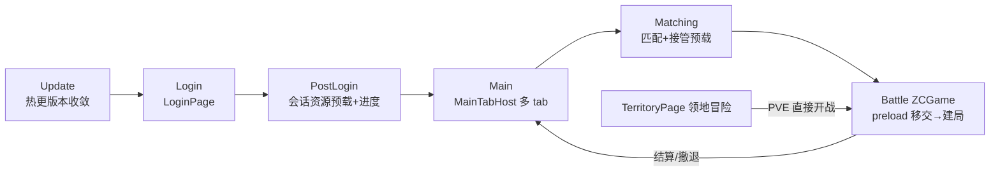

# 代码库架构梳理（现状实证核对）

> **定位**：本文档是对 `assets/script` 源码的**只读现状梳理**，用于回答「入口在哪、分层怎么走、数据从哪来、例外在哪里」，属于**实证核对**而非新增规范。
> 规范与详细设计以 [AGENTS.md](../AGENTS.md)、[AI架构与代码规范.md](AI架构与代码规范.md)、[zcds-表现层与领地规范.md](zcds-表现层与领地规范.md) 为准；架构示意图另见 [架构总览图.html](架构总览图.html)。
> 核对日期：2026-10-19。代码演进后本文档可能过时，修改相关模块时请顺手核对。

---

## 1. 范围与方法

- 仓库：`D:\City1001\Demo3.8`（Cocos Creator 3.8 + TypeScript），源码根 `assets/script`。
- 方法：目录级结构枚举 + 关键入口/流程文件精读 + 依赖方向 grep 检索；codegraph 索引规模：1,025 文件 / 32,731 节点 / 100,649 边（2026-10-19 查询）。
- 证据等级：本文每条结论标注 `confirmed`（直接读到代码/配置）或 `inferred`（依据代码内注释与调用链推演）。

### 源码分层规模（`.ts` 文件数）

| 层级 / 目录 | 说明 | 规模 |
| :--- | :--- | :--- |
| `app/bootstrap` | 组合根 | 1（ProcedureBootstrap.ts） |
| `app/procedure` | 流程编排 | 6（Update/Login/PostLogin/Main/Matching/Game） |
| `app/<feature>` | 业务功能（zcds/territory/bigmap/login/matching/main/card/league…30+） | 见 §5 |
| `core` | 端口、运行时契约、纯规则 | asset/config/hex/network/runtime/territory/update |
| `framework` | 通用基础设施 | procedure/ui/event/net/pool/tween/task… |
| `platform` | 引擎适配器 | cocos/config/hotupdate/network/payment |
| `tests` | 单测（`npx tsx --test`） | 229 个 `*.test.ts` |

---

## 2. 分层架构与依赖红线（实证）

依赖严格单向向内（与 [AI架构与代码规范.md](AI架构与代码规范.md) §2 声明一致）：

```text
app/bootstrap（组合根：装配全局端口与流程）
  -> app/procedure（流程编排）、app/<feature>/application（用例/Presenter）、app/<feature>/view（Cocos 视图组件）
  -> core（领域端口、运行时契约、纯业务与几何规则）
platform（Cocos 引擎资源/网络/配置/热更新适配器） -> core
framework（通用 UI 基类 / 弹窗 / 流程机制）        -> core
```

| 结论 | 证据 | 状态 |
| :--- | :--- | :--- |
| `core/**` 纯净：无 `cc`/`framework`/`app`/`platform` 依赖 | `core` 目录 grep `from '(cc\|framework\|app\|platform)/` 0 命中 | confirmed |
| `app/<feature>/model` 纯净：无 `cc` 依赖 | `zcds/model`、`territory/model`、`bigmap/model` grep `from 'cc'` 均 0 命中 | confirmed |
| `app/<feature>/application` 基本纯净，少量边界适配例外 | `ZCGameLoader`/`ZCGuideLoader`（资源加载器）、`TerritoryPageAssets`（资产类型）、`BigMapStorage`/`BigMapSaveKeys`/`TerritorySaveStoreAdapter`/`TerritoryChapterInfoRepository`/`BigMapEntry`（`sys.localStorage`/`director`） | confirmed（例外见 §7.2） |
| `framework/**` 不依赖具体 app feature | 全仓 grep 仅 3 个遗留文件命中，且指向**不存在的模块、无调用方**（见 §7.1） | confirmed（死代码） |
| `platform/**` 只实现 core 端口 | `CocosAssetService`(AssetService)、`RefConfigService`(ConfigService)、`FetchNetworkTransport`(NetworkTransport) | confirmed |
| 页面导航只走 `GameRoute`，不直接切 Procedure | 16 处调用点（见 §3.3） | confirmed |

---

## 3. 入口与流程生命周期

### 3.1 组合根：`app/bootstrap/ProcedureBootstrap.ts`

`Root.scene` 常驻组件，唯一同时了解 framework / platform / 业务的地方（`ProcedureBootstrap.ts:31`）。职责（`onLoad`，`ProcedureBootstrap.ts:40-101`）：

1. 接线 framework 门面出口（`FW.showTip` → `Toast.show`、`FW.showReward` → `ShowRewardPage.open`、`FW.pay` → `CenterPaymentService`），守「framework 不反向依赖 app」红线。
2. 初始化音频（`AudioMgr`）、红点变量（`registerRdVars`）、支付结算出口（`GameNet` 监听 `CmdRechargeBroMsg`）。
3. 装配服务：`CocosAssetService` / `RefConfigService` / `FetchNetworkTransport` / `AppSessionAssetService`，`configure(GameContext)`。
4. 注册路由：`Update/Login/PostLogin/Main/Matching/Battle → Procedure*`，首流程 `navigate(GameRoute.Update)`。

### 3.2 流程机：`framework/procedure/ProcedureManager.ts`

- 全局单例组件（挂 `Root.scene` 的 Procedure 节点），`routes: Map<route, Procedure>` 由组合根装配（`ProcedureManager.ts:46,116`）。
- 流程切换 = **两阶段**：`await onPreload(params, context)`（可异步、可取消）→ `onEnter(params)`（同步）。`switchToken` 保证连续切换只认最后一次，过期预加载经 `context.cancelled` + `ResourceScope.dispose()` 清理（`ProcedureManager.ts:163-244`）。
- 每帧 `update(dt)`：先 `UpdateBeat.loop(dt)`（见 §8 责任闭合卡），再按 1/60 固定步长驱动当前流程 `onUpdate`（上限 10 步/帧，防螺旋追赶）。

### 3.3 页面导航方式（16 处实证）

| 调用点 | 去向 |
| :--- | :--- |
| `LoginPage.ts:186` | `PostLogin` |
| `ProcedurePostLogin.ts:126` | `Main` |
| `MainPage.ts:18` | `Matching` |
| `TerritoryPage.ts:111` | `Battle`（PVE） |
| `ZCGame.ts:900/903` | `Main`（结算/撤退） |
| `ProcedureMatching.ts:381` | `Battle`（移交预加载） |
| `ProcedureUpdate.ts:101/118/147/164/200` | `Login` |
| `ActivityJump.ts:75`、`GMCommandTable.ts:122` | `Matching` / `Login` |

结论：`confirmed` —— 业务页面与流程一律经 `ProcedureManager.navigate(GameRoute.*)`，未发现 `switchTo` 直切具体 Procedure 类的活跃调用。

---

## 4. 主流程链与跨流程资源交接



- **资源交接链**（`confirmed`）：登录后 `AppSessionAssetService.prepare()` 并行预载「基础配置 + 对局资源（`ZCGamePreload`/`ZCGameLoader`）+ 主界面图标 + 通用美术」，进度与热更共用 `LaunchProgressUI`（`ProcedureUpdate.ts:23-26`）→ 匹配流程 `takeBattlePreload()` **单次消费**接管（`ProcedureMatching.ts:181-188`）→ `ProcedureGame.onPreload` 经 `params.preload.transferTo(context.resources)` 移交资源作用域（`ProcedureGame.ts:50-58`）→ `onEnter` 资源就绪后才 `addComponent(ZCGame)` + `initialize(entry)`。
- **PVE 旁路**：领地「冒险」页直接 `navigate(GameRoute.Battle, {pve…})`，`ProcedureGame.onEnter` 里组装 PVE 波次/倍率修改器（`ProcedureGame.ts:115-191`），结算回写 `TerritorySaveStore`。

---

## 5. Feature 解剖

### 5.1 对局 `app/zcds`（组合根 + application/model/view/ui）

| 子目录 | 文件数 | 职责与代表文件 |
| :--- | :--- | :--- |
| 根 | 2 | `ZCGame.ts`（对局组合根 Component）、`ZCDCLogSwitch.ts` |
| `application` | 7 | 预加载 `ZCGameLoader`/`ZCGamePreload`、客户端战斗配置 `ZCClientCombatConfig`/`ZCPveCombatConfig`、阶段机 `ZCBattlePhaseController`、入口类型 `ZCGameEntry` |
| `model` | 31 | **纯规则（零 cc）**：`ZCGameModel`（规则模型）、`ZCGameRenderFrame`（渲染快照）、`ZCMatchConfig`/`ZCMapConfig`/`ZCPvpConfigCompiler`/`ZCModifierEngine`/`ZCSeededRandom`（确定性随机）等 |
| `view` | 26 | 表现组件：`ZCGameRenderWorld`（表现实体）、`ZCGameHUDView`、`ZCUnitView`、`ZCHexView`、`ZCOutlineLayer`、`ZCEffectPool`/`ZCNodePool`（对象池）、`ZCWallRenderer` 等 |
| `ui` | 5 | 结算 `ZCSettlementPage`、逃跑 `GameRunAway`、新手引导 `ZCGuidePanel` |

对局内运行模型（`confirmed`）：

```text
服务端 battle.seed
  -> ZCGameModel（确定性规则：抽地块/保底/AI/出生抖动，ZCSeededRandom）
  -> ZCGameRenderFrame 快照
  -> ZCGameRenderWorld + 视图（renderDynamic 逐帧 / renderStatic 0.15s 节流）
界面意图 <-> EventMgr.instance + ZCGameUiEvent 事件中控（ZCGame 注册 handler，shutdown 时 offTarget）
```

### 5.2 领地「冒险」页 `app/territory`

| 子目录 | 文件数 | 职责与代表文件 |
| :--- | :--- | :--- |
| `application` | 9 | `TerritoryPresenter`（纯 TS 台面编排）、章节/地块 Repository、`TerritorySaveStoreAdapter`（存档）、`TerritoryPageAssets` |
| `model` | 14 | **纯规则**：`TerritoryMapConfig`/`TerritoryMapLayout`（六边布局）、`TerritoryResourceGain`（喷发/飘字曲线真源）、`TerritoryCellReveal`/`IdleReward`/`GrantedReward` 等 |
| `view` | 10 | `TerritoryPage`、`TerritoryMapView`、`TerritoryStationView`、`TerritoryHexFlip`（碎裂）、`TerritoryGainBurst`（纯类粒子）等 |

进入对局：`TerritoryPage.ts:111` → `navigate(GameRoute.Battle, {pve…})`。

### 5.3 大世界 / 基地建造 `app/bigmap`

| 子目录 | 文件数 | 职责与代表文件 |
| :--- | :--- | :--- |
| `application` | 5 | `BigMapEntry`（入口）、`BigMapPresenter`、`BigMapConfigLoader`、`BigMapStorage`/`BigMapSaveKeys`（存档） |
| `model` | 7 | **纯规则**：`BigMapWorld`（种子纯函数建图）、`BigMapConfig`/`BigMapUnlock`/`BigMapBattle`/`BigMapBase`/`BigMapSaveData` |
| `view` | 5 | `BigMapPage`、`BigMapWorldView`、`BigMapBaseView`、`BigMapTheme`（线框绘制）、`BigMapEntryButton` |

入口：主界面右下角悬浮按钮 `BigMapEntryButton → BigMapEntry.open`（覆盖页，切 tab 不销毁）。

### 5.4 其他 feature

`login` / `matching` / `main`（`MainTabHost`）/ `card` / `league` / `mail` / `store` / `gift` / `role` / `activity` / `celebration` / `battle` / `net`（`GameNet`）/ `session` / `rd` / `update` / `loading` / `showReward` / `common` 等 30+ 目录，未逐一展开。

---

## 6. 数据流

### 6.1 配表链路（`confirmed`）

```text
Excel 配置
  -> tools/config（导出 json / remoteRef / refGen 类型；BigMap 表由 gen_bigmap_tables.py 一次性推算）
  -> tools/ref（产物同步 + 引用守卫）
  -> tools/pvp_card_check.py（卡表 unitPrefabPath 资源存在性校验）
  -> 运行时 RefConfigService（RefUtil.loadRefSmallAll）→ ConfigService.getTable
  -> feature application 边界 capture 归一化 → model → view
```

### 6.2 资源链路（`confirmed`）

业务只经 `core/asset/AssetService` 端口（`load/loadDir/has`），实现为 `platform/cocos/CocosAssetService`；`ResourceScope` 统一作用域释放；登录后会话级常驻资源由 `SessionAssetService`（`AppSessionAssetService`）管理并跨流程交接。

### 6.3 网络链路（`confirmed`）

- 中心服 HTTP：`core/network/NetworkTransport` ← `platform/network/FetchNetworkTransport`（登录网关、支付开单）。
- 游戏服 socket：`app/net/GameNet` 包 `framework/net/NetSocket` + `ProtoMgr` + 静态 protobuf（`lib/protobuf/protoCompiledStatic`，微信小游戏安全）+ `CacheMgr` 推送缓存；自带心跳（5s）与重连（15s 建连超时兜底）。
- 发送泵依赖 `UpdateBeat` 主循环（`ProcedureManager.update` 驱动），详见 §8。

---

## 7. 实证观察到的例外与偏差

### 7.1 framework 遗留死代码（confirmed）

`framework/coroutine/Cor.ts`、`framework/fsm/AsyncFSM.ts`、`framework/utils/StringRef.ts` 分别 import `app/ref/Ref`、`app/game/gamestate/state/GameLoading`、`app/ref/Ref`——这些**模块在仓库中不存在**，且全仓检索无任何调用方引用这三个文件（迁移遗留）。结论：死代码，不构成活跃的分层违规；可安全清理。

### 7.2 application 层少量 `cc` 值依赖（confirmed）

- 资源加载器：`ZCGameLoader`/`ZCGuideLoader`/`TerritoryPageAssets`（需具体引擎资产类型走 `AssetService`）。
- 存储/环境适配：`BigMapStorage`/`BigMapSaveKeys`/`TerritorySaveStoreAdapter`/`TerritoryChapterInfoRepository`（`sys.localStorage`）、`BigMapEntry`（`director`/`Widget`）。

属于数据边界适配，与「外部数据在 Repository 边界归一化」兼容；但严格按「application 不得依赖 `cc`」字面是例外，新增 Repository 时优先抽到 platform 适配器。

### 7.3 platform → app 反向依赖（confirmed，活跃例外）

`platform/hotupdate/CocosHotUpdateFactory.ts:4` import `app/update/HotUpdateManager`，由 `ProcedureUpdate.ts:7,156` 活跃调用。即「platform 只实现 core 端口」存在一个已知活跃例外（热更管理器复用 app 层业务编排）。

---

## 8. 责任闭合卡：网络发送泵依赖 `UpdateBeat`

| 项 | 内容 |
| :--- | :--- |
| 对象/范围 | 游戏服 socket 发送泵（`NetSocket.sendData`） |
| 触发者 | `ProcedureManager.update`（`ProcedureManager.ts:270`） |
| 当前装配 | 常驻 `Root.scene` 组件，每帧先 `UpdateBeat.loop(dt)` 再驱动当前流程（`ProcedureManager.ts:252-270`） |
| 实际执行者 | `UpdateBeat → Timer → FW.Task.delay → NetSocket.sendData`（`NetSocket.ts:248` `await FW.Task.delay(1)`） |
| 成功副作用与观察点 | 角色页/卡牌升级/GM 指令等二次拉取的正常刷新；`isSending` 标志（`NetSocket.ts:222,283`） |
| 失败是否返回且被检查 | 发送泵卡死时**无日志**（2026-10-19 修复记录，`ProcedureManager.ts:253-263` 注释） |
| 重试/重放来源 | `sendData` 内部 `while` 自循环；重连成功事件重放（`NetSocket.ts:57,204,256`） |
| 不能覆盖的对象 | 不走 `FW.Task.delay` 的 `sendNow()` 路径（登录因此一直正常）；`Timer` 双驱动源 `DemoMain`（未挂场景） |
| 状态 | wiring `confirmed`；因果链 `inferred`（依据代码内修复注释） |

---

## 9. 未覆盖与最小验证

- 仅完整跟踪了 `bootstrap/procedure/zcds/territory/bigmap` 主链路与 6 个 Procedure；其余 30+ feature 未逐行展开。
- codegraph 索引可能滞后于工作区，本文结论以直接读文件为准。
- 最小验证命令：
  - `npx tsx --test tests/zcds-progress.test.ts tests/territory-presenter.test.ts tests/bigmap-world.test.ts`（对局/领地/大世界核心不变量）
  - `npx tsc --noEmit`（编译期拦截死代码引用等类型问题）
  - `python tools/pvp_card_check.py`（配表资源存在性）

---

## 附：依赖检索命令（可复现）

```powershell
# core 纯净性（应 0 命中）
rg -n "from ['\"](cc|framework|app|platform)/" assets/script/core

# feature model 纯净性（应 0 命中）
rg -n "from ['\"]cc['\"]" assets/script/app/zcds/model assets/script/app/territory/model assets/script/app/bigmap/model

# framework → app 反向依赖
rg -n "from ['\"][^'\"]*app/" assets/script/framework

# platform → app 反向依赖
rg -n "from ['\"][^'\"]*app/" assets/script/platform

# 页面导航（GameRoute 使用点）
rg -n "ProcedureManager\.navigate\(GameRoute|\.navigate\(GameRoute\." assets/script/app
```
