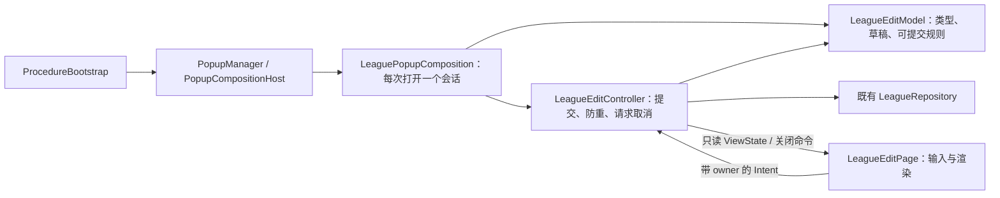

# 工程架构使用情况与升级

检查日期：2026-11-05。目标版本：Cocos Creator 3.8.8。检查对象为当前工作副本，包含原有未提交变更；不代表仓库 HEAD 的状态。

## 1. 使用情况

通过 CodeGraph 追踪组合会话与页面调用链，再用 TypeScript AST 扫描 `core/framework/platform/app` 下的静态 import/export 和直接继承关系。排除 `.d.ts`；动态加载、运行时反射和别名解析不在本轮扫描范围。

| 检查项 | 本轮升级后的结果 | 解读 |
| --- | --- | --- |
| 扫描规模 | core 19、framework 106、platform 13、app 673，共 811 个 TS 文件 | 源码文件数量，不等于架构合规率 |
| 直接继承 ControllerBase 的类 | 23 个，包括框架组件控制器和组合对象 | 比本轮开始时新增 LeagueEditController；不把这 23 个全部算作业务 Controller |
| bootstrap 中名称以 Composition 结尾的类 | 8 个 | 已形成可复用的外部装配方式；本轮新增 LeaguePopupComposition |
| Page 运行时引用 Repository | 44 个文件 | 排除了纯类型 import/export；这是逐页复查入口，不能直接据此判定 44 个页面全都违规 |
| 分层反向依赖 | `platform/hotupdate/CocosHotUpdateFactory.ts` 引用 `app/update/HotUpdateManager.ts` | 已核实的待修复问题；装配业务 Manager 的部分应迁到应用组合层，保留 platform 的原生适配能力 |

扫描明细位于 `outputs/architecture-upgrade-2026-11-05/usage.json` 和 `pages-runtime-repositories.json`。

| 范围 | 现有使用方式 | 状态 |
| --- | --- | --- |
| 登录、登录后加载、匹配 | Procedure 转发生命周期，Composition 创建与释放 Controller/View | 已采用 |
| 主 tab、主页面 | 外部 Composition 拥有业务 Controller，页面报告作用域生命周期 | 已采用；不表示所有内嵌业务均已迁移 |
| 战斗 | BattleComposition 拥有入口、运行期、结算与资源会话 | 已采用 |
| 大地图、章节领地 | Entry/Controller/Model 分离，视图派发意图并消费展示输出 | 已采用既有模块边界 |
| 卡牌升级、布阵弹窗 | PopupCompositionHost 为每次打开创建外部会话 | 已采用 |
| 联盟编辑弹窗 | 本轮接入同一宿主，由 LeaguePopupComposition 拥有 Model/Controller | 本轮完成 |
| 联盟创建、捐献，以及邮件、好友、玩家资料 | 尚有页面持有业务状态、请求或业务回调 | 后续按用例迁移，不批量机械拆类 |

## 2. 本轮升级

升级前，LeagueEditPage 同时负责输入、提交锁、Repository 调用、迟到结果判断和提示。升级后沿用现有框架，不新增通用基类或全局注册服务：



实施顺序：核对打开入口、参数和 prefab 绑定 → 分离规则与用例 → 接入已有组合宿主 → 将页面改为输入与展示 → 更新受影响测试和迁移清单。全部已经落实。

### 文件与职责

- `assets/script/app/league/LeagueEditModel.ts`：保存一次打开的编辑类型与草稿，复用占位串常量判断可提交；不持有节点、全局事件或请求。
- `LeagueEditEvents.ts`：集中声明带 owner 的 change/submit 意图和只读展示状态。
- `LeagueEditController.ts`：集中接收意图、管理在途锁，调用既有 `edit`，处理成功/离线/失败与迟到响应。
- `LeagueEditPage.ts`：保留原有 prefab 路径、四个 Inspector 字段和参数类型导出；只绑定 CLICK/输入事件、渲染和关闭，不持有 Model/Controller/Repository。
- `assets/script/app/bootstrap/LeaguePopupComposition.ts`：创建并持有 Model/Controller，注入 Repository、提示与网络取消能力。先保存控制器，再启动；关闭时先清空句柄再释放。
- `ProcedureBootstrap.ts`：卡牌工厂未命中时继续尝试联盟工厂。保留原有日志设置等工作区改动。

四个新增源码的 `.meta` 由编辑器导入生成；未修改 prefab、场景或配表。MCP 已核实 LeagueEdit prefab 有效，14 个节点、78 个组件，原有静态测试继续验证四个绑定与 Button 覆盖。目录 refresh 调用曾超时，因此另用脚本资产查询和本地 imported 元数据确认导入结果。

### 关键边界

1. 打开参数仍是 `{ type, content }`，四类编辑共用一个 prefab；保留原文，不 trim、不追加前缀。
2. 空串与 `***` 不发包；无效 type 不提交；在途请求拒绝重复提交。
3. 输入可以在请求期间修改；结果返回时草稿不同则放弃旧结果，保留新草稿并恢复提交。
4. 离线、失败和抛错均恢复提交能力；成功沿用按钮关闭原因。
5. 请求 caller 是真实 Controller；宿主关闭立即解除事件并 removeCaller，迟到结果不渲染、不提示、不关闭重开的页面。
6. 缓存节点重开时创建新的 Model/Controller；沿用 PopupCompositionHost 的取消和初始化失败清理机制。

另补齐上轮 ControllerBase 优化遗漏的战斗测试：`tests/zcds-matching-preload.test.ts` 从检查逐条 `off` 调用，改为通过真实事件派发验证退出后的旧通知无效。其余原有改动保留。

## 3. 验证

命令与原始输出归入 `outputs/architecture-upgrade-2026-11-05/`。

- 专项验证：75 项通过，0 失败；包含新增规则/控制器、真实页面与组合源码接线、缓存重开、初始化失败、元数据、原有 prefab、意图和 caller 护栏。
- 定义完整性：`verify defs` 无缺失导出；`verify route` 的本轮白名单无完全无覆盖文件。
- TypeScript：本轮前后各 1884 条全项目诊断，忽略行号后逐条计数对比，无新增或消失的指纹；这不表示工程已全量编译通过。
- 最终显式 TAP 全量：5077 项，4987 通过、90 失败。与 2026-11-05 14:29:44（上海时间）保存的 full 基线按失败名称做双向差集：新增 0、消失 8。现有工作副本包含其他任务变更，不将这 8 项全部归因于本轮；失败名称与统计校验保存在 `tests-full-final-comparison.json`，原始输出为 `tests-full-tap-final.txt`。
- 上轮遗漏的战斗测试适配后，该文件 17 项中 16 通过、1 项原有失败；本轮没有把它报告成全绿。

专项命令：

```powershell
npx tsx --test tests/league-edit-controller.test.ts tests/league-edit-composition.test.ts tests/league-apply-edit.test.ts tests/popup-composition.test.ts tests/popup-lifecycle.test.ts tests/bootstrap-composition-conventions.test.ts tests/controller-resources.test.ts tests/view-intent-events.test.ts tests/callback-owner.test.ts
```

`verify full` 本轮曾返回退出码 0，但显示测试汇总 `-1/-1`。其采集器按 TAP 解析，调用时没有指定 TAP 报告器；该结果不作为测试通过证据，亦不能将它报告的“修复 98 项”算成本轮收益。改用显式报告器取得真实统计：

```powershell
npx tsx --test --test-reporter=tap "tests/**/*.test.ts"
```

未修改已有基线，也未修改正在变化的 verify 工具来扩大本轮范围。尚未完成独立同行评审与运行时交互验收，不作提交放行结论。

## 4. 后续升级顺序

1. 修复热更工厂的反向依赖，拆清应用装配与 platform 适配，核对 Web/小游戏/原生三条入口并运行热更专项。
2. 修复 verify 采集器：显式指定 TAP，检查子进程退出码和汇总完整性；无法解析必须失败，不能返回 PASS。
3. 联盟创建/捐献沿用本轮的组合会话入口，迁移费用校验、防重与取消，保留现有 Repository 和协议。
4. 继续按邮件、好友、玩家资料用例拆分。44 个 Repository 引用页面按实际请求与状态归属逐页判定，展示资源读取不机械升级成新系统。

迁移状态维护在[工程架构迁移清单](工程架构迁移清单.md)，不将未迁移页面加入“必须已解耦”的阻断守卫。
