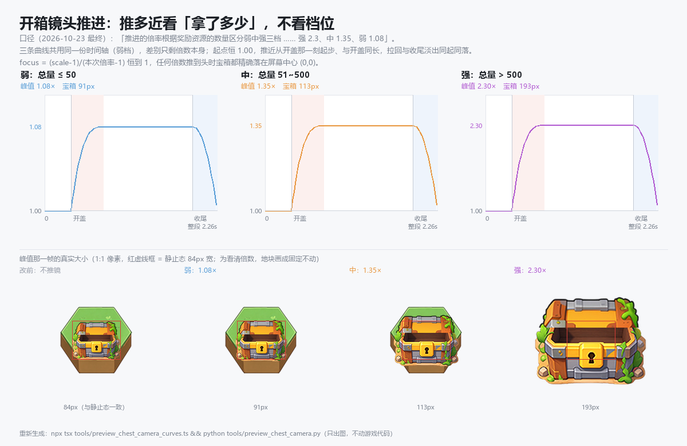
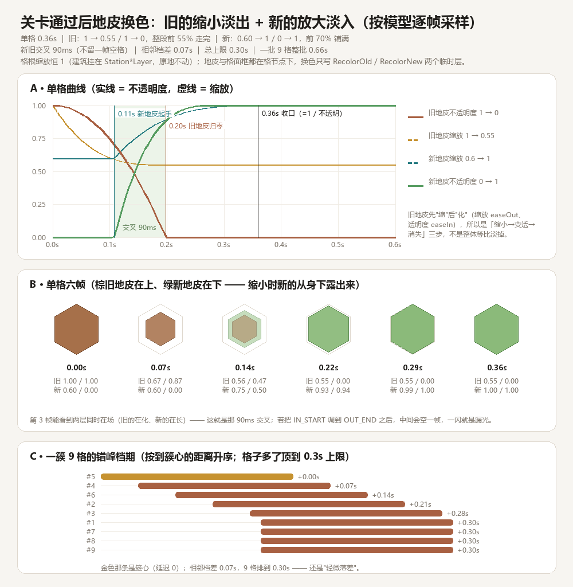

# 章节地图动画与点击反馈 · 实现说明

> 对应需求（2026-10-22）：
>
> > 实现章节的动画效果，点击反馈的优化。
> > 三种宝箱动画播放的判断标准 / 获得的奖励：弱宝箱 = 所有类型的资源数量相加 **< 100**；
> > 中宝箱 = **100~1000**；大宝箱 = **1000 以上**。
> > 涉及到的资源 icon 需要匹配上游戏内使用的，不要另外创新，但一些不具备误导性的星光特效、粒子可以使用新的。
>
> 同日晚些的第二轮需求（领地玩法交互优化，四条）见 **§8**。
>
> 原始表现规格见 [`docs/章节地图动画实现规格.md`](./章节地图动画实现规格.md)（代码注释里引用的就是这份）；
> 逐帧复核图见 [`docs/章节地图宝箱动画预览.png`](./章节地图宝箱动画预览.png)（时间轴）
> 与 [`docs/章节地图宝箱关键帧.png`](./章节地图宝箱关键帧.png)（实图关键帧）。
>
> 第三轮（同日）：
> > 1. 增加固定资源生成宝箱的动画反馈，类似装饰建筑的动效；
> > 2. 增加一个新的宝箱打开反馈，点击宝箱打开时切换成开盖图，可以考虑补帧效果。
>
> 落点：需求 1 → **§8.4**（复用 `playBuildingShake`）；需求 2 → **§3.3**（`chest_seq_0…5` 补帧换图）。
>
> 第四轮（同日，宝箱动画收口）：
> > 1. 奖励飞向资源栏：粒子大小放大 **1.35 倍**；
> > 2. 相机推进：推进的倍率根据奖励资源的数量区分弱中强三档，弱小于 50、中 51-500、强 1000+，
> >    **强 2.3 / 中 1.35 / 弱 1.08**。
>
> 落点：需求 1 → **§3.1.3**（`FLY_ICON_SCALE`）；需求 2 → **§3.1**（`territoryChestCameraZoomOf`）。
> ⚠️ 这一轮把同一天更早的「三档倍率一律 2.3」**作废**了 —— 倍率从此看奖励总量，不看档位。
>
> 云（同日四版，都在 **§8.7 / §8.8 / §8.9 / §8.10**）：15px 间隔 → 铺满背景 + 云洞 → 影子分层 + 云洞不裁剪
> → **美术层拆图**（三版的"运行时切 rect"实机把影子切到了云体上，整片云发灰，四版改成
> `cloud_body_*` / `cloud_shadow_*` 两张同画布 PNG）。
>
> 吐司（同日）：底框与字体**对齐主界面底部聊天条**（60% 黑底 + 微软雅黑 24 / 白 @145 / 加粗 / 字距 0.24），
> 见 **§10**。

---

## 1. 一句话结构

| 关注点 | 归属 | 说明 |
| --- | --- | --- |
| 这一批奖励算哪一档 | `territory/model/TerritoryChestTier.ts` | 纯函数、零 `cc`，只认「总数量」 |
| 三档各自长什么样 | `territory/model/TerritoryChestAnimation.ts` | 参数表 + 纯函数曲线，视图不写时间常量 |
| 每帧把数写进节点 | `territory/view/TerritoryChestView.ts` | 代码建节点（不是 prefab），`step(dt)` 推进 |
| 开盖怎么演 | `territory/model/TerritoryChestAnimation.ts` → `territoryChestOpenFrame` | 只给**帧号**，帧图由 `tools/gen_chest_open_frames.py` 离线烘焙 |
| 「生成宝箱」的反馈 | `territory/view/TerritoryMapView.ts` → `syncChestSpawnView` | 复用装饰建筑的抖动，判据是「上一轮没箱、这轮有」 |
| 点击手感 | `territory/model/TerritoryTapFeedback.ts` + `view/TerritoryTapFeedback.ts` | PressBounce + 绿光圈 + 蓝圆环 |
| 覆盖层坐标系 / 接线 | `territory/view/TerritoryMapView.ts` | 换算格子世界坐标 → 页面坐标 |
| 资源图标 / 结算时机 | `main/MainTerritoryMap.ts` | 走 `roleProperty` 表取游戏内图标 |

全程**不建 tween**：本工程池化节点上跑 tween 会在回收后继续跑（`AGENTS.md` 渲染幂等规则），
所以曲线全部落在纯 TS 模型里，视图逐帧 `step(dt)` 读值写节点，`elapsed = -1` 即空闲。

---

## 2. 分档口径（唯一判据 = 总数量）

```
总数量 = Σ 这一批奖励的 amount（负数 / 0 / NaN 跳过，不做类型加权、不按条目数）

< 100            → 弱（weak）
100 ~ 1000（含） → 中（medium）
> 1000           → 强（strong）
```

三条必须记住的边界：

1. **`1000` 属于中档**。需求里「100~1000」与「1000 以上」在 1000 处重叠，按「区间闭合优先」取中；
   想改成「1000 也算强」须同时改 `TerritoryChestTier`、`tests/territory-chest-tier.test.ts` 与本文。
2. **空奖励 ⇒ `null`**，不是弱档。`null` 让「没有奖励」与「奖励很小」在类型上分开，
   调用方不必再判一次 `rewards.length`（少一个漏判点就空放一次开箱）。
3. **`NaN` / `±Infinity` 一律弱档**。脏数据最多是小动画，不能因为一个 NaN 触发全屏镜头 + 粒子雨。

「是不是宝箱」与「开多大的箱」是两件事，分开判：

- **是不是**：`TerritoryPresenter` 是否带了来源格 `originCellId`（挂机产出 / 离线收益不带）→ 不带就直接结算，不放全屏。
- **多大**：拿到来源格后才用总数量分档。

---

## 3. 三档表现差异（参数表真源 `TERRITORY_CHEST_SPECS`）

| 维度 | 弱 2.26s | 中 2.38s | 强 3.23s |
| --- | --- | --- | --- |
| 宝箱本体 | 弹出 1.15 → 蓄力下压 0.96 → 开盖 | 同左 + 蓄力上浮 8px | 延迟入场（0.30s 才出）+ 上浮 6px |
| 箱盖 | **换帧** `chest_seq_0…5`，0.35→0.77s（0.42s / 6 帧 ≈ 70ms 一张） | 0.45→0.87s | 0.70→1.18s（0.48s） |
| 奖励生成 | 4 枚图标，**开盖后立刻**（0.80s）飞出 | 喷泉 + 星光 **与开盖同时**（0.45s）起，6 枚图标 1.05s | 喷泉 + 星光 0.70s 起，8 枚图标 1.35s |
| 放射光条 | 10 条 | 12 条 | 16 条 |
| 全屏光柱 | **无** | **有**（劈下 → 呼吸 → 淡出归零，0.45~1.30s） | **无**（改用彩虹） |
| 彩虹光束 | 无 | 无 | 有（30°/s 旋转，1.18~2.89s） |
| 镜头 | 上限 2.3×（无暗角）；**实际倍数看奖励总量**：1.08 / 1.35 / 2.3 | 同左 | 同左，但 0→0.3s 一把推到位、2.89→3.23s 拉回 |
| 暗角 | **无** | **无** | 峰值 0.55 |
| 粒子 | **无** | 喷泉 30 + 星光 40 | 喷泉 34 + 星光 48 |
| 飞出奖励 | 4 枚 | 6 枚 | 8 枚 |
| **收尾淡出** | 末 0.32s（1.94→2.26） | 末 0.30s（2.08→2.38） | 末 0.34s（2.89→3.23） |

**2026-10-23 三条口径变更**（用户同一轮提出，第二条半天后被第三条取代）：

1. **白光爆点整层移除**（「移除宝箱打开的圆形闪光特效」）。原来是盖开的瞬间炸一发
   12 层同心圆的径向白闪（峰值半径 204px，覆盖大半个屏幕）。现在删的不只是视图的
   `Flash` 节点，连 `flashStart / flashSeconds / flashPeak` 与 `territoryChestFlashAlpha`
   一起删了 —— 留一个恒 0 的窗口，早晚会被人"顺手改回来"。开箱的"亮"改由
   **放射光条 + 箱口光晕 + 星光**承担。时序锚点相应从 `flashStart` 换成
   `lidStart + lidSeconds`（两者原本就在同一帧上）。
2. ~~**三档推镜倍率统一成 2.3×**~~ —— **已作废**（同日被第 3 条取代）。
   那条把倍率与档位绑死了，结果"拿 20 个银币"和"拿 3000 个银币"推得一样近。
3. **推镜倍率改由「这一批奖励的总量」决定**（最终口径）：

   > 「推进的倍率根据奖励资源的数量区分弱中强三档，弱小于 50、中 51-500、强 1000+；
   >   强推进倍率 = 2.3、中推近 = 1.35、弱推进 = 1.08」

   真源是 `territoryChestCameraZoomOf(totalAmount)`，参数表里的 `cameraZoom`（三档都是
   2.3）退化成**上限 / 兜底**（不传总量时才用它）。详见 §3.1。

弱档的**禁止项**仍是「全屏遮罩 + 粒子雨」，推镜幅度则改由奖励总量决定（§3.1）。
单测钉的是：弱档 `territoryChestBeamAlpha` / `...RainbowFx` / 喷泉 / 星光恒 `null`、
`vignetteAlpha === 0`、**三档 `cameraZoom` 恒为上限 2.3**（不代表运行时倍数）、
以及 `territoryChestCameraZoomOf` 的 50 / 500 两个边界。

**时长不是参考视频量到的 3.0 / 2.6 / 4.0**，而是由「最后一枚奖励落袋」推出来的：

```
totalSeconds = territoryChestLastRewardAt(spec) + settleSeconds + fadeOutSeconds
```

| 档 | 末枚落袋 | `settleSeconds` | 淡出 | 合计 | 老口径的空转 |
| --- | --- | --- | --- | --- | --- |
| 弱 | 1.78s | 0.16 | 0.32 | 2.26s | 0.67s |
| 中 | 1.90s | 0.18 | 0.30 | 2.38s | 0.30s |
| 强 | 2.67s | 0.22 | 0.34 | 3.23s | **0.83s** |

「空转」= 最后一枚图标飞走 → 宝箱开始消失之间的静止。老口径把它挂在
`totalSeconds - fadeOutSeconds` 上，与奖励飞完的时刻无关，于是每一档都白留了这么一截，
实机读作卡顿（2026-10-22 用户：「宝箱打开后，获取奖励后快速消失，现在停止的时间太长了」）。
现在这一截**恒等于 `settleSeconds`**，与总时长解耦；想调"多喘一口"只动这一个数。

⚠️ 由此强档 3.23s 低于参考规格的「不得快于 3.5s」。这是**有意偏离**：参考视频那 0.5s
本身也是静置，属于要修的问题而不是要保留的节奏。要严格对齐参考视频就把 `settleSeconds` 调大
（强档 ≈ 0.47 即回到 3.5s），但仍会保留"先消失、后收尾"的次序。


```
npx tsx tools/preview_chest_timeline_curves.ts && python tools/preview_chest_timeline.py
```

模型里对应的三个导出（视图**只**用这三个，不再碰 `totalSeconds`）：

| 函数 | 含义 | 弱 / 中 / 强 |
| --- | --- | --- |
| `territoryChestLastRewardAt(spec)` | 最后一枚奖励落袋的时刻 | 1.78 / 1.90 / 2.67s |
| `territoryChestFadeStart(spec)` | 收尾淡出起点 = 末枚落袋 + `settleSeconds`（再与 `totalSeconds - fadeOutSeconds` 取小兜底） | 1.94 / 2.08 / 2.89s |
| `territoryChestEndSeconds(spec)` | 整段真正的结束时刻，`step()` 按它停播 | 2.26 / 2.38 / 3.23s |

`totalSeconds` 保留在参数表里只是为了"读起来有个数"，它必须恒等于 `territoryChestEndSeconds`；
两者一旦不等，屏幕上的差别就是多出来一段空转（单测逐档比对，填歪直接红）。
`0.06` 的飞行错峰也收成了 `TERRITORY_CHEST_FLY_STAGGER` 一个常量 —— 以前 `flyFx` 与
`lastRewardAt` 各写一份，改一处另一处就悄悄错位。

### 3.1 镜头：倍率按**奖励总量**分三档（2026-10-23 最终口径）

> 用户：「推进的倍率根据奖励资源的数量区分弱中强三档，弱小于 50、中 51-500、强 1000+；
> 强推进倍率 = 2.3、中推近 = 1.35、弱推进 = 1.08」



```
npx tsx tools/preview_chest_camera_curves.ts && python tools/preview_chest_camera.py
```

#### 倍率表（真源 `territoryChestCameraZoomOf`）

| 这一批奖励总量 | 运行时倍率 | 常量 | 宝箱可见宽（静止 84px） |
| --- | --- | --- | --- |
| `≤ 0`（没有奖励） | **1.08** | `TERRITORY_CHEST_CAMERA_ZOOM_WEAK` | 90.7px |
| `1 ~ 50` | **1.08** | 同上 | 90.7px |
| `51 ~ 500` | **1.35** | `..._MEDIUM` | 113.4px |
| `≥ 501` | **2.30** | `..._STRONG` | 193.2px |

⚠️ **用户原话写的是「强 1000+」，字面上 501~999 无人认领**。这里按他给的粒子数分档
（501 以上 = 30 枚）保持一致处理 ⇒ `> 500` 直接进强档。若确认真要 1000 才进强档，
只改 `territoryChestCameraZoomOf` 里的一行，视图与单测都不用动。

⚠️ **与档位解耦**：档位（弱 / 中 / 强，由 `territoryChestTierOf` 按 100 / 1000 判）管的是
"演多大"（光柱 / 彩虹 / 粒子雨 / 暗角），倍率管的是"拿了多少"。**两套阈值不能互相复用** ——
所以宁可各写一份，也不去借 `territoryChestTierOf`。

#### 时序（仍按档位走，与倍率无关）

| 档 | 起手 | 到位 | 拉回 |
| --- | --- | --- | --- |
| 弱 | 0.35s（`lidStart`，开盖那一刻） | 0.77s（= 开盖结束） | 1.94 → 2.26s |
| 中 | 0.45s | 0.87s | 2.08 → 2.38s |
| 强 | 0s（入场即推） | 0.30s | 2.89 → 3.23s |

#### 六条口径（都是"不这么写就会穿帮"的）

1. **起点恒 1.00**。点下去那一帧的宝箱必须与地图上静止那只**逐像素同大** —— 上一轮刚修过
   「点一下箱子突然弹大一圈」，推镜只能从 1 开始涨。
2. **推近与开盖同步起步**（弱 / 中）。`cameraInStart = lidStart`、`cameraInSeconds = lidSeconds`
   ⇒ 箱子开的时候镜头跟着凑近，而不是"点一下就怼上来"或者"开完了才凑近"。
3. **拉回与淡出同起同落**。`cameraOutStart = territoryChestFadeStart`、
   `cameraOutSeconds = fadeOutSeconds` ⇒ 倍率回到 1.00 的那一帧宝箱正好淡完。
4. **倍率只乘在 Stage 上**。Stage 里是宝箱 + 光效，`Fly`（飞向栏位的图标）是它的兄弟节点，
   所以"镜头推近"不会把已飞出的 `+N` 图标一起放大。
5. **缩放 + 对焦两件事一起做**（2026-10-23）。只缩放的话宝箱会一直留在原来的格子上"原地变大"，
   用户要的是「放大的同时保证宝箱在屏幕中央」，所以还要把**视角中心**从格心挪到屏幕中心：

```
宝箱页面坐标 = k × origin + stagePos     // k = scale，origin = 格心
要求          = origin × (1 - focus)     // focus 0 = 原位，1 = 屏幕中心 (0,0)
⇒ stagePos    = origin × (1 - focus - k)
校验：focus=0 / k=1 ⇒ stagePos=0（与改动前逐像素一致）；focus=1 / k=本次倍率 ⇒ 宝箱落在 (0,0)
```

6. **`focus` 的分母必须是"本次倍率"，不是参数表的 2.3**。
   `focus = (scale - 1) / (本次倍率 - 1)` —— 用 2.3 当分母的话，弱档（1.08）推到头只有
   `0.08 / 1.3 ≈ 0.06`，**宝箱永远挪不到屏幕中央**。用户要的"放大同时居中"对弱档同样成立，
   所以 `applyCamera` 必须把 `this.cameraZoom` 作为第三参数传进 `territoryChestCameraFx`。

`focus` **不是另一条曲线**，它由 `scale` 归一化推出来："放大到几成"与"挪到几成"天然同相；
两条独立曲线迟早会有相位差，看着像"地图像被拽了一下"。

⚠️ 副作用（已知、接受）：弱档只有 8% 的放大，于是"把宝箱挪到屏幕中央"这次**平移**会成为
主要可见运动。这是"必须居中"这条硬要求带来的，不是 bug —— 如果实机觉得弱档平移太多，
把 `focus` 乘一个小于 1 的系数即可（但那样宝箱就不再落在屏幕正中央，要用户点头）。

### 3.1.1 镜头是"真镜头"：覆盖层 + 地图两半（2026-10-23）

> 用户：「相机推进的实际效果应该是**地块和宝箱同时放大**，而不是只有宝箱放大。」

上一版只把倍率乘在覆盖层的 Stage 上，`MapLayer` 一动不动 ⇒ 观感是"宝箱凑近、地块不动"。
现在拆成两半，**同帧同值**：

| 半边 | 归谁 | 做什么 |
| --- | --- | --- |
| 覆盖层（宝箱 / 光柱 / 彩虹 / 放射光条） | `TerritoryChestView.applyCamera` | `stage.setScale(k)` + `stage.setPosition(origin × (1 - focus - k))` |
| 地图（`MapLayer` = ScrollView content） | `TerritoryMapView.applyChestCamera` | `MapLayer.setScale(k)` + 平移让**同一个格子**落在 `origin × (1 - focus)` |

地图侧的推导（全在覆盖层坐标系里）：

```
格心屏幕位置 = layerOrigin' + k × L        // L = origin - layerOrigin，格心相对 MapLayer 原点的偏移
要求         = origin × (1 - focus)
⇒ layerOrigin' = origin × (1 - focus) - k × L
校验：focus=0 / k=1 ⇒ layerOrigin' = layerOrigin（原样）
```

三条实现上的硬要求：

1. **基准只在开演前量一次**（`captureChestCamera(point)`）。每帧现量会把"已经挪过的位置"当成原点，
   镜头就成了一条越推越远的加速曲线。
2. **基准 = 二元组之外的第三个数**：`origin`（格心）+ `layerOrigin`（`MapLayer` 原点）+ `basePos`
   （`MapLayer` 原始 position，收工要还回去）。
3. **只在这时候敢动 `ScrollView` 的 content**：表演期间 `ScrollView.enabled` 已被 `scrollLock` 关掉；
   `stop()` 以 `(1, 0)` 触发钩子还原地图，**还原完之后**才解锁滚动 —— 带着放大后的 content 去解锁，
   之后的拖拽边界会算得很离谱。
4. **两条收工路径都要还原**：`stopChestPlay()`（页面主动打断 / 换章）显式调 `restoreChestCamera()`；
   自然播完走 `update` 里那句「`chestCameraActive` 且已不在播 ⇒ 还原」。钩子收到的 `(1, 0)`
   只是"数值上回到原位"，真正把 `position` / `scale` 写回基准的是这两处（幂等，重复调不回推）。

顺带：光柱 `Beam` / 彩虹 `Rainbow` 从 Root 挪进了 `Stage`。原来它们挂在 Root（不吃缩放），
宝箱被 `focus` 挪到屏幕中央后，光柱还杵在原格上 —— 一眼穿帮。

⚠️ 地图侧**只吃 `(scale, focus)` 两个数**，不关心倍率是 1.08 还是 2.3 —— 换倍率不用改
`TerritoryMapView.applyChestCamera`（它拿到了 `focus` 就已经知道该把格心挪到哪）。
要区分档次只能动这三样：**暗角（0 / 0 / 0.55）**、**推近快慢（0.42s / 0.42s / 0.30s）**、
光柱 / 彩虹 / 粒子。倍率不在此列（它看奖励总量，见 §3.1）。

### 3.1.2 白光爆点已移除（2026-10-23）

用户：「移除宝箱打开的圆形闪光特效」。原来盖开瞬间有一发 **12 层同心圆**的径向白闪
（峰值半径 204px，等于半个屏幕的白），现在整层摘掉：

- 视图 `TerritoryChestView` 不再建 `Flash` 节点，`applyFlash` 删除；
- 模型 `TerritoryChestAnimation` 的 `flashStart / flashSeconds / flashPeak` 与
  `territoryChestFlashAlpha` 一并删除（不是把 alpha 调 0 —— 留个空窗口早晚被改回来）；
- 时序锚点从 `flashStart` 换成 `lidStart + lidSeconds`（两者原来就在同一帧）；
- 开箱的"亮"改由 **放射光条（`Rays`）+ 箱口光晕（`Glow`）+ 星光**承担。

单测 `白光爆点整层移除` 从三个面反向钉住：参数表不带字段、模型不导出函数、视图不建节点
（连 `g.circle(..., mouthY, ...)` 这种画法都不许再出现）。

### 3.1.3 奖励飞行：粒子数按**奖励总量**分三档（2026-10-23）

> 用户：「根据奖励数量匹配对应的粒子数量，分成三档：资源数量 50 以下的播放 5 个粒子飞行，
> 51-500 的播放 15 个，501 以上的播放 30 个。」

真源是 `territoryChestFlyCount(totalAmount)`（总量 = 这批奖励 `amount` 之和，负数 / NaN 视为 0）：

| 总量 | 粒子数 | 说明 |
| --- | --- | --- |
| `≤ 0`（没有奖励） | **0** | 不飞，别凭空飞一串没有意义的图标 |
| `1 ~ 50` | **5** | 边界闭在"50 以下"这一侧 |
| `51 ~ 500` | **15** | |
| `≥ 501` | **30** | |

⚠️ 粒子数只由**总量**决定，与档位（弱 / 中 / 强）无关：档位管"演多大"（光柱 / 彩虹 / 粒子雨），
粒子数管"拿了多少"。参数表里的 `flyCount`（4 / 6 / 8）现在只是**没有总量时的兜底默认值**。

#### 30 枚不许把演出拖长 —— 靠"更密"消化，不靠"更久"

固定错峰 `0.06s` 排 30 枚 = **1.74s** 的起飞窗口，加到弱档会把整段从 2.26s 拖到 3.8s ——
用户上一轮刚说过「停止的时间太长了」。所以错峰随枚数压缩：

```
territoryChestFlyStagger(n) = min(0.06, TERRITORY_CHEST_FLY_SPREAD / (n - 1))
TERRITORY_CHEST_FLY_SPREAD  = 0.42   // = 强档标准排布 8 枚 × 0.06
```

| 粒子数 | 实际错峰 | 起飞窗口 | 弱档整段时长 |
| --- | --- | --- | --- |
| 4（弱档标准） | 0.060s | 0.18s | 2.26s（不变） |
| 6（中档标准） | 0.060s | 0.30s | 2.38s（不变） |
| 8（强档标准） | 0.060s | 0.42s | 3.23s（不变） |
| 5 / 15 / 30 | 0.060 / 0.030 / 0.0145s | ≤ 0.42s | 2.26 → 2.50s（+0.24s） |

也就是说：**≤ 8 枚时手感一个像素都没动**，只有"多给粒子"那两档才开始压缩，且整段最多长 0.3s。

#### 四个时长函数都要带 `flyCount`

末枚落袋的时刻 = `flyStart + stagger(n) × (n-1) + flySeconds`，所以：

- `territoryChestLastRewardAt` / `territoryChestFadeStart` / `territoryChestEndSeconds` /
  `territoryChestFlyFx` 全部接受可选 `flyCount`（缺省 = 表里的标准值）；
- `flyCount > spec.flyCount` 时，`FadeStart` / `EndSeconds` **不再被 `totalSeconds` 夹住** ——
  否则 30 枚里排在后面的会被收尾硬切掉；
- 视图里 `this.flyCount` 只算一次（`play()` 里），`applyFly` / 停播 / 起点全用同一个数。

#### 视图侧另外三处必须跟着改

1. **图标按 `rewards` 轮转**（`index % this.rewards.length`）：30 枚往往只有 2 种资源，
   按下标直取会让大部分粒子变成空图标。喷泉早就是这个口径，飞出与 `ensureFlySlots` 也对齐。
2. **飞行起点跟随镜头**：`Fly` 层活在 Root（不跟缩放），宝箱被 `focus` 挪到屏幕中央后，
   起点必须写 `origin × (1 - cameraFocus)` —— 否则 30 枚会从原来那格凭空冒出来。
   抖动也改成取模（`(index % 5) * 2.5`），线性增长在 30 枚时会把起点飘到 170px 开外。
3. **粒子尺寸 ×1.35**（同日追加：「奖励飞向资源栏：粒子大小放大 1.35 倍」）：

| 项 | 改前 | 改后 |
| --- | --- | --- |
| 图标 `UITransform` 边长 | 44 × 44 | **59.4 × 59.4**（`FLY_ICON_BASE_SIZE × FLY_ICON_SCALE`） |
| `+N` 数量文字的 y | −30（固定） | **−41.7** = `−(size/2 + 12)`（跟着边长走，否则被图标压住） |

   ⚠️ **只改 `setContentSize`，不许改 `applyFly` 里的 `setScale(fx.scale, ...)`**：
   那一条是**飞行过程**的缩放（起飞 1:1、到终点前收到 0.3 假装被吸入），把 1.35 混进去
   会把"被吸入"的收小一起放大 1.35 倍，读作"到终点还很大就消失了"。

### 3.1.4 层级：箱口特效在宝箱**之上**、奖励图标**之下**（2026-10-29）

> 用户：「打开宝箱的特效应该在宝箱的上层，奖励资源的 icon 的下层显示，现在被宝箱遮挡了。」

原来 `Stage` 的兄弟序是 `Beam → Rainbow → Stars → Rays → Glow → Chest → Fountain`：
**箱口那几层全在箱体后面**。星光 / 放射光条 / 箱口光晕都是从箱口（`origin`）向外炸的，
而箱子在屏幕上是 84×67 ⇒ 有一半形状被箱体吃掉，读作"光效被宝箱挡住"。

现在的渲染序（`TerritoryChest.prefab` 的 `_children`，越靠后越在上）：

| # | 节点 | 位置关系 | 为什么 |
| --- | --- | --- | --- |
| 1 | `Beam` 光柱 | **箱体之下** | 从箱口一直铺到屏幕顶（箱口那段宽 36px、alpha 达 235）；挪到箱子前面等于一条白带横穿箱体 |
| 2 | `Rainbow` 彩虹 | **箱体之下** | 同上（6 条 16→0.9H 的光带，近箱口处密集） |
| 3 | `Chest` 宝箱 | — | 表演主体 |
| 4 | `Stars` 星光 | 箱体之上 | 从箱口向外飞，落在箱体范围内的那些必须看得见 |
| 5 | `Rays` 放射光条 | 箱体之上 | 360° 放射，下半圈原来全被箱体盖住 |
| 6 | `Glow` 箱口光晕 | 箱体之上 | 7 层同心圆（r 10~73）圆心就在箱口，原来只露出四个边角 |
| 7 | `Fountain` 喷泉图标 | **最上层** | 玩家最先要读到的是"拿到了什么"，光效不许盖住奖励图标 |

⚠️ **不对称是刻意的**：上面第 1、2 条（背景光）与第 4~6 条（箱口特效）方向相反。
"统一都放到箱子上层"会把箱子糊白，别为了整齐把 `Beam` / `Rainbow` 也翻过来。

⚠️ **顺序只活在 prefab 里**：视图只 `requireChild` 取引用，一句 `setSiblingIndex` 都不写
（2026-10-28 起"结构归 prefab，绘制归代码"）。所以改顺序**不会报错、源码一个字都不变**，
症状只有"光效又被挡住了"—— 守卫是单测 `tests/territory-chest-layer-order.test.ts`：
它直接读 prefab 的 `_children`，正反两端都钉（特效在箱体之上、`Fountain` 最后、光柱彩虹在箱体之下）。

### 3.2 修正记录（都有单测钉）

| 问题 | 现象 | 处理 |
| --- | --- | --- |
| `SpringPop` 峰值 | 用 `Back.easeOut` 解析式，写 `1.15` 实际只冲到 **1.02**（s 是过冲强度不是峰值倍率） | 改**两段显式曲线**：前 65% 涨到 `overshoot`、后 35% 落回 1，峰值恒等于参数 |
| 中档飞行尾巴 | `flyStart 2.0 + 0.6 + 5×0.06 = 2.9s` 超过总时长 2.6s ⇒ 末两枚「飞一半消失」 | 改 `flyStart 1.70 / flySeconds 0.55`，末枚 2.55s 落地 |
| 窗口端点残值 | `0.47-0.37` 的浮点误差让末帧落在区间内，白光留 `2e-16`、飞行多写一帧 | 端点判定统一加 `PHASE_EPSILON = 1e-9` |
| 幽灵双盖（补帧期） | 早期「拆箱体/箱盖两片 + 箱盖旋转」方案里，闭合盖垫在新盖之上 ⇒ 过渡帧出现两张盖子 | 改为**离线烘焙成品帧**（§3.3），运行时只换 `spriteFrame`，不存在两层叠加 |
| 基准缩放被动画覆盖 | 单 Sprite 时 `applyChest` 每帧写 `setScale(fx.scale,…)` 会把「缩到 132px 高」的基准缩放冲掉，宝箱瞬间变成 1:1 像素 | 拆两层：`Chest` 收动画缩放、`ChestArt` 只收基准缩放 |
| **开盖一闪而过** | `lidSeconds = 0.15` + 6 帧 = 25ms/张（≈40fps 闪过）⇒ 肉眼只看到「闭合」直接跳到「全开」，读不出"正在打开" | `lidSeconds` 0.42 / 0.42 / 0.48（≈70~80ms 一张）；单测钉「每帧 ≥ 60ms」 |
| **奖励动画比开盖晚** | 喷泉 `fountainStart = 1.20`，而箱盖 0.80s 就开完了 ⇒ 有 0.4s 是「开着的空箱子」 | 粒子起点对齐 `lidStart`（与开盖同时），白光落到开盖结束那一刻 |
| **光灭了宝箱还在 / 宝箱淡出时透出底下那只** | 各光效窗口长短不一（光条 0.9s、白光 0.87s、喷泉 1.75s），宝箱却留到 `totalSeconds`；且地图格子上那只一直在下面 | ① 加 `fadeOutSeconds`：宝箱与**全部**光效乘同一个收尾系数（`territoryChestTailFade`）；② 表演期间把地图上那一格的宝箱图摘掉（`chestPlayingCell`） |
| **奖励拿完后宝箱静置太久** | 收尾挂在 `totalSeconds - fadeOutSeconds`，与"奖励飞完"无关 ⇒ 弱 0.67s / 中 0.30s / 强 0.83s 的「开着的空箱子」；强档还带着 2.3× 镜头怼着它 | 收尾起点改成 `末枚落袋 + settleSeconds`（`territoryChestFadeStart` / `...EndSeconds`），`totalSeconds` 由这条线**推出来**；镜头回拉与彩虹收束也对齐同一刻。空转从 0.30~0.83s 压到 0.16~0.22s |
| **开箱没镜头感** | 弱 / 中档 `cameraZoom = 1`、`cameraInSeconds = 0` ⇒ 宝箱只是在地块上原地换帧，缺"凑近看"的冲击 | 弱 1.06× / 中 1.10×，**开盖那一刻**起步、与开盖同长推到位，收尾与淡出同起同落拉回 1.00；暗角仍为 0。倍率乘在 Stage（宝箱 + 光效）上并绕箱口缩放 ⇒ 飞向栏位的图标不跟着放大（**2026-10-23 最终改为按奖励总量 1.08 / 1.35 / 2.3**，见 §3.1；同一天又按"地块和宝箱要同时放大"把地图那半也接上了，见 §3.1.1 —— 当时"地图层不动"的取舍已作废） |
| **开箱那一下白得糊屏** | 盖开瞬间炸一发 12 层同心白闪，峰值半径 204px ⇒ 覆盖半个屏幕，宝箱本体反而被糊掉 | 2026-10-23 **整层移除**：视图不建 `Flash` 节点、`applyFlash` 删除、参数表三个 `flash*` 与 `territoryChestFlashAlpha` 一并删；亮度改由放射光条 + 箱口光晕 + 星光承担（§3.1.2） |
| **三档的"轻重"读不出来** | 弱 / 中档只推 6% / 10%，实机上和"不推"几乎没区别 ⇒ 三档开箱看起来一样 | 2026-10-23 先试过"三档统一 2.3×"，但那样"拿 20 个"和"拿 3000 个"推得一样近；**最终改为按奖励总量 1.08 / 1.35 / 2.3**（§3.1），档位差异仍由**暗角（0 / 0 / 0.55）**与**推近快慢（0.42s / 0.42s / 0.30s）**承担 |
| **只有宝箱放大、地块不动** | 倍率只乘在覆盖层 `Stage` 上，`MapLayer` 完全没动 ⇒ 看着像宝箱贴在地图上"自己变大" | 2026-10-23 镜头拆两半：视图每帧把 `(scale, focus)` 通过 `setCameraHook` 转给 `TerritoryMapView`，地图侧 `applyChestCamera` 同帧缩 `MapLayer` 并平移，让**同一个格子**落回同一屏幕点（§3.1.1） |
| **宝箱放大后不在屏幕中央** | 原来 `stagePos = origin × (1 - scale)` 只保证"绕格心放大"，宝箱始终留在格心 | 加 `focus`（由 `scale` 归一化推出，不另起曲线），公式改成 `origin × (1 - focus - scale)`；`focus=1` 时宝箱精确落在 `(0,0)`（§3.1） |
| **奖励粒子数固定 4 / 6 / 8，与拿了多少无关** | 小额奖励飞一大串、巨额奖励也只飞 8 枚，读不出"这次赚翻了" | 2026-10-23 按总量分三档 5 / 15 / 30（`territoryChestFlyCount`）；同时把错峰按枚数压缩，避免 30 枚把演出拖到 3.8s（§3.1.3） |
| **飞行粒子偏小** | 44×44 的图标在屏幕上只占一点点，配上 `+N` 几乎看不清是哪种资源 | 2026-10-23 粒子尺寸 **×1.35**（44 → 59.4，`FLY_ICON_SCALE`），只改 `UITransform`；`+N` 的 y 改成 `−(size/2 + 12)` 跟着下移，免得起飞画面里压在图标上（§3.1.3） |
| **箱口特效被宝箱遮挡** | `Stage` 的兄弟序把 `Stars / Rays / Glow` 排在 `Chest` **之前** ⇒ 星光、放射光条、箱口光晕有一半被 84×67 的箱体吃掉，只有边角露出来 | 2026-10-29 重排 `Stage`：`Beam → Rainbow → Chest → Stars → Rays → Glow → Fountain`（箱口特效在箱体之上、奖励图标之下）；`Beam / Rainbow` 作为背景光**刻意保留在箱体之下**，单测 `territory-chest-layer-order` 正反两端钉住（§3.1.4） |

### 3.3 宝箱开盖 = 补帧换图（`chest_seq_0 … chest_seq_5`）

两块成品美术之间**没有可插值的姿态参数**（一张是地图上的闭合箱，一张是 `zw_0005` 的开盖箱），
所以过渡只能**离线烘焙**：

| 项 | 值 |
| --- | --- |
| 输入 | `image/territory/buildings/territory_fixed_resource_v1.png`（闭合，212×212 / bbox 143×113）+ `image/territory/chest/chest_open_v1.png`（开盖，`zw_0005` 裁切） |
| 烘焙脚本 | `tools/gen_chest_open_frames.py`（接缝 `SEAM_RATIO = 0.532`，采样 `p = 0, .2, .4, .6, .8, 1`） |
| 箱盖生长 | `k = 1 - (1-p)^1.5`，箱盖高度 = `seam * k`（绕水平轴掀起的 2D 投影，`p=0` 高度为 0 ⇒ 完全闭合） |
| 闭合盖垫底 | `alpha = (1-p)^2`、纵向压扁 `1 - 0.2p`，画在新盖**下面**（防幽灵双盖） |
| 输出 | `image/territory/chest/chest_seq_0.png … chest_seq_5.png`（6 帧同画布） |
| 运行时 | `territoryChestOpenFrame(spec, t)` → 帧号；视图 `applyChestFrame(index)` 同帧不重写 |

帧数走 `TERRITORY_CHEST_OPEN_FRAMES`（全局常量，三档共用）—— 想改节奏改采样点即可，
**不要**在视图里写帧号，视图只认 `model/TerritoryChestAnimation` 算出来的索引。

复核图：[`docs/章节地图宝箱关键帧.png`](./章节地图宝箱关键帧.png)
（`tools/preview_chest_frames.py` 直接把真帧图按 `scale` 贴上去，标 `frame N`）。

### 3.4 🔴 新图的 `.meta` 必须是 `sprite-frame`（否则整段开箱「没有箱子」）

手写 meta 只给了 `6c48a`（texture）、`userData.type` 留成 `"texture"` 时，
`resources.load('image/territory/chest/chest_seq_0/spriteFrame', SpriteFrame)` **直接抛错**
（`@f9941` 那个子资源根本不存在）—— 视图 `applyChestFrames()` 拿到全空数组就把
`chestSprite.enabled = false`，于是**光效照播、箱子没有**，控制台只有一条 warn。

所以：**贴新图不要手写 meta**，用 `tools/gen_chest_meta.py` 生成。它保证：

| 要点 | 原因 |
| --- | --- |
| 同时写 `6c48a`（texture）与 `f9941`（sprite-frame）两个子资源 | `SpriteFrame` 走 `@f9941`，缺了就没图 |
| `userData.type = "sprite-frame"` | 决定主资源类型 |
| **`trimType: "none"`**（不按内容包围盒裁） | 补帧每帧 bbox 不同；裁了 `rect` 就每帧变，缩放会算出每帧不同比例 ⇒ 一开盖就整体缩小、还左右跳。**代价**：运行时拿不到可见区，箱子与地图上那只对齐要靠 `TERRITORY_CHEST_ART_METRICS` 的实测值（见 §6.1） |

---

## 4. 点击反馈（PressBounce + 绿光圈 + 蓝圆环）

| 元素 | 参数 | 曲线 |
| --- | --- | --- |
| 地块按压 | 0.18s | `1 → 0.94`（EaseOutCubic）→ `1.02` → `1`，三个关键值**精确**等于常量 |
| 绿色光圈 | 0.3s | 半径 `10 → 62`，alpha `1 → 0`（前段几乎不淡，最后才消失） |
| 蓝色圆环 | 0.3s | `scale 1.4/0.4`、`alpha 1 → 0` |

几点实现约束：

- **按下瞬间就得看见**：不要 `cc.Button` 的 `SCALE` 过渡（它在**抬起**时才回，且是放大），
  所以我们自己驱：`onStationClick` 里**先** `playTapFeedback(cellId)` 再 `emit` 事件 ——
  反过来的话请求期的 `LoadingPopup` 会把反馈盖住，等于没做。
- 反馈槽位固定 4 个（全忙抢最老的），池化复用，`releasePress()` 幂等复位到 1。
- 绿光圈用 6 层同心圆叠出径向感，蓝圆环用 32 段折线描边（都是 `Graphics` 现画）。

---

## 5. 覆盖层为什么挂「页面根」

宝箱 / 光柱 / 暗角 / 点击光圈都**不是**挂在地图内容层上，而是挂在页面根：

- `MapLayer` 是 `ScrollView` 的 content —— 挂那里会**跟着地图滚动**（光柱跑出屏幕）；
- 而且会被 `ScrollView` 的 `Mask` **裁成方块**（全屏光柱被裁成地图那么大一块）。

所以 `ensureOverlayHost()` 一路跳到 `MapLayer.parent.parent`（页面根）并 `setSiblingIndex(last)`，
坐标用矩阵换算，不自己推布局：

```ts
hexTransform.convertToWorldSpaceAR(new Vec3(0, HEX_GRID_CONTENT_LIFT, 0))
  → hostTransform.convertToNodeSpaceAR(...)
```

层级顺序（后建在上）：宝箱根 → 暗角(60) / 资源栏(100) / 飘字(110) 各自按页面既有顺序排。

---

## 6. 资源图标：复用游戏内那套，不另画

| 用途 | 来源 |
| --- | --- |
| 宝箱本体 | `image/territory/chest/chest_seq_0…5`（补帧序列，见 §3.3）；单张=只换一次图、读不出"正在打开" |
| 飞出 / 喷泉的资源图标 | `roleProperty` 表 → `resIconRoot(icon)`（默认 `icons/resource`）；`item` 表那支的 `icon` 本身就是路径 |
| 星光 / 粒子 / 光柱 / 彩虹 | 全新程序化绘制（用户明确允许：「不具备误导性的星光特效、粒子可以使用新的」） |

补帧图**全部同画布**，视图只按第 0 张有图的帧量一次尺寸，再按**可见宽**归一（见 §6.1）。

### 6.1 尺寸与落位：必须和地图上静止的那只**对得上**（2026-10-22 第二轮）

用户口径：「播放宝箱打开动画时，动画的节点大小需要与原宝箱静止状态的大小相近（可以轻微的放大），
坐标点保持一致不要有明显的偏移」。实机症状是**点一下箱子突然弹大一圈、还往下沉**。

| | 改前 | 改后 |
| --- | --- | --- |
| 归一依据 | 补帧图的**画布高** 132 / 156 | **可见宽** 84（= 建筑归一宽） |
| 结果缩放 | `0.846` | `0.609` |
| 可见尺寸 | `117 × 93`（静止态 84 × 66 的 **1.39 倍**） | `84 × 67`（差 0.6px） |
| 节点落位 | 直接摆 `origin` | `origin + (0, 12.78)`，把**视觉中心**顶回 `origin` |
| 视觉中心 | 比格心低 **17.5px** | 对齐（-0.3px） |

两个坑：

1. **画布高不等于箱子高**。补帧画布 `142×156`，上方 44px 是**留给箱盖张开的**（第 5 帧才顶到
   `y=154`）；按画布高归一等于把这截空白算进箱子 ⇒ 整体大 1.39 倍。**要按可见宽归一**。
2. **画布中心不等于箱子中心**。闭合箱占 `y ∈ [2,112]`，画布中心 `78` 比箱子的视觉中心 `57`
   高 `21px`；节点以画布中心对齐格心 ⇒ 箱子整体下沉 `21 × scale`。必须把这 21px 补偿掉，
   而且补偿要**乘当前缩放**（`chestAnchorY * fx.scale`），否则弹出 / 蓄力时视觉中心会上下滑。

成本：补帧图是 `trimType: "none"` 导入的（不裁边，否则每帧 `rect` 不同、一开盖就整体缩放），
运行时 `frame.rect` 恒等于整块画布 ⇒ **可见区拿不到**，只能把实测值写进
`TERRITORY_CHEST_ART_METRICS`（`chest_seq_0.png` 的 alpha 包围盒）。换美术必须重测：

```
tests/territory-chest-placement.test.ts   # 自己解 PNG 的 alpha 重算包围盒来比对
tools/preview_chest_placement.py          # 出对照图（docs/章节地图宝箱落位-改前改后.png）
```

「轻微放大」**不由基准缩放承担**（静止帧严格 1:1，和地图上那只严丝合缝），
由弹出过冲 `TERRITORY_CHEST_POP_OVERSHOOT = 1.15` 承担。

⚠️ 已知美术口径问题（未处理，与尺寸/落位无关）：`chest_seq_0`（所谓"闭合帧"）里箱子
**已经露出内衬**，而地图上静止的是 `territory_fixed_resource_v1`（金色箱盖压着）。
即两张图的箱子画法不同 ⇒ 点击瞬间仍会看到"换了个箱子"的观感。要修得重跑
`tools/gen_chest_open_frames.py`（让第 0 帧真正闭合）。

图标**按需加载 + 永久缓存**（`resId → SpriteFrame | null`）：奖励的 `resId` 是服务端回的，
配置期无法穷举；一次开箱最多 3~5 种，加载完就留着，失败也缓存 `null` 避免每批都重试。

### 6.2 飘字「icon + 数字」按实测宽度居中（2026-10-23）

用户口径见 `tests/territory-resource-gain.test.ts` 的规则 4.3：一组宽度不同的子件必须按**中心**摆，
不能共用同一个左边界 `x`。实机表现是 `+1` 偏左、`+100000` 偏右，整组始终没对准格心。

根因两层：

1. prefab 里 `Amount` 的锚点在**左边**（`x = 0`）且 `x` 写死 ⇒ 数字变宽只往右长，整组跟着偏。
   prefab 里只看得到样张那一句（`+100`），所以"看着是居中的"，永远发现不了。
2. 只按样张把 prefab 挪正也没用 —— 运行时的数字位数是变的（1~6 位）。

改法：

- 几何抽成纯函数 **`territoryGainContentX(iconWidth, textWidth, iconAnchorX, textAnchorX)`**
  （`model/TerritoryResourceGain`）：总宽 = 图标宽 + 间隙 + 数字宽，`left = -总宽/2`，
  再按**各自锚点**换算出要写的 `x`。任一宽度非有限正数 ⇒ 返回 `null`（保持原摆位，
  首帧 Label 还没排版就是这个状态，不能把整组甩到左边）。
- 视图 `TerritoryResourceGainView.layoutContent()` 在 `play()` 里、写完 `string` 之后调一次：
  先 `amountLabel.updateRenderData(true)` **逼一次同步排版**（`overflow = NONE` 时 Label 是
  延迟把实测尺寸写回 `UITransform` 的，不逼一下读到的是上一句的宽度），再读两个 `UITransform` 宽度。
- prefab 里样张（`+100`）的摆位也按同一公式对正（`Icon.x -41 → -43.29`、`Amount.x -15 → -17.29`），
  否则编辑器里看到的与实机不一致。单测第 ⑤ 条就是拿 prefab 存的值和公式比。

⚠️ 间隙 `TERRITORY_GAIN_ICON_TEXT_GAP_PX = 6` 是唯一真源：改它要连 prefab 一起改。

---

## 7. 接线与降级（三条不能破的规矩）

1. **奖励绝不吞**。`playChestOpen` 返回 `boolean`（格子不在视口 / 覆盖层没建起来 ⇒ `false`），
   页面拿到 `false` 就**立刻结算**，不等动画。
2. **资源缺失静默降级**。宝箱美术、图标、翻转材质、底光序列帧各自独立 `try`：
   缺哪个就少哪一项（光效 / 数字照常），不提示、不阻断进页面。
3. **打断不算播完**。`stop()` 只把时钟置 -1 并收起节点，**不回调** `onDone`；
   换章 / 重渲染 / 页面销毁前都调 `stop()`，避免回调到已重渲染的旧状态。

```ts
// MainTerritoryMap
void this.loadChestArt(assets);        // 加载宝箱美术 → mapView.setChestArt(frame)
onDestroy() { this.mapView?.stopChestPlay(); }
```

---

## 8. 第二轮交互优化（2026-10-22，四条）

> 需求原话：随机地块不播宝箱、直接播获得资源；宝箱用 `zw_0005` 换图；关掉解锁提示；播放时屏蔽拖动点击。

### 8.1 随机格不开箱，直接喷资源（+ 粒子按量分级）

随机格是「解锁即发奖」，本来就没有「开箱」这一步。判据放在 **Presenter**（玩法口径的持有者），
页面只负责「怎么演」：

```ts
// TerritoryPresenter —— 随机格
this.ports.outputs.showRewards(result.rewards, cellId, { chest: false });
// TerritoryPresenter —— 固定资源点（仍走开箱）
this.ports.outputs.showRewards(result.rewards, site.cellId);
```

页面侧 `presentRewards(rewards, cellId, presentation?)` 见到 `presentation?.chest === false` 就走
`playCellGains(...)`：**整批**奖励喷发 + 飘字，不开箱、**也不弹奖励窗**。**不传 = 开箱**，
所以老调用点（挂机产出）行为不变。

> ⚠️ 2026-10-26 修正：这里原来是 `settleRewards(...)`，而它会按 `resId` 把"非钱包类"全部判进
> `popup` ⇒ 随机池发的道具（图纸 / 蓝本）一进来就变成一张「获得奖励」弹窗，粒子一颗都没有。
> 详见 [§8.11 ④](#811-云的第五轮svn-合并后的三处回归2026-10-26)。

粒子个数按**这一批奖励的总量**分级（`territoryBurstCountForTotal`）：

| 总量 | 粒子数 | 意图 |
| --- | --- | --- |
| `< 50` | 5（很稀疏） | 小奖励只有零星几颗 |
| `50 ~ 200`（含） | 9 | 中等 |
| `> 200` | 12（满喷） | 大奖励铺满倒锥 |

池子仍按**满喷 12** 预建（池化节点不能每次重建），`play` 时只点亮前 `count` 颗、
超出的槽位连图一起清掉（避免下一喷少喷时留残影）；整喷时长也按 `count` 缩短
（`territoryBurstTotalSeconds(count)`），否则稀疏喷发会有半秒空挂。

### 8.2 屏蔽拖动与点击

播放期间的位移穿帮（格子被拖走、动画留在原地）来自两件事，分别处理：

| 输入 | 处理 | 为什么这样分 |
| --- | --- | --- |
| 点击地块 | `TerritoryMapView.onStationClick` 开头 `if (this.inputLocked) return;` | 防连点二次发包，必须挡在**发事件之前** |
| 拖动地图 | 页面注入端口 `mapView.scrollLock = (locked) => scrollView.enabled = !locked` | 视图不认识滚动容器；关 `enabled` 即摘掉拖拽监听，比 `preventTouch` 干净 |

开演即 `setInputLocked(true)`；释放在 `update` 里按「还播不播」判（`inputLocked && !chestView.isPlaying`），
`stopChestPlay()` 也顺手解锁 —— 换章 / 重渲染打断时不会把输入永久锁死。

### 8.3 关掉「已解锁，点击宝箱领取」与「已领取」两条轻提示

`TERRITORY_TWO_STEP_TEXTS.fixedResource` 里 `unlocked` 与 `claimed` **都改空串**，
调用点统一是 `if (tip) showTip(tip)` ⇒ 空串即静音，不用再加开关。

| 时刻 | 原来弹什么 | 现在 | 为什么 |
| --- | --- | --- | --- |
| 解锁成功（第一下点宝箱） | 「已解锁，点击宝箱领取」 | 不弹 | 紧接着就是开箱表演，再叠一句文字会和它抢同一时刻（2026-10-22 §3） |
| 领取成功（第二下点宝箱） | 「已领取」 | 不弹 | 那条深色提示条躺在**屏幕正中**，把刚开的宝箱和周围地块一起盖住；同样的信息开箱表演 + 奖励飘字已经表达过（2026-10-22 追加） |

⚠️ `TERRITORY_TEXTS.fixedResourceClaimed` 这句话**没有删** —— 以后地图角标或别处要复用时不必再造一句，
但 presenter 的提示链不再引用它。判据：`tests/territory-presenter.test.ts` 的
「领取成功不该再弹「已领取」提示条」。

> 注意这和**全局** `Toast` 无关：`Toast` 是所有页面共用的轻提示（`FW.showTip` → `Toast.show`），
> 银币不足 / 解锁失败 / 加载失败仍然要弹。这里只是「这两次成功不再播报」。

### 8.4 固定资源格「生成宝箱」的抖动（需求 2026-10-22 第二轮 §1）

> 需求原话：「增加固定资源生成宝箱的动画反馈，类似装饰建筑的动效」。

**动效不认识宝箱** —— 直接复用装饰建筑/随机格揭示建筑时那条脉冲：
`TerritoryStationView.playBuildingShake()` → `core/hex/ShakePresentation`
（Y/X 双段 120% 脉冲、每段 `SPAWN_SHAKE_PHASE_SECONDS = 0.12`、`BUILDING_SHAKE_STRETCH = 0.2`）。
不新造参数 ⇒ 宝箱"长出来"和建筑"长出来"是同一手感。

**判据只有一条**：`syncStations`（每秒全量渲染）里，**上一轮没有宝箱、这一轮有**。

```ts
// TerritoryMapView.syncStations
const firstPass = !this.stationsReady;         // 首帧只做快照
...
const content = { ...this.stationRenderOf(site, input), iconScale: ... };
view.render(content);
this.syncChestSpawnView(site, content, view, firstPass);
...
this.stationsReady = true;                     // 快照建立
```

`syncChestSpawnView` 的三个前置：

| 条件 | 原因 |
| --- | --- |
| `site.type === fixedResource` | 其它站点有自己的解锁/翻格表现，不该跟着抖 |
| `content.icon != null` | 「摆着宝箱」的定义就是**渲染出了宝箱图**；领取后 `icon: null`，再解锁一次会重新抖（正是「又生成一个」的观感） |
| `!firstPass && !content.hidden` | 首帧一屏宝箱不该同时抖；`hidden`（等翻格）时看不见，先不记快照、等可见那轮再判 |

**抖动要比地块晚 0.22s**（需求 §3「宝箱生成动画需要比地块生成动画稍晚展示」）：

```ts
this.chestSpawnDelay.set(site.cellId, CHEST_SPAWN_SHAKE_DELAY_SECONDS);  // 排队，不当场播
// update → stepChestSpawnDelays(dt) 扣到 0 再 view.playBuildingShake()
```

地块（地皮换色 / 翻转）在**这一帧**就发生，宝箱是叠在同一格上的次级元素 ——
同一帧一起动只会读成「整格弹了一下」，读不出「格子上长出一只宝箱」。
0.22s ≈ 地块动效第一段收势，先后关系清楚又不让人等；**别调到 0.4s 以上**
（`syncStations` 每秒才全量走一遍，太晚会和下一轮渲染撞在一起）。
与全工程一致，这里不建 tween/定时器，用「排队表 + 每帧扣时间」。

`syncGrid` 换图（换章 / 改布局）时 `chestCells.clear()` + `stationsReady = false`
+ `chestSpawnDelay.clear()` —— 新图上本来摆着宝箱的格子不算「刚生成」，没抖的排队也作废。

### 8.5 新地块生成：整格淡入 + 由小变大 + 错峰（需求 2026-10-22 第三轮）

口径原文：*「增加新地块生成动画 / 生成新的地块整个节点由透明渐变 / 地块由小变大 /
多个地块出现有轻微的先后落差」*。真源 `model/TerritoryHexSpawn.ts`（纯函数）+ `view/TerritoryHexSpawn.ts`（纯类）。

| 需求 | 落在哪 | 参数 |
| --- | --- | --- |
| 整格由透明渐变 | 格节点挂 `UIOpacity`，**子节点一起淡**（地皮 / 格面框 / 底光 / `Reveal` 全在格节点下） | `opacity: 0 → 1`，前 **70%**（`OPACITY_PORTION`）就铺满 |
| 由小变大 | `node.setScale(fromScale → 1)` | `FROM_SCALE = 0.55`，`easeOutCubic` |
| 轻微先后落差 | 一批新格按**到这批格包围盒中心的距离**升序排延迟 | 相邻档差 `0.055s`，**总上限 `0.3s`** |

单格 `0.4s`、整批最长 `0.3 + 0.4 = 0.7s`。曲线都在模型里，视图只负责逐帧写节点。

**触发**：`paintHexes` 末尾调 `syncHexSpawn` —— 本帧 `revealedCells` 有、上一帧快照没有的格子就是「新生成」。
首帧只做快照（`spawnBootstrapped`，与既有的 `hexFlipBootstrapped` 同一套路），
否则进页面时满图的格子会集体重播一遍。换图（`gridKey` 变）时 `hexSpawn.reset()` + 快照清空。

**四条踩过的坑**：

1. **站点不在格节点下**。`initialize` 把站点四块视觉（icon / caption / 底板 / 角标）挂到了另外四个层
   （`StationIconLayer` / `StationCaptionLayer` / `StationTextLayer` / `StationBadgeLayer`），
   格节点的 `UIOpacity` 管不到它们 ⇒ 逐格给这四个节点也挂 `UIOpacity`，走
   `TerritoryStationView.setSpawnOpacity()`，由 `play()` 的 `onFrame` 回调同步。
2. **站点比格节点晚半拍建出来**。`renderMap` 的顺序是 `syncGrid`（建格）→ `syncFlip` → `syncStations`（建站点），
   站点第一次出现时生成动画已经起播 ⇒ `syncStations` 末尾要 `applyHexSpawnFade()` 用
   `hexSpawn.opacityOf(node)` **追写一次当前进度**，否则站点先闪一帧全不透明。
3. **`play()` 必须先手写一遍起手帧**。只记时间不写节点，第一帧渲染时节点还是满尺寸不透明 ⇒「闪一帧」。
4. **翻格与生成抢同一格的缩放**。翻格自己就会「新地皮放大填充」，再叠整格淡入只会糊 ⇒
   `syncHexSpawn` 跳过 `hexFlip.isPlaying` 的格，且 `syncFlip` 起播成功时 `hexSpawn.stop(node)`（**翻格优先**）。

池化契约与其它表现层一致：`isPlaying / play / step / stop / reset`，`settle()` 里缩放复位 1、
`opacity = 255`（**必须收口**，否则节点被复用时会带着半透明或 0.55 的缩放继续用）。

**看图**：`docs/章节地图新地块生成预览.png`（A 单格曲线 / B 一簇 9 格六帧快照 / C 整批档期甘特）。
改了参数重跑即可复核（图与代码同一份真源）：

```bash
"C:/Users/Administrator/.workbuddy/binaries/python/envs/default/Scripts/python.exe" tools/preview_hex_spawn.py
```

> 一个**不影响观感但值得知道**的细节：`territoryHexSpawnDelays` 的两格「等距」是按 `dx²+dy²`
> 的**原始浮点值**比的。几何上完全等距的一簇格子（比如画图用的 3×3 对称簇）算出来会差千分之几，
> 「等距按 cellId 兜底」根本撞不上 ⇒ 档期顺序看着散。真实批次是进度推进后**边界上的不规则形状**，
> 极少出现等距，所以没为此加取整（加了反而会让「可复现」依赖取整精度）。

### 8.6 关卡通过后「地皮换色」：旧的缩小淡出 + 新的放大淡入（需求 2026-10-23）

口径原文：*「原本红色的地块变小，变透消失，新的地块小变大出现，伴随透明度变实 /
有多个地块变化时，动画轻微的时间落差 / 地块上的建筑保持原地不动」*。

真源 `model/TerritoryHexRecolor.ts`（纯函数）+ `view/TerritoryHexRecolor.ts`（纯类）。

| 需求 | 落在哪 | 参数 |
| --- | --- | --- |
| 旧地块变小、变透消失 | `outScale` / `outOpacity` | `1 → 0.55`（`OUT_SCALE`）/ `1 → 0`，在自己的窗口（整段前 **55%**）里走完 |
| 新地块小变大 + 透明度变实 | `inScale` / `inOpacity` | `0.6 → 1` / `0 → 1`（前 **70%** 铺满，与"生成"同一口径） |
| 多格轻微时间落差 | `territoryHexRecolorDelays()` | 按这批格的**簇心**升序，间隔 `0.07s`，总上限 `0.3s` |
| 建筑原地不动 | **不动格根** | 缩放只写在两个临时子节点上，格根缩放恒 1 |

单格 `0.36s`、整批最长 `0.3 + 0.36 = 0.66s`。



```
npx tsx tools/preview_hex_recolor_curves.ts && python tools/preview_hex_recolor.py
```

（图 A = 四条曲线 + 90ms 交叉区；B = 单格六帧，棕旧在上、绿新在下；C = 9 格错峰甘特。
图与代码同一份真源，改参数重跑即可复核。）

#### 节点结构（`createHex` 里多挂两个子节点）

```
Hex_<cellId>     ← 格根：地皮 Sprite（换色期间 enabled = false）
├── RecolorNew   ← 新地皮：0.6 → 1，透明度 0 → 1
├── RecolorOld   ← 旧地皮：1 → 0.55，透明度 1 → 0
├── Frame        ← 格面框（通关即消失，不参与本动画）
├── GroundGlow
└── Reveal       ← 翻格用的"新地皮放大填充"
```

`RecolorOld` 排在 `RecolorNew` **之后**（子节点顺序 = 渲染序 ⇒ 旧地皮画在上面）：
旧地皮缩小的过程里新地皮从它身下露出来，读作"换了一张"，而不是"两张各淡各的"。

#### 三条「不这么写就穿帮」的规矩

1. **不动格根**。格根一缩，格面框 / 底光 / `Reveal` 会跟着缩一圈；建筑虽然不在格节点下
   （挂 `StationIconLayer` 等四个层），但「建筑原地不动」这条需求从根上靠的就是**格根缩放恒 1**。
   视图里 `setScale` 的写口只有 `applyLayer` / `hideLayer`，它们收到的都是临时层节点
   （单测反向钉：源码里不许出现 `active.node.setScale`）。
2. **换色期间把格根地皮藏起来**（`ground.enabled = false`）。不藏的话，`paintHexes` 已经把
   满尺寸的新地皮写在地面上了 —— 底下一张满的、上面一张从小长大的，读不出"从小的长起来"。
   ⚠️ `paintHexes` 每秒全量重绘一次，`applyTileFrame` 会把它重新 `enabled = true`，
   所以**写完帧要立刻再藏一次**（同帧，看不见）——`syncHexRecolor` 后面的那句 `hideGround`。
3. **收口三件事一件不能漏**：格根地皮 `enabled = true`（否则这一格永久空白）、
   把新帧写回格根（动画中途被打断时格根可能还停在旧帧 ⇒「通关了还是泥巴块」）、
   两个临时层收起 + 缩放复位 1 + 透明度 255（池化复用不能带着半尺寸 / 半透明）。

#### 触发判据：地皮**帧 → 帧**变了

```ts
recolorBootstrapped                       // 首帧只做快照
&& ground.spriteFrame && nextFrame        // 两张都非空（排除"美术刚加载完"的整屏误判）
&& ground.spriteFrame !== nextFrame       // 真的换了
&& revealedSnapshot.has(cellId)           // 上一帧就看得见（新露出的归"生成动画"）
&& !hexFlip.isPlaying(node)               // 正在翻格 ⇒ 让位
&& hexSpawn.isPlaying(node) === false     // 正在生成 ⇒ 让位
```

判据刻意**不用** `passed` 翻转：「通关」在四类格上的口径各不相同（起始格 / 随机资源格 / 宝箱 /
战斗站点，见 `isCellPassed`），而"地皮换了"是它们的共同结果 —— 只要从泥块变草地就该放这段。

**三方让位顺序：翻格 > 生成 > 换色**。翻格起播时会 `hexSpawn.stop(node)` + `hexRecolor.stop(node)`
（翻格要靠格根地皮做"旧 → 新"换脸，而换色正把格根地皮藏起来，两套一起跑必然打架）；
生成与换色则靠上面的 `isPlaying` 判据互相避开。

换章 / 布局重建（`syncGrid` 的 `gridKey` 变）时要 `hexRecolor.reset()` + `recolorBootstrapped = false`：
格节点会被重建，藏起来的格根地皮与半透明的临时层留在旧节点上就成了"烂格"。

### 8.7 未解锁云：15px 挡云区 + 静止图 + 消散挪层（需求 2026-10-23）

> 用户：*「云层和地块有个**固定的间隔 15px**，不会遮挡地块」*
> *「云层的序列帧动画是**只有在地块解锁、云层消散**才使用；未解锁状态下应该是**静止的图片**」*

#### 为什么是「擦掉遮挡区」而不是缩云

云图 **200×240**，一格格面只有 **123×90**。想让云天然不碰地块，云得缩到 **0.37 倍**——
那已经不是"盖着一朵云"，是一颗孤立的小白点，整片地图读不出"未探索"。
所以云**保持原尺寸压在地块之上**，改用一层**反向遮罩**把「已解锁区域外扩 15px」范围内的云擦掉。

#### 层结构（`TerritoryCloudView.attach`，插在 `GridLayer` 的后一位）

```
CloudKeepOut        ← Mask(GRAPHICS_STENCIL, inverted) + Graphics：画的是「不显示」区
├── CloudShadow     ← **影子层**（第 0 个孩子 ⇒ 所有影子在所有云体之下，见 8.11 ⑤）
│   ├── CloudFillShadow   ← 铺满层的影子（8.8）
│   └── CloudLayerShadow  ← 真实云层的影子（`cloud_shadow_0`，与云体同坐标）
├── CloudFillLayer  ← 铺满背景的虚拟云（8.8）
└── CloudLayer      ← 未解锁的云（静止图；**被上面那层擦**）
CloudDissolveLayer  ← 正在消散的云（自带一张"排除自己"的遮罩，见下）
└── CloudShadow
```

三个名字都导出成常量（`TERRITORY_CLOUD_KEEP_OUT_NODE` / `..._LAYER_NODE` / `..._DISSOLVE_NODE`），
单测按层序钉死：`MapBackground → GridLayer → CloudKeepOut → CloudDissolveLayer → StationIconLayer → GainLayer`。

🔴 **反向模具必须自己设 `fillColor.a = 0`**：`Mask._createGraphics` 只在「还没有 Graphics」时才建，
我们先 `addComponent(Graphics)` 再 `fill()`，`Mask` 就不会替我们清 alpha —— 不写这一句，
`fill()` 画出来的是**实心白多边形**，整块区域直接白掉。

#### 15px 是**每条边的法向距离**，不是顶点等比放大

「顶点等比放大」在斜边上只有 ~7.5px（水平方向才是 15）。所以按**斜接（miter）**求交：

```
p' = p + gap × (n₁ + n₂) / (1 + n₁·n₂)      // n₁ / n₂ = 相邻两边的外法线
```

`territoryCloudKeepOutPoints(inset = 15)` 返回这条外扩六边形；单测**逐边量法向距离**，六条边都必须是 15
（留档：水平顶点因此推到 `x = ±76.5` 而不是 61.5 + 15 = 76.5 之外的某个"等比"值）。
`inset = 0` 退化成格面本身；脏参数（NaN / 负数 / 非数）一律回落到 15，不产出 NaN 坐标。

一次 `Graphics.fill()` 画完所有已解锁格的并集 —— 相邻两格的挡云区自然连成一片，
不会在公共边留出一条"缝里还挂着云"的细线。

#### 未解锁 = 静止图（**不再轮播**）

`cloud_idle_0..4` 是给"飘动"准备的序列，2026-10-23 起 `setFrames` **只取第 0 张**：
`this.idleFrame = idle.filter(...)[0] ?? null`，`step()` 里也不再有任何待机换帧。
待机那套（`TERRITORY_CLOUD_IDLE_FRAME_SECONDS` / `territoryCloudPhase` / 逐格相位）**整条删除**，
单测用反向守卫钉住"不许回来"——留着空窗口早晚被改回去。

只有**解锁消散**才播序列：`cloud_dissolve_0..1`，`TERRITORY_CLOUD_DISSOLVE_SECONDS = 0.5`
（外加 `TERRITORY_CLOUD_DISSOLVE_HOLD = 0.3` 的停留），播完即回收。

#### 🔴 消散中的云要**挪出遮罩层**

`startDissolve(cellId)` 第一件事是 `sprite.node.setParent(dissolveLayer)`，然后才起播：

> 消散的云盖的正是**刚解锁**的那一格 —— 而那一格此刻已经在挡云区里了。
> 留在 `CloudLayer`（遮罩子节点）里，消散第一帧就会被自己的挡云区擦干净，用户看到的是"云直接消失"。

消散层**自己也有遮罩**（`inverted` 反向，画的是「已解锁格外扩 15px，但**排除正在消散的那些格**」）：
散的那朵在自己那一格上完整地散，溢出到**邻居**地块的部分照旧被擦 15px
（用户第三轮：「这部分的云朵也要与地块有间隔，且图层在地块的上方」）。
集合只在「正在消散的格」变化时重画（`syncDissolveKeepOut` 比 `dissolveIds`）。

回退（进度回滚 ⇒ 这一格又变回未解锁）时再 `setParent(layer)` 挪回来并重新 `applyIdle`，影子一起回家。

#### 两处幂等

- **挡云区只在集合变化时重画**：`syncKeepOut` 比较 `revealed` 与上次的 `keepOutIds`，相同就跳过
  （`renderMap` 每秒都会走一遍，重画一次就是一次 `Graphics` 全量重建）；
- **已解锁集合为空 ⇒ `mask.enabled = false`**：空的反向模具在部分机型上会整屏擦掉，不赌。

#### 看效果（图与代码同一份真源）

`docs/章节地图未解锁云-铺满背景与云洞.png`（三栏，按模型的**真实输出**画）：
**A** = 铺满后的整块内容层（含顶部留白）+ 15px 缝（绿色 = 已解锁）；
**B** = 整张图都解锁、只剩中间一格时的"云洞"（不裁剪、每格一朵、缩到 `POCKET_SCALE`）；
**C** = 三朵挤在一起，看影子是不是全在所有云体之下。
改了格面尺寸 / 15px / 行数重跑即可：

```bash
"C:/Users/Administrator/.workbuddy/binaries/node/versions/22.22.2-6/node.exe" --import tsx \
  tools/preview_cloud_keepout.ts > /tmp/cloud_keepout.json
"C:/Users/Administrator/.workbuddy/binaries/python/envs/default/Scripts/python.exe" \
  tools/preview_cloud_keepout.py < /tmp/cloud_keepout.json
```

### 8.8 云的第二轮：铺满整个背景 + 被包围的云洞（2026-10-23）

> 用户：*「云的填充整个背景图全部填充，包括玩家信息和资源栏上方，只有全地图解锁后才展示」*
> *「云层裁剪的特殊处理：被地块包围的云层不裁剪，置于最顶层，可以在视觉上遮挡 UI，但是不影响点击，
> 不能遮挡粒子特效」*

#### ① 铺满背景 = 把**同一张格网向外延伸**

原来一朵云只摆在**格位**上，而内容层 = 地图包围盒 + 四周 `TERRITORY_MAP_CONTENT_PADDING`(300px)：
滚到边缘时，那圈留白一片云都没有，顶部露出底图（截图 1 红框）。

`territoryCloudFillPoints(rows, columns, width, height, occupied?)` 直接让**行列号越界**、坐标仍旧走
`hexGridViewPoint` ⇒ 延伸出来的点与真实格**同间距同相位**，云连成一片、没有接缝。
（另铺一层"更稀疏的雾"会有密度台阶：重叠区更亮，边界一眼可见。）

🔴 2026-10-26 补：**格网内没有内容的格也要铺**，只跳过 `occupied`（= 真实云层已经盖了的格，
由 `TerritoryMapView.syncClouds` → `setFillOccupied` 喂进来）。老口径把"格内"整片交给真实云层，
可真实云层只认配了内容的 ~117 格 —— 20×20 章节图上剩下 280 多格直接露出沙漠底图
（见 [§8.11 ③](#811-云的第五轮svn-合并后的三处回归2026-10-26)）。

视图侧建 `CloudFillLayer`，是 `CloudKeepOut` 的**第一个**子节点：与真实格云**同一张反向遮罩**，
已解锁的地方连它一起擦，不用单独判一遍。20×20 章节 ≈ 594 个静态 Sprite
（同图同层可合批，创建一次，之后零开销）。

**全地图解锁 ⇒ 整层关闭**（`fillLayer.active = false`）：格位那圈本来就被挡云区擦干净了，
但**留白那圈虚拟云没有对应的已解锁格**，不显式关掉就会在 100% 之后还挂着一圈雾。

#### ② 云洞 = 「被地块包围」的未解锁小洞，搬到页面最顶层

判据（`territoryCloudPocketCells`）：从未解锁格互相连通、且**碰不到地图边缘** ⇒ 是洞。
实现反过来做：从边缘的未解锁格灌一遍，剩下的就是洞。

🔴 **必须封顶**（`TERRITORY_CLOUD_POCKET_MAX_CELLS = 8`）：开局"整片未探索区"也满足
"碰不到边缘"（如果前沿没推到边界），不封顶会把半张图搬到 UI 之上。

| 需求原话 | 落到哪 |
| --- | --- |
| 不裁剪 | 云洞层**不在 `MapLayer` 里** ⇒ 不吃 `CloudKeepOut` 的反向擦除（原来洞被周围那圈 15px 啃成一个白点，就是截图里露出来的那块） |
| 置于最顶层、可遮挡 UI | 挂在**页面根**、append 在 UI 之后 ⇒ 压住玩家信息 / 资源栏 |
| 不影响点击 | 不注册任何监听、不挂 `BlockInputEvents` ⇒ 事件照旧落到下面的 ScrollView / 按钮 |
| 不能遮挡粒子特效 | `TerritoryOverlay`（宝箱 / 飞出奖励 / 点击反馈）是之后建的、且会把自己设为最后一个孩子 ⇒ 天然压在云洞之上 |

两个容易写错的细节（**三版已被下面 §8.9 推翻，留档说明为什么当时这么写**）：

1. **云洞层自己的遮罩是「正像」的**（`inverted = false`），画的是"洞外扩 15px"。
   不裁的话，云 200×240 会盖住两圈邻居的**建筑图标**；裁到洞边又会在洞角留白。
   ⚠️ 实机结果是**一块白色六边形**（云的形状被硬边裁平），三版撤掉，见 §8.9。
2. **洞里要铺"洞格 + 六邻"一小片**（`territoryCloudPocketPatchPoints`）：`cloud_idle_0` 四周是透明的，
   单朵只盖得住洞的中间，四个角还露底图。
   ⚠️ 三版改成"每格一朵 + 缩小"，这个函数已整条删除，见 §8.9。

云洞层每帧把自己的**世界位置 / 世界缩放**对齐 `MapLayer`（`step` 里一句），
子节点于是可以继续用**地图局部坐标**摆位：地图滚动、推镜时不用逐格换算，只有一个节点在动。

### 8.9 云的第三轮：影子分层 + 云洞不裁剪（需求 2026-10-23 三版）

> ⚠️ **本节的「运行时切片」一节（①）已被 §8.10 推翻**：实机影子压到了云体上，整片云发灰。
> 云洞那部分（②）仍然有效。留档是因为"为什么当初会那么写"比结论更有用。

> 用户：*「云层的影子部分的层级要比云层低」*
> *「云洞部分的不裁剪，只需要减少云朵数量，或者轻微缩小云朵的size，在视觉上保留云朵未解锁的象征意义即可」*
> *「这部分的云朵也要与地块有间隔，且图层在地块的上方」*

#### ① ~~一张图切成「云体 / 影子」两条~~（已撤，见 §8.10）

`cloud_idle_0.png` 是 **200×240**，**影子和云体烤在同一张图里**：影子是 `rgba(0,0,0,56)`（≈22% 黑）
的一团，压在云体下方。PIL 逐行统计（5 张 idle + 2 张 dissolve 分布一致）：

| 行（自上而下） | 内容 |
| --- | --- |
| `0 … 119` | 云体，alpha 255 |
| `116 … 197` | 只剩 alpha 61 的黑色影子 |
| `≥ 198` | 全透明 |

单张 Sprite 画出来时，**后画的云**的影子会盖到**先画的云**的云体上（像脏了一块）。
所以按行切成两条（`TERRITORY_CLOUD_BODY_BAND` / `..._SHADOW_BAND`，**故意重叠 4 行**防中缝），
影子统一塞进每个云层的 `CloudShadow` 分组，而它永远是**第 0 个孩子** ⇒ 所有影子在所有云体之下。
（⚠️ 这条"每个云层各一个分组"的写法 2026-10-26 被证明**只够层内**，两层一叠就漏，见 §8.11 ⑤。）

运行时用 `new SpriteFrame()` + `reset()` 造切片帧，三个数由纯函数 `territoryCloudBandRect` 算：

```
originalSize = 整张画布（200×240）      // 关键：尺寸跟着画布走，两条切片的锚点才一致
rect         = 那一条（纹理坐标，y 向上）：y = H − bottom，height = bottom − top
offset       = 切片中心 − 画布中心       // 把切片摆回原位
```

于是**体 / 影两个节点写同一个 `setPosition` 就对齐**，视图侧没有任何补偿系数。

🔴 两个坑：

1. **`rect` 必须叠在源帧自己的 `rect` 上**：`image/territory/` 这棵树有 `auto-atlas.pac`，
   云图 meta 里 `redirect` 指向图集页 —— `texture` 是一张**大图集**，拿纹理尺寸当画布会把别的图切进来；
2. **`packable = false`**：切片靠 `rect` 定位，别让动态合图把它搬走。

切不出来（没有 texture / 尺寸是 0）时：云体退回**原图**、影子层留空 —— 等价于老的单层表现，不报错。

#### ② 云洞不裁剪 = 少放几朵 + 缩一点

正像遮罩撤掉（`pocketMask` / `pocketGraphics` / `territoryCloudPocketPatchPoints` 一起删除，
单测反向钉住"不许回来"）。取而代之：

- **数量**：一个洞格只放**一朵**（原来是"洞格 + 六邻"7 朵）；
- **尺寸**：`TERRITORY_CLOUD_POCKET_SCALE = 0.60` —— 算出来的：格面 123×90 + 四周 15px
  ⇒ 洞内可用 **153×120**；**整朵云**（云体 200×120 + 地面投影）是 `200×198`，
  `200 × 0.60 = 120 < 153`、`198 × 0.60 = 118.8 < 120` ⇒ 一朵云正好落在"洞 + 15px"里，
  **不压地块**（对应第三轮第 3 条「也要与地块有间隔」）。
  ⚠️ 2026-10-26 之前是 **0.74**，只按云体 120 高算、漏了影子，实机高 147 > 120，上下各糊出去 13px
  （见 [§8.11 ②](#811-云的第五轮svn-合并后的三处回归2026-10-26)）；
- **落点**：y 偏移走 `territoryCloudArtOffsetY(倍率)`（= `-21.5 × 倍率`），缩得再小重心也对准洞心；
- **层级**：云洞层仍在**页面根**（压在地块与 UI 之上、被 `TerritoryOverlay` 的宝箱 / 粒子压住），
  每帧对齐 `MapLayer` 的世界变换时**必须带上内容层偏移**（见 §8.11 ①）。

⚠️ 洞格在 `CloudLayer` 里那朵要**收起来**（`setCloudVisible(cellId, false)`）：
`sync` 会为每个未解锁格建云，洞格也是未解锁 —— 不收就是洞心叠两朵（正常层那朵被邻格的 15px
啃掉一圈，比别处更亮，正是截图里那块白斑）。但它**仍然记进 `shown`**，所以洞格解锁时
`startDissolve` 照常把它点亮、播出消散（`startDissolve` 起手有一句 `if (!active) active = true`）。

再小就不行了：缩到"连透明边都不碰格面"要 0.45 倍，那个尺寸的云会变成一颗颗孤立的小白点，
反而读不出"这里被雾盖着"（用户：「在视觉上保留云朵未解锁的象征意义即可」）。

### 8.10 云的第四轮：美术层拆图（影子才真的落到云体之下）

> 用户（看了实机截图）：*「云的影子和云层的顺序反了，云在上方，影子在下方」*
> *「需要和这个参考图一致」*（参考图就是正常的一朵云 + 云脚下的阴影）

#### 症状

截图里整片云区变成**灰石头色**：`(185,185,176)` / `(144,144,137)` / `(167,163,150)` 满地都是。
这些正好是奶油色 `(237,237,225)` 被 **22% 黑**压暗一次的结果 —— 也就是说，
**影子被画到了云体上**，而且不是"顺序反了"，是**两张图上下互换了**。

#### 根因：`SpriteFrame.rect` 是自上而下的

三版用 `y = H − bottom` 算切片在纹理里的 y，前提是"纹理原点在左下"。但 Cocos 3.x 的
`SpriteFrame._calculateUV()` 是把 `rect.y` **直接当 top** 用的：

```ts
const l = rect.x / texw;
const r = (rect.x + rect.width) / texw;
const t = rect.y / texh;                 // ← 直接当 top
const b = (rect.y + rect.height) / texh;
uv[0] = l; uv[1] = t;                    // top-left
```

于是：

| 目标 | 三版实际算出的 `rect` | 落在画布上的内容 |
| --- | --- | --- |
| 云体（行 `0…120`） | `y = 240 − 120 = 120`, `h = 120` | 行 `120…240` = **影子那一刀** |
| 影子（行 `116…198`） | `y = 240 − 198 = 42`, `h = 82` | 行 `42…124` = **云体那一刀** |

两条切片互换，再叠加 `offsetY = ±60` 的上下位移 —— 影子内容被顶到画布上方 60px，
正好糊在云体的奶油色上。**这就是"云发灰"的全部原因**。

顺带说明为什么这个 bug 很隐蔽：单元测试是拿同一个公式算期望值的，**测出来全绿**；
只有实机才看得见。

#### 修法：不在运行时切，改在美术层拆

新建 `tools/split_cloud_layers.py`（一次性、可重跑）：

```
cloud_idle_0.png      → cloud_body_0.png            + cloud_shadow_0.png
cloud_dissolve_0.png  → cloud_dissolve_body_0.png   + cloud_dissolve_shadow_0.png
cloud_dissolve_1.png  → cloud_dissolve_body_1.png   + cloud_dissolve_shadow_1.png
```

规则：

| 约束 | 为什么 |
| --- | --- |
| 两张**同画布 200×240** | 体 / 影两个节点写同一个 `setPosition` 就对齐，一个 offset 都不用算 |
| 像素**互斥** | 叠起来严格等于原图（脚本里 `verify()` 逐像素验，差一个都要报错退出） |
| `.meta` 的 `trimType: none` | 自动裁剪会把影子图那圈全透明的边切掉，`offset` 一变又歪 |
| 按 `r + g + b <= 90` 分体 / 影 | 影子是纯黑 + 低 alpha（只有 21/34/46/56/61 五种），云体最暗也在 `(200,200,180)` 以上，中间没有灰区 |

运行时只做一件事：**影子先进影子层（`CloudKeepOut` 的第 0 个孩子，见 §8.11 ⑤）、云体后画**，
消散时两套帧按**同一个 index** 同步换，并一起淡出。

同时**整条删除**了 `TERRITORY_CLOUD_BODY_BAND` / `TERRITORY_CLOUD_SHADOW_BAND` /
`ITerritoryCloudArtBand` / `territoryCloudBandRect` / 视图里的 `sliceFrame`，
单测反向钉住"不许回来"（`new SpriteFrame` / `originalSize` / `packable` 一个都不许出现）。

#### 帧的注入方式也跟着变了

`setFrames(idle, dissolve)` → `setFrames(ITerritoryCloudFrames)`：

```ts
{ body, shadow, dissolveBody, dissolveShadow }   // 四组前缀，各自按文件名排序
```

⚠️ 前缀不能互相包含：`cloud_dissolve_` 会同时命中 `cloud_dissolve_shadow_0`
（把它当云体帧喂进去就又是一次"影子画在云上"）。

#### 踩坑记录

| 坑 | 现象 | 处理 |
| --- | --- | --- |
| 图集里没这 6 张新图 | 云整片消失、零报错 | 让编辑器刷新资源库重新导入（`auto-atlas.pac` 是按目录收的，不用手改） |
| 预览脚本卡住 3 分钟不出图 | `sys.stdin.read()` 干等 EOF | 改成读命令行参数传 json；非交互时 stdin 不是 tty 但也不会 EOF |
| 单测绿但实机灰 | 测试和代码用同一个（错的）公式 | 方向类的东西不要"算两份"，直接让美术资源本身无歧义 |

看效果：`python tools/preview_cloud_keepout.py` → `docs/章节地图未解锁云-铺满背景与云洞.png`
（A 铺满 + 岛；B 云洞不裁剪；C 三朵重叠，影子全在云体之下）。

### 8.11 云的第五轮：SVN 合并后的三处回归（2026-10-26）

> 用户（两张截图）：*「1.云层的遮挡因为 svn 冲突偏移了，重新调整云层遮挡位置，以及被地块包围
> 云层的大小 2.左侧未解锁的地块没有云层遮挡，空了一块背景图 3.点击随机资源地块播放资源的
> 粒子动画因为 svn 冲突消失了，变成了奖励确认弹窗，重新隐藏弹窗，播放粒子动画」*

先确认了工作区里**没有冲突标记残留**（`^<<<<<<<` / `*.mine` / `*.r###` 全空）、
`tests/territory-cloud.test.ts` 25/25 全绿 —— 所以不是"标记没清"，是**合并后的语义**错了。

#### ① 云洞偏移：`CloudPocket` 层没吃到「内容层偏移」

实测（截图 `510×736`，设计宽 750 ⇒ 屏幕缩放 ≈ 0.548）：

| 量 | 值 |
| --- | --- |
| 两个洞心 | `(346.1, 314.3)` / `(398.6, 338.4)` |
| 两朵云心 | `(345.7, 375.9)` / `(399.3, 401.2)` |
| 逐朵差值 | `(-0.4, +61.6)` / `(+0.7, +62.8)` |

`x` 完全对齐、`y` 一致地低 62px ⇒ **纯纵向、整层**的偏移。62 / 0.548 ≈ **113~150 地图像素**，
正好是 `territoryMapContentShiftY()` 的 **150**。

根因：那 150px 是 `TerritoryMapView.applyContentShift()` 写在 **`MapLayer` 的孩子**上的
（格子层 / 云层 / 站点层 / 飘字层都 +150），`MapLayer.worldPosition` **不含**它。
而云洞层偏偏挂在**页面根**（要压在 UI 之上），`syncPocketTransform` 原先直接
`pocket.setWorldPosition(map.worldPosition)` ⇒ 整层比地块低 150px ≈ 一排半格，
于是"云没落在洞里，压到了下面那排已解锁地块上"（用户红圈）。

修法（`TerritoryCloudView.syncPocketTransform`）：

```ts
const shift = territoryMapContentShiftY();
const world = map.getComponent(UITransform)!.convertToWorldSpaceAR(new Vec3(0, shift, 0));
pocket.setWorldPosition(world.x, world.y, world.z);   // 含缩放，一次算完
```

拿不到 `UITransform` 时按纯平移降级（`worldPosition.y + shift * worldScale.y`）——
宁可差一个缩放系数，也不要整层掉下去 150。

**为什么这 150 不能改成"也 applyContentShift 一下"**：`applyContentShift` 只遍历
`MapLayer.children`，云洞层不在里面；给它加一条"顺便也挪"的分支等于让**两个地方**都管同一个偏移，
换章 / 重渲染时必然二次叠加。偏移只在**消费端**（对齐 `MapLayer` 的地方）补一次才对。

#### ② 云洞太大：倍率是按**云体**算的，漏了地面投影

老 `TERRITORY_CLOUD_POCKET_SCALE = 0.74` 的算式是「云体 200×120 < 格面 123×90 + 15×2 = 153×120」，
但**整朵云**（云体 + 地面投影）是 `200×198`：`198 × 0.74 = 147 > 120`，
上下各糊出去 13px ⇒ 洞里的云压到相邻地块（用户：「被地块包围云层的大小」）。

改成按整朵云收：

```
高：198 × s ≤ 120 ⇒ s ≤ 0.606
宽：200 × s ≤ 153 ⇒ s ≤ 0.765
⇒ TERRITORY_CLOUD_POCKET_SCALE = 0.60     （118.8 × 120，正好落在"洞 + 15px"里）
```

顺带把 y 偏移改成**随倍率走**：`territoryCloudArtOffsetY(scale) = -21.5 × scale`。
写死 `-21.5` 时，0.74 倍下美术重心会比格面中心低 5.6px、0.6 倍下低 8.6px（缩得越小漂得越多），
现在任何倍率都精确对中。

#### ③ 左侧空出一块底图：铺满层只铺了"格网之外"

`territoryCloudFillPoints` 原口径跳过**所有格网内的格**（"格内交给真实云层"）。但真实云层只认
`sites` / `randomSites.candidateCells` / 起始格 —— 章节图 `20×20 / 400` 格里只有 ~117 格配了内容，
剩下 280 多格**既没有真实云、又不在铺满范围** ⇒ 整条裸露的沙漠底图（用户红框）。

改成「格内空格照铺，只跳过 `occupied`」：

```ts
territoryCloudFillPoints(rows, columns, width, height, occupied?: ReadonlySet<number>)
```

`occupied` 由 `TerritoryMapView.syncClouds` 在**换图 / 换章时**喂一次
（`clouds.setFillOccupied(this.cloudCells.map(c => c.cellId))`）—— 不跳过就会有内容格
叠两朵（更亮、边界一眼可见）。实测 20×20 章节图：铺满云 `294 → 594` 朵（+300），
节点总量 1188，静态同图同层可合批。

#### ④ 随机格又弹奖励窗了：`chest:false` 走错了通道

`TerritoryPresenter` 的 `{ chest: false }` 还在，`presentRewards` 的分支也还在，
但它落到的是 `settleRewards` —— 那条按 `resId` 拆「钱包类（7/9）→ 飘字 / 其余 → 弹窗」。
随机池发的恰恰是**道具**（图纸 / 蓝本），全是"非钱包类" ⇒ `gains` 空、`popup` 满：
粒子一颗都没有，只剩一张「获得奖励」弹窗（用户截图 2）。

改法：`chest === false` 走新的 `playCellGains` —— **整批**奖励喷发 + 飘字，`FW.ShowReward` 一次不调。

```ts
// MainTerritoryMap
if (presentation?.chest === false) { void this.playCellGains(rewards, cellId); return; }
```

⚠️ 必须在喷之前把图标**现取现塞**：`loadResourceGainIcons` 只预载了银币 / 体力两张，
道具 id 是随机池给的 —— 不取就是**空图粒子**（有 `+N` 没图标，看着像"粒子坏了"）。
新增 `TerritoryMapView.setGainIcon(resId, frame)` 逐枚回写。

#### ⑤ 追加：云影子压到云体上（"灰云带"）

> 用户（截图：整片云里横着一条发灰的云）：*「有部分的云层阴影遮挡了云层」*

把铺满层补满以后暴露出来的**跨层**问题。原结构是"每个云层各带一个 `CloudShadow` 分组，
分组在层内第 0 个孩子"——那只保证了**层内**顺序：

```
CloudKeepOut
├── CloudFillLayer        ← 层内顺序：fill 影子 → fill 云体
│   └── CloudShadow
└── CloudLayer            ← 层内顺序：cloud 影子 → cloud 云体
    └── CloudShadow
```

整层比较时 `CloudLayer` 排在 `CloudFillLayer` **之后** ⇒ **真实云层的影子画在了铺满层云体之上**。
真实云只落在 ~117 个有内容的格上，所以那一片正好是一条"灰云带"——奶油色 `(237,237,225)` 被
21~61 alpha 的黑压一次就是灰。

修法：影子**全部**抽到一个独立的影子层，作为 `CloudKeepOut` 的**第 0 个孩子**，
里面再分"铺满 / 真实云层"两个子分组（各自可清空，互不干扰）：

```
CloudKeepOut
├── CloudShadow          ← 影子层（第 0 个孩子）
│   ├── CloudFillShadow
│   └── CloudLayerShadow
├── CloudFillLayer       ← 云体
└── CloudLayer           ← 云体
```

这样"影子在云体之下"变成**全局**不变量，不依赖任何一层的兄弟序。
`createShadowGroup(parent, name)` 里也**删掉了 `setSiblingIndex(0)`** —— 位置由父节点的插入顺序
保证，单靠"设成第 0"只在一个层里成立，正是这次踩的坑。

⚠️ 云洞层（`TerritoryCloudPocket`）与消散层（`CloudDissolveLayer`）是**独立顶层节点**，
层内没有别的云体 ⇒ 它们各自的 `CloudShadow` 子分组仍然是层内第 0 个孩子，不受影响。

#### 单测钉了什么

| 用例 | 钉的哪条 |
| --- | --- |
| `云谱参数：云洞缩小倍率按"整朵云（含影子）+ 15px"算` | 0.60 的算式 + `territoryCloudArtOffsetY` 随倍率、脏倍率退回 1.0 |
| `铺满：…`（同一用例内追加） | 格网内**空格**必须全部铺到（`bare === 0`）+ 有内容的格不许重复铺 |
| `视图：setFillOccupied 会重算铺满格点` | 喂 preoccupied 后那一朵要撤、别的空格不动、同集合不重建 |
| `视图：云洞每格只放一朵…` | 云洞 y 偏移 = `territoryCloudArtOffsetY(scale)`；**世界坐标 = MapLayer + 内容层偏移 × 世界缩放** |
| `视图：铺满层建在挡云遮罩里…` | 遮罩下的顺序必须是「影子层 → 铺满云体 → 真实云体」+ 两层影子都住在影子层里 |
| `视图：影子统一住进「影子层」` | `shadowLayerNode === keepOut.children[0]`、云体层都排在它之后、体影同坐标 |
| `接线：renderMap…`（追加） | `syncClouds` 必须调 `setFillOccupied` |
| `随机资源格（chest:false）不许弹奖励窗` | `chest:false` 分支不许再出现 `settleRewards` / `playCellGains` 里不许有 `FW.ShowReward`、必须有 `setGainIcon` |

---

### 8.12 云的第六轮：消散的过渡动画（2026-10-26）

> 用户（截图：解锁两格、云还盖在上面）：*「解锁地块，云层消散时增加一个过渡动画。
> 云朵快速变小消失，爆炸散开消失，过程伴随透明度变透消失」*

三句话对应**三件事**，一件都不能少，但也不能互相替代：

| 用户的话 | 由什么实现 | 参数 |
| --- | --- | --- |
| 云朵**快速变小** | 节点缩放（不是换图） | 起手 `1 → 1.06`，裂开段收到 `0.84` |
| **爆炸散开** | ① `cloud_dissolve_body_0…1` 两帧序列（裂成环 → 只剩碎块）<br>② 碎块段缩放**掉头向外炸** | 帧号按剩余时长均分；缩放 `0.84 → 1.15` |
| 过程伴随**变透** | `sprite.color.a`（不写 `UIOpacity`，避免退出合批） | 前 30% 恒 1，之后线性到 0 |

#### 时间轴（0.5s）

```
进度   0%────12%──────────────30%──────────56%─────────100%
帧     └── 整朵（index=-1）──┴─ 消散帧 0（裂成环）─┴─ 消散帧 1（碎块）─┘
缩放   1 ──→ 1.06 ───────────→ 0.84 ──────→ 1.15（掉头向外炸）──────→
上飘   0 ───────────────────── 云体 +12px（缓出），影子始终不动 ────→
透明   1 ──────────────────────┴──→ 0（hold 之后线性）──────────────→
```

30fps 采样（`territoryCloudDissolveFrame` 逐帧求值）：

| 秒 | 帧 | 缩放 | 上飘 | alpha |
| --- | --- | --- | --- | --- |
| 0.000 | -1 | 1.000 | 0.0 | 255 |
| 0.050 | -1 | 1.058 | 0.0 | 255 |
| 0.100 | 0 | 0.987 | 2.1 | 255 |
| 0.167 | 0 | 0.898 | 5.1 | 243 |
| 0.250 | 0 | 0.844 | 8.1 | 182 |
| 0.283 | 1 | 0.849 | 9.1 | 158 |
| 0.350 | 1 | 1.006 | 10.6 | 109 |
| 0.433 | 1 | 1.122 | 11.7 | 49 |
| 0.483 | 1 | 1.148 | 12.0 | 12 |

#### ① 起手**不许换帧**（`index = -1`）

老口径的 `territoryCloudDissolveFrame(0, n)` 返回 `index: 0`，视图片刻写 `cloud_dissolve_body_0` ——
那是一张**中间已经裂出一个大洞的环**。玩家看到的是"整朵云"直接跳成"断掉的环"，
一次瞬间跳变，读起来是换图而不是过渡。

现在起手返回 `index: -1`（视图映射回 `cloud_body_0` 整朵图），只让缩放先演一下：

```ts
if (t < TERRITORY_CLOUD_DISSOLVE_INTACT) {      // 前 12% = 60ms
    return { index: -1, opacity: 1, scale: 1 + (PUNCH - 1) * easeOut(t / INTACT), liftY: 0 };
}
```

`PUNCH = 1.06` 是"炸"的那一下。上限压到 1.1 —— 再大就是在抽搐，不是爆炸。

#### ② 缩放要**一收一放**，不能只往一个方向走

```
CRUSH = 0.84   ← 裂开段收尾：外壳炸出洞，壳在往回收（"变小"）
BURST = 1.15   ← 碎块段收尾：碎片向外炸（"散开"）；调头点 = TERRITORY_CLOUD_DISSOLVE_FRAGMENT = 0.5
```

- 只**单调缩小**（前一版就是这么写的，缩到 0.42）：两帧美术本来是「整朵 → 中间炸出洞的环 → 只剩三块碎屑」，
  再一路缩，观感是"云瘪了/被吸走"，不是"炸开"；
- 只**单调放大**：变成"云涨大"，更不对；
- **一收一放**才是爆炸：`BURST > 1` 不矛盾 —— 消散帧 1 的碎屑包围盒只有 `75×152`（整朵是 `200×198`），
  放大 1.15 之后碎块的可见范围仍只有整朵云的一半，观感是"炸开、飞散"而不是"整朵变大"。

调头点 `0.5` 故意对上"两帧序列的中点"：消散帧 1 接管的那一帧正好开始向外炸，
**帧与缩放同一拍**，不会出现"先炸开、再换图"的错位。

#### ③ 缩放 / 上飘都乘在**轨道记的起手值**上

消散轨道（`ITerritoryCloudDissolveTrack`）不再只记"已用时"，还记 `baseX / baseY / baseScale`：

```ts
writeScale(body, track.baseScale * frame.scale);
moveNode(body.node, track.baseX, track.baseY + frame.liftY);
```

⚠️ 不能拿节点**当前**的 `scale` / `position` 当基准：它们每一帧都在变，`scale *= 0.98` 这种写法
半秒后会滚成 0（云直接没），而且回退 / 复位时无从还原。

#### ④ 影子和云体**不是同一条曲线**

第一版预览图（`docs/章节地图云消散预览.png` 的前身）暴露了两处：

1. 云已经只剩几缕，**地上还挂着一大团灰影子**（体 / 影同一个透明度、一起淡到 100%）；
2. 碎块段云体向外炸到 1.15 时，影子跟着放大成"地上那团灰也炸开了"，一眼假。

物理上清楚得很：云升起来、变薄、散掉，地上的投影只会**更小、更早没**。所以姿态里给影子
单独两个字段：

| 节点 | 缩放 | 位置 | 不透明度 |
| --- | --- | --- | --- |
| 云体 | `baseScale × pose.scale`（`1.06 → 0.84 → 1.15`） | `baseY + liftY`（+12px 封顶） | `pose.opacity`（`0.3 → 1.0` 线性到 0） |
| 影子 | `baseScale × pose.shadowScale`（裂开段同云体，碎块段 `0.84 → 0.70`） | `baseY`（**不动**） | `pose.shadowOpacity`（`0.3 → 0.75` 就归零） |

- 裂开段（`burst < 0.5`）`shadowScale === scale`：还是同一朵云，不能分家；
- 碎块段 `shadowScale` **反着走**：云 `0.84 → 1.15`，影子 `0.84 → 0.70`；
- `TERRITORY_CLOUD_DISSOLVE_SHADOW_GONE = 0.75`：影子到 75% 就全透明，比云体早 25%。

#### ⑤ 云洞那朵也得散（老口径是"凭空消失 + 凭空出现"）

洞格的云画在页面顶层的云洞层（**0.6 倍**），解锁区那朵是收起来待命的（**1.0 倍**）。
老口径洞格一解锁：`rebuildPocket` 把云洞那朵连节点销毁，同一帧 `startDissolve` 又点亮正常层那朵
⇒ 实机是"一朵小云凭空没 + 一朵大云凭空来"，比"没有过渡"更扎眼。

现在在 `syncPocket` 里先做一次交接，再重建云洞层：

```ts
for (const cellId of previous) {                  // previous = 旧洞格集合
    if (this.pocketCells.has(cellId)) continue;    // 还留在洞里
    if (!revealed.has(cellId)) continue;           // 只是被挪出洞集合（连通块超封顶），不播
    this.startPocketDissolve(cellId);              // 挪进消散层 + 记一条 0.6 倍轨道
}
this.rebuildPocket(cells);
```

**为什么挪进地图里的 `CloudDissolveLayer` 而不是留在云洞层自己散**：

- 消散层的挡云区会把"正在消散的格"排除 ⇒ 云在自己那格上完整地散；
- 云洞那朵 0.6 倍只有 120px 宽，洞的可用空间是 153×120 ⇒ **够不着**邻居那圈 15px 擦除区，不会被削边；
- 两个层用的是**同一套地图局部坐标**（`CloudDissolveLayer` 自己也吃了 150 的内容层偏移），
  所以 `setParent` 不改局部坐标、云不会跳位 —— 和 `startDissolve` 同一个理由；
- 收尾动作不同：解锁区那朵是**常驻节点**（复位后收起，这格若又变未解锁还要用），
  云洞那朵是**借来的临时节点**（直接销毁，云洞层会自己重建）。

云洞层的子节点也因此改成带格号的名字（`CloudPocket_${cellId}` / `CloudPocketShadow_${cellId}`）——
洞格解锁时要在一堆同款云里认出"要走的那一朵"，光靠 `CloudPocket` 认不出来。

#### 单测钉了什么

| 用例 | 钉的哪条 |
| --- | --- |
| `消散四段：整朵炸一下 → 裂开（壳收到 0.84）→ 碎块炸开（1.15）+ 上飘 + 淡出` | 起手 `index === -1` / `scale === 1` / `liftY === 0`；炸开段帧不变、缩放**单调涨**且不过 1.1；裂开段缩放单调收到 `CRUSH`、碎块段单调炸到 `BURST`、**调头点接缝连续**（≈CRUSH）；上飘单调不降、不越 `LIFT_PX`；透明度 hold 之后单调不增；脏秒数不产 NaN |
| `格子露出的那一帧：… → 整朵炸一下 → 体/影同步换帧 + 收缩/炸开 + 淡出` | 起手是 `cloud_body_0` 且缩放=1；炸开段放大；裂开段 `scale < 1` 且不低于 `CRUSH`、alpha 仍 255；碎块段换成帧 1、`scale > CRUSH`、alpha 开始降；**云体 y 上飘而影子 y 恒定**；体/影同帧同缩放同 alpha；收尾缩放/位置/alpha 全部复位 |
| `视图：云洞每格只放一朵…`（改写结尾） | 洞格解锁后云洞层不留云、正常层那朵仍收着、消散轨道只有 1 条、那朵挪进消散层且**仍是 0.6 倍**、散完销毁 |

#### 已知遗留：帧切换处仍是**内容硬切**

消散只有两帧美术（`cloud_dissolve_body_0…1`），所以有两处是"内容在一帧内换掉"：

| 时刻 | 从 | 到 | 观感 |
| --- | --- | --- | --- |
| `0.12`（67ms） | 整朵云 | 中间裂出洞的环 | 云的下半**突然少了一块** |
| `0.56`（283ms） | 裂开的环 | 三块碎屑 | 云**突然只剩几缕** |

缩放 / 上飘 / 淡出都在连续插值，这两处没有。要彻底磨平只有两条路：

1. **美术多给 2~3 帧**（`cloud_dissolve_2…3`，按"裂得更碎"的方向画）→ 改
   `tools/split_cloud_layers.py` 的 `FRAMES` 重拆，代码一行不用改（帧数是从 `dissolveBody.length` 读的）；
2. 运行时给云体加一层**交叉淡化**（换帧时留一张"上一帧"的 ghost 节点，70ms 内互相抵掉）
   —— 每个消散格多一个节点、四套生命周期要跟着收拾。

第二条没做：在 0.5s 的爆炸里，这两处硬切**反而是"炸开"的一部分**（爆炸本来就是不连续的），
先按现状上真机；确实觉得跳再补。

---

### 8.13 云的第七轮：底边凭什么要算上侧壁（2026-10-26）

用户原话（配图红框圈出最下面一排的三处）：

> 「底部的云层也要和地块有 15px 的间隙」

#### 现象：上、左、右都是 15px，只有**底边是 0**

截图里上边缘明显留白，底部却是云直接贴在深棕色的侧壁上。当时的挡云遮罩是"已解锁格的
**格面**外扩 15px"，而地皮图不是一张薄的六边形 —— 它是**立着的**。

#### 量一遍就清楚了（全部相对格面中心，y 向上）

| 量 | 数值 | 怎么来的 |
| --- | --- | --- |
| 格面顶 / 底 | `+45` / `-45` | `HEX_GRID_FACE_HEIGHT = 90` |
| 地皮图顶 | `+46` | 图高 117、图心比格面中心低 `12.5` ⇒ `58.5 - 12.5` |
| 地皮图底 | `-71` | `-58.5 - 12.5` |
| 遮罩底（**旧**：格面 − 15） | `-60` | `-45 - 15` |
| 遮罩底（**新**：轮廓 − 15） | `-86` | `-45 - 26 - 15` |

旧口径的遮罩底边 `-60` **比地块图底 `-71` 还高 11px** ⇒ 那 11px 的侧壁落在"云区"里，被云整个盖住。
所以底部的观感是"0 间隙"，甚至更糟：不是"少给了 15px"，而是**反向吃掉了 11px**。

> 上边缘为什么"看起来对"：遮罩顶 `+60`、图顶 `+46`，差 **14px**，四舍五入就是 15 —— 纯属巧合（
> 图顶只比格面顶多 1px），不是算对了。

#### 美术事实：地皮图是「格面 + 侧壁」

`assets/resources/image/buildings/img_land_01.png`（草地）/ `img_land_02.png`（泥土）都是
**126×117**，逐行扫草地 / 棕色像素：

| 区间 | 内容 | 高度 |
| --- | --- | --- |
| `y = 0…91` | 格面（草地或泥土） | 92px ≈ `HEX_GRID_FACE_HEIGHT` |
| `y = 92…116` | 深棕 2.5D 侧壁 | **26px** |

于是 `HexGridLayout` 里多一个**只属于美术**的常量：

```ts
/** 地皮图格面以下的 2.5D 侧壁高度（美术事实，不参与蜂窝几何）。 */
export const HEX_GRID_TILE_SIDE_HEIGHT = 26;
```

⚠️ 对局侧用的是扁平 `hex_flat`（没有侧壁），**别把 26 加进蜂窝几何**，否则对局的地块会全部错位。

#### 改法：把「轮廓」和「格面」分成两个函数

`model/TerritoryCloud.ts` 原来只有一个模块级常量 `HEX_FACE_OUTLINE`，现在拆成两个导出函数：

```ts
export function territoryFaceOutlinePoints(): ITerritoryCloudPoint[]    // 6 点，只有格面（旧基准，留作对照）
export function territoryTileOutlinePoints(): ITerritoryCloudPoint[] {  // 6 点，格面 + 侧壁
    const bottom = -hh - HEX_GRID_TILE_SIDE_HEIGHT;                     // -45 - 26 = -71
    return [ {x: hw, y: 0}, {x: qw, y: hh}, {x: -qw, y: hh},
             {x: -hw, y: 0}, {x: -qw, y: bottom}, {x: qw, y: bottom} ];  // 下两点只是变低，x 不变
}
```

`territoryCloudKeepOutPoints` 的默认基准换成后者，并加了第二参只给离线预览图用：

```ts
export function territoryCloudKeepOutPoints(
    inset: number = TERRITORY_CLOUD_KEEP_OUT_PX,
    outline: readonly ITerritoryCloudPoint[] = territoryTileOutlinePoints(),
): ITerritoryCloudPoint[]
```

- **视图（`TerritoryCloudView.traceKeepOut`）一行没改** —— 它一直调的是这个函数，基准换了自动跟着走；
- 下两个顶点只是**变低 26px**、`x` 不动，所以左右两条斜边只是各变长一点，外扩仍是斜接（miter）15px；
- 没选"把云整体往下推"或"缩小云"：那会连带影响顶部 / 云洞，而且云本来就靠遮罩裁，推云是治标。

#### 实测：三边的间隙

`docs/章节地图未解锁云-15px间距.png` 是单格套合图（真地皮 + 白线=地块轮廓 + 红框=遮罩）：

| 边 | 实测 | 原因 |
| --- | --- | --- |
| 底 | **15.0px** | 遮罩底 `-86` vs 图底 `-71` |
| 左 / 右 | 15.6px | 图比格面每侧宽 1.5px（126 vs 123） |
| 上 | 14.0px | 图顶比格面顶高 1px（117 - 92 - 26 = -1） |

要严格三边都 15，得改成"按图 bbox 外扩"而不是"按格面 + 侧壁外扩"；现在这 ±1px 是美术图的
描边余量，肉眼看不出来，先不动。

#### 左右对照：旧口径把侧壁吃掉半截

`docs/章节地图云与地块间隙.png`（真地皮 + 真云 + 真遮罩多边形，旧 / 新各一栏）：

| 栏 | 实测底边 | 观感 |
| --- | --- | --- |
| 旧（只按格面外扩） | **−11px** | 云把侧壁下半截整个盖住 |
| 新（按地块轮廓外扩） | **+15px** | 侧壁完整，下面露出 15px 空隙 |

#### 单测钉了什么

| 用例 | 钉的哪条 |
| --- | --- |
| `挡云多边形：地块轮廓外扩 15px（含侧壁）` | `HEX_GRID_TILE_SIDE_HEIGHT === 26`；**上两点 y 不变**（`±45`，别顺手把整块往下推）；下两点 `y = -45 - 26`、`x = ±30.75` 不变；`bottomEdge === -71 - 15`；每条边法向外移仍**精确 15** |
| `inset = 0` 用例 | 基准同步换成 `territoryTileOutlinePoints()`（否则断言全挂） |

#### 复核

```bash
# 左右对照：旧 -11px / 新 +15px
"C:/Users/Administrator/.workbuddy/binaries/python/envs/default/Scripts/python.exe" tools/preview_cloud_tile_gap.py

# 单格套合：白线（轮廓）与红框（遮罩）相距 15px
"C:/Users/Administrator/.workbuddy/binaries/python/envs/default/Scripts/python.exe" tools/preview_cloud_mask_outline.py
```

两张图的几何都由 `tools/preview_cloud_tile_gap.ts` 导出（= 代码真源），python 只负责合成与标注，
所以**改了常量重跑就同步**，不会出现"图对了、代码没改"的假确认。

> 画图时踩的两个坑（脚本已按真口径修好）：① 遮罩点相对的是**格面中心**，而地皮图锚点是**图心**
> （图心比格面中心低 12.5），两者混用会让整块遮罩下移 12.5px；② 面板坐标里`put()` 内部已经加了
> origin，调用方再传一次绝对坐标会让地块整体偏移出画面。

---

### 8.14 云的第八轮：全解锁后云为什么散不掉（2026-10-27）

用户原话（配两张图：个人信息面板 + chapter_01 左侧一大片云）：

> 「该账号 chapter_01 的地块全部解锁后，云团没有消失」

#### 不是"没关"，是**关不掉**

铺满层（`CloudFillLayer`）本来就有一条收工路径：

```ts
// 老口径
const allRevealed = this.totalCells > 0 && revealed.size >= this.totalCells;
```

`this.totalCells` = `rows × columns` = **400**。但 `revealed` 不是"格网里哪些格亮了"，
它是 `territoryRevealedCells(map, progress)` 的产物，只可能包含三类格：

| 来源 | 说明 |
| --- | --- |
| 已占领 / 已解锁格 | `progress.ownedCells ∪ progress.unlockedCells` |
| 站点 | `unlock.requiredCells` 全部打开（或没前置且在已占领格前沿） |
| 随机候选格 | 在已占领格前沿 |

**没有内容的格永远不会出现在里面** —— 没有站点、不在候选里、也没人会去点它，
"露出"这件事对它根本不存在。而章节图恰恰有大量这种格：

| 章节 | 格网 | 有内容的格 | 空白格 | 其中被内容包住的 |
| --- | --- | --- | --- | --- |
| chapter_01 | 20×20 = 400 | 262 | **138** | 12 |
| chapter_02 | 400 | 188 | **212** | 63 |
| chapter_03~07 | 400 | 117 | **283** | 33~45 |

⇒ 分母 400 是**一堵够不到的墙**：`revealed.size` 最多 262（chapter_01），`allRevealed` 恒 `false`，
铺满层永远开着。用户看到的就是"全部点亮了，左边还压着一大片雾"——
那片雾正是那 138 个没有内容的格。

> 顺带证伪了一种猜测：这不是"配置里有点不到的死格"。7 张章节图里
> **0 个站点的 `requiredCells` 指向空白格**，且从起始格做解锁闭包能把**全部 262 / 188 / 117 格**
> 都打开 ⇒ "全部解锁"这个状态本身是可达的，只是判据没认出来。

#### 改法：分母换成「会盖真实云的格」

真实云层只给**有内容的格**盖（`territoryCloudCells` = `sites` + `randomSites.candidateCells` +
起始格），所以只要这撮格全露出来了，就没有"待解锁"这回事了，铺满层（它的职责是把没内容的空格
也蒙上）跟着一起收工：

```ts
private isFullyRevealed(revealed: ReadonlySet<number>): boolean {
    if (this.cells.length > 0) {
        for (const cell of this.cells) {
            if (!revealed.has(cell.cellId)) return false;
        }
        return true;
    }
    // 退化图（一格内容都没有，多半是配错图）：回退老判据，别一进去就把云全撤了。
    return this.totalCells > 0 && revealed.size >= this.totalCells;
}
```

同时把那段"按需翻转"的写法摊平成直白的赋值（原来 `if (active === allRevealed) active = !allRevealed`
要读两遍才懂，语义等价）：

```ts
const allRevealed = this.isFullyRevealed(revealed);
const fillActive = !allRevealed;
if (this.fillLayer?.isValid && this.fillLayer.active !== fillActive) {
    this.fillLayer.active = fillActive;
    if (this.fillShadowGroup?.isValid) this.fillShadowGroup.active = fillActive;
}
```

#### 为什么这次露出的底图不是"老毛病复发"

2026-10-26 修过一条"未解锁的地块没有云层遮挡，空了一块背景图"。那条说的是**玩到一半**：
大量空白格既没真实云、又不在铺满范围 ⇒ 裸底图。现在铺满层照旧盖着，只是**全解锁后**收掉 ——
那时候地图已经没什么可探索的了，露出底图是收工状态，不是穿帮。

> 🔴 上面这段的**分子**（`revealed`）当天又被推翻了：`revealed` 含"前沿看得见、还没开"的格，
> 会提前收工 ⇒ 见 §8.16。`isFullyRevealed` 这个函数名与 `totalCells` 字段都已一并删除。

> 顺带排查：全解锁后不会有"残留的小云朵"。云洞（`territoryCloudPocketCells`）只从 `cells`
> 里挑，空白格根本不在候选里 ⇒ 铺满层一关，画面上**一朵云都不剩**。

#### 单测钉了什么（`tests/territory-cloud.test.ts` 26 → 29）

| 用例 | 钉的哪条 |
| --- | --- |
| `🔴 全解锁判据按「有内容的格」算，不是 rows × columns` | 用真实配比（400 格 / 262 内容格）复现；断言 `revealed.size < 400` 的前提下 `fillVisible === false` |
| `真·没解锁完时铺满层不许提前关` | 少露最后一格 ⇒ 铺满层必须还在（防"一改就把雾提前撤了"） |
| `一格内容都没有的退化图` | `cells` 为空时回退老判据 |

已实测**临时退回老判据 ⇒ 第一条立刻红**，守卫有效。

### 8.15 云的第九轮：铺满层改成淡出（2026-10-27 同日追加）

用户原话：

> 「给铺满层挂 UIOpacity 走一条淡出时间轴」

上一版（§8.14）把判据改对了，但收工方式仍是 `active = false` —— 最后一格解锁的那一帧，
地图边界那一圈雾**瞬间消失**，而同一时刻最后一朵真实云还在散 0.5s ⇒ 观感是"啪一下没了"。

#### 曲线放在模型里，视图只管推进

`model/TerritoryCloud.ts`：

```ts
export const TERRITORY_CLOUD_FILL_FADE_SECONDS = 0.5;   // 刻意与消散同长

export function territoryCloudFillOpacity(seconds, total = TERRITORY_CLOUD_FILL_FADE_SECONDS): number {
    if (!(seconds > 0)) return 1;      // 还没起跑 / NaN / 负数
    if (total <= 0) return 0;
    if (!(seconds < total)) return 0;  // 淡完了
    return 1 - easeOut(seconds / total);   // 与消散同一条缓动：快起慢收
}
```

**为什么是 0.5s（= `TERRITORY_CLOUD_DISSOLVE_SECONDS`）**：铺满层的退场起点就是"最后一个有内容的格
被露出"的那一帧，而那一刻最后一朵真实云也开始散。同长 ⇒ 边界那圈雾与那朵云一起散尽；
比消散长 ⇒ 云散完了地图上还挂着一层灰；比消散短 ⇒ 边界比中心先秃一块。别写成"消完再淡"。

#### 视图的三个状态

| 字段 | 语义 |
| --- | --- |
| `fillFadeElapsed` | 退场已用时；`< 0` = 没在退场 |
| `fillDismissed` | 已淡完 ⇒ `active = false`（连绘制都省了） |
| `fillOpacity` / `fillShadowOpacity` | `UIOpacity`，**惰性建**（没淡过的存档零开销） |

- `sync` 只负责**起跑 / 取消**，不推进时间；`step(dt)` 里 `stepFillFade` 推进。
- 退场**过程中** `active` 仍是 `true`（要画，只是越来越透），淡完那一帧才 `active = false`。
- `UIOpacity` 必须同时挂在**铺满云体**与**铺满影子**上 —— 影子住在全局影子层里的另一个节点，
  只淡云体会让退场那 0.5s 浮着一层灰。
- 回退（撤销解锁 / 服务端快照改口径）：与消散的 `cancelDissolve` 同态度，**回退不该有动画**，
  整层立刻复原成全不透明。
- `rebuildFill` 重建时也要看 `fillDismissed` —— 换章后尺寸变了不该把雾又点亮。

> 时间记法沿用本文件既有的 `elapsed + dt`（与消散轨道一致），但**曲线是模型里的纯函数**，
> 视图里没有 `tween`、也没有"每秒算一次"的离散状态。

#### 单测钉了什么（`tests/territory-cloud.test.ts` 29 → 33）

| 用例 | 钉的哪条 |
| --- | --- |
| `铺满层退场曲线` | 起手 1 / 到点 0 / 单调递减 / NaN 按 1 / 半程已掉大半 / **与消散同长** |
| `全解锁后铺满层淡出 0.5s 再收` | 没淡过不建 `UIOpacity`；起跑那帧仍在画；中途云体与影子同值且在 0~255 之间；淡完 `active=false` 且 opacity 0；收工后再 `sync` 不亮 |
| `淡出中途回退` | 立刻复原成全不透明（不走动画） |
| `淡完后再重建铺满层` | `rebuildFill` 不许把 `active` 顶回来 |

已实测**临时改回 `active = false` 瞬间收掉 ⇒ 3 条立刻红**，守卫有效。

> 🔴 0.5s 这条现在是**默认档**，不再是"全解锁唯一的那条"：走镜头散场时淡出变成 2s
> （见 §8.16）。两条时长各有各的约束，`TERRITORY_CLOUD_FILL_FADE_SECONDS` 那份**没有改**。

---

### 8.16 云的第十轮：判据改成「已激活」+ 全解锁镜头散场 + 雾逐朵退场（2026-10-27 同日第三 / 五轮）

用户原话（先两条，后两条）：

> 「还未激活完全部地块，云层就消失了」
> 「优化云层消失效果，拉高摄像机，观看云层逐渐消失的过程，屏幕内囊括了所有地块，
>   云雾消失后重新拉进镜头，回到初始高度」
> 「拉远 0.7s 改成 1.1s，雾淡阶段 1.4s 改成 2s，从靠近地块的云雾先消失，离地块远的消失的慢，
>   形成一个消失扩散的视觉效果」

#### ① 判据：分子从 `revealed` 换成「已激活」

§8.14 把**分母**改对了（`cells` 而不是 `rows × columns`），但**分子**还是错的：

`revealed` = `territoryRevealedCells(map, progress)` 的产物，它里面有一类格是

| 来源 | 能看见? | 已激活? |
| --- | --- | --- |
| 已占领 / 已解锁 | ✅ | ✅ |
| 前置满足的站点 | ✅ | ❌（还没点进去打） |
| **已占领格前沿的随机候选格** | ✅ | ❌（**还没花钱开**）|

第三类就是"地图上看得见、还没买"的格。它们一进 `revealed`，"全图解锁"立刻成立 ⇒
玩家还有一格没激活，整片雾就散了（用户第一条）。

改法：`sync` 多收一个**探针**，只认服务端确认过的状态：

```ts
// TerritoryMapView.isCellActivated
激活 = isCellUnlocked(服务端允许点) || isOwned(已占领) || isAreaPassed(同区域已通关)
```

三个都是服务端确认过的，玩家点了就一定往前走 ⇒ 判据**不会死锁**。
这也是不拿 `isCellPassed` 当唯一判据的原因：宝箱要"领完"、`bonus` 根本不走 `isAreaPassed`
（`areaPeers` 只认 stage/boss/asyncPvp），卡在最后那一格就永远收不了官。

⚠️ **两个判据故意不同源，别为了"统一"合并**：

| 判据 | 管什么 | 用什么 |
| --- | --- | --- |
| 逐格 | 这一格的云要不要散 | `revealed`（格子一露就得让开）|
| 整片 | 铺满层什么时候收工 | **激活**（打通才算）|

#### ② 演出：拉远 → 看雾散 → 拉回

`model/TerritoryCloud.ts` 新增三段常量与三条纯函数：

| 段 | 常量 | 画面 |
| --- | --- | --- |
| 拉远 1.1s | `TERRITORY_CLOUD_DOLLY_OUT_SECONDS` | `easeOut` 抬到「整张图入画」 |
| 淡出 2s | `TERRITORY_CLOUD_DOLLY_FADE_SECONDS` | 在拉远视角里慢慢淡，**逐朵错峰**（见 ③）|
| 拉回 0.7s | `TERRITORY_CLOUD_DOLLY_IN_SECONDS` | `1 - easeOut` 对称落回 |

```ts
territoryCloudDollyTotalSeconds()            // 3.8
territoryCloudDollyZoom(seconds)             // 0 → 1 → 1 → 0
territoryCloudDollyFadeDue(seconds)          // ≥ 1.1 才起淡
territoryCloudDollyFitScale(mapW, mapH, vw, vh)  // ≤1，只缩不放，余量 0.94
```

> 📌 2026-10-27 同日第五轮（用户）：「拉远 0.7s 改成 1.1s，雾淡阶段 1.4s 改成 2s」——
> 1.4s 里几百朵雾一起淡完太快，读不出"逐渐"；总时长 2.8s → **3.8s**。

`fitScale` 的分母是 **包围盒 + 一整格**：`layout.width/height` 量的是**格心**，最外圈地块的图
还往外探半格，只按包围盒算会让边缘那圈地块被裁掉半个。

**时钟只放一只**：散场时钟在 `TerritoryCloudView`（`dollyElapsed`），因为"什么时候起淡"由它定；
地图视图每帧只读 `dollyZoom` / `dollyScale` 去推 `MapLayer`。两边各持一只表必然漂。

**镜头复用宝箱那套基准**（`captureChestCamera` / `applyChestCamera`）：它只吃 `(k, f)` 两个数，
与"谁在推"无关。对焦点取**地图包围盒中心**（`GridLayer` 本地原点 + `HEX_GRID_CONTENT_LIFT`）：

```ts
this.applyChestCamera(1 + (fit - 1) * zoom, zoom);   // k: 1→fit，f: 0→1
```

- `f: 0 → 1` ⇒ 地图中心从原屏幕位置挪到**屏幕正中**；
- `k: 1 → fit` ⇒ 缩到整张图入画；
- `f = 0, k = 1` 正好是恒等变换 ⇒ 第一帧与最后一帧都精确回到初始高度。

收尾只留**一条路径**：`update` 里

```ts
const cameraBusy = this.chestView?.isPlaying === true || this.clouds.dollyActive;
if (this.chestCameraActive && !cameraBusy) this.restoreChestCamera();
if (this.inputLocked && !cameraBusy) this.setInputLocked(false);
```

开箱与散场共用同一套基准，谁在播都不能还原（否则另一边正推着的地图会"啪"一下弹回）。

**退化**：`fitScale >= 1`（图本来就比视口小）或页面没注入视口 ⇒ **不演镜头**，直接走 0.5s 淡出
（否则就是"站在原地 3.8 秒"）。取不到覆盖层 ⇒ 只演雾散、镜头不动。

#### ③ 雾的退场：逐朵按「到最近地块的距离」错峰（同日第五轮）

用户原话：

> 「从靠近地块的云雾先消失，离地块远的消失的慢，形成一个消失扩散的视觉效果」

老口径是**整层一个 `UIOpacity`** ⇒ 几百朵雾同一帧起淡、同一帧淡完，屏幕上是"整层灰整体变薄"，
读成"调低了透明度"，不读成"雾在退"。

现在每朵按自己的**波次**（`0` = 贴着地块、`1` = 最远）各拿一条窗口：

```
距离   0（贴着地块） ───────────────────────→ 最远
起淡   ── 0 ──→ 0.25 × 总时长
淡完   0.55 × 总时长 ──────────────────────→ 1.00 × 总时长
```

| 纯函数 | 作用 |
| --- | --- |
| `territoryCloudFillWaveOrder(distance, maxDistance)` | 距离 → 波次（0~1，脏参数一律 0）|
| `territoryCloudFillWaveWindow(order, total)` | 波次 → `{ delay, duration }` |
| `territoryCloudFillWaveOpacity(seconds, order, total)` | 整条时间轴已用时 → 这一朵的不透明度 |

窗口推导（`SPREAD = 0.45`、`STAGGER = 0.25`）：

```ts
delay    = 波次 × STAGGER × 总时长                       // 近端 0、远端 0.25T
duration = 总时长 − delay − SPREAD × 总时长 × (1 − 波次)   // 近端 0.55T、远端 0.75T
```

- **起得早 + 淡得更快**两条必须同时有：只错开起淡时间，观感是"整片雾匀速变薄、只是先后不同"，
  远的那圈并不比近的慢；
- 两端严格收在整条时长以内（远端 `delay + duration = 总时长`）—— 铺满层是"整条走完"才
  `active = false` 的，只要有一朵没淡完就被收起来，那朵就是"啪"一下没；
- `STAGGER` 必须 **小于** `SPREAD`：否则窗长随距离**变短**，远的反而先没（单测钉了这条单调性）。

视图侧：波次在**起淡那一刻**编一次（`prepareFillWave`，全解锁时地块位置已是终态），
逐帧只做一次除法；写透明度走 `Sprite.color.a` 而**不是** `UIOpacity` ——
几百个组件会让节点退出静态合批（影子在另一个节点里，用同一个读数一起写）。

#### 单测（`tests/territory-cloud.test.ts` 33 → 50）

| 用例 | 钉的哪条 |
| --- | --- |
| 三段时长 | 1.1 / 2 / 0.7、总计 3.8、**淡出 ≠ 0.5** |
| 拉远曲线 | 0→1→恒 1→0、镜像对称、两段各自单调、NaN/越界归 0 |
| 起淡时机 | `1.09` false / `1.1` true |
| 入画倍率 | 与独立算出的期望一致、比"只按包围盒"更小、只缩不放、四个入参非法一律回 1 |
| 视图：拉远未到位雾不淡 | 差 0.02s 都不许起淡；起淡即切 2s；3.1s 淡完；3.8s 收工回 0 |
| 视图：无余量不演镜头 | `fitScale = 1` ⇒ 走 0.5s |
| 🔴 前沿格不算激活 | `revealed` 全含但有一格没激活 ⇒ 等 5 秒也不散 |
| 回退 / 换章 | 演出立刻收、雾立刻回来、时长退回默认档 |
| 波次归一化 | 线性、越界夹 1、脏距离/脏分母一律 0 |
| 波窗口 | 近端 0 起 / 远端 0.25T 起、窗长随距离变长、右端不越整条时长、`STAGGER < SPREAD` |
| 波透明度 | 同一时刻近 < 中 < 远（远的那刻还是 1）、整条走完全 0 |
| 视图：逐朵错峰 | 中途**不是**一个 alpha、近的比远的先散、最远的仍是 255、收工全 0、影子同读数 |
| 接线 | 探针参数、`(1+(fit-1)*zoom, zoom)`、`cameraBusy`、`stepCloudDolly` 排在 `clouds.step` 之后、页面注入视口 |

#### 复核

```bash
NODE_OPTIONS=--max-old-space-size=4096 npx tsx --test tests/territory-cloud.test.ts   # 50/50
```

---

## 9. 验收口径

- **看云消散**：`docs/章节地图云消散预览.png`（10 帧胶片，用**真美术帧**按模型姿态合成；
  地块也在图里当参照物 —— 没有地块就看不出"云变小了没有"）。改了消散参数后重跑：

  ```bash
  "C:/Users/Administrator/.workbuddy/binaries/python/envs/default/Scripts/python.exe" tools/preview_cloud_dissolve.py
  ```

- **看云的 15px 间隙**：`docs/章节地图云与地块间隙.png`（旧 / 新口径左右对照，真地皮 + 真云，
  底部实测 旧 −11px / 新 +15px）与 `docs/章节地图未解锁云-15px间距.png`（单格套合：白线=地块轮廓、
  红框=遮罩，相距 15px）。改了 `HEX_GRID_TILE_SIDE_HEIGHT` / `TERRITORY_CLOUD_KEEP_OUT_PX` 后重跑：

  ```bash
  "C:/Users/Administrator/.workbuddy/binaries/python/envs/default/Scripts/python.exe" tools/preview_cloud_tile_gap.py
  "C:/Users/Administrator/.workbuddy/binaries/python/envs/default/Scripts/python.exe" tools/preview_cloud_mask_outline.py
  ```

- **看动画（两条时间轴）**：`docs/章节地图宝箱动画预览.png`（三档时间轴，按模型逐帧采样绘制）。
  改了 `TERRITORY_CHEST_SPECS` 后重跑即可复核（图与代码同一份真源，不会漂）：

  ```bash
  "C:/Users/Administrator/.workbuddy/binaries/python/envs/default/Scripts/python.exe" tools/preview_chest_animation.py
  ```

- **看推镜**：`docs/章节地图宝箱镜头推进-改前改后.png`（按奖励总量的三条倍率曲线 + 峰值那一帧的
  1:1 大小：84 / 91 / 113 / 193px）。
  重跑：`npx tsx tools/preview_chest_camera_curves.ts && python tools/preview_chest_camera.py`

- **看实图**：`docs/章节地图宝箱关键帧.png`（三档各 6 帧，箱体/箱盖/封条按视图几何搬运）：

  ```bash
  "C:/Users/Administrator/.workbuddy/binaries/python/envs/default/Scripts/python.exe" tools/preview_chest_frames.py
  ```

- **看数据**：
  `npx tsx --test tests/territory-chest-tier.test.ts tests/territory-chest-animation.test.ts tests/territory-tap-feedback.test.ts tests/territory-burst-density.test.ts`
  （分档边界 99/100/1000/1001、弱档禁止项、光柱/彩虹互斥、时序单调、换帧索引不越界且每张都用到、
  粒子确定性、点击三个关键值、粒子分级 50/200、收尾系数单调归零、每帧 ≥60ms、
  收尾紧跟末枚落袋、三档推镜（起点恒 1 / 峰值 = 本次倍率 / 收尾回 1 / `focus` 一律到 1）、
  倍率三档 50 / 500 边界、粒子 ×1.35 与接线）。
- **看新地块生成**：`npx tsx --test tests/territory-hex-spawn.test.ts`
  （曲线端点精确 / 单调递增 / 透明先铺满、脏数据与 `+Infinity` 兜底、错峰簇心最先 / 档差 /
  0.3s 封顶 / 等距按 `cellId` 可复现、`play` 起手写起手帧、重复 `play` 不打回进度、
  `settle` 收口 1 与 255、死节点自动出列，外加四条接线守卫）。
- **看地皮换色**：`npx tsx --test tests/territory-hex-recolor.test.ts`
  （旧地皮单调缩小变淡且在自己窗口末尾归零、新地皮单调长大变实且先铺满、**新旧必须交叉**、
  脏数据兜底、错峰簇心 / 档差 / 封顶 / 可复现、`play` 起手就藏格根地皮、缺帧静默降级、
  `stop`/`reset` 收口「还回地皮 + 写回新帧 + 复位缩放透明度」、`hideGround` 幂等、
  「不许动格根」反向守卫、地图侧建节点 / 判定 / 推进 / 换章复位 / 与翻格让位）。
- **看未解锁云**：`npx tsx --test tests/territory-cloud.test.ts`
  （15px 逐边量法向距离、消散曲线、待机不轮播、层序、挡云区只在集合变化时重画、
  铺满层同相位、云洞判定与封顶、**云体/影子是同画布的两张图 + trimType=none**、
  **影子分组必须是第 0 个孩子**、消散层"排除自己"的遮罩、云洞"一格一朵 + 缩小"、
  消散时体 / 影同 index 同步换帧、以及四条反向守卫）。

  美术换了云图要先重拆（`cloud_body_*` / `cloud_shadow_*` 是拆出来的，别手改）：

  ```bash
  "C:/Users/Administrator/.workbuddy/binaries/python/envs/default/Scripts/python.exe" tools/split_cloud_layers.py
  ```

  看效果：`python tools/preview_cloud_keepout.py` → `docs/章节地图未解锁云-铺满背景与云洞.png`。
- **看飘字居中**：`npx tsx --test tests/territory-resource-gain.test.ts`
  （`territoryGainContentX` 三种位数都居中 / 间隙恒 6 / 长数字把整组往左撑开 / 脏宽度返回 null，
  以及 **prefab 存的样张摆位必须与公式一致**）。口径见 §6.2。
- **看吐司**：`npx tsx --test tests/toast.test.ts`（底条 `430×56` / 60% 黑 / 圆角 12、
  **与主界面 `ChatBar/ChatMsg` 逐项对值**（字号 24 / 行高 31 / 白 @145 / 加粗 / 字距 0.24 / 微软雅黑）、
  prefab 序列化值与脚本 `@property` 一致、单行不折行）。口径细节见 §10。
  看效果：`python tools/preview_toast_style.py` → `docs/Toast样式-对齐聊天条.png`。
- **改动自检清单**：
  1. 改 `TERRITORY_CHEST_SPECS` 后，末枚飞行是否仍在 `fadeStart` 之前？`totalSeconds` 是否仍等于
     `末枚落袋 + settleSeconds + fadeOutSeconds`？（单测会逐档比对，填歪直接红）
  2. 新增档位元素时，弱档是否被意外打开（禁止项）？
  3. 新增资源类型时，`roleProperty` 里有没有登记？没有的话图标是空的（不会崩）。
  4. 换宝箱美术时，`chest_seq_*` 有没有重跑 `tools/gen_chest_open_frames.py`？**
     新图有没有用 `tools/gen_chest_meta.py` 生成 `.meta`**（手写的少了 `@f9941` 就没有箱子）？
     帧数是否仍是 `TERRITORY_CHEST_OPEN_FRAMES`（视图不写死帧号）？
  5. 新增 `showRewards` 调用点时，随机格那类「解锁即发奖」有没有带 `{ chest: false }`？
     漏了就是白白放一次开箱。
  6. 新增站点类型时，要不要跟着 `syncChestSpawnView` 抖一下？（只有固定资源格该抖）
  7. 新增**任何**光效层（Graphics / 粒子 / 图标）时，有没有乘上 `this.tailFade`？
     漏一层就是「这层比宝箱晚灭」，收尾会显脏。
  8. 觉得"播太长 / 太短"时只调 `settleSeconds`（落袋后的停留）。**不要**直接改 `totalSeconds`：
     它与推导值不同步的那一刻，屏幕上就又出现「奖励拿完了、空箱子还杵着」。
  9. 调推镜幅度改 `territoryChestCameraZoomOf` 的三档常量（1.08 / 1.35 / 2.3），**不要**去改
     `TERRITORY_CHEST_SPECS[tier].cameraZoom` —— 那三个 2.3 是上限 / 兜底，按档位改倍率等于
     又回到"拿多拿少推得一样近"。**别把 `scale` 的起点抬起来** ——
     `t = 0` 必须是 1.00，否则点下去那一帧宝箱就比地图上那只大，读作"突然弹一下"。
     新增表演物时也请挂在 `Stage` 下（挂到 `Root` 就吃不到镜头，挂在 `Fly` 旁边则会连图标一起放大）。
 10. 改奖励飞行的粒子尺寸时只动 `FLY_ICON_SCALE`（`ensureFlySlots` 里 `setContentSize`）；
     **不要**把倍数混进 `applyFly` 的 `setScale(fx.scale, …)` —— 那是飞行过程的收小。
     顺便看一眼 `+N` 的 y（`−(size/2 + 12)`）：图标一变大，固定值就会被压住。
 11. 调吐司外观只改 `Toast.ts` 里「吐司 / 吐司·文字」两组 `@property`，**别只改 `Toast.prefab`** ——
     运行时 `_applyTextStyle()` 会覆盖 prefab 的值，只改 prefab 会"编辑器里变了、跑起来没变"。
     反过来也别在业务侧 `label.fontSize = …` 硬写：口径一分散就对不上聊天条了。

---

## 10. 吐司（Toast）底框与字体：对齐主界面聊天条（2026-10-23）

### 10.1 需求与改法

用户给的两张截图：领地里弹「前置领地尚未占领」，主界面底部聊天条显示「空空如也消息~」。
要求吐司的**底框**换成聊天条那种半透明黑，**字体 / 字号 / 颜色**也跟聊天条一致。

改法不是"看着像"就调，而是**把聊天条的值量出来写进吐司**，并且让 `Toast.ts` 的 `@property`
成为唯一真源（`Toast.prefab` 只是同一组值的副本）。

| 项 | 改前 | 改后 | 来源 |
| --- | --- | --- | --- |
| 底条填充 | `#1D313F`（不透明的深蓝灰） | `new Color(0, 0, 0, 153)` = 60% 黑 | `image/main/hud/hud_chat_bar.png` 实测像素 |
| 底条高度 | 100 | 56 | 聊天条 44 高 + 24 号字的呼吸空间，视觉同密度 |
| 圆角 | 12 | 12（不变） | 聊天条按比例换算后 ≈ 11.2，取 12 |
| 字号 | 28 | **24** | `ArenaRoot.prefab` → `ChatBar/ChatMsg._fontSize` |
| 行高 | 36 | **31** | 同上 `_lineHeight` |
| 字色 | `Color.WHITE` | **`rgba(255,255,255,145)`** | 同上 `_color`（alpha 145 = 57% 白，**不是纯白**） |
| 加粗 | 是 | 是 | 同上 `_isBold = true` |
| 字距 | 0 | **0.24** | 同上 `_spacingX` |
| 字体族 | 引擎默认 | **`Microsoft YaHei`** | 同上 `_fontFamily` |

底条宽度 `430` / 左右内边距 `48` 不动（宽度由文案长度决定观感，聊天条是 700×44 拉满整行，直接抄宽度会太宽）。

### 10.2 为什么写进代码，而不是只配 prefab

`_applyTextStyle()` 在 `_applyLayout()` 里、**设 `contentSize` 之前**被调用，逐个字段写进 `Label`：

```ts
label.fontSize = Math.max(1, this.fontSize);
label.lineHeight = Math.max(1, this.lineHeight);
label.color = this.fontColor;
label.isBold = true;                 // 聊天条正文加粗，旁边「世界」角标反倒不加粗
label.spacingX = this.letterSpacing;
if (this.fontFamily) label.fontFamily = this.fontFamily;
```

两个理由：

1. **prefab 只决定"编辑器里长什么样"**。运行时只要有人改了宽高、或换了一次预制体，两边就会打架，
   且现场看到的是"字变小了 / 变白了"，很难反推到是 prefab 没同步。
2. 反过来也成立：样式口径要调只改 `@property` 默认值一处，prefab 与测试跟着对齐即可（下面两条单测就是钉这个）。

⚠️ 顺序不能反：`Label` 默认 `overflow = NONE`，会把「文本实测尺寸」回写进 `UITransform`，
所以必须先 `overflow = SHRINK` + `enableWrapText = false`，再 `setContentSize`，最后 `_drawPanel`。
这也保证了换字号后文字不会把底条撑变形。

### 10.3 单测钉了什么

`npx tsx --test tests/toast.test.ts`（8 条全绿），其中两条是这次新增、专防口径漂移的：

- **`样式口径：吐司与主界面聊天条……是同一套字 + 同一块黑底`** —— 直接去读 `ArenaRoot.prefab` 里
  `ChatBar/ChatMsg` 的 `_fontSize / _lineHeight / _color / _isBold / _spacingX / _fontFamily`，
  和 `Toast.ts` 的 `@property` 默认值逐项对值。以后谁改了聊天条忘了改吐司，这条自己会红。
- **`Toast.prefab 里序列化的样式与脚本 @property 默认值一致`** —— 防止"代码改了、prefab 没改"。

另外 `roundRect(-215, -28, 430, 56, 12)` 与 `fillColor = {0,0,0,153}` 两条是直接断言绘制调用，
底条几何和颜色也钉住了。

### 10.4 看效果

```bash
"C:/Users/Administrator/.workbuddy/binaries/python/envs/default/Scripts/python.exe" tools/preview_toast_style.py
```

→ `docs/Toast样式-对齐聊天条.png`：三栏对照（① 聊天条原图 ② 改前 430×100 / `#1D313F`
③ 改后 430×56 / 60% 黑 / 白 @145），全部贴在假地图底图上 —— 半透明底条不垫底图是看不出真实观感的。
